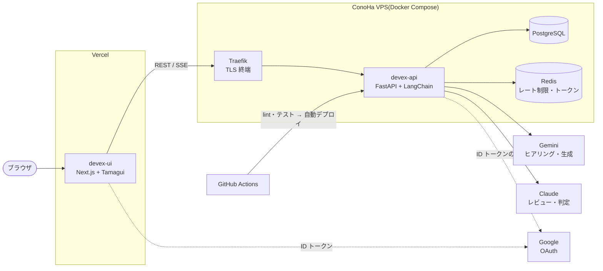

# Devex

> **クライアントとの合意を、設計から実装・テストまでつなぐ。**

Devex は、単なる「AI による設計書生成アプリ」ではなく、**クライアントとの合意を基準に、要件定義から設計・実装計画・実装手順・テストまでを一貫して管理し、開発中の仕様変更にも柔軟に対応できるよう支援するシステム**である。

要件や設計を文書として生成するだけでなく、それらを相互に関連付けられた構造化データとして管理する。これにより、設計の一貫性と実装可能性を検証するとともに、仕様変更が発生した際には、その内容・背景・合意状況・影響範囲を明確にし、関連する設計や実装計画、テストを適切に見直せるようにする。

また、開発者の内部作業を効率化するだけでなく、変更内容や影響、未決事項をクライアントに説明し、認識をすり合わせ、合意を得ながら開発を進めることを支援する。

Devex が目指すのは、AI による文書生成の自動化ではなく、**クライアントとの合意を起点として、仕様の決定・変更・影響確認・再設計・実装・検証をつなぎ、関係者が根拠を共有しながら開発を進められる状態を実現すること**である。

→ 方針の全体: [プロジェクトの位置付け・コンセプト](appendix/devex_project_positioning.md)。合意と変更管理の仕組みは、今後のステージで作ります([今後の調整案](#今後の調整案))。

**今できること**: AI との対話で要件を引き出し、要件定義 → 設計 → 実装手順 → テストまでを、ID でつながった設計情報として組み立てる。

本番: <https://devex.uandi-tech.com/> 

<!-- スクリーンショット: ヒアリング画面 / 4文書のプレビュー / 詳細設計モード(UML の編集)/ 変更の影響 / AI 設計レビュー を docs/images/ に置いてここに並べる -->

## リポジトリ構成

3つの独立した Git リポジトリで構成しています(モノレポではありません)。

| リポジトリ                                                                   | 内容                                                   |
| ----------------------------------------------------------------------- | ---------------------------------------------------- |
| [devex-project](https://github.com/yd-uai-coder/devex-project)(このリポジトリ) | 仕様(`docs/`)、開発の記録と教材(`textbook/`)、計画・資料(`appendix/`) |
| [devex-api](https://github.com/yd-uai-coder/devex-api)                  | バックエンド(FastAPI + LangChain + PostgreSQL + Redis)     |
| [devex-ui](https://github.com/yd-uai-coder/devex-ui)                    | フロントエンド(Next.js + Tamagui)                           |

`devex-api`・`devex-ui` は、自作の汎用テンプレートから作り始めました。Devex で使わないテンプレートのデモ(汎用チャット・UI のデモ集・DB)は削除しています(各 README の「出自」を参照)。

## 何を解決するか

| よくある課題                              | Devex の解決                                               |
| ----------------------------------- | ------------------------------------------------------- |
| AI に設計書を書かせると、文書が増えるだけで中身がつながらない    | 各段階の設計情報を構造化したデータとして持ち、要件 → 画面・処理 → 作業単位 → テストを ID でつなぐ |
| ヒアリングで非機能要件やセキュリティが聞き漏れ、設計の後で要件が変わる | 非機能要求グレードに基づく観点の表で、何を聞いたか・何が残っているかを記録する。選択肢のカードで答えやすくする |
| 設計を直すと、どこに影響するか分からない                | ID でつないだ要素のグラフから変更の影響範囲を示し、古くなった要素に印を付ける                |
| 書かれた設計が実装できるか、作るまで分からない             | 作業単位ごとの実装手順書を生成し、その過程で設計の不足・矛盾を指摘する。生成とは別のモデルが設計をレビューする |

AI がコードや文書を大量に作ることは目的にしていません。**人が「なぜこの構造なのか」「どの順で作るか」「どの変更がどこへ効くか」を理解し、判断しながら開発できる状態**を作ることを目指しています。

## 主な機能

- **ヒアリング** ── AI とのチャット(ストリーミング)。観点ごとの状態の表、選択肢カードでの回答、参考資料(PDF など)の取り込み、完了の判定
- **4文書の生成** ── 要件定義書・外部設計書・内部設計書・実装計画書を一括で生成。版の履歴と復元、Markdown でのダウンロード
- **詳細設計モード** ── 機能一覧 → データフロー → データモデル → ソフトウェア構造 → 主要処理の手順 → 処理ロジック → 実装計画を、段階ごとに承認しながら組み立てる。UML 設計図の自動レイアウト・編集・draw.io / SVG の出力
- **実装手順書と実装可能性チェック** ── 作業単位ごとに、対象ファイル・責務・実装順序・使う設計・確認方法をまとめ、設計の不足・矛盾を指摘する
- **トレーサビリティと変更の影響の分析** ── 要件から作業単位・テストまでの追跡、変更の影響範囲の表示、古くなった要素の管理
- **AI 設計レビューとテスト設計** ── 生成とは別のモデルによるレビュー、指摘の採否、レビュー結果からの再ヒアリング、テスト観点・テスト仕様書の生成
- **アカウント** ── メールまたは Google でのログイン・登録、マイページで用途ごとのモデルと自分の API キー(Gemini / Claude)を登録

## ハイライト

### 上流工程・設計

- 日本の SI の文書体系(要件定義書・外部設計書・内部設計書・実装計画書)と、実務の詳細設計(C4・arc42・日本の詳細設計の成果物)に合わせた構成
- 非機能要求グレードに基づくヒアリングの観点。効果測定では、聞けた潜在の事実が 0〜1/14 から 10/14 に増え、AI による非機能・制約の推測が 6〜7割から 0 になった([測定の記録](appendix/measurements/stage6-effect.md))
- **Devex 自身の仕様を、Devex が生成する4文書と同じ形で書いた**([`docs/`](docs/))。そのうえで、Devex が生成した文書と自分の開発記録を突き合わせて比べた([比較](textbook/retrospectives/goal3-comparison.md))

### AI・LLM アプリケーション

- 構造化出力による意味モデル(図・設計の各段階を、文章でなくデータとして持つ)と、その決定的な検証
- 生成(Gemini)とレビュー(Claude Sonnet)・修正の判定(Claude Haiku)を別のモデルにする構成。検証を「決定的なチェック → 安いモデル → 強いモデル → 人」の順に重ね、費用と見落としを抑える
- 用途ごとのモデルの選択と、利用者の API キーの暗号化(Fernet。鍵の入れ替えに対応)、利用者ごとのレート制限と1日の上限
- 実際の LLM での効果測定と費用の見積もり・実費の記録
- AI と協働する開発の進め方を自分で設計し、運用しながら改め、AI の提案の精度を数えた(下の「本人の役割と AI の使い方」)

### 実装・運用

- バックエンドは routes → services → repositories → models の層の分離。例外は1か所に集め、まとめて HTTP の応答に変える([設計の理由](devex-api/CLAUDE.md))
- テスト: バックエンドの単体・結合テスト(実 PostgreSQL・Redis)、フロントエンドのコンポーネントテスト、Playwright の E2E(偽の LLM)
- CI/CD: GitHub Actions で lint・テスト。`main` への push で VPS に自動デプロイ。フロントエンドは Vercel
- 本番: ConoHa VPS 上の Docker Compose を、複数のプロジェクトで共有する Traefik(TLS の終端)の下に置く。運用の手順(反映・ロールバック・バックアップ)は [`OPERATIONS.md`](devex-api/OPERATIONS.md)
- 認証: JWT(リフレッシュトークンは httpOnly Cookie)、Google OAuth、ログイン・登録のレート制限、リクエストサイズの上限

## システム構成

## 技術スタック

| 分類      | 技術                                                                           | 選んだ理由                                                         |
| ------- | ---------------------------------------------------------------------------- | ------------------------------------------------------------- |
| フロントエンド | Next.js 16(App Router)、React 19、Tamagui、Zustand、React Flow、Vitest、Playwright | 画面ごとの動的なルーティング。UML の編集に React Flow                            |
| バックエンド  | Python 3.13、FastAPI、SQLAlchemy 2(async)、Alembic、Pydantic v2、uv、pytest、Ruff   | 非同期に強く、LLM のストリーミングとバックグラウンドの文書生成に向く。OpenAPI が自動で出る           |
| AI      | LangChain(Gemini / Claude)                                                   | モデルの提供元を抽象化し、用途ごとにモデルを切り替える。PDF は Gemini で直接読む                |
| データ     | PostgreSQL、Redis                                                             | 構造のあるデータ(プロジェクト・版・意味モデル)と JSON の両方を扱う。Redis はレート制限とリフレッシュトークン |
| 通信      | SSE                                                                          | ストリーミングがサーバーからの片方向で足り、通常の HTTP で完結する                          |
| インフラ    | Docker Compose、Traefik、Vercel、GitHub Actions                                 | 開発・テスト・本番の環境の差をなくす                                            |

詳しくは [内部設計書](docs/internal_design.md) 3.1節。

## 規模

| 項目              | 数                                             |
| --------------- | --------------------------------------------- |
| バックエンドのコード      | Python 約3.4万行(テストを除く)                         |
| バックエンドのテスト      | 176 ファイル・約1,500 ケース                           |
| フロントエンドのコード     | TypeScript 約2.6万行(テストを除く。うち Devex の画面 約2.3万行) |
| フロントエンドのテスト     | 161 ファイル・約1,000 ケース                           |
| E2E(Playwright) | 4 ファイル・9 テスト                                  |
| DB マイグレーション     | 30                                            |
| コミット            | 3リポジトリで計 約220                                 |

## 本人の役割と AI の使い方

開発には AI(Claude Code)を使いました。何を AI に任せ、何を自分が判断するかを、はじめに決めて進めています。

- **自分が担ったこと**: 構想と要件、各段階の設計の決定、AI の提案の採否、画面の確認、本番への反映と確認。AI が出したコード・設計・計画はすべて提案として扱い、採用するかどうかは自分が決めました。
- **AI が担ったこと**: 最初の MVP と品質向上の段階(約1週間)は、AI が書いた教材とサンプルを見ながら自分で手で実装しました。その後は、AI が実装とテストを書き、自分が設計とレビューに専念する形に切り替えました。切り替えた理由と結果は振り返りに記録しています。
- **進め方そのものを設計した**: 「AI が学習教材と手順を書き、人が判断し、詰まった点を教材に戻す」という開発の進め方を作り、40 近いルールとして運用しながら改めました。各段階で、AI の推奨と自分の選択が違った件数・計画の変動・本番で見つかった不具合を数え、AI の提案の精度の変化を分析しています(本番の確認で見つかった不具合は、後半の7段階で1件)。

→ [プロジェクト全体の振り返り](textbook/retrospectives/project-retrospective.md) ・ [決定の記録](textbook/decision-digest.md) ・ [開発の進め方(handoff)](appendix/cl-development-handoff-v2.md)

## デモの触り方

1. <https://devex.uandi-tech.com/> を開き、Google アカウントまたはメールアドレスで登録する
2. マイページで、自分の API キー(Gemini は [Google AI Studio](https://aistudio.google.com/apikey)、Claude は [Anthropic Console](https://console.anthropic.com/) で取得)を登録し、用途ごとのモデルを選ぶ。キーはサーバーで暗号化して保存し、画面には末尾しか表示しません。マイページからいつでも削除できます
3. ダッシュボードでプロジェクトを作り、作りたいものを一言書いてヒアリングを始める
4. ヒアリングが終わったら4文書を生成し、プレビュー・ダウンロードする。詳細設計モードでは、段階ごとに生成と承認を進められる

## さらに読む

| 読みたいこと              | 文書                                                                                                                                                                       |
| ------------------- | ------------------------------------------------------------------------------------------------------------------------------------------------------------------------ |
| Devex の仕様           | [要件定義書](docs/requirements.md) ・ [外部設計書](docs/external_design.md) ・ [内部設計書](docs/internal_design.md) ・ [実装計画書](docs/implementation_plan.md)                               |
| バックエンドの構成・設計の理由     | [devex-api の README](devex-api/README.md) ・ [CLAUDE.md](devex-api/CLAUDE.md) ・ [OPERATIONS.md](devex-api/OPERATIONS.md)                                                  |
| フロントエンドの構成          | [devex-ui の README](devex-ui/README.md) ・ [CLAUDE.md](devex-ui/CLAUDE.md)                                                                                                |
| 開発の振り返り・決定の経緯       | [プロジェクト全体の振り返り](textbook/retrospectives/project-retrospective.md) ・ [段階ごとの振り返り](textbook/retrospectives/overall-retrospective.md) ・ [決定の記録](textbook/decision-digest.md) |
| 構想の経緯・効果測定・CL 開発の手法 | [appendix の一覧](appendix/README.md) ・ [構想の経緯](appendix/concept-history.md) ・ [効果測定](appendix/README.md#効果測定の一覧)                                                           |

開発の経緯(10段階。すべて完了・本番に反映済み)

| 段階  | トピック              | 概要                                                    | 目的                     |
|:--- |:----------------- |:----------------------------------------------------- |:---------------------- |
| 1   | MVP               | チャットによるヒアリングと、4文書の一括生成、プレビュー・ダウンロード、本番デプロイ            | コア機能をエンドツーエンドで動かす      |
| 2   | 機能拡張・品質向上         | 文書のバージョン履歴、プロンプトテンプレートの選択、構造化ログ・エラー追跡                 | 継続して使える品質にする           |
| 3   | UML 設計図パイプライン     | UML 意味モデル、自動レイアウト、React Flow での編集、承認、draw.io / SVG 出力 | 設計を文章ではなく構造として扱う土台を作る  |
| 4   | 詳細設計モード           | 機能一覧から実装計画までを段階ごとに承認しながら組み立てる。処理 ID による紐づけと陳腐化の検知     | 人がコーディングするのに十分な詳細設計を作る |
| 5   | 実装手順書 + 実装可能性チェック | 作業単位ごとの手順書を生成し、その過程で設計の不足・矛盾を指摘する                     | 実装できない設計を表に出す          |
| 6   | ヒアリング改良 + 上流の構造化  | 観点ごとの状態と出どころの記録、非機能要求グレードに基づく観点、答えやすい問い方、要件 ID の採番    | 聞き漏れと設計後の要件変更を減らす      |
| 7   | 変更影響分析・変更管理       | ID でつないだ要素のグラフから変更の影響範囲を示す。陳腐化を要素単位で管理する              | 設計を変更に強くする             |
| 8   | AI 設計レビュー + テスト設計 | 生成と分けたレビュー、レビュー結果からの再ヒアリング、テスト観点・テストケースの生成、生成の質の評価    | 要件からテストまでの追跡を完成させる     |
| 9   | 使い勝手とアカウント・モデル設定  | メニューの整理、プロジェクトの削除・検索・ページ送り、マイページ(用途ごとのモデルと API キー)    | 自分のキーとモデルで使えるようにする     |
| 10  | Google 認証         | Google アカウントでのログインと登録・連携                              | 登録とログインの手間を減らす         |

段階ごとの詳細は [実装計画書](docs/implementation_plan.md) 4.1節。

## 今後の調整案

冒頭の位置づけを実現するための計画です。詳しくは [プロジェクトの位置付け・コンセプト](appendix/devex_project_positioning.md)(方針の正本)にあります。

### 3つの柱と、今の Devex

| 柱 | 今の Devex |
|---|---|
| ① 設計から実装までの一貫性 | **ほぼ作り済み**。安定した ID・決定的な検証・実装可能性チェック・別のモデルによる設計レビュー・テスト仕様書。いずれも効果測定をした |
| ② クライアントとの合意に基づく変更管理 | **土台だけある**。変更の影響の分析、「誰が決めたか」と根拠の記録、要件の出どころ(推測を含む)。変更要求(CR)・合意済みの版・長い期間の履歴は無い |
| ③ 関係者間の認識共有と合意形成 | **無い**。影響や未決の点は開発者の画面の中だけにあり、クライアントへの説明・共有の手段が無い |

### ステージ配分

最初のステージで、代表的な1つのシナリオについて、変更の受付から再検証までを**縦に1本**通し、続くステージで厚くします。

| ステージ | トピック | 中身 | 完了の判断基準(案) |
|---|---|---|---|
| 11 | 合意と変更の一巡 | 合意済みの版(文書単位)・変更要求(CR)・CR に結んだ影響の一覧・変更の説明書・合意の記録・反映・再検証 | 1件の CR が受付から再検証まで通り、「何を・なぜ・誰の合意で・どこに反映したか」を後からたどれる |
| 12 | 合意の精度 | 行単位の合意と変更の履歴・確認事項の一覧(推測・未決)・差分の再生成と合意済みの行の保護 | 合意済みの行が、CR の範囲外の再生成で変わらない |
| 13 | 説明とすり合わせ | 変更の規模の集計・選択肢つきの説明・クライアントの閲覧・コメント・合意 | クライアントが説明書だけで合意・却下を判断できる |
| 14 | 変更の取り込み | 議事録・メール・資料から、合意済みの内容と違う点を拾って CR の下書きにする | 差分を仕込んだ資料で、拾い漏れと誤りを測れる |
| 15 | 実装との接続 | コミット・PR と作業単位を ID で結ぶ | 必要性を確かめてから着手を決める |

影響の分析・再生成・設計レビュー・「古い」の印は作り済みなので、ステージ11 で新しく作るのは、主に合意と CR とその記録です。

**引き続きやらないこと**: AI による完全自動の実装、企業をまたぐ複雑な権限管理、プロジェクト管理ツールの置き換えや直接連携。
