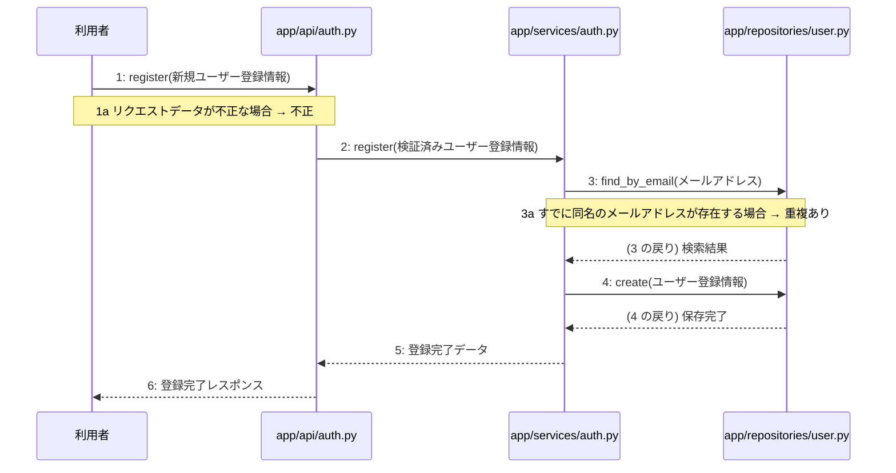

# M-01-T02 新規ユーザー登録機能の実装

> 種別: 機能 / マイルストーン: M-01 環境構築と認証基盤の実装 / 依存: M-01-T01

## 目的

新規ユーザー登録機能のAPIエンドポイント、ビジネスロジック、リポジトリ層を実装し、ユーザーをデータベースに登録できるようにする。

## 対象の処理・参照する設計

- 段階5 F-01 新規ユーザー登録
- 段階6 register(`app/api/auth.py`)(設計に無い ── 未定義を参照)
- 段階6 L-01 register(`app/services/auth.py`)
- 段階6 find_by_email(`app/repositories/user.py`)(設計に無い ── 未定義を参照)
- 段階6 create(`app/repositories/user.py`)(設計に無い ── 未定義を参照)
- 段階4 `app/api/auth.py`
- 段階4 `app/services/auth.py`
- 段階4 `app/repositories/user.py`

### シーケンス図(段階5 F-01 新規ユーザー登録 の手順から導出)

## 作成・変更するファイル(依存順)

| ファイル | 種類 | 責務 | 根拠 |
|---|---|---|---|
| `app/repositories/user.py` | モジュール | usersテーブルに対するPostgreSQLのCRUD操作を行う | 段階4 |
| `app/services/auth.py` | モジュール | ユーザー登録およびログイン認証のビジネスロジックを制御する | 段階4 |
| `app/api/auth.py` | モジュール | 認証に関するAPIエンドポイントの受け皿とリクエスト検証を行う | 段階4 |
| `tests/test_auth.py` | テスト | 新規ユーザー登録機能の単体テストおよび結合テストを行う | 段階7 開発環境 |

## 実装の要点(設計に書いていないことだけ)

- 依存される順に従い、リポジトリ層、サービス層、API層、テストの順に実装する。
- ステップ 3〜5 のトランザクション制御をサービス層に適用する。

## テスト観点

| # | 観点 | SUT | ドライバ | スタブ |
|---|---|---|---|---|
| TC-01 | 正常な新規ユーザー登録情報を受け取り、ユーザーが登録されて201 Createdが返ること | POST /api/v1/auth/register | 結合テスト(pytest) | スタブ不要 ── 実際のデータベースまたはテスト用DBを使用する |
| TC-02 | 不正なリクエストデータを受け取り、400 Bad Requestが返ること | POST /api/v1/auth/register | 結合テスト(pytest) | スタブ不要 |
| TC-03 | すでに存在するメールアドレスで登録しようとし、409 Conflictが返ること | POST /api/v1/auth/register | 結合テスト(pytest) | スタブ不要 |

- Given: 有効な新規ユーザー登録情報がある / When: 登録APIを呼び出す / Then: ユーザーが登録され201が返る
- Given: 不正な形式のデータがある / When: 登録APIを呼び出す / Then: 400エラーが返る
- Given: すでに登録済みのメールアドレスがある / When: 同じメールアドレスで登録APIを呼び出す / Then: 409エラーが返る

## 確認方法

- pytest tests/test_auth.py を実行し、すべてのテストケースが成功することを確認する。

## 未定義・要決定

| 重要度 | 出どころ | 対象 | 内容 | 直す段階 |
|---|---|---|---|---|
| 最重要 | AI | app/api/auth.py | 段階6において app/api/auth.py の register の詳細なフローやシグネチャが『設計にありません』とされており、具体的なリクエストスキーマおよびレスポンススキーマが不明である。 | 段階6 |
| 最重要 | AI | app/repositories/user.py | 段階6において find_by_email および create の詳細なクエリやシグネチャが『設計にありません』とされており、ORMやSQLの具体的な実装方法が不明である。 | 段階6 |
