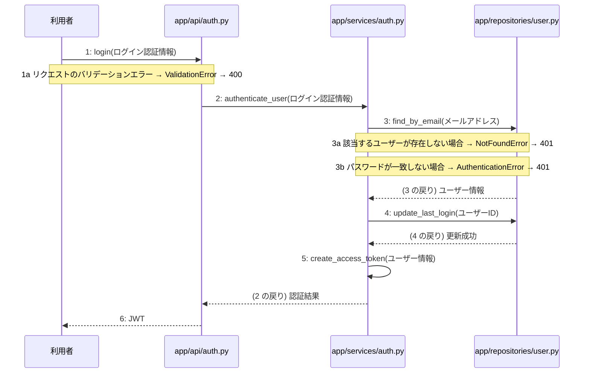

# M-01-T03 ログイン認証とJWT発行機能の実装

> 種別: 機能 / マイルストーン: M-01 環境構築と認証基盤の実装 / 依存: M-01-T02

## 目的

利用者がメールアドレスとパスワードでログインし、JWTアクセストークンを取得できるようにする。

## 対象の処理・参照する設計

- 段階5 F-02 ログイン認証
- 段階6 login(`app/api/auth.py`)(設計に無い ── 未定義を参照)
- 段階6 L-02 authenticate_user(`app/services/auth.py`)
- 段階6 find_by_email(`app/repositories/user.py`)(設計に無い ── 未定義を参照)
- 段階6 update_last_login(`app/repositories/user.py`)(設計に無い ── 未定義を参照)
- 段階6 L-03 create_access_token(`app/services/auth.py`)
- 段階4 `app/api/auth.py`
- 段階4 `app/services/auth.py`
- 段階4 `app/repositories/user.py`

### シーケンス図(段階5 F-02 ログイン認証 の手順から導出)

## 作成・変更するファイル(依存順)

| ファイル | 種類 | 責務 | 根拠 |
|---|---|---|---|
| `app/repositories/user.py` | モジュール | usersテーブルに対するユーザー検索および最終ログイン日時更新を行う | 段階4 |
| `app/services/auth.py` | モジュール | 認証のビジネスロジック、パスワード検証、トランザクション制御、およびJWTの生成を行う | 段階4 |
| `app/api/auth.py` | モジュール | ログインAPIのエンドポイントとしてリクエストを受け取り、バリデーションとJWT返却を行う | 段階4 |

## 実装の要点(設計に書いていないことだけ)

- app/repositories/user.py、app/services/auth.py、app/api/auth.pyの順に実装する
- 手順3から5までを単一のトランザクションとしてサービス層で処理する

## テスト観点

| # | 観点 | SUT | ドライバ | スタブ |
|---|---|---|---|---|
| TC-01 | 正常系: 有効な認証情報でログインしJWTが発行されること | app/api/auth.pyのlogin関数 | 結合テスト(pytest) | スタブ不要 ── 実際のデータベースおよびサービス層を使用する |
| TC-02 | 異常系: 存在しないメールアドレスの場合に401が返ること | app/api/auth.pyのlogin関数 | 結合テスト(pytest) | スタブ不要 ── 実際のデータベースを使用する |
| TC-03 | 異常系: パスワードが一致しない場合に401が返ること | app/api/auth.pyのlogin関数 | 結合テスト(pytest) | スタブ不要 ── 実際のデータベースを使用する |

- Given: 登録済みのユーザーが存在する / When: 正しいメールアドレスとパスワードでログインAPIを呼び出す / Then: 200 OKとJWTアクセストークンが返却される

## 確認方法

- pytestを実行し、ログイン機能のテストがすべて成功することを確認する

## 未定義・要決定

| 重要度 | 出どころ | 対象 | 内容 | 直す段階 |
|---|---|---|---|---|
| 最重要 | AI | 07章 認証 | JWTの有効期限が『(要決定)』となっており具体的な時間が決まっていない。 | 段階7 |
| 最重要 | AI | 段階6 authenticate_user | パスワードのハッシュ化アルゴリズムや検証ライブラリについての指定が設計にない。 | 段階6 |
| 最重要 | AI | 段階6 create_access_token | JWTの署名に使用する秘密鍵の取得元やアルゴリズムの指定が設計にない。 | 段階6 |
