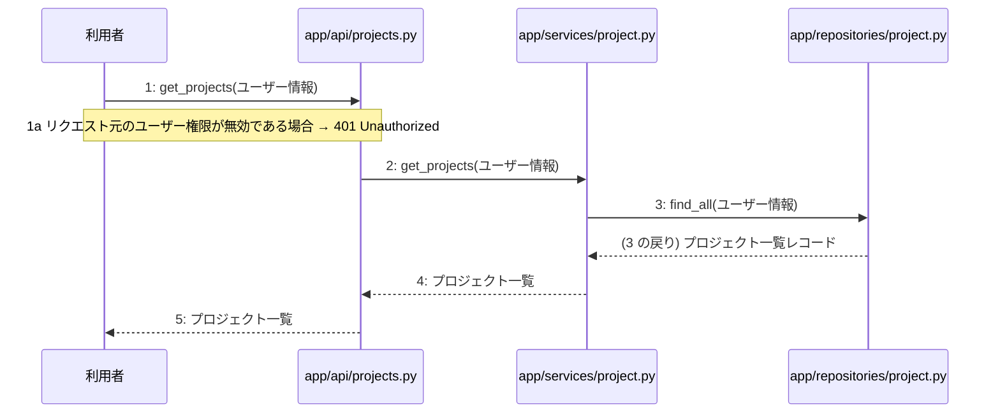

# M-02-T01 プロジェクト一覧取得機能の実装

> 種別: 機能 / マイルストーン: M-02 プロジェクト管理とAI対話ヒアリング機能の実装 / 依存: M-01-T03

## 目的

利用者からのプロジェクト一覧取得リクエストを受け付け、データベースから該当するプロジェクトの一覧を取得して返却できるようにする。

## 対象の処理・参照する設計

- 段階5 F-03 プロジェクト一覧取得
- 段階6 get_projects(`app/api/projects.py`)(設計に無い ── 未定義を参照)
- 段階6 L-04 get_projects(`app/services/project.py`)
- 段階6 find_all(`app/repositories/project.py`)(設計に無い ── 未定義を参照)
- 段階4 `app/api/projects.py`
- 段階4 `app/services/project.py`
- 段階4 `app/repositories/project.py`

### シーケンス図(段階5 F-03 プロジェクト一覧取得 の手順から導出)

## 作成・変更するファイル(依存順)

| ファイル | 種類 | 責務 | 根拠 |
|---|---|---|---|
| `app/repositories/project.py` | モジュール | projectsテーブルから作成済みプロジェクトの一覧を検索する | 段階4 |
| `app/services/project.py` | モジュール | プロジェクト一覧取得のビジネスロジックを実行する | 段階4 |
| `app/api/projects.py` | モジュール | プロジェクト一覧取得APIへのリクエストを受け取り検証する | 段階4 |

## 実装の要点(設計に書いていないことだけ)

- 依存される順にリポジトリ層、サービス層、API層の順でファイルを実装する。

## テスト観点

| # | 観点 | SUT | ドライバ | スタブ |
|---|---|---|---|---|
| TC-01 | 有効なユーザー情報でプロジェクト一覧が正しく取得できること | app.api.projects.get_projects | 結合テスト(pytest) | スタブ不要 ── 実データベースまたはテスト用インメモリDBを使用する |
| TC-02 | 認証されていない場合や無効なユーザー権限の場合に401 Unauthorizedが返却されること | app.api.projects.get_projects | 結合テスト(pytest) | スタブ不要 ── 認証ミドルウェアまたは認証情報を模して検証する |

- Given: 認証済みの有効なユーザーが存在すること When: GET /api/v1/projects にリクエストを送信する Then: プロジェクト一覧が返却されること

## 確認方法

- pytestを実行し、プロジェクト一覧取得に関するテストがすべて成功することを確認する。

## 未定義・要決定

| 重要度 | 出どころ | 対象 | 内容 | 直す段階 |
|---|---|---|---|---|
| 最重要 | AI | 段階6 get_projects(app/api/projects.py) | APIエンドポイント層の具体的なシグネチャや処理詳細が段階6に記載されていない。 | 段階6 |
| 最重要 | AI | 段階6 find_all(app/repositories/project.py) | リポジトリ層のシグネチャやクエリの詳細が段階6に記載されていない。 | 段階6 |
