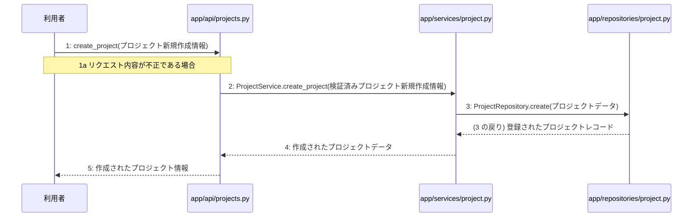

# M-02-T02 プロジェクト新規作成機能の実装

> 種別: 機能 / マイルストーン: M-02 プロジェクト管理とAI対話ヒアリング機能の実装 / 依存: M-02-T01

## 目的

利用者からのプロジェクト新規作成リクエストを受け付け、ビジネスロジックを経てデータベースに新しいプロジェクトを登録できるようにする。

## 対象の処理・参照する設計

- 段階5 F-04 プロジェクト新規作成
- 段階6 create_project(`app/api/projects.py`)(設計に無い ── 未定義を参照)
- 段階6 L-05 ProjectService.create_project(`app/services/project.py`)
- 段階6 ProjectRepository.create(`app/repositories/project.py`)(設計に無い ── 未定義を参照)
- 段階4 `app/api/projects.py`
- 段階4 `app/services/project.py`
- 段階4 `app/repositories/project.py`

### シーケンス図(段階5 F-04 プロジェクト新規作成 の手順から導出)

## 作成・変更するファイル(依存順)

| ファイル | 種類 | 責務 | 根拠 |
|---|---|---|---|
| `app/repositories/project.py` | モジュール | projectsテーブルに対するPostgreSQLのCRUD操作を行う | 段階4 |
| `app/services/project.py` | モジュール | プロジェクトの取得および新規作成のビジネスロジックを制御する | 段階4 |
| `app/api/projects.py` | モジュール | プロジェクト・参考資料・チャットに関するAPIエンドポイントの受け皿とリクエスト検証を行う | 段階4 |

## 実装の要点(設計に書いていないことだけ)

- app/repositories/project.py から順に作成し、app/services/project.py、最後に app/api/projects.py を実装する
- ユースケース層におけるトランザクション制御を適用する

## テスト観点

| # | 観点 | SUT | ドライバ | スタブ |
|---|---|---|---|---|
| TC-01 | 正常なプロジェクト新規作成情報を受け取り、プロジェクトが登録されて作成されたデータが返されること | create_project | 結合テスト、pytestを使用しAPIエンドポイントを呼び出す | スタブ不要 ── 実際のデータベースおよびサービス層を使用する |
| TC-02 | 不正なプロジェクト新規作成情報を受け取り、バリデーションエラーとなること | create_project | 結合テスト、pytestを使用しAPIエンドポイントを呼び出す | スタブ不要 ── 実際のAPI層の検証機能を使用する |

- Given 有効なプロジェクト新規作成情報がある When POST /api/v1/projects を呼び出す Then ステータスコード 201 と作成されたプロジェクト情報が返される
- Given 不正なプロジェクト新規作成情報がある When POST /api/v1/projects を呼び出す Then バリデーションエラーが返される

## 確認方法

- pytest を実行してプロジェクト新規作成に関連するテストがすべて成功することを確認する

## 未定義・要決定

| 重要度 | 出どころ | 対象 | 内容 | 直す段階 |
|---|---|---|---|---|
| 最重要 | AI | 段階6 create_project(app/api/projects.py) | 段階6の詳細設計が記載されていないため、具体的なリクエストスキーマや関数内部の処理詳細が不明である。 | 段階6 |
| 最重要 | AI | 段階6 ProjectRepository.create(app/repositories/project.py) | 段階6の詳細設計が記載されていないため、リポジトリ層のシグネチャやクエリの詳細が不明である。 | 段階6 |
