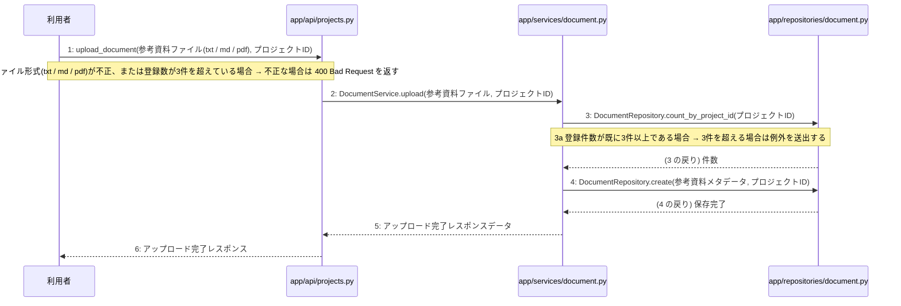

# M-02-T03 参考資料アップロード機能の実装

> 種別: 機能 / マイルストーン: M-02 プロジェクト管理とAI対話ヒアリング機能の実装 / 依存: M-02-T02

## 目的

利用者からの参考資料アップロードリクエストを受け付け、ファイル形式と登録件数の検証を行った上でデータベースにメタデータを保存する。

## 対象の処理・参照する設計

- 段階5 F-05 参考資料アップロード
- 段階6 upload_document(`app/api/projects.py`)(設計に無い ── 未定義を参照)
- 段階6 DocumentService.upload(`app/services/document.py`)(設計に無い ── 未定義を参照)
- 段階6 DocumentRepository.count_by_project_id(`app/repositories/document.py`)(設計に無い ── 未定義を参照)
- 段階6 DocumentRepository.create(`app/repositories/document.py`)(設計に無い ── 未定義を参照)
- 段階4 `app/api/projects.py`
- 段階4 `app/services/document.py`
- 段階4 `app/repositories/document.py`

### シーケンス図(段階5 F-05 参考資料アップロード の手順から導出)

## 作成・変更するファイル(依存順)

| ファイル | 種類 | 責務 | 根拠 |
|---|---|---|---|
| `app/repositories/document.py` | モジュール | documentsテーブルに対するPostgreSQLのCRUD操作を行う | 段階4 |
| `app/services/document.py` | モジュール | 参考資料アップロードのビジネスロジックを制御する | 段階4 |
| `app/api/projects.py` | モジュール | 参考資料アップロードのエンドポイントとリクエスト検証を提供する | 段階4 |

## 実装の要点(設計に書いていないことだけ)

- 依存される順に従い、リポジトリ層、サービス層、API層の順に実装する。
- 手順4〜6は単一のトランザクションとして実行する。

## テスト観点

| # | 観点 | SUT | ドライバ | スタブ |
|---|---|---|---|---|
| TC-01 | 正常なファイル形式と件数でアップロードが成功すること | upload_document | 結合テスト (pytest) | スタブ不要 ── 実際のデータベースおよびファイル処理を使用する |
| TC-02 | 不正なファイル形式または登録件数超過時にバリデーションエラーや例外が返却されること | upload_document | 結合テスト (pytest) | スタブ不要 ── 実際のデータベースおよびファイル処理を使用する |

- Given 正常な参考資料ファイルとプロジェクトIDがある When upload_documentを呼び出す Then アップロード完了レスポンスが返る
- Given 登録件数が既に3件以上である When upload_documentを呼び出す Then 制限超過エラーとなる

## 確認方法

- pytestを実行し、参考資料アップロードのテストがすべて成功することを確認する。

## 未定義・要決定

| 重要度 | 出どころ | 対象 | 内容 | 直す段階 |
|---|---|---|---|---|
| 最重要 | AI | 段階6 upload_document(app/api/projects.py) | 段階6のロジック詳細が設計に記載されていないため、詳細なバリデーションルールやレスポンスの構造を定義する必要がある。 | 段階6 |
| 最重要 | AI | 段階6 DocumentService.upload(app/services/document.py) | 段階6のロジック詳細が設計に記載されていないため、ビジネスロジックの詳細な手順を定義する必要がある。 | 段階6 |
| 最重要 | AI | 段階6 DocumentRepository.count_by_project_id(app/repositories/document.py) | 段階6のロジック詳細が設計に記載されていないため、クエリの詳細を定義する必要がある。 | 段階6 |
| 最重要 | AI | 段階6 DocumentRepository.create(app/repositories/document.py) | 段階6のロジック詳細が設計に記載されていないため、挿入処理の詳細を定義する必要がある。 | 段階6 |
