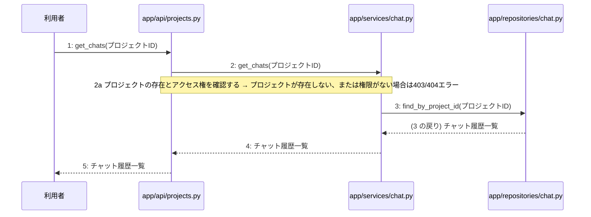

# M-02-T04 チャット履歴取得機能の実装

> 種別: 機能 / マイルストーン: M-02 プロジェクト管理とAI対話ヒアリング機能の実装 / 依存: M-02-T02

## 目的

プロジェクトに紐づくチャット履歴をAPI経由で取得できるようにする。

## 対象の処理・参照する設計

- 段階5 F-06 チャット履歴取得
- 段階6 get_chats(`app/api/projects.py`)(設計に無い ── 未定義を参照)
- 段階6 get_chats(`app/services/chat.py`)(設計に無い ── 未定義を参照)
- 段階6 find_by_project_id(`app/repositories/chat.py`)(設計に無い ── 未定義を参照)
- 段階4 `app/api/projects.py`
- 段階4 `app/services/chat.py`
- 段階4 `app/repositories/chat.py`

### シーケンス図(段階5 F-06 チャット履歴取得 の手順から導出)

## 作成・変更するファイル(依存順)

| ファイル | 種類 | 責務 | 根拠 |
|---|---|---|---|
| `app/repositories/chat.py` | モジュール | chatsテーブルからプロジェクトIDに一致するチャット履歴を検索する | 段階4 |
| `app/services/chat.py` | モジュール | プロジェクトの存在とアクセス権の確認およびチャット履歴取得処理を制御する | 段階4 |
| `app/api/projects.py` | モジュール | チャット履歴取得APIリクエストを受け取り、サービス層を呼び出してレスポンスを返す | 段階4 |

## 実装の要点(設計に書いていないことだけ)

- 依存される順序に従い、リポジトリ層、サービス層、API層の順に実装を行う。

## テスト観点

| # | 観点 | SUT | ドライバ | スタブ |
|---|---|---|---|---|
| TC-01 | 正常系: 指定したプロジェクトIDのチャット履歴一覧が取得できること | app/api/projects.py get_chats | 結合テスト (pytest) | スタブ不要 ── 実際のデータベースおよびサービス層を使用する |
| TC-02 | 異常系: プロジェクトが存在しない、または権限がない場合にエラーが返ること | app/services/chat.py get_chats | 単体テスト (pytest) | app/repositories/chat.py をスタブ化して存在しないプロジェクトを模擬する |

- Given 存在するプロジェクトIDと紐づくチャット履歴が存在する When チャット履歴取得APIを呼び出す Then チャット履歴一覧が返される

## 確認方法

- pytest を実行してチャット履歴取得に関するテストがすべて成功することを確認する。

## 未定義・要決定

| 重要度 | 出どころ | 対象 | 内容 | 直す段階 |
|---|---|---|---|---|
| 最重要 | AI | 段階6 get_chats(app/api/projects.py) | 詳細な実装ロジックやバリデーション仕様が段階6に記載されていないため決定が必要である。 | 段階6 |
| 最重要 | AI | 段階6 get_chats(app/services/chat.py) | 詳細な実装ロジックや権限確認の具体的手順が段階6に記載されていないため決定が必要である。 | 段階6 |
| 最重要 | AI | 段階6 find_by_project_id(app/repositories/chat.py) | 詳細なクエリ構造やソート順などが段階6に記載されていないため決定が必要である。 | 段階6 |
