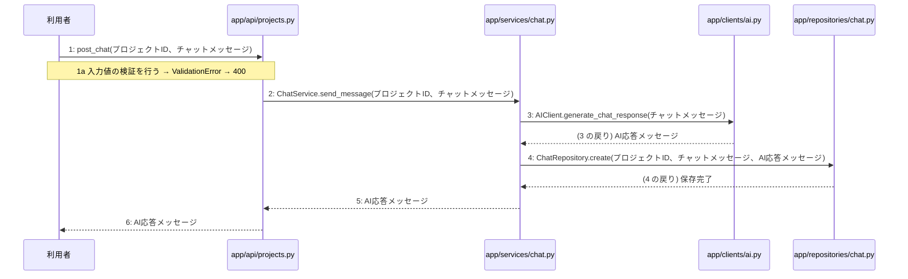

# M-02-T05 ヒアリングチャットメッセージ送信とAI応答機能の実装

> 種別: 機能 / マイルストーン: M-02 プロジェクト管理とAI対話ヒアリング機能の実装 / 依存: M-02-T04

## 目的

ヒアリングチャットメッセージを送信し、LLMからのAI応答を取得してチャット履歴として保存する機能を提供する。

## 対象の処理・参照する設計

- 段階5 F-07 ヒアリングチャットメッセージ送信
- 段階6 post_chat(`app/api/projects.py`)(設計に無い ── 未定義を参照)
- 段階6 ChatService.send_message(`app/services/chat.py`)(設計に無い ── 未定義を参照)
- 段階6 AIClient.generate_chat_response(`app/clients/ai.py`)(設計に無い ── 未定義を参照)
- 段階6 ChatRepository.create(`app/repositories/chat.py`)(設計に無い ── 未定義を参照)
- 段階4 `app/api/projects.py`
- 段階4 `app/services/chat.py`
- 段階4 `app/clients/ai.py`
- 段階4 `app/repositories/chat.py`

### シーケンス図(段階5 F-07 ヒアリングチャットメッセージ送信 の手順から導出)

## 作成・変更するファイル(依存順)

| ファイル | 種類 | 責務 | 根拠 |
|---|---|---|---|
| `app/repositories/chat.py` | モジュール | chatsテーブルに対するPostgreSQLのCRUD操作を行う | 段階4 |
| `app/clients/ai.py` | モジュール | LLM Providerとの通信やプロンプト管理を行いAIモデルの差異を抽象化する | 段階4 |
| `app/services/chat.py` | モジュール | チャット履歴の取得およびヒアリングチャットメッセージ送信のビジネスロジックを制御する | 段階4 |
| `app/api/projects.py` | モジュール | プロジェクト・参考資料・チャットに関するAPIエンドポイントの受け皿とリクエスト検証を行う | 段階4 |

## 実装の要点(設計に書いていないことだけ)

- リポジトリ層、外部連携層、ユースケース層、APIエンドポイント層の順に実装する。
- ユースケース層では単一のトランザクションとしてメッセージ保存等の処理を制御する。

## テスト観点

| # | 観点 | SUT | ドライバ | スタブ |
|---|---|---|---|---|
| TC-01 | 正常系: チャットメッセージ送信が成功し、AI応答メッセージが返却されること | post_chat | 結合テスト (pytest) | AIClient.generate_chat_response をスタブ化し、固定のAI応答を返す |
| TC-02 | 異常系: 入力値の検証エラー時にバリデーションエラーとなること | post_chat | 単体テスト (pytest) | スタブ不要 ── 入力値検証のテストのため |

- Given 有効なプロジェクトIDとチャットメッセージがあるとき When APIへメッセージ送信リクエストを実行すると Then AI応答メッセージが返却され履歴に保存される

## 確認方法

- pytestを用いた結合テストが正常に通過することを確認する。
- POST /api/v1/projects/{id}/chats に対してリクエストを送信し、HTTP 200 OK とAI応答が返ることを確認する。

## 未定義・要決定

| 重要度 | 出どころ | 対象 | 内容 | 直す段階 |
|---|---|---|---|---|
| 最重要 | AI | 段階6 AIClient.generate_chat_response | LLM Providerへ送信する際のプロンプトの構成やモデルの種類、パラメータの詳細が設計に記載されていない。 | 段階6 |
| 最重要 | AI | 段階6 ChatRepository.create | chatsテーブルへの保存時におけるカラム構造やマッピング定義の細かい仕様が設計に記載されていない。 | 段階3 |
