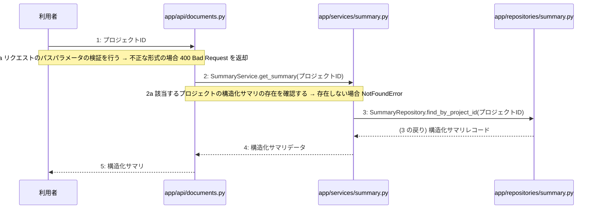

# M-02-T06 構造化サマリ取得機能の実装

> 種別: 機能 / マイルストーン: M-02 プロジェクト管理とAI対話ヒアリング機能の実装 / 依存: M-02-T05

## 目的

プロジェクトIDを指定して構造化サマリを取得するAPIエンドポイント、サービス、リポジトリを実装する。

## 対象の処理・参照する設計

- 段階5 F-08 構造化サマリ取得
- 段階6 SummaryService.get_summary(`app/services/summary.py`)(設計に無い ── 未定義を参照)
- 段階6 SummaryRepository.find_by_project_id(`app/repositories/summary.py`)(設計に無い ── 未定義を参照)
- 段階4 `app/api/documents.py`
- 段階4 `app/services/summary.py`
- 段階4 `app/repositories/summary.py`

### シーケンス図(段階5 F-08 構造化サマリ取得 の手順から導出)

## 作成・変更するファイル(依存順)

| ファイル | 種類 | 責務 | 根拠 |
|---|---|---|---|
| `app/repositories/summary.py` | モジュール | summariesテーブルからプロジェクトIDに該当する構造化サマリレコードを取得する。 | 段階4 |
| `app/services/summary.py` | モジュール | 構造化サマリ取得のビジネスロジックを制御し、存在確認とリポジトリ呼び出しを行う。 | 段階4 |
| `app/api/documents.py` | モジュール | 構造化サマリ取得のAPIエンドポイントを提供し、リクエストのパスパラメータ検証を行う。 | 段階4 |

## 実装の要点(設計に書いていないことだけ)

- 依存される順にリポジトリ層、サービス層、API層の順で実装を作成する。

## テスト観点

| # | 観点 | SUT | ドライバ | スタブ |
|---|---|---|---|---|
| TC-01 | 正常系: 指定したプロジェクトIDの構造化サマリが正しく取得できること | app.api.documents.get_summary | 結合テスト(pytest) | スタブ不要 ── 実際のデータベースまたはテスト用インメモリDBを使用する |
| TC-02 | 異常系: 該当するプロジェクトの構造化サマリが存在しない場合に NotFoundError が発生すること | app.services.summary.SummaryService.get_summary | 単体テスト(pytest) | SummaryRepositoryをスタブ化し、該当データなしを返却させる |
| TC-03 | 異常系: パスパラメータの形式が不正な場合に 400 Bad Request が返却されること | app.api.documents.get_summary | 結合テスト(pytest) | スタブ不要 |

- Given データベースに指定プロジェクトの構造化サマリが存在する When GET /api/v1/projects/{id}/summary を呼び出す Then 200 OK と構造化サマリが返される
- Given データベースに指定プロジェクトの構造化サマリが存在しない When SummaryService.get_summary を呼び出す Then NotFoundError が発生する
- Given 不正な形式のプロジェクトIDを指定する When GET /api/v1/projects/{id}/summary を呼び出す Then 400 Bad Request が返される

## 確認方法

- pytest を実行し、構造化サマリ取得に関する単体テストおよび結合テストがすべて成功することを確認する。

## 未定義・要決定

| 重要度 | 出どころ | 対象 | 内容 | 直す段階 |
|---|---|---|---|---|
| 最重要 | AI | 段階6 SummaryService.get_summary | 段階6の詳細設計が「設計にありません」となっているため、例外クラスの仕様や具体的なバリデーションルール等の詳細処理手順を決定する必要がある。 | 段階6 |
| 最重要 | AI | 段階6 SummaryRepository.find_by_project_id | 段階6の詳細設計が「設計にありません」となっているため、発行するクエリの挙動や例外ハンドリングの詳細を決定する必要がある。 | 段階6 |
