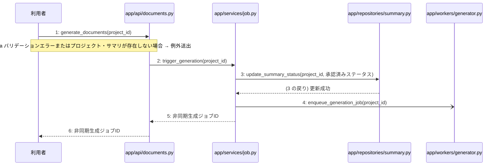

# M-03-T01 構造化サマリ承認と設計書非同期生成トリガー機能の実装

> 種別: 機能 / マイルストーン: M-03 非同期設計書生成とジョブ管理機能の実装 / 依存: M-02-T06

## 目的

利用者がプロジェクトの構造化サマリを承認し、4種設計書の非同期生成ジョブをバックグラウンドで起動できるようになる。

## 対象の処理・参照する設計

- 段階5 F-09 構造化サマリ承認・設計書非同期生成トリガー
- 段階6 generate_documents(`app/api/documents.py`)(設計に無い ── 未定義を参照)
- 段階6 trigger_generation(`app/services/job.py`)(設計に無い ── 未定義を参照)
- 段階6 update_summary_status(`app/repositories/summary.py`)(設計に無い ── 未定義を参照)
- 段階6 enqueue_generation_job(`app/workers/generator.py`)(設計に無い ── 未定義を参照)
- 段階4 `app/api/documents.py`
- 段階4 `app/services/job.py`
- 段階4 `app/repositories/summary.py`
- 段階4 `app/workers/generator.py`

### シーケンス図(段階5 F-09 構造化サマリ承認・設計書非同期生成トリガー の手順から導出)

## 作成・変更するファイル(依存順)

| ファイル | 種類 | 責務 | 根拠 |
|---|---|---|---|
| `app/repositories/summary.py` | モジュール | summariesテーブルに対するサマリのステータス更新を行う | 段階4 |
| `app/workers/generator.py` | モジュール | Celery非同期キューに4種設計書の一括生成ジョブを登録する | 段階4 |
| `app/services/job.py` | モジュール | サマリのステータス更新と非同期生成ジョブの登録を単一のトランザクションとして制御する | 段階4 |
| `app/api/documents.py` | モジュール | 構造化サマリ承認・設計書非同期生成トリガーのエンドポイントを提供する | 段階4 |

## 実装の要点(設計に書いていないことだけ)

- 手順 3 のデータベース更新と手順 4 の Celery ジョブ登録は、サービス層にて単一のトランザクションとして確実に処理する
- 依存される順序として、リポジトリ層(summary.py)・ワーカー層(generator.py)・サービス層(job.py)・API層(documents.py)の順に実装する

## テスト観点

| # | 観点 | SUT | ドライバ | スタブ |
|---|---|---|---|---|
| TC-01 | 有効なプロジェクトIDでリクエストされた場合にサマリが承認済みに更新され非同期生成ジョブIDが返却されること | generate_documents | 結合テスト(pytest) | app/workers/generator.pyのenqueue_generation_jobをモック化してジョブIDの返却をスタブする |
| TC-02 | 存在しないプロジェクトIDまたはバリデーションエラーの場合に適切なエラーレスポンスが返却されること | generate_documents | 結合テスト(pytest) | スタブ不要 ── データベースとバリデーション機構を利用する |

- Given: 対象のプロジェクトと構造化サマリが存在しているとき
- When: 構造化サマリ承認・設計書非同期生成トリガーのエンドポイントにリクエストを送信すると
- Then: サマリが承認済みステータスに更新され非同期生成ジョブIDが返却されること

## 確認方法

- pytestを用いた結合テストを実行し、テストがすべて成功することを確認する
- APIエンドポイントに対してHTTPリクエストを送信し、非同期生成ジョブIDが正しく返却されることを確認する

## 未定義・要決定

| 重要度 | 出どころ | 対象 | 内容 | 直す段階 |
|---|---|---|---|---|
| 最重要 | AI | 段階6 generate_documents(app/api/documents.py) | 段階6の詳細設計が記載されていないため、リクエストデータのバリデーション仕様および返却するジョブIDのデータ構造やレスポンス形式が不明である。 | 段階6 |
| 最重要 | AI | 段階6 trigger_generation(app/services/job.py) | 段階6の詳細設計が記載されていないため、承認済みステータスの具体的な値や、トランザクション境界の詳細なエラーハンドリング方針が不明である。 | 段階6 |
| 最重要 | AI | 段階6 update_summary_status(app/repositories/summary.py) | 段階6の詳細設計が記載されていないため、summariesテーブルのどの列をどのような値に更新するかの詳細が不明である。 | 段階6 |
| 最重要 | AI | 段階6 enqueue_generation_job(app/workers/generator.py) | 段階6の詳細設計が記載されていないため、Celeryキューへ登録する際のタスク名や引数の構造が不明である。 | 段階6 |
