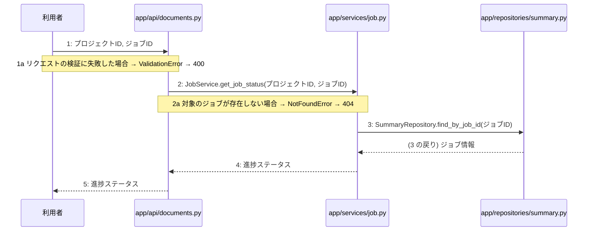

# M-03-T02 非同期生成ジョブの進捗ステータス確認機能の実装

> 種別: 機能 / マイルストーン: M-03 非同期設計書生成とジョブ管理機能の実装 / 依存: M-03-T01

## 目的

非同期生成ジョブの進捗ステータス確認機能(F-10)を実装し、指定したジョブの進捗状態を取得して返却できるようにする。

## 対象の処理・参照する設計

- 段階5 F-10 非同期生成ジョブの進捗ステータス確認
- 段階6 JobService.get_job_status(`app/services/job.py`)(設計に無い ── 未定義を参照)
- 段階6 SummaryRepository.find_by_job_id(`app/repositories/summary.py`)(設計に無い ── 未定義を参照)
- 段階4 `app/api/documents.py`
- 段階4 `app/services/job.py`
- 段階4 `app/repositories/summary.py`

### シーケンス図(段階5 F-10 非同期生成ジョブの進捗ステータス確認 の手順から導出)

## 作成・変更するファイル(依存順)

| ファイル | 種類 | 責務 | 根拠 |
|---|---|---|---|
| `app/repositories/summary.py` | モジュール | summariesテーブルからジョブIDに対応するサマリまたはジョブの状態を取得する | 段階4 |
| `app/services/job.py` | モジュール | ジョブの進捗ステータス取得を制御する | 段階4 |
| `app/api/documents.py` | モジュール | 非同期生成ジョブの進捗ステータス確認APIエンドポイントの受け皿とリクエスト検証を行う | 段階4 |

## 実装の要点(設計に書いていないことだけ)

- 依存される順序に基づき、リポジトリ層、サービス層、API層の順に実装する。

## テスト観点

| # | 観点 | SUT | ドライバ | スタブ |
|---|---|---|---|---|
| TC-01 | 正常系: 指定したジョブの進捗ステータスが正しく返却されること | JobService.get_job_status | 単体テスト (pytest) | SummaryRepository.find_by_job_idをスタブ化し、ジョブ情報を返却する |
| TC-02 | 異常系: 対象のジョブが存在しない場合に404エラーになること | JobService.get_job_status | 単体テスト (pytest) | SummaryRepository.find_by_job_idをスタブ化し、Noneを返却する |

- Given 存在するジョブIDが指定されている When 進捗ステータス確認APIを呼び出す Then 進捗ステータスが返却される

## 確認方法

- pytestを実行し、作成した単体テストおよび結合テストがすべて成功することを確認する。

## 未定義・要決定

| 重要度 | 出どころ | 対象 | 内容 | 直す段階 |
|---|---|---|---|---|
| 最重要 | AI | 段階6 JobService.get_job_status | JobService.get_job_statusの詳細な処理ロジックが段階6に定義されていない。 | 段階6 |
| 最重要 | AI | 段階6 SummaryRepository.find_by_job_id | SummaryRepository.find_by_job_idの詳細な処理ロジックが段階6に定義されていない。 | 段階6 |
| 中程度 | 検証 | F-10 | M-03-T02 の処理 F-10 の手順に DB 操作がありますが、CRUD 図にこの処理の操作がありません。 | 段階3 |
