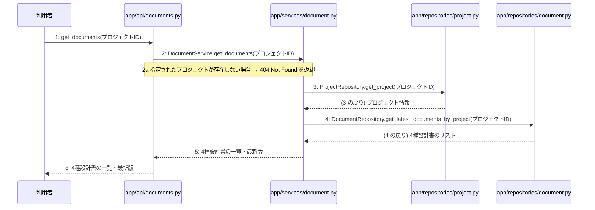

# M-03-T03 生成された4種設計書の一覧・最新版取得機能の実装

> 種別: 機能 / マイルストーン: M-03 非同期設計書生成とジョブ管理機能の実装 / 依存: M-03-T02

## 目的

指定されたプロジェクトに紐づく生成された4種設計書の一覧と最新版を取得できるようにする。

## 対象の処理・参照する設計

- 段階5 F-11 生成された4種設計書の一覧・最新版取得
- 段階6 get_documents(`app/api/documents.py`)(設計に無い ── 未定義を参照)
- 段階6 DocumentService.get_documents(`app/services/document.py`)(設計に無い ── 未定義を参照)
- 段階6 ProjectRepository.get_project(`app/repositories/project.py`)(設計に無い ── 未定義を参照)
- 段階6 DocumentRepository.get_latest_documents_by_project(`app/repositories/document.py`)(設計に無い ── 未定義を参照)
- 段階4 `app/api/documents.py`
- 段階4 `app/services/document.py`
- 段階4 `app/repositories/project.py`
- 段階4 `app/repositories/document.py`

### シーケンス図(段階5 F-11 生成された4種設計書の一覧・最新版取得 の手順から導出)

## 作成・変更するファイル(依存順)

| ファイル | 種類 | 責務 | 根拠 |
|---|---|---|---|
| `app/repositories/project.py` | モジュール | プロジェクトの存在確認のためのデータベース参照を行う | 段階4 app/repositories/project.py |
| `app/repositories/document.py` | モジュール | 指定されたプロジェクトの4種設計書の最新版一覧をデータベースから取得する | 段階4 app/repositories/document.py |
| `app/services/document.py` | モジュール | プロジェクトの存在確認と設計書一覧取得のビジネスロジックを制御する | 段階4 app/services/document.py |
| `app/api/documents.py` | モジュール | 4種設計書の一覧・最新版取得APIのリクエストを受信しビジネスロジックを呼び出す | 段階4 app/api/documents.py |

## 実装の要点(設計に書いていないことだけ)

- 依存関係に従い、リポジトリ層、サービス層、API層の順に実装を行う。

## テスト観点

| # | 観点 | SUT | ドライバ | スタブ |
|---|---|---|---|---|
| TC-01 | 指定したプロジェクトの4種設計書の一覧・最新版が正常に取得できること | app/api/documents.py の get_documents | pytestによる結合テスト | スタブ不要 ── 実際のデータベースおよびリポジトリを使用する |

- Given: 指定されたプロジェクトが存在し、4種設計書が生成されている
- When: GET /api/v1/projects/{id}/documents を実行する
- Then: HTTP 200 OK と4種設計書の一覧・最新版が返却される

## 確認方法

- pytestを実行し、F-11のテストケースが成功することを確認する。

## 未定義・要決定

| 重要度 | 出どころ | 対象 | 内容 | 直す段階 |
|---|---|---|---|---|
| 中程度 | AI | 段階6 get_documents | 段階6の処理詳細が設計に記載されていないため、具体的なクエリ条件やレスポンスフォーマットの詳細は既存実装やモデル定義に従って実装する。 | 段階6 |
