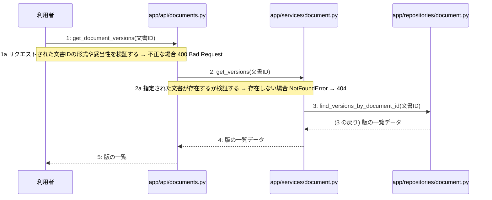

# M-04-T01 指定文書の版一覧取得機能の実装

> 種別: 機能 / マイルストーン: M-04 設計書の自己診断、版管理、および再生成機能の実装 / 依存: M-03-T03

## 目的

指定された文書の版一覧を取得するAPIエンドポイント、サービス、およびリポジトリを実装し、版の一覧を取得できるようにする。

## 対象の処理・参照する設計

- 段階5 F-12 指定文書の版一覧取得
- 段階6 get_document_versions(`app/api/documents.py`)(設計に無い ── 未定義を参照)
- 段階6 get_versions(`app/services/document.py`)(設計に無い ── 未定義を参照)
- 段階6 find_versions_by_document_id(`app/repositories/document.py`)(設計に無い ── 未定義を参照)
- 段階4 `app/api/documents.py`
- 段階4 `app/services/document.py`
- 段階4 `app/repositories/document.py`

### シーケンス図(段階5 F-12 指定文書の版一覧取得 の手順から導出)

## 作成・変更するファイル(依存順)

| ファイル | 種類 | 責務 | 根拠 |
|---|---|---|---|
| `app/repositories/document.py` | モジュール | PostgreSQLのdocumentsテーブルから直近3件の版の一覧データを取得する | 段階4 |
| `app/services/document.py` | モジュール | 指定された文書が存在するか検証し、リポジトリを呼び出して版の一覧を取得するビジネスロジックを制御する | 段階4 |
| `app/api/documents.py` | モジュール | 文書IDの形式や妥当性を検証し、サービスを呼び出してHTTP 200 OKと版の一覧をレスポンスとして返す | 段階4 |

## 実装の要点(設計に書いていないことだけ)

- 依存される順にリポジトリ層、サービス層、API層の順で実装を行う
- 既存のデータベース接続および共通例外ハンドラーを再利用する

## テスト観点

| # | 観点 | SUT | ドライバ | スタブ |
|---|---|---|---|---|
| TC-01 | 正常系: 指定された文書の直近3件の版の一覧が取得できること | app.api.documents.get_document_versions | pytestによるAPI結合テスト | スタブ不要 ── 実データベースまたはテスト用セッションを使用 |
| TC-02 | 異常系: 存在しない文書IDを指定した場合に404 Not Foundが返ること | app.api.documents.get_document_versions | pytestによるAPI結合テスト | スタブ不要 ── 実データベースを使用 |
| TC-03 | 異常系: 不正な形式の文書IDを指定した場合に400 Bad Requestが返ること | app.api.documents.get_document_versions | pytestによるAPI結合テスト | スタブ不要 |

- Given 存在する文書IDと複数の版データがデータベースに登録されているとき When GET /api/v1/documents/{id}/versions を呼び出す Then HTTP 200 OK と版の一覧が返される
- Given 存在しない文書IDを指定したとき When GET /api/v1/documents/{id}/versions を呼び出す Then 404 Not Found が返される

## 確認方法

- pytestを実行し、版一覧取得に関するすべてのテストケースが成功することを確認する

## 未定義・要決定

| 重要度 | 出どころ | 対象 | 内容 | 直す段階 |
|---|---|---|---|---|
| 最重要 | AI | 段階6 get_document_versions | 段階6の詳細ロジックが定義されておらず、どのような形式やバリデーションルールで文書IDを検証すべきか不明である。 | 段階6 |
| 最重要 | AI | 段階6 get_versions | 段階6の詳細ロジックが定義されておらず、存在確認の具体的な条件やエラー送出仕様が不明である。 | 段階6 |
| 最重要 | AI | 段階6 find_versions_by_document_id | 段階6の詳細ロジックが定義されておらず、直近3件を絞り込むためのソート条件や抽出クエリの仕様が不明である。 | 段階6 |
