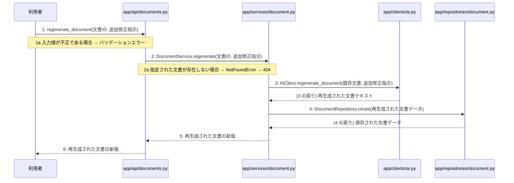

# M-04-T02 追加修正指示による文書再生成機能の実装

> 種別: 機能 / マイルストーン: M-04 設計書の自己診断、版管理、および再生成機能の実装 / 依存: M-04-T01

## 目的

追加修正指示を元にLLMを使用して文書を再生成し、新しい版としてデータベースに保存できるようにする。

## 対象の処理・参照する設計

- 段階5 F-13 追加修正指示による文書再生成
- 段階6 regenerate_document(`app/api/documents.py`)(設計に無い ── 未定義を参照)
- 段階6 DocumentService.regenerate(`app/services/document.py`)(設計に無い ── 未定義を参照)
- 段階6 AIClient.regenerate_document(`app/clients/ai.py`)(設計に無い ── 未定義を参照)
- 段階6 DocumentRepository.create(`app/repositories/document.py`)(設計に無い ── 未定義を参照)
- 段階4 `app/api/documents.py`
- 段階4 `app/services/document.py`
- 段階4 `app/clients/ai.py`
- 段階4 `app/repositories/document.py`

### シーケンス図(段階5 F-13 追加修正指示による文書再生成 の手順から導出)

## 作成・変更するファイル(依存順)

| ファイル | 種類 | 責務 | 根拠 |
|---|---|---|---|
| `app/clients/ai.py` | モジュール | LLM Providerを呼び出して文書を再生成する処理を実装する | 段階4 |
| `app/repositories/document.py` | モジュール | 再生成された文書データをデータベースに保存する処理を実装する | 段階4 |
| `app/services/document.py` | モジュール | 文書再生成のビジネスロジックとトランザクションを制御する | 段階4 |
| `app/api/documents.py` | モジュール | 文書再生成リクエストのエンドポイントとバリデーションを実装する | 段階4 |

## 実装の要点(設計に書いていないことだけ)

- app/clients/ai.py、app/repositories/document.py、app/services/document.py、app/api/documents.pyの順に依存関係に沿って実装する

## テスト観点

| # | 観点 | SUT | ドライバ | スタブ |
|---|---|---|---|---|
| TC-01 | 正常系: 指定された文書と追加修正指示をもとに文書が再生成され新版として保存されること | DocumentService.regenerate | 単体テスト (pytest) | AIClientとDocumentRepositoryをモック化する |

- Given 既存の文書が存在する時 When regenerate_documentが呼び出されたら Then 新しい版の文書が返却される

## 確認方法

- pytestを実行し、文書再生成の単体テストおよび結合テストが成功することを確認する

## 未定義・要決定

なし
