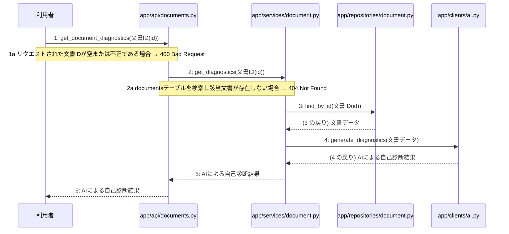

# M-04-T03 AIによる自己診断結果取得機能の実装

> 種別: 機能 / マイルストーン: M-04 設計書の自己診断、版管理、および再生成機能の実装 / 依存: M-04-T02

## 目的

利用者が指定した文書の自己診断結果をAIにより取得し返却できるようにする。

## 対象の処理・参照する設計

- 段階5 F-14 AIによる自己診断結果取得
- 段階6 get_document_diagnostics(`app/api/documents.py`)(設計に無い ── 未定義を参照)
- 段階6 get_diagnostics(`app/services/document.py`)(設計に無い ── 未定義を参照)
- 段階6 find_by_id(`app/repositories/document.py`)(設計に無い ── 未定義を参照)
- 段階6 generate_diagnostics(`app/clients/ai.py`)(設計に無い ── 未定義を参照)
- 段階4 `app/api/documents.py`
- 段階4 `app/services/document.py`
- 段階4 `app/clients/ai.py`
- 段階4 `app/repositories/document.py`

### シーケンス図(段階5 F-14 AIによる自己診断結果取得 の手順から導出)

## 作成・変更するファイル(依存順)

| ファイル | 種類 | 責務 | 根拠 |
|---|---|---|---|
| `app/repositories/document.py` | モジュール | documentsテーブルから文書データを取得して存在確認を行う | 段階4 |
| `app/clients/ai.py` | モジュール | LLM Providerを呼び出して不足点を3段階で診断する | 段階4 |
| `app/services/document.py` | モジュール | 自己診断結果取得のビジネスロジックを制御する | 段階4 |
| `app/api/documents.py` | モジュール | 自己診断結果取得APIのリクエストを受け付け検証と応答を行う | 段階4 |

## 実装の要点(設計に書いていないことだけ)

- 依存関係に従い永続化層、外部連携層、ユースケース層、API層の順に実装する。

## テスト観点

| # | 観点 | SUT | ドライバ | スタブ |
|---|---|---|---|---|
| TC-01 | 正常系: 指定した文書のAI自己診断結果が正常に取得できること | get_document_diagnostics | API結合テスト(pytest) | app/clients/ai.pyをスタブ化し固定のAI診断結果を返す |
| TC-02 | 異常系: 存在しない文書IDを指定した場合に404エラーとなること | get_document_diagnostics | API結合テスト(pytest) | スタブ不要 ── データベース層の検証を利用 |

- Given 存在する文書IDが指定されている When 自己診断結果取得APIを呼び出す Then AIによる自己診断結果が返却される

## 確認方法

- pytestを実行しすべてのテストが成功することを確認する。

## 未定義・要決定

| 重要度 | 出どころ | 対象 | 内容 | 直す段階 |
|---|---|---|---|---|
| 最重要 | AI | 段階6 get_document_diagnostics(app/api/documents.py) | 処理ロジックの詳細(段階6)の設計が記載されていません。 | 段階6 |
| 最重要 | AI | 段階6 get_diagnostics(app/services/document.py) | 処理ロジックの詳細(段階6)の設計が記載されていません。 | 段階6 |
| 最重要 | AI | 段階6 find_by_id(app/repositories/document.py) | 処理ロジックの詳細(段階6)の設計が記載されていません。 | 段階6 |
| 最重要 | AI | 段階6 generate_diagnostics(app/clients/ai.py) | 処理ロジックの詳細(段階6)の設計が記載されていません。 | 段階6 |
