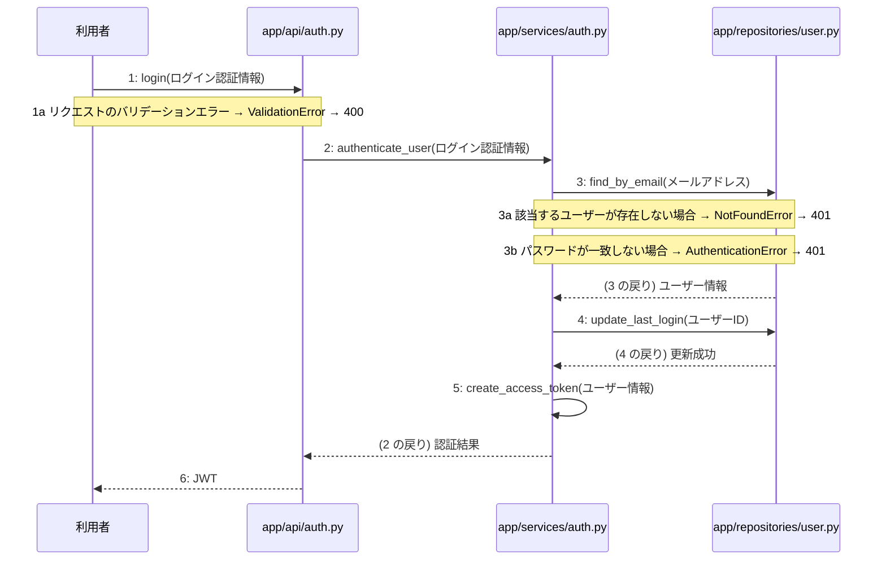

> ⚠ この単位には「未定義・要決定」が 3 件残っています(最重要 3 件)。決めてから渡すことを勧めます。

あなたは実装担当者です。以下の設計情報に従って実装してください。

## プロジェクト概要

Devex: 段階7のマイルストーン M-01〜M-04 を実装する。今回はそのうち、M-01(環境構築と認証基盤の実装)の単位 M-01-T03 だけを扱う。

## 実装ルール

- モジュールは、段階4のモジュール一覧の依存先にだけ依存する(層を飛び越さない)。

### 07章 横断事項

| 項目 | 方針 | 関わるファイル(例) |
|---|---|---|
| 例外と HTTP | システム内で発生した例外は、APIエンドポイント層において共通の例外ハンドラーで捕捉する。バリデーションエラーは 400 Bad Request、認証エラーは 401 Unauthorized、リソースが存在しない場合は 404 Not Found、予期せぬサーバーエラーは 500 Internal Server Error を返却する。 | app/main.py, app/api/auth.py, app/api/projects.py, app/api/documents.py |
| 認証 | クライアントのリクエスト認証には JWT を使用し、有効期限は『(要決定)』とする。認証が必要なすべてのエンドポイントにおいて、リクエストヘッダーに含まれる Bearer トークンの検証を必須とする。 | app/api/auth.py, app/services/auth.py, app/repositories/user.py |
| トランザクション | 複数のリポジトリ操作やデータベースの書き込みを伴う一連のビジネスロジックは、ユースケース層において単一のトランザクションとして実行する。トランザクション内でエラーが発生した場合は自動的にロールバックを行う。 | app/services/auth.py, app/services/project.py, app/services/chat.py, app/services/summary.py, app/services/job.py, app/services/document.py |
| ログ | すべてのAPIリクエストおよびレスポンス、エラー発生時には構造化ログを出力する。ログにはタイムスタンプ、ユーザーID、処理ID、リクエストパス、ステータスコード、エラーメッセージを含め、個人情報やパスワードハッシュは出力しない。 | app/main.py, app/api/auth.py, app/api/projects.py, app/api/documents.py |
| 非同期処理 | 構造化サマリ承認後の4種設計書の順次生成や文書の再生成は、Celeryを用いたバックグラウンドの非同期ジョブとして実行する。ジョブの実行状態や進捗ステータスは適宜データベースに記録し、API経由で確認できるようにする。 | app/services/job.py, app/workers/generator.py |
| 外部サービスの呼び出し | LLM Providerなどの外部サービスとの通信はすべて外部連携層にカプセル化する。外部API呼び出し時のタイムアウトやレート制限によるエラーを想定し、適切な例外処理と必要に応じたリトライを実装する。 | app/clients/ai.py, app/services/chat.py, app/services/document.py, app/workers/generator.py |

### 段階7 開発環境

DockerおよびDocker Composeによるコンテナ化された開発環境。バックエンドにはPython/FastAPI、データベースにはPostgreSQL、非同期キューイング機構にはCeleryとRedisを採用する。LLM連携にはOpenAI API等の抽象化レイヤーを設け、単体テストおよび結合テストにはpytestを使用する。CI/CDパイプラインにより自動テストとリントを実施する方針とする。

## 今回の実装単位

M-01-T03 ログイン認証とJWT発行機能の実装(種別: 機能 / 処理: F-02)

目的: 利用者がメールアドレスとパスワードでログインし、JWTアクセストークンを取得できるようにする。

前提: M-01-T02 まで実装済み

## 作成・変更するファイル(依存順)

| ファイル | 種類 | 責務 |
|---|---|---|
| `app/repositories/user.py` | モジュール | usersテーブルに対するユーザー検索および最終ログイン日時更新を行う |
| `app/services/auth.py` | モジュール | 認証のビジネスロジック、パスワード検証、トランザクション制御、およびJWTの生成を行う |
| `app/api/auth.py` | モジュール | ログインAPIのエンドポイントとしてリクエストを受け取り、バリデーションとJWT返却を行う |

実装の要点:

- app/repositories/user.py、app/services/auth.py、app/api/auth.pyの順に実装する
- 手順3から5までを単一のトランザクションとしてサービス層で処理する

## 参照する設計

### 段階5 F-02 ログイン認証

トリガー: POST /api/v1/auth/login

| No | 呼び出し元 → 呼び出し先 | 種別 | 関数 | 渡すデータ | 処理内容 | 結果 | DB 操作 | 分岐・例外 |
|---|---|---|---|---|---|---|---|---|
| 1 | 利用者 → app/api/auth.py | 同期 | login | ログイン認証情報 | ログインAPIのエンドポイントでリクエストを受け取る | バリデーション結果 | — | F-02a へ |
| 1a | — | — | — | ログイン認証情報 | リクエストのバリデーションエラー | 400 Bad Request | — | ValidationError → 400 |
| 2 | app/api/auth.py → app/services/auth.py | 同期 | authenticate_user → 詳細: L-02 | ログイン認証情報 | 認証ビジネスロジックを呼び出す | 認証結果 | — | F-02b へ |
| 3 | app/services/auth.py → app/repositories/user.py | 同期 | find_by_email | メールアドレス | ユーザー情報を取得する | ユーザー情報 | users R | F-02c へ |
| 3a | — | — | — | メールアドレス | 該当するユーザーが存在しない場合 | 認証エラー | — | NotFoundError → 401 |
| 3b | — | — | — | パスワード | パスワードが一致しない場合 | 認証エラー | — | AuthenticationError → 401 |
| 4 | app/services/auth.py → app/repositories/user.py | 同期 | update_last_login | ユーザーID | 最終ログイン日時を更新する | 更新成功 | users U | — |
| 5 | app/services/auth.py → app/services/auth.py | 同期 | create_access_token → 詳細: L-03 | ユーザー情報 | JWTを発行する | JWT | — | — |
| 6 | app/api/auth.py → 利用者 | 戻り | — | JWT | JWTを返却する | 200 OK | — | — |

注記: 手順 3〜5 が1つのトランザクション

シーケンス図(手順の表から導いた図。直すのは表):

- 段階6 login(`app/api/auth.py`): 設計にありません

### 段階6 L-02 authenticate_user(`app/services/auth.py`)

呼ばれる手順: F-02#2

| 項目 | 内容 |
|---|---|
| シグネチャ | def authenticate_user(credentials: LoginCredentials) -> AuthResult: |
| 引数 | credentials: ログイン認証情報 |
| 戻り値 | 認証結果 |
| 例外 | AuthenticationError: 認証に失敗した場合、HTTP 401を返す |
| 事前条件 | 有効なログイン認証情報が入力されていること |
| 事後条件 | 入力された認証情報に基づきユーザーの検証を行い、結果を返すこと |

擬似フロー:

1. ユーザーリポジトリを使用して入力された認証情報のユーザーを検索する
    - app/repositories/user.py の関数を呼び出す
    - 該当するユーザーが存在しない場合は認証エラーとする
2. パスワードの検証を行う
    - 入力されたパスワードと保存されているハッシュ化パスワードを比較する
    - 一致しない場合は認証エラーとする
3. 認証成功時の結果を生成して返却する
    - 認証結果のデータを組み立てる
    - 呼び出し元へ返却する

- 段階6 find_by_email(`app/repositories/user.py`): 設計にありません

- 段階6 update_last_login(`app/repositories/user.py`): 設計にありません

### 段階6 L-03 create_access_token(`app/services/auth.py`)

呼ばれる手順: F-02#5

| 項目 | 内容 |
|---|---|
| シグネチャ | def create_access_token(user: dict) -> str: |
| 引数 | user: ユーザー情報を格納した辞書 |
| 戻り値 | 生成されたJWT文字列 |
| 例外 | なし |
| 事前条件 | 渡されたユーザー情報が有効であること |
| 事後条件 | 有効なJWT文字列が返却されること |

擬似フロー:

1. アクセストークンのペイロードを作成する
    - ユーザーの識別子を含める
    - 有効期限を設定する
2. 秘密鍵とアルゴリズムを用いてJWTを署名・生成する
    - 設定された秘密鍵を取得する
    - JWTエンコード処理を実行する
3. 生成されたJWT文字列を返却する

- 段階4 `app/api/auth.py`(入口): 認証に関するAPIエンドポイントの受け皿とリクエスト検証を行う / 依存先: app/services/auth.py

- 段階4 `app/services/auth.py`(ユースケース): ユーザー登録およびログイン認証のビジネスロジックを制御する / 依存先: app/repositories/user.py

- 段階4 `app/repositories/user.py`(永続化): usersテーブルに対するPostgreSQLのCRUD操作を行う / 依存先: PostgreSQL

## テスト観点

| # | 観点 | SUT | ドライバ | スタブ |
|---|---|---|---|---|
| TC-01 | 正常系: 有効な認証情報でログインしJWTが発行されること | app/api/auth.pyのlogin関数 | 結合テスト(pytest) | スタブ不要 ── 実際のデータベースおよびサービス層を使用する |
| TC-02 | 異常系: 存在しないメールアドレスの場合に401が返ること | app/api/auth.pyのlogin関数 | 結合テスト(pytest) | スタブ不要 ── 実際のデータベースを使用する |
| TC-03 | 異常系: パスワードが一致しない場合に401が返ること | app/api/auth.pyのlogin関数 | 結合テスト(pytest) | スタブ不要 ── 実際のデータベースを使用する |

- Given: 登録済みのユーザーが存在する / When: 正しいメールアドレスとパスワードでログインAPIを呼び出す / Then: 200 OKとJWTアクセストークンが返却される

## 完了条件

- この単位のテストが全件成功する
- 既存のテストが壊れていない
- lint・型チェックが成功する
- (テーブルを変える単位)マイグレーションの適用が成功する
- 開発環境で起動し、確認方法の操作ができる
- 確認方法: pytestを実行し、ログイン機能のテストがすべて成功することを確認する

## 未定義・要決定(決まるまで、推測で実装しないこと)

- [最重要] 07章 認証: JWTの有効期限が『(要決定)』となっており具体的な時間が決まっていない。
- [最重要] 段階6 authenticate_user: パスワードのハッシュ化アルゴリズムや検証ライブラリについての指定が設計にない。
- [最重要] 段階6 create_access_token: JWTの署名に使用する秘密鍵の取得元やアルゴリズムの指定が設計にない。

## 制約

- 既存の API を変更しない。
- 設計に無いことを推測で決めない。

まず現在のリポジトリを調査し、既存実装との整合性を確認してください。不整合がある場合は実装せず、問題点を報告してください。
