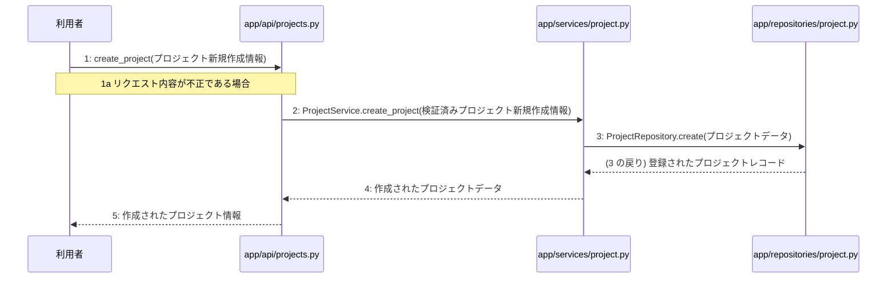

> ⚠ この単位には「未定義・要決定」が 2 件残っています(最重要 2 件)。決めてから渡すことを勧めます。

あなたは実装担当者です。以下の設計情報に従って実装してください。

## プロジェクト概要

Devex: 段階7のマイルストーン M-01〜M-04 を実装する。今回はそのうち、M-02(プロジェクト管理とAI対話ヒアリング機能の実装)の単位 M-02-T02 だけを扱う。

## 実装ルール

- モジュールは、段階4のモジュール一覧の依存先にだけ依存する(層を飛び越さない)。

### 07章 横断事項

| 項目 | 方針 | 関わるファイル(例) |
|---|---|---|
| 例外と HTTP | システム内で発生した例外は、APIエンドポイント層において共通の例外ハンドラーで捕捉する。バリデーションエラーは 400 Bad Request、認証エラーは 401 Unauthorized、リソースが存在しない場合は 404 Not Found、予期せぬサーバーエラーは 500 Internal Server Error を返却する。 | app/main.py, app/api/auth.py, app/api/projects.py, app/api/documents.py |
| 認証 | クライアントのリクエスト認証には JWT を使用し、有効期限は『(要決定)』とする。認証が必要なすべてのエンドポイントにおいて、リクエストヘッダーに含まれる Bearer トークンの検証を必須とする。 | app/api/auth.py, app/services/auth.py, app/repositories/user.py |
| トランザクション | 複数のリポジトリ操作やデータベースの書き込みを伴う一連のビジネスロジックは、ユースケース層において単一のトランザクションとして実行する。トランザクション内でエラーが発生した場合は自動的にロールバックを行う。 | app/services/auth.py, app/services/project.py, app/services/chat.py, app/services/summary.py, app/services/job.py, app/services/document.py |
| ログ | すべてのAPIリクエストおよびレスポンス、エラー発生時には構造化ログを出力する。ログにはタイムスタンプ、ユーザーID、処理ID、リクエストパス、ステータスコード、エラーメッセージを含め、個人情報やパスワードハッシュは出力しない。 | app/main.py, app/api/auth.py, app/api/projects.py, app/api/documents.py |
| 非同期処理 | 構造化サマリ承認後の4種設計書の順次生成や文書の再生成は、Celeryを用いたバックグラウンドの非同期ジョブとして実行する。ジョブの実行状態や進捗ステータスは適宜データベースに記録し、API経由で確認できるようにする。 | app/services/job.py, app/workers/generator.py |
| 外部サービスの呼び出し | LLM Providerなどの外部サービスとの通信はすべて外部連携層にカプセル化する。外部API呼び出し時のタイムアウトやレート制限によるエラーを想定し、適切な例外処理と必要に応じたリトライを実装する。 | app/clients/ai.py, app/services/chat.py, app/services/document.py, app/workers/generator.py |

### 段階7 開発環境

DockerおよびDocker Composeによるコンテナ化された開発環境。バックエンドにはPython/FastAPI、データベースにはPostgreSQL、非同期キューイング機構にはCeleryとRedisを採用する。LLM連携にはOpenAI API等の抽象化レイヤーを設け、単体テストおよび結合テストにはpytestを使用する。CI/CDパイプラインにより自動テストとリントを実施する方針とする。

## 今回の実装単位

M-02-T02 プロジェクト新規作成機能の実装(種別: 機能 / 処理: F-04)

目的: 利用者からのプロジェクト新規作成リクエストを受け付け、ビジネスロジックを経てデータベースに新しいプロジェクトを登録できるようにする。

前提: M-02-T01 まで実装済み

## 作成・変更するファイル(依存順)

| ファイル | 種類 | 責務 |
|---|---|---|
| `app/repositories/project.py` | モジュール | projectsテーブルに対するPostgreSQLのCRUD操作を行う |
| `app/services/project.py` | モジュール | プロジェクトの取得および新規作成のビジネスロジックを制御する |
| `app/api/projects.py` | モジュール | プロジェクト・参考資料・チャットに関するAPIエンドポイントの受け皿とリクエスト検証を行う |

実装の要点:

- app/repositories/project.py から順に作成し、app/services/project.py、最後に app/api/projects.py を実装する
- ユースケース層におけるトランザクション制御を適用する

## 参照する設計

### 段階5 F-04 プロジェクト新規作成

トリガー: POST /api/v1/projects

| No | 呼び出し元 → 呼び出し先 | 種別 | 関数 | 渡すデータ | 処理内容 | 結果 | DB 操作 | 分岐・例外 |
|---|---|---|---|---|---|---|---|---|
| 1 | 利用者 → app/api/projects.py | 同期 | create_project | プロジェクト新規作成情報 | プロジェクト新規作成APIのリクエストを受け取り、リクエスト内容を検証する | 検証済みプロジェクト新規作成情報 | — | 4a へ |
| 1a | — | — | — | 検証エラー | リクエスト内容が不正である場合 | ValidationError → 422 | — | — |
| 2 | app/api/projects.py → app/services/project.py | 同期 | ProjectService.create_project → 詳細: L-05 | 検証済みプロジェクト新規作成情報 | プロジェクト新規作成のビジネスロジックを実行する | 作成されたプロジェクトデータ | — | — |
| 3 | app/services/project.py → app/repositories/project.py | 同期 | ProjectRepository.create | プロジェクトデータ | projectsテーブルに新しいプロジェクトを登録する | 登録されたプロジェクトレコード | projects C | — |
| 4 | app/services/project.py → app/api/projects.py | 戻り | — | 作成されたプロジェクトデータ | ビジネスロジックの結果をAPI層へ返す | 作成されたプロジェクトデータ | — | — |
| 5 | app/api/projects.py → 利用者 | 戻り | — | 作成されたプロジェクト情報 | 作成されたプロジェクト情報をレスポンスとして返す | 作成されたプロジェクト情報 (201 Created) | — | — |

注記: 手順 2〜4 が1つのトランザクション

シーケンス図(手順の表から導いた図。直すのは表):

- 段階6 create_project(`app/api/projects.py`): 設計にありません

### 段階6 L-05 ProjectService.create_project(`app/services/project.py`)

呼ばれる手順: F-04#2

| 項目 | 内容 |
|---|---|
| シグネチャ | def create_project(project_in: ProjectCreate) -> Project: |
| 引数 | project_in: 検証済みプロジェクト新規作成情報 |
| 戻り値 | 作成されたプロジェクトデータ |
| 例外 | なし |
| 事前条件 | 呼び出し元で検証済みプロジェクト新規作成情報が用意されていること |
| 事後条件 | projects テーブルに新しいプロジェクトが登録され、作成されたプロジェクトデータが返されること |

擬似フロー:

1. プロジェクト新規作成情報を受け取る
    - 引数の project_in を取得する
2. app/repositories/project.py のリポジトリを呼び出してプロジェクトを永続化する
    - プロジェクト作成のデータベース操作を実行する
3. 作成されたプロジェクトデータを返却する
    - 永続化されたプロジェクトのデータを戻り値として返す

- 段階6 ProjectRepository.create(`app/repositories/project.py`): 設計にありません

- 段階4 `app/api/projects.py`(入口): プロジェクト・参考資料・チャットに関するAPIエンドポイントの受け皿とリクエスト検証を行う / 依存先: app/services/project.py, app/services/chat.py, app/services/document.py

- 段階4 `app/services/project.py`(ユースケース): プロジェクトの取得および新規作成のビジネスロジックを制御する / 依存先: app/repositories/project.py

- 段階4 `app/repositories/project.py`(永続化): projectsテーブルに対するPostgreSQLのCRUD操作を行う / 依存先: PostgreSQL

## テスト観点

| # | 観点 | SUT | ドライバ | スタブ |
|---|---|---|---|---|
| TC-01 | 正常なプロジェクト新規作成情報を受け取り、プロジェクトが登録されて作成されたデータが返されること | create_project | 結合テスト、pytestを使用しAPIエンドポイントを呼び出す | スタブ不要 ── 実際のデータベースおよびサービス層を使用する |
| TC-02 | 不正なプロジェクト新規作成情報を受け取り、バリデーションエラーとなること | create_project | 結合テスト、pytestを使用しAPIエンドポイントを呼び出す | スタブ不要 ── 実際のAPI層の検証機能を使用する |

- Given 有効なプロジェクト新規作成情報がある When POST /api/v1/projects を呼び出す Then ステータスコード 201 と作成されたプロジェクト情報が返される
- Given 不正なプロジェクト新規作成情報がある When POST /api/v1/projects を呼び出す Then バリデーションエラーが返される

## 完了条件

- この単位のテストが全件成功する
- 既存のテストが壊れていない
- lint・型チェックが成功する
- (テーブルを変える単位)マイグレーションの適用が成功する
- 開発環境で起動し、確認方法の操作ができる
- 確認方法: pytest を実行してプロジェクト新規作成に関連するテストがすべて成功することを確認する

## 未定義・要決定(決まるまで、推測で実装しないこと)

- [最重要] 段階6 create_project(app/api/projects.py): 段階6の詳細設計が記載されていないため、具体的なリクエストスキーマや関数内部の処理詳細が不明である。
- [最重要] 段階6 ProjectRepository.create(app/repositories/project.py): 段階6の詳細設計が記載されていないため、リポジトリ層のシグネチャやクエリの詳細が不明である。

## 制約

- 既存の API を変更しない。
- 設計に無いことを推測で決めない。

まず現在のリポジトリを調査し、既存実装との整合性を確認してください。不整合がある場合は実装せず、問題点を報告してください。
