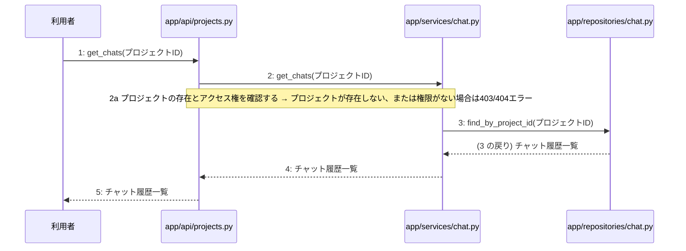

> ⚠ この単位には「未定義・要決定」が 3 件残っています(最重要 3 件)。決めてから渡すことを勧めます。

あなたは実装担当者です。以下の設計情報に従って実装してください。

## プロジェクト概要

Devex: 段階7のマイルストーン M-01〜M-04 を実装する。今回はそのうち、M-02(プロジェクト管理とAI対話ヒアリング機能の実装)の単位 M-02-T04 だけを扱う。

## 実装ルール

- モジュールは、段階4のモジュール一覧の依存先にだけ依存する(層を飛び越さない)。

### 07章 横断事項

| 項目 | 方針 | 関わるファイル(例) |
|---|---|---|
| 例外と HTTP | システム内で発生した例外は、APIエンドポイント層において共通の例外ハンドラーで捕捉する。バリデーションエラーは 400 Bad Request、認証エラーは 401 Unauthorized、リソースが存在しない場合は 404 Not Found、予期せぬサーバーエラーは 500 Internal Server Error を返却する。 | app/main.py, app/api/auth.py, app/api/projects.py, app/api/documents.py |
| 認証 | クライアントのリクエスト認証には JWT を使用し、有効期限は『(要決定)』とする。認証が必要なすべてのエンドポイントにおいて、リクエストヘッダーに含まれる Bearer トークンの検証を必須とする。 | app/api/auth.py, app/services/auth.py, app/repositories/user.py |
| トランザクション | 複数のリポジトリ操作やデータベースの書き込みを伴う一連のビジネスロジックは、ユースケース層において単一のトランザクションとして実行する。トランザクション内でエラーが発生した場合は自動的にロールバックを行う。 | app/services/auth.py, app/services/project.py, app/services/chat.py, app/services/summary.py, app/services/job.py, app/services/document.py |
| ログ | すべてのAPIリクエストおよびレスポンス、エラー発生時には構造化ログを出力する。ログにはタイムスタンプ、ユーザーID、処理ID、リクエストパス、ステータスコード、エラーメッセージを含め、個人情報やパスワードハッシュは出力しない。 | app/main.py, app/api/auth.py, app/api/projects.py, app/api/documents.py |
| 非同期処理 | 構造化サマリ承認後の4種設計書の順次生成や文書の再生成は、Celeryを用いたバックグラウンドの非同期ジョブとして実行する。ジョブの実行状態や進捗ステータスは適宜データベースに記録し、API経由で確認できるようにする。 | app/services/job.py, app/workers/generator.py |
| 外部サービスの呼び出し | LLM Providerなどの外部サービスとの通信はすべて外部連携層にカプセル化する。外部API呼び出し時のタイムアウトやレート制限によるエラーを想定し、適切な例外処理と必要に応じたリトライを実装する。 | app/clients/ai.py, app/services/chat.py, app/services/document.py, app/workers/generator.py |

### 段階7 開発環境

DockerおよびDocker Composeによるコンテナ化された開発環境。バックエンドにはPython/FastAPI、データベースにはPostgreSQL、非同期キューイング機構にはCeleryとRedisを採用する。LLM連携にはOpenAI API等の抽象化レイヤーを設け、単体テストおよび結合テストにはpytestを使用する。CI/CDパイプラインにより自動テストとリントを実施する方針とする。

## 今回の実装単位

M-02-T04 チャット履歴取得機能の実装(種別: 機能 / 処理: F-06)

目的: プロジェクトに紐づくチャット履歴をAPI経由で取得できるようにする。

前提: M-02-T02 まで実装済み

## 作成・変更するファイル(依存順)

| ファイル | 種類 | 責務 |
|---|---|---|
| `app/repositories/chat.py` | モジュール | chatsテーブルからプロジェクトIDに一致するチャット履歴を検索する |
| `app/services/chat.py` | モジュール | プロジェクトの存在とアクセス権の確認およびチャット履歴取得処理を制御する |
| `app/api/projects.py` | モジュール | チャット履歴取得APIリクエストを受け取り、サービス層を呼び出してレスポンスを返す |

実装の要点:

- 依存される順序に従い、リポジトリ層、サービス層、API層の順に実装を行う。

## 参照する設計

### 段階5 F-06 チャット履歴取得

トリガー: GET /api/v1/projects/{id}/chats

| No | 呼び出し元 → 呼び出し先 | 種別 | 関数 | 渡すデータ | 処理内容 | 結果 | DB 操作 | 分岐・例外 |
|---|---|---|---|---|---|---|---|---|
| 1 | 利用者 → app/api/projects.py | 同期 | get_chats | プロジェクトID | チャット履歴取得APIリクエストを受け取る | バリデーション済みのプロジェクトID | — | — |
| 2 | app/api/projects.py → app/services/chat.py | 同期 | get_chats | プロジェクトID | チャット履歴取得処理を呼び出す | チャット履歴一覧 | — | 3a へ |
| 2a | — | — | — | プロジェクトID | プロジェクトの存在とアクセス権を確認する | 検証結果 | projects U | プロジェクトが存在しない、または権限がない場合は403/404エラー |
| 3 | app/services/chat.py → app/repositories/chat.py | 同期 | find_by_project_id | プロジェクトID | chatsテーブルからチャット履歴を検索する | チャット履歴一覧 | chats R | — |
| 4 | app/services/chat.py → app/api/projects.py | 戻り | — | チャット履歴一覧 | チャット履歴一覧を返す | チャット履歴一覧 | — | — |
| 5 | app/api/projects.py → 利用者 | 戻り | — | チャット履歴一覧 | チャット履歴一覧をレスポンスとして返す | HTTP 200 OK | — | — |

注記: 手順 2〜4 が1つのトランザクション

シーケンス図(手順の表から導いた図。直すのは表):

- 段階6 get_chats(`app/api/projects.py`): 設計にありません

- 段階6 get_chats(`app/services/chat.py`): 設計にありません

- 段階6 find_by_project_id(`app/repositories/chat.py`): 設計にありません

- 段階4 `app/api/projects.py`(入口): プロジェクト・参考資料・チャットに関するAPIエンドポイントの受け皿とリクエスト検証を行う / 依存先: app/services/project.py, app/services/chat.py, app/services/document.py

- 段階4 `app/services/chat.py`(ユースケース): チャット履歴の取得およびヒアリングチャットメッセージ送信のビジネスロジックを制御する / 依存先: app/repositories/chat.py, app/clients/ai.py

- 段階4 `app/repositories/chat.py`(永続化): chatsテーブルに対するPostgreSQLのCRUD操作を行う / 依存先: PostgreSQL

## テスト観点

| # | 観点 | SUT | ドライバ | スタブ |
|---|---|---|---|---|
| TC-01 | 正常系: 指定したプロジェクトIDのチャット履歴一覧が取得できること | app/api/projects.py get_chats | 結合テスト (pytest) | スタブ不要 ── 実際のデータベースおよびサービス層を使用する |
| TC-02 | 異常系: プロジェクトが存在しない、または権限がない場合にエラーが返ること | app/services/chat.py get_chats | 単体テスト (pytest) | app/repositories/chat.py をスタブ化して存在しないプロジェクトを模擬する |

- Given 存在するプロジェクトIDと紐づくチャット履歴が存在する When チャット履歴取得APIを呼び出す Then チャット履歴一覧が返される

## 完了条件

- この単位のテストが全件成功する
- 既存のテストが壊れていない
- lint・型チェックが成功する
- (テーブルを変える単位)マイグレーションの適用が成功する
- 開発環境で起動し、確認方法の操作ができる
- 確認方法: pytest を実行してチャット履歴取得に関するテストがすべて成功することを確認する。

## 未定義・要決定(決まるまで、推測で実装しないこと)

- [最重要] 段階6 get_chats(app/api/projects.py): 詳細な実装ロジックやバリデーション仕様が段階6に記載されていないため決定が必要である。
- [最重要] 段階6 get_chats(app/services/chat.py): 詳細な実装ロジックや権限確認の具体的手順が段階6に記載されていないため決定が必要である。
- [最重要] 段階6 find_by_project_id(app/repositories/chat.py): 詳細なクエリ構造やソート順などが段階6に記載されていないため決定が必要である。

## 制約

- 既存の API を変更しない。
- 設計に無いことを推測で決めない。

まず現在のリポジトリを調査し、既存実装との整合性を確認してください。不整合がある場合は実装せず、問題点を報告してください。
