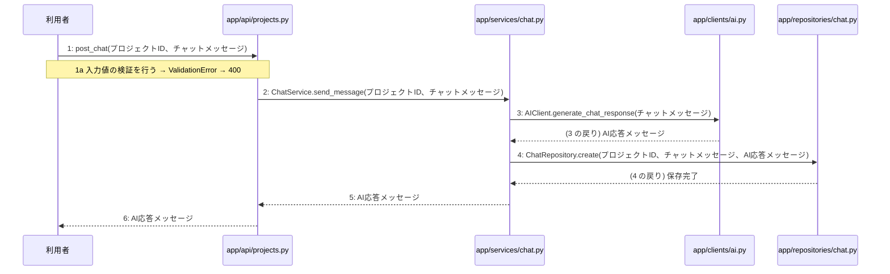

> ⚠ この単位には「未定義・要決定」が 2 件残っています(最重要 2 件)。決めてから渡すことを勧めます。

あなたは実装担当者です。以下の設計情報に従って実装してください。

## プロジェクト概要

Devex: 段階7のマイルストーン M-01〜M-04 を実装する。今回はそのうち、M-02(プロジェクト管理とAI対話ヒアリング機能の実装)の単位 M-02-T05 だけを扱う。

## 実装ルール

- モジュールは、段階4のモジュール一覧の依存先にだけ依存する(層を飛び越さない)。

### 07章 横断事項

| 項目 | 方針 | 関わるファイル(例) |
|---|---|---|
| 例外と HTTP | システム内で発生した例外は、APIエンドポイント層において共通の例外ハンドラーで捕捉する。バリデーションエラーは 400 Bad Request、認証エラーは 401 Unauthorized、リソースが存在しない場合は 404 Not Found、予期せぬサーバーエラーは 500 Internal Server Error を返却する。 | app/main.py, app/api/auth.py, app/api/projects.py, app/api/documents.py |
| 認証 | クライアントのリクエスト認証には JWT を使用し、有効期限は『(要決定)』とする。認証が必要なすべてのエンドポイントにおいて、リクエストヘッダーに含まれる Bearer トークンの検証を必須とする。 | app/api/auth.py, app/services/auth.py, app/repositories/user.py |
| トランザクション | 複数のリポジトリ操作やデータベースの書き込みを伴う一連のビジネスロジックは、ユースケース層において単一のトランザクションとして実行する。トランザクション内でエラーが発生した場合は自動的にロールバックを行う。 | app/services/auth.py, app/services/project.py, app/services/chat.py, app/services/summary.py, app/services/job.py, app/services/document.py |
| ログ | すべてのAPIリクエストおよびレスポンス、エラー発生時には構造化ログを出力する。ログにはタイムスタンプ、ユーザーID、処理ID、リクエストパス、ステータスコード、エラーメッセージを含め、個人情報やパスワードハッシュは出力しない。 | app/main.py, app/api/auth.py, app/api/projects.py, app/api/documents.py |
| 非同期処理 | 構造化サマリ承認後の4種設計書の順次生成や文書の再生成は、Celeryを用いたバックグラウンドの非同期ジョブとして実行する。ジョブの実行状態や進捗ステータスは適宜データベースに記録し、API経由で確認できるようにする。 | app/services/job.py, app/workers/generator.py |
| 外部サービスの呼び出し | LLM Providerなどの外部サービスとの通信はすべて外部連携層にカプセル化する。外部API呼び出し時のタイムアウトやレート制限によるエラーを想定し、適切な例外処理と必要に応じたリトライを実装する。 | app/clients/ai.py, app/services/chat.py, app/services/document.py, app/workers/generator.py |

### 段階7 開発環境

DockerおよびDocker Composeによるコンテナ化された開発環境。バックエンドにはPython/FastAPI、データベースにはPostgreSQL、非同期キューイング機構にはCeleryとRedisを採用する。LLM連携にはOpenAI API等の抽象化レイヤーを設け、単体テストおよび結合テストにはpytestを使用する。CI/CDパイプラインにより自動テストとリントを実施する方針とする。

## 今回の実装単位

M-02-T05 ヒアリングチャットメッセージ送信とAI応答機能の実装(種別: 機能 / 処理: F-07)

目的: ヒアリングチャットメッセージを送信し、LLMからのAI応答を取得してチャット履歴として保存する機能を提供する。

前提: M-02-T04 まで実装済み

## 作成・変更するファイル(依存順)

| ファイル | 種類 | 責務 |
|---|---|---|
| `app/repositories/chat.py` | モジュール | chatsテーブルに対するPostgreSQLのCRUD操作を行う |
| `app/clients/ai.py` | モジュール | LLM Providerとの通信やプロンプト管理を行いAIモデルの差異を抽象化する |
| `app/services/chat.py` | モジュール | チャット履歴の取得およびヒアリングチャットメッセージ送信のビジネスロジックを制御する |
| `app/api/projects.py` | モジュール | プロジェクト・参考資料・チャットに関するAPIエンドポイントの受け皿とリクエスト検証を行う |

実装の要点:

- リポジトリ層、外部連携層、ユースケース層、APIエンドポイント層の順に実装する。
- ユースケース層では単一のトランザクションとしてメッセージ保存等の処理を制御する。

## 参照する設計

### 段階5 F-07 ヒアリングチャットメッセージ送信

トリガー: POST /api/v1/projects/{id}/chats

| No | 呼び出し元 → 呼び出し先 | 種別 | 関数 | 渡すデータ | 処理内容 | 結果 | DB 操作 | 分岐・例外 |
|---|---|---|---|---|---|---|---|---|
| 1 | 利用者 → app/api/projects.py | 同期 | post_chat | プロジェクトID、チャットメッセージ | チャットメッセージ送信のリクエストを受け付ける | バリデーション結果 | — | 3a へ |
| 1a | — | — | — | リクエストパラメータ | 入力値の検証を行う | 検証エラー | — | ValidationError → 400 |
| 2 | app/api/projects.py → app/services/chat.py | 同期 | ChatService.send_message | プロジェクトID、チャットメッセージ | メッセージ送信とAI応答取得のビジネスロジックを実行する | AI応答メッセージ | — | — |
| 3 | app/services/chat.py → app/clients/ai.py | 同期 | AIClient.generate_chat_response | チャットメッセージ | LLM Providerへメッセージを送信してAIの応答を取得する | AI応答メッセージ | — | — |
| 4 | app/services/chat.py → app/repositories/chat.py | 同期 | ChatRepository.create | プロジェクトID、チャットメッセージ、AI応答メッセージ | ユーザーのメッセージとAIの応答をチャット履歴として保存する | 保存完了 | chats C | — |
| 5 | app/services/chat.py → app/api/projects.py | 戻り | — | AI応答メッセージ | ビジネスロジックの結果を返す | AI応答メッセージ | — | — |
| 6 | app/api/projects.py → 利用者 | 戻り | — | AI応答メッセージ | AIの応答メッセージをクライアントへ返却する | HTTP 200 OK | — | — |

注記: 手順 3〜5 が1つのトランザクション

シーケンス図(手順の表から導いた図。直すのは表):

- 段階6 post_chat(`app/api/projects.py`): 設計にありません

- 段階6 ChatService.send_message(`app/services/chat.py`): 設計にありません

- 段階6 AIClient.generate_chat_response(`app/clients/ai.py`): 設計にありません

- 段階6 ChatRepository.create(`app/repositories/chat.py`): 設計にありません

- 段階4 `app/api/projects.py`(入口): プロジェクト・参考資料・チャットに関するAPIエンドポイントの受け皿とリクエスト検証を行う / 依存先: app/services/project.py, app/services/chat.py, app/services/document.py

- 段階4 `app/services/chat.py`(ユースケース): チャット履歴の取得およびヒアリングチャットメッセージ送信のビジネスロジックを制御する / 依存先: app/repositories/chat.py, app/clients/ai.py

- 段階4 `app/clients/ai.py`(外部連携): LLM Providerとの通信やプロンプト管理を行いAIモデルの差異を抽象化する / 依存先: OpenAI

- 段階4 `app/repositories/chat.py`(永続化): chatsテーブルに対するPostgreSQLのCRUD操作を行う / 依存先: PostgreSQL

## テスト観点

| # | 観点 | SUT | ドライバ | スタブ |
|---|---|---|---|---|
| TC-01 | 正常系: チャットメッセージ送信が成功し、AI応答メッセージが返却されること | post_chat | 結合テスト (pytest) | AIClient.generate_chat_response をスタブ化し、固定のAI応答を返す |
| TC-02 | 異常系: 入力値の検証エラー時にバリデーションエラーとなること | post_chat | 単体テスト (pytest) | スタブ不要 ── 入力値検証のテストのため |

- Given 有効なプロジェクトIDとチャットメッセージがあるとき When APIへメッセージ送信リクエストを実行すると Then AI応答メッセージが返却され履歴に保存される

## 完了条件

- この単位のテストが全件成功する
- 既存のテストが壊れていない
- lint・型チェックが成功する
- (テーブルを変える単位)マイグレーションの適用が成功する
- 開発環境で起動し、確認方法の操作ができる
- 確認方法: pytestを用いた結合テストが正常に通過することを確認する。
- 確認方法: POST /api/v1/projects/{id}/chats に対してリクエストを送信し、HTTP 200 OK とAI応答が返ることを確認する。

## 未定義・要決定(決まるまで、推測で実装しないこと)

- [最重要] 段階6 AIClient.generate_chat_response: LLM Providerへ送信する際のプロンプトの構成やモデルの種類、パラメータの詳細が設計に記載されていない。
- [最重要] 段階6 ChatRepository.create: chatsテーブルへの保存時におけるカラム構造やマッピング定義の細かい仕様が設計に記載されていない。

## 制約

- 既存の API を変更しない。
- 設計に無いことを推測で決めない。

まず現在のリポジトリを調査し、既存実装との整合性を確認してください。不整合がある場合は実装せず、問題点を報告してください。
