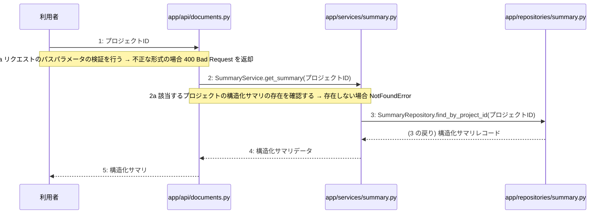

> ⚠ この単位には「未定義・要決定」が 2 件残っています(最重要 2 件)。決めてから渡すことを勧めます。

あなたは実装担当者です。以下の設計情報に従って実装してください。

## プロジェクト概要

Devex: 段階7のマイルストーン M-01〜M-04 を実装する。今回はそのうち、M-02(プロジェクト管理とAI対話ヒアリング機能の実装)の単位 M-02-T06 だけを扱う。

## 実装ルール

- モジュールは、段階4のモジュール一覧の依存先にだけ依存する(層を飛び越さない)。

### 07章 横断事項

| 項目 | 方針 | 関わるファイル(例) |
|---|---|---|
| 例外と HTTP | システム内で発生した例外は、APIエンドポイント層において共通の例外ハンドラーで捕捉する。バリデーションエラーは 400 Bad Request、認証エラーは 401 Unauthorized、リソースが存在しない場合は 404 Not Found、予期せぬサーバーエラーは 500 Internal Server Error を返却する。 | app/main.py, app/api/auth.py, app/api/projects.py, app/api/documents.py |
| 認証 | クライアントのリクエスト認証には JWT を使用し、有効期限は『(要決定)』とする。認証が必要なすべてのエンドポイントにおいて、リクエストヘッダーに含まれる Bearer トークンの検証を必須とする。 | app/api/auth.py, app/services/auth.py, app/repositories/user.py |
| トランザクション | 複数のリポジトリ操作やデータベースの書き込みを伴う一連のビジネスロジックは、ユースケース層において単一のトランザクションとして実行する。トランザクション内でエラーが発生した場合は自動的にロールバックを行う。 | app/services/auth.py, app/services/project.py, app/services/chat.py, app/services/summary.py, app/services/job.py, app/services/document.py |
| ログ | すべてのAPIリクエストおよびレスポンス、エラー発生時には構造化ログを出力する。ログにはタイムスタンプ、ユーザーID、処理ID、リクエストパス、ステータスコード、エラーメッセージを含め、個人情報やパスワードハッシュは出力しない。 | app/main.py, app/api/auth.py, app/api/projects.py, app/api/documents.py |
| 非同期処理 | 構造化サマリ承認後の4種設計書の順次生成や文書の再生成は、Celeryを用いたバックグラウンドの非同期ジョブとして実行する。ジョブの実行状態や進捗ステータスは適宜データベースに記録し、API経由で確認できるようにする。 | app/services/job.py, app/workers/generator.py |
| 外部サービスの呼び出し | LLM Providerなどの外部サービスとの通信はすべて外部連携層にカプセル化する。外部API呼び出し時のタイムアウトやレート制限によるエラーを想定し、適切な例外処理と必要に応じたリトライを実装する。 | app/clients/ai.py, app/services/chat.py, app/services/document.py, app/workers/generator.py |

### 段階7 開発環境

DockerおよびDocker Composeによるコンテナ化された開発環境。バックエンドにはPython/FastAPI、データベースにはPostgreSQL、非同期キューイング機構にはCeleryとRedisを採用する。LLM連携にはOpenAI API等の抽象化レイヤーを設け、単体テストおよび結合テストにはpytestを使用する。CI/CDパイプラインにより自動テストとリントを実施する方針とする。

## 今回の実装単位

M-02-T06 構造化サマリ取得機能の実装(種別: 機能 / 処理: F-08)

目的: プロジェクトIDを指定して構造化サマリを取得するAPIエンドポイント、サービス、リポジトリを実装する。

前提: M-02-T05 まで実装済み

## 作成・変更するファイル(依存順)

| ファイル | 種類 | 責務 |
|---|---|---|
| `app/repositories/summary.py` | モジュール | summariesテーブルからプロジェクトIDに該当する構造化サマリレコードを取得する。 |
| `app/services/summary.py` | モジュール | 構造化サマリ取得のビジネスロジックを制御し、存在確認とリポジトリ呼び出しを行う。 |
| `app/api/documents.py` | モジュール | 構造化サマリ取得のAPIエンドポイントを提供し、リクエストのパスパラメータ検証を行う。 |

実装の要点:

- 依存される順にリポジトリ層、サービス層、API層の順で実装を作成する。

## 参照する設計

### 段階5 F-08 構造化サマリ取得

トリガー: GET /api/v1/projects/{id}/summary

| No | 呼び出し元 → 呼び出し先 | 種別 | 関数 | 渡すデータ | 処理内容 | 結果 | DB 操作 | 分岐・例外 |
|---|---|---|---|---|---|---|---|---|
| 1 | 利用者 → app/api/documents.py | 同期 | — | プロジェクトID | GET /api/v1/projects/{id}/summary リクエストを受信する | 構造化サマリ取得のトリガー | — | F-08 a へ |
| 1a | — | — | — | プロジェクトID | リクエストのパスパラメータの検証を行う | 検証結果 | — | 不正な形式の場合 400 Bad Request を返却 |
| 2 | app/api/documents.py → app/services/summary.py | 同期 | SummaryService.get_summary | プロジェクトID | 構造化サマリ取得処理を呼び出す | 構造化サマリデータ | — | F-08 b へ |
| 2a | — | — | — | プロジェクトID | 該当するプロジェクトの構造化サマリの存在を確認する | サマリデータの有無 | summaries R | 存在しない場合 NotFoundError |
| 3 | app/services/summary.py → app/repositories/summary.py | 同期 | SummaryRepository.find_by_project_id | プロジェクトID | summariesテーブルから構造化サマリを取得する | 構造化サマリレコード | summaries R | — |
| 4 | app/services/summary.py → app/api/documents.py | 戻り | — | 構造化サマリデータ | 構造化サマリを返す | 構造化サマリデータ | — | — |
| 5 | app/api/documents.py → 利用者 | 戻り | — | 構造化サマリ | レスポンスとして構造化サマリを返却する | 200 OK と 構造化サマリ | — | — |

シーケンス図(手順の表から導いた図。直すのは表):

- 段階6 SummaryService.get_summary(`app/services/summary.py`): 設計にありません

- 段階6 SummaryRepository.find_by_project_id(`app/repositories/summary.py`): 設計にありません

- 段階4 `app/api/documents.py`(入口): サマリ・設計書・ジョブ・版管理に関するAPIエンドポイントの受け皿とリクエスト検証を行う / 依存先: app/services/summary.py, app/services/document.py, app/services/job.py

- 段階4 `app/services/summary.py`(ユースケース): 構造化サマリの取得に関するビジネスロジックを制御する / 依存先: app/repositories/summary.py

- 段階4 `app/repositories/summary.py`(永続化): summariesテーブルに対するPostgreSQLのCRUD操作を行う / 依存先: PostgreSQL

## テスト観点

| # | 観点 | SUT | ドライバ | スタブ |
|---|---|---|---|---|
| TC-01 | 正常系: 指定したプロジェクトIDの構造化サマリが正しく取得できること | app.api.documents.get_summary | 結合テスト(pytest) | スタブ不要 ── 実際のデータベースまたはテスト用インメモリDBを使用する |
| TC-02 | 異常系: 該当するプロジェクトの構造化サマリが存在しない場合に NotFoundError が発生すること | app.services.summary.SummaryService.get_summary | 単体テスト(pytest) | SummaryRepositoryをスタブ化し、該当データなしを返却させる |
| TC-03 | 異常系: パスパラメータの形式が不正な場合に 400 Bad Request が返却されること | app.api.documents.get_summary | 結合テスト(pytest) | スタブ不要 |

- Given データベースに指定プロジェクトの構造化サマリが存在する When GET /api/v1/projects/{id}/summary を呼び出す Then 200 OK と構造化サマリが返される
- Given データベースに指定プロジェクトの構造化サマリが存在しない When SummaryService.get_summary を呼び出す Then NotFoundError が発生する
- Given 不正な形式のプロジェクトIDを指定する When GET /api/v1/projects/{id}/summary を呼び出す Then 400 Bad Request が返される

## 完了条件

- この単位のテストが全件成功する
- 既存のテストが壊れていない
- lint・型チェックが成功する
- (テーブルを変える単位)マイグレーションの適用が成功する
- 開発環境で起動し、確認方法の操作ができる
- 確認方法: pytest を実行し、構造化サマリ取得に関する単体テストおよび結合テストがすべて成功することを確認する。

## 未定義・要決定(決まるまで、推測で実装しないこと)

- [最重要] 段階6 SummaryService.get_summary: 段階6の詳細設計が「設計にありません」となっているため、例外クラスの仕様や具体的なバリデーションルール等の詳細処理手順を決定する必要がある。
- [最重要] 段階6 SummaryRepository.find_by_project_id: 段階6の詳細設計が「設計にありません」となっているため、発行するクエリの挙動や例外ハンドリングの詳細を決定する必要がある。

## 制約

- 既存の API を変更しない。
- 設計に無いことを推測で決めない。

まず現在のリポジトリを調査し、既存実装との整合性を確認してください。不整合がある場合は実装せず、問題点を報告してください。
