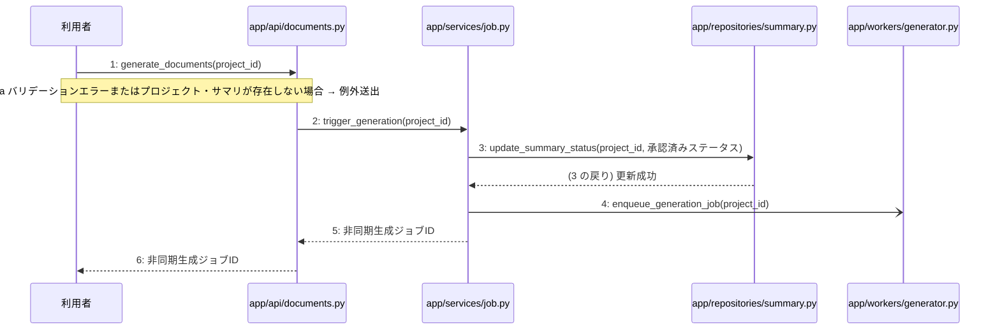

> ⚠ この単位には「未定義・要決定」が 4 件残っています(最重要 4 件)。決めてから渡すことを勧めます。

あなたは実装担当者です。以下の設計情報に従って実装してください。

## プロジェクト概要

Devex: 段階7のマイルストーン M-01〜M-04 を実装する。今回はそのうち、M-03(非同期設計書生成とジョブ管理機能の実装)の単位 M-03-T01 だけを扱う。

## 実装ルール

- モジュールは、段階4のモジュール一覧の依存先にだけ依存する(層を飛び越さない)。

### 07章 横断事項

| 項目 | 方針 | 関わるファイル(例) |
|---|---|---|
| 例外と HTTP | システム内で発生した例外は、APIエンドポイント層において共通の例外ハンドラーで捕捉する。バリデーションエラーは 400 Bad Request、認証エラーは 401 Unauthorized、リソースが存在しない場合は 404 Not Found、予期せぬサーバーエラーは 500 Internal Server Error を返却する。 | app/main.py, app/api/auth.py, app/api/projects.py, app/api/documents.py |
| 認証 | クライアントのリクエスト認証には JWT を使用し、有効期限は『(要決定)』とする。認証が必要なすべてのエンドポイントにおいて、リクエストヘッダーに含まれる Bearer トークンの検証を必須とする。 | app/api/auth.py, app/services/auth.py, app/repositories/user.py |
| トランザクション | 複数のリポジトリ操作やデータベースの書き込みを伴う一連のビジネスロジックは、ユースケース層において単一のトランザクションとして実行する。トランザクション内でエラーが発生した場合は自動的にロールバックを行う。 | app/services/auth.py, app/services/project.py, app/services/chat.py, app/services/summary.py, app/services/job.py, app/services/document.py |
| ログ | すべてのAPIリクエストおよびレスポンス、エラー発生時には構造化ログを出力する。ログにはタイムスタンプ、ユーザーID、処理ID、リクエストパス、ステータスコード、エラーメッセージを含め、個人情報やパスワードハッシュは出力しない。 | app/main.py, app/api/auth.py, app/api/projects.py, app/api/documents.py |
| 非同期処理 | 構造化サマリ承認後の4種設計書の順次生成や文書の再生成は、Celeryを用いたバックグラウンドの非同期ジョブとして実行する。ジョブの実行状態や進捗ステータスは適宜データベースに記録し、API経由で確認できるようにする。 | app/services/job.py, app/workers/generator.py |
| 外部サービスの呼び出し | LLM Providerなどの外部サービスとの通信はすべて外部連携層にカプセル化する。外部API呼び出し時のタイムアウトやレート制限によるエラーを想定し、適切な例外処理と必要に応じたリトライを実装する。 | app/clients/ai.py, app/services/chat.py, app/services/document.py, app/workers/generator.py |

### 段階7 開発環境

DockerおよびDocker Composeによるコンテナ化された開発環境。バックエンドにはPython/FastAPI、データベースにはPostgreSQL、非同期キューイング機構にはCeleryとRedisを採用する。LLM連携にはOpenAI API等の抽象化レイヤーを設け、単体テストおよび結合テストにはpytestを使用する。CI/CDパイプラインにより自動テストとリントを実施する方針とする。

## 今回の実装単位

M-03-T01 構造化サマリ承認と設計書非同期生成トリガー機能の実装(種別: 機能 / 処理: F-09)

目的: 利用者がプロジェクトの構造化サマリを承認し、4種設計書の非同期生成ジョブをバックグラウンドで起動できるようになる。

前提: M-02-T06 まで実装済み

## 作成・変更するファイル(依存順)

| ファイル | 種類 | 責務 |
|---|---|---|
| `app/repositories/summary.py` | モジュール | summariesテーブルに対するサマリのステータス更新を行う |
| `app/workers/generator.py` | モジュール | Celery非同期キューに4種設計書の一括生成ジョブを登録する |
| `app/services/job.py` | モジュール | サマリのステータス更新と非同期生成ジョブの登録を単一のトランザクションとして制御する |
| `app/api/documents.py` | モジュール | 構造化サマリ承認・設計書非同期生成トリガーのエンドポイントを提供する |

実装の要点:

- 手順 3 のデータベース更新と手順 4 の Celery ジョブ登録は、サービス層にて単一のトランザクションとして確実に処理する
- 依存される順序として、リポジトリ層(summary.py)・ワーカー層(generator.py)・サービス層(job.py)・API層(documents.py)の順に実装する

## 参照する設計

### 段階5 F-09 構造化サマリ承認・設計書非同期生成トリガー

トリガー: POST /api/v1/projects/{id}/generate

| No | 呼び出し元 → 呼び出し先 | 種別 | 関数 | 渡すデータ | 処理内容 | 結果 | DB 操作 | 分岐・例外 |
|---|---|---|---|---|---|---|---|---|
| 1 | 利用者 → app/api/documents.py | 同期 | generate_documents | project_id | 構造化サマリ承認・設計書非同期生成トリガーのエンドポイントにリクエストを送信する | 非同期生成ジョブID | — | 1a へ |
| 1a | — | — | — | リクエストデータ | バリデーションエラーまたはプロジェクト・サマリが存在しない場合 | 400 Bad Request または 404 Not Found | — | 例外送出 |
| 2 | app/api/documents.py → app/services/job.py | 同期 | trigger_generation | project_id | ジョブサービスのサマリ承認と非同期生成トリガー処理を呼び出す | 非同期生成ジョブID | — | — |
| 3 | app/services/job.py → app/repositories/summary.py | 同期 | update_summary_status | project_id, 承認済みステータス | summariesテーブルのサマリを承認済みに更新する | 更新成功 | summaries U | — |
| 4 | app/services/job.py → app/workers/generator.py | 非同期 | enqueue_generation_job | project_id | 4種設計書の一括生成ジョブをCelery非同期キューに登録する | 非同期生成ジョブID | — | — |
| 5 | app/services/job.py → app/api/documents.py | 戻り | — | 非同期生成ジョブID | 非同期生成ジョブIDを返す | 非同期生成ジョブID | — | — |
| 6 | app/api/documents.py → 利用者 | 戻り | — | 非同期生成ジョブID | レスポンスとして非同期生成ジョブIDを返す | 非同期生成ジョブID | — | — |

注記: 手順 3〜4 が1つのトランザクション

シーケンス図(手順の表から導いた図。直すのは表):

- 段階6 generate_documents(`app/api/documents.py`): 設計にありません

- 段階6 trigger_generation(`app/services/job.py`): 設計にありません

- 段階6 update_summary_status(`app/repositories/summary.py`): 設計にありません

- 段階6 enqueue_generation_job(`app/workers/generator.py`): 設計にありません

- 段階4 `app/api/documents.py`(入口): サマリ・設計書・ジョブ・版管理に関するAPIエンドポイントの受け皿とリクエスト検証を行う / 依存先: app/services/summary.py, app/services/document.py, app/services/job.py

- 段階4 `app/services/job.py`(ユースケース): 構造化サマリ承認・設計書非同期生成トリガーおよび非同期生成ジョブの進捗ステータス確認を制御する / 依存先: app/repositories/summary.py, app/workers/generator.py

- 段階4 `app/repositories/summary.py`(永続化): summariesテーブルに対するPostgreSQLのCRUD操作を行う / 依存先: PostgreSQL

- 段階4 `app/workers/generator.py`(ユースケース): バックグラウンドで4種設計書の順次生成や再生成の非同期ジョブを処理する / 依存先: app/repositories/document.py, app/clients/ai.py, Celery

## テスト観点

| # | 観点 | SUT | ドライバ | スタブ |
|---|---|---|---|---|
| TC-01 | 有効なプロジェクトIDでリクエストされた場合にサマリが承認済みに更新され非同期生成ジョブIDが返却されること | generate_documents | 結合テスト(pytest) | app/workers/generator.pyのenqueue_generation_jobをモック化してジョブIDの返却をスタブする |
| TC-02 | 存在しないプロジェクトIDまたはバリデーションエラーの場合に適切なエラーレスポンスが返却されること | generate_documents | 結合テスト(pytest) | スタブ不要 ── データベースとバリデーション機構を利用する |

- Given: 対象のプロジェクトと構造化サマリが存在しているとき
- When: 構造化サマリ承認・設計書非同期生成トリガーのエンドポイントにリクエストを送信すると
- Then: サマリが承認済みステータスに更新され非同期生成ジョブIDが返却されること

## 完了条件

- この単位のテストが全件成功する
- 既存のテストが壊れていない
- lint・型チェックが成功する
- (テーブルを変える単位)マイグレーションの適用が成功する
- 開発環境で起動し、確認方法の操作ができる
- 確認方法: pytestを用いた結合テストを実行し、テストがすべて成功することを確認する
- 確認方法: APIエンドポイントに対してHTTPリクエストを送信し、非同期生成ジョブIDが正しく返却されることを確認する

## 未定義・要決定(決まるまで、推測で実装しないこと)

- [最重要] 段階6 generate_documents(app/api/documents.py): 段階6の詳細設計が記載されていないため、リクエストデータのバリデーション仕様および返却するジョブIDのデータ構造やレスポンス形式が不明である。
- [最重要] 段階6 trigger_generation(app/services/job.py): 段階6の詳細設計が記載されていないため、承認済みステータスの具体的な値や、トランザクション境界の詳細なエラーハンドリング方針が不明である。
- [最重要] 段階6 update_summary_status(app/repositories/summary.py): 段階6の詳細設計が記載されていないため、summariesテーブルのどの列をどのような値に更新するかの詳細が不明である。
- [最重要] 段階6 enqueue_generation_job(app/workers/generator.py): 段階6の詳細設計が記載されていないため、Celeryキューへ登録する際のタスク名や引数の構造が不明である。

## 制約

- 既存の API を変更しない。
- 設計に無いことを推測で決めない。

まず現在のリポジトリを調査し、既存実装との整合性を確認してください。不整合がある場合は実装せず、問題点を報告してください。
