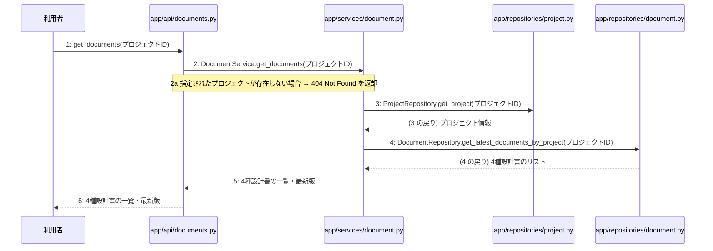

> ⚠ この単位には「未定義・要決定」が 1 件残っています(最重要 0 件)。決めてから渡すことを勧めます。

あなたは実装担当者です。以下の設計情報に従って実装してください。

## プロジェクト概要

Devex: 段階7のマイルストーン M-01〜M-04 を実装する。今回はそのうち、M-03(非同期設計書生成とジョブ管理機能の実装)の単位 M-03-T03 だけを扱う。

## 実装ルール

- モジュールは、段階4のモジュール一覧の依存先にだけ依存する(層を飛び越さない)。

### 07章 横断事項

| 項目 | 方針 | 関わるファイル(例) |
|---|---|---|
| 例外と HTTP | システム内で発生した例外は、APIエンドポイント層において共通の例外ハンドラーで捕捉する。バリデーションエラーは 400 Bad Request、認証エラーは 401 Unauthorized、リソースが存在しない場合は 404 Not Found、予期せぬサーバーエラーは 500 Internal Server Error を返却する。 | app/main.py, app/api/auth.py, app/api/projects.py, app/api/documents.py |
| 認証 | クライアントのリクエスト認証には JWT を使用し、有効期限は『(要決定)』とする。認証が必要なすべてのエンドポイントにおいて、リクエストヘッダーに含まれる Bearer トークンの検証を必須とする。 | app/api/auth.py, app/services/auth.py, app/repositories/user.py |
| トランザクション | 複数のリポジトリ操作やデータベースの書き込みを伴う一連のビジネスロジックは、ユースケース層において単一のトランザクションとして実行する。トランザクション内でエラーが発生した場合は自動的にロールバックを行う。 | app/services/auth.py, app/services/project.py, app/services/chat.py, app/services/summary.py, app/services/job.py, app/services/document.py |
| ログ | すべてのAPIリクエストおよびレスポンス、エラー発生時には構造化ログを出力する。ログにはタイムスタンプ、ユーザーID、処理ID、リクエストパス、ステータスコード、エラーメッセージを含め、個人情報やパスワードハッシュは出力しない。 | app/main.py, app/api/auth.py, app/api/projects.py, app/api/documents.py |
| 非同期処理 | 構造化サマリ承認後の4種設計書の順次生成や文書の再生成は、Celeryを用いたバックグラウンドの非同期ジョブとして実行する。ジョブの実行状態や進捗ステータスは適宜データベースに記録し、API経由で確認できるようにする。 | app/services/job.py, app/workers/generator.py |
| 外部サービスの呼び出し | LLM Providerなどの外部サービスとの通信はすべて外部連携層にカプセル化する。外部API呼び出し時のタイムアウトやレート制限によるエラーを想定し、適切な例外処理と必要に応じたリトライを実装する。 | app/clients/ai.py, app/services/chat.py, app/services/document.py, app/workers/generator.py |

### 段階7 開発環境

DockerおよびDocker Composeによるコンテナ化された開発環境。バックエンドにはPython/FastAPI、データベースにはPostgreSQL、非同期キューイング機構にはCeleryとRedisを採用する。LLM連携にはOpenAI API等の抽象化レイヤーを設け、単体テストおよび結合テストにはpytestを使用する。CI/CDパイプラインにより自動テストとリントを実施する方針とする。

## 今回の実装単位

M-03-T03 生成された4種設計書の一覧・最新版取得機能の実装(種別: 機能 / 処理: F-11)

目的: 指定されたプロジェクトに紐づく生成された4種設計書の一覧と最新版を取得できるようにする。

前提: M-03-T02 まで実装済み

## 作成・変更するファイル(依存順)

| ファイル | 種類 | 責務 |
|---|---|---|
| `app/repositories/project.py` | モジュール | プロジェクトの存在確認のためのデータベース参照を行う |
| `app/repositories/document.py` | モジュール | 指定されたプロジェクトの4種設計書の最新版一覧をデータベースから取得する |
| `app/services/document.py` | モジュール | プロジェクトの存在確認と設計書一覧取得のビジネスロジックを制御する |
| `app/api/documents.py` | モジュール | 4種設計書の一覧・最新版取得APIのリクエストを受信しビジネスロジックを呼び出す |

実装の要点:

- 依存関係に従い、リポジトリ層、サービス層、API層の順に実装を行う。

## 参照する設計

### 段階5 F-11 生成された4種設計書の一覧・最新版取得

トリガー: GET /api/v1/projects/{id}/documents

| No | 呼び出し元 → 呼び出し先 | 種別 | 関数 | 渡すデータ | 処理内容 | 結果 | DB 操作 | 分岐・例外 |
|---|---|---|---|---|---|---|---|---|
| 1 | 利用者 → app/api/documents.py | 同期 | get_documents | プロジェクトID | 4種設計書の一覧・最新版取得APIのリクエストを受信する | バリデーション済みのプロジェクトID | — | — |
| 2 | app/api/documents.py → app/services/document.py | 同期 | DocumentService.get_documents | プロジェクトID | 設計書一覧および最新版の取得ビジネスロジックを呼び出す | 4種設計書の一覧・最新版 | — | 1a へ |
| 2a | — | — | — | プロジェクトID | 指定されたプロジェクトが存在しない場合 | NotFoundError | — | 404 Not Found を返却 |
| 3 | app/services/document.py → app/repositories/project.py | 同期 | ProjectRepository.get_project | プロジェクトID | プロジェクトの存在確認を行う | プロジェクト情報 | projects R | — |
| 4 | app/services/document.py → app/repositories/document.py | 同期 | DocumentRepository.get_latest_documents_by_project | プロジェクトID | 生成された4種設計書の最新版一覧を取得する | 4種設計書のリスト | documents R | — |
| 5 | app/services/document.py → app/api/documents.py | 戻り | — | 4種設計書の一覧・最新版 | 取得した設計書一覧をAPI層へ返す | 4種設計書の一覧・最新版 | — | — |
| 6 | app/api/documents.py → 利用者 | 戻り | — | 4種設計書の一覧・最新版 | APIレスポンスとして結果を返却する | HTTP 200 OK と4種設計書の一覧・最新版 | — | — |

注記: トランザクションは使用せず、参照系クエリを順次実行する

シーケンス図(手順の表から導いた図。直すのは表):

- 段階6 get_documents(`app/api/documents.py`): 設計にありません

- 段階6 DocumentService.get_documents(`app/services/document.py`): 設計にありません

- 段階6 ProjectRepository.get_project(`app/repositories/project.py`): 設計にありません

- 段階6 DocumentRepository.get_latest_documents_by_project(`app/repositories/document.py`): 設計にありません

- 段階4 `app/api/documents.py`(入口): サマリ・設計書・ジョブ・版管理に関するAPIエンドポイントの受け皿とリクエスト検証を行う / 依存先: app/services/summary.py, app/services/document.py, app/services/job.py

- 段階4 `app/services/document.py`(ユースケース): 参考資料アップロード、設計書取得、版一覧取得、文書再生成、自己診断結果取得のビジネスロジックを制御する / 依存先: app/repositories/document.py, app/clients/ai.py

- 段階4 `app/repositories/project.py`(永続化): projectsテーブルに対するPostgreSQLのCRUD操作を行う / 依存先: PostgreSQL

- 段階4 `app/repositories/document.py`(永続化): documentsテーブルに対するPostgreSQLのCRUD操作を行う / 依存先: PostgreSQL

## テスト観点

| # | 観点 | SUT | ドライバ | スタブ |
|---|---|---|---|---|
| TC-01 | 指定したプロジェクトの4種設計書の一覧・最新版が正常に取得できること | app/api/documents.py の get_documents | pytestによる結合テスト | スタブ不要 ── 実際のデータベースおよびリポジトリを使用する |

- Given: 指定されたプロジェクトが存在し、4種設計書が生成されている
- When: GET /api/v1/projects/{id}/documents を実行する
- Then: HTTP 200 OK と4種設計書の一覧・最新版が返却される

## 完了条件

- この単位のテストが全件成功する
- 既存のテストが壊れていない
- lint・型チェックが成功する
- (テーブルを変える単位)マイグレーションの適用が成功する
- 開発環境で起動し、確認方法の操作ができる
- 確認方法: pytestを実行し、F-11のテストケースが成功することを確認する。

## 未定義・要決定(決まるまで、推測で実装しないこと)

- [中程度] 段階6 get_documents: 段階6の処理詳細が設計に記載されていないため、具体的なクエリ条件やレスポンスフォーマットの詳細は既存実装やモデル定義に従って実装する。

## 制約

- 既存の API を変更しない。
- 設計に無いことを推測で決めない。

まず現在のリポジトリを調査し、既存実装との整合性を確認してください。不整合がある場合は実装せず、問題点を報告してください。
