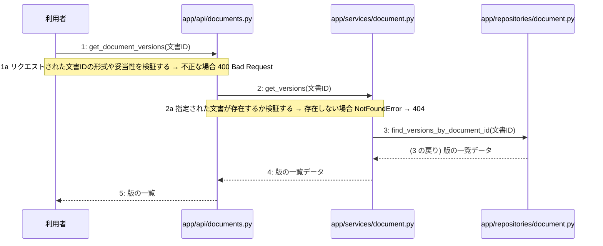

> ⚠ この単位には「未定義・要決定」が 3 件残っています(最重要 3 件)。決めてから渡すことを勧めます。

あなたは実装担当者です。以下の設計情報に従って実装してください。

## プロジェクト概要

Devex: 段階7のマイルストーン M-01〜M-04 を実装する。今回はそのうち、M-04(設計書の自己診断、版管理、および再生成機能の実装)の単位 M-04-T01 だけを扱う。

## 実装ルール

- モジュールは、段階4のモジュール一覧の依存先にだけ依存する(層を飛び越さない)。

### 07章 横断事項

| 項目 | 方針 | 関わるファイル(例) |
|---|---|---|
| 例外と HTTP | システム内で発生した例外は、APIエンドポイント層において共通の例外ハンドラーで捕捉する。バリデーションエラーは 400 Bad Request、認証エラーは 401 Unauthorized、リソースが存在しない場合は 404 Not Found、予期せぬサーバーエラーは 500 Internal Server Error を返却する。 | app/main.py, app/api/auth.py, app/api/projects.py, app/api/documents.py |
| 認証 | クライアントのリクエスト認証には JWT を使用し、有効期限は『(要決定)』とする。認証が必要なすべてのエンドポイントにおいて、リクエストヘッダーに含まれる Bearer トークンの検証を必須とする。 | app/api/auth.py, app/services/auth.py, app/repositories/user.py |
| トランザクション | 複数のリポジトリ操作やデータベースの書き込みを伴う一連のビジネスロジックは、ユースケース層において単一のトランザクションとして実行する。トランザクション内でエラーが発生した場合は自動的にロールバックを行う。 | app/services/auth.py, app/services/project.py, app/services/chat.py, app/services/summary.py, app/services/job.py, app/services/document.py |
| ログ | すべてのAPIリクエストおよびレスポンス、エラー発生時には構造化ログを出力する。ログにはタイムスタンプ、ユーザーID、処理ID、リクエストパス、ステータスコード、エラーメッセージを含め、個人情報やパスワードハッシュは出力しない。 | app/main.py, app/api/auth.py, app/api/projects.py, app/api/documents.py |
| 非同期処理 | 構造化サマリ承認後の4種設計書の順次生成や文書の再生成は、Celeryを用いたバックグラウンドの非同期ジョブとして実行する。ジョブの実行状態や進捗ステータスは適宜データベースに記録し、API経由で確認できるようにする。 | app/services/job.py, app/workers/generator.py |
| 外部サービスの呼び出し | LLM Providerなどの外部サービスとの通信はすべて外部連携層にカプセル化する。外部API呼び出し時のタイムアウトやレート制限によるエラーを想定し、適切な例外処理と必要に応じたリトライを実装する。 | app/clients/ai.py, app/services/chat.py, app/services/document.py, app/workers/generator.py |

### 段階7 開発環境

DockerおよびDocker Composeによるコンテナ化された開発環境。バックエンドにはPython/FastAPI、データベースにはPostgreSQL、非同期キューイング機構にはCeleryとRedisを採用する。LLM連携にはOpenAI API等の抽象化レイヤーを設け、単体テストおよび結合テストにはpytestを使用する。CI/CDパイプラインにより自動テストとリントを実施する方針とする。

## 今回の実装単位

M-04-T01 指定文書の版一覧取得機能の実装(種別: 機能 / 処理: F-12)

目的: 指定された文書の版一覧を取得するAPIエンドポイント、サービス、およびリポジトリを実装し、版の一覧を取得できるようにする。

前提: M-03-T03 まで実装済み

## 作成・変更するファイル(依存順)

| ファイル | 種類 | 責務 |
|---|---|---|
| `app/repositories/document.py` | モジュール | PostgreSQLのdocumentsテーブルから直近3件の版の一覧データを取得する |
| `app/services/document.py` | モジュール | 指定された文書が存在するか検証し、リポジトリを呼び出して版の一覧を取得するビジネスロジックを制御する |
| `app/api/documents.py` | モジュール | 文書IDの形式や妥当性を検証し、サービスを呼び出してHTTP 200 OKと版の一覧をレスポンスとして返す |

実装の要点:

- 依存される順にリポジトリ層、サービス層、API層の順で実装を行う
- 既存のデータベース接続および共通例外ハンドラーを再利用する

## 参照する設計

### 段階5 F-12 指定文書の版一覧取得

トリガー: GET /api/v1/documents/{id}/versions

| No | 呼び出し元 → 呼び出し先 | 種別 | 関数 | 渡すデータ | 処理内容 | 結果 | DB 操作 | 分岐・例外 |
|---|---|---|---|---|---|---|---|---|
| 1 | 利用者 → app/api/documents.py | 同期 | get_document_versions | 文書ID | 文書の版一覧取得リクエストを受信する | 版の一覧 | — | 1a へ |
| 1a | — | — | — | 文書ID | リクエストされた文書IDの形式や妥当性を検証する | 検証結果 | — | 不正な場合 400 Bad Request |
| 2 | app/api/documents.py → app/services/document.py | 同期 | get_versions | 文書ID | 文書の版一覧取得ビジネスロジックを呼び出す | 版の一覧 | — | 2a へ |
| 2a | — | — | — | 文書ID | 指定された文書が存在するか検証する | 存在確認結果 | documents R | 存在しない場合 NotFoundError → 404 |
| 3 | app/services/document.py → app/repositories/document.py | 同期 | find_versions_by_document_id | 文書ID | PostgreSQLから直近3件の版の一覧を取得するリポジトリを呼び出す | 版の一覧データ | documents R | — |
| 4 | app/services/document.py → app/api/documents.py | 戻り | — | 版の一覧データ | 取得した版の一覧を呼び出し元へ返す | 版の一覧 | — | — |
| 5 | app/api/documents.py → 利用者 | 戻り | — | 版の一覧 | 版の一覧をレスポンスとして返す | HTTP 200 OK と版の一覧 | — | — |

シーケンス図(手順の表から導いた図。直すのは表):

- 段階6 get_document_versions(`app/api/documents.py`): 設計にありません

- 段階6 get_versions(`app/services/document.py`): 設計にありません

- 段階6 find_versions_by_document_id(`app/repositories/document.py`): 設計にありません

- 段階4 `app/api/documents.py`(入口): サマリ・設計書・ジョブ・版管理に関するAPIエンドポイントの受け皿とリクエスト検証を行う / 依存先: app/services/summary.py, app/services/document.py, app/services/job.py

- 段階4 `app/services/document.py`(ユースケース): 参考資料アップロード、設計書取得、版一覧取得、文書再生成、自己診断結果取得のビジネスロジックを制御する / 依存先: app/repositories/document.py, app/clients/ai.py

- 段階4 `app/repositories/document.py`(永続化): documentsテーブルに対するPostgreSQLのCRUD操作を行う / 依存先: PostgreSQL

## テスト観点

| # | 観点 | SUT | ドライバ | スタブ |
|---|---|---|---|---|
| TC-01 | 正常系: 指定された文書の直近3件の版の一覧が取得できること | app.api.documents.get_document_versions | pytestによるAPI結合テスト | スタブ不要 ── 実データベースまたはテスト用セッションを使用 |
| TC-02 | 異常系: 存在しない文書IDを指定した場合に404 Not Foundが返ること | app.api.documents.get_document_versions | pytestによるAPI結合テスト | スタブ不要 ── 実データベースを使用 |
| TC-03 | 異常系: 不正な形式の文書IDを指定した場合に400 Bad Requestが返ること | app.api.documents.get_document_versions | pytestによるAPI結合テスト | スタブ不要 |

- Given 存在する文書IDと複数の版データがデータベースに登録されているとき When GET /api/v1/documents/{id}/versions を呼び出す Then HTTP 200 OK と版の一覧が返される
- Given 存在しない文書IDを指定したとき When GET /api/v1/documents/{id}/versions を呼び出す Then 404 Not Found が返される

## 完了条件

- この単位のテストが全件成功する
- 既存のテストが壊れていない
- lint・型チェックが成功する
- (テーブルを変える単位)マイグレーションの適用が成功する
- 開発環境で起動し、確認方法の操作ができる
- 確認方法: pytestを実行し、版一覧取得に関するすべてのテストケースが成功することを確認する

## 未定義・要決定(決まるまで、推測で実装しないこと)

- [最重要] 段階6 get_document_versions: 段階6の詳細ロジックが定義されておらず、どのような形式やバリデーションルールで文書IDを検証すべきか不明である。
- [最重要] 段階6 get_versions: 段階6の詳細ロジックが定義されておらず、存在確認の具体的な条件やエラー送出仕様が不明である。
- [最重要] 段階6 find_versions_by_document_id: 段階6の詳細ロジックが定義されておらず、直近3件を絞り込むためのソート条件や抽出クエリの仕様が不明である。

## 制約

- 既存の API を変更しない。
- 設計に無いことを推測で決めない。

まず現在のリポジトリを調査し、既存実装との整合性を確認してください。不整合がある場合は実装せず、問題点を報告してください。
