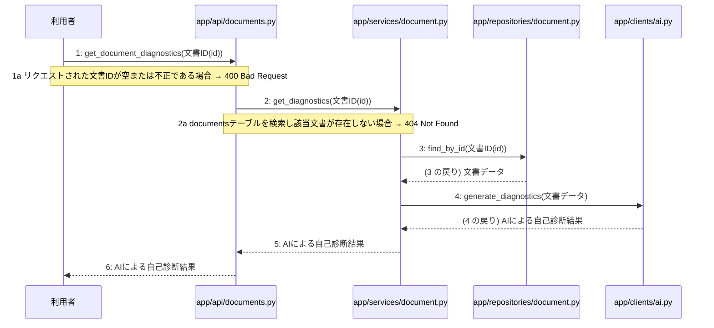

> ⚠ この単位には「未定義・要決定」が 4 件残っています(最重要 4 件)。決めてから渡すことを勧めます。

あなたは実装担当者です。以下の設計情報に従って実装してください。

## プロジェクト概要

Devex: 段階7のマイルストーン M-01〜M-04 を実装する。今回はそのうち、M-04(設計書の自己診断、版管理、および再生成機能の実装)の単位 M-04-T03 だけを扱う。

## 実装ルール

- モジュールは、段階4のモジュール一覧の依存先にだけ依存する(層を飛び越さない)。

### 07章 横断事項

| 項目 | 方針 | 関わるファイル(例) |
|---|---|---|
| 例外と HTTP | システム内で発生した例外は、APIエンドポイント層において共通の例外ハンドラーで捕捉する。バリデーションエラーは 400 Bad Request、認証エラーは 401 Unauthorized、リソースが存在しない場合は 404 Not Found、予期せぬサーバーエラーは 500 Internal Server Error を返却する。 | app/main.py, app/api/auth.py, app/api/projects.py, app/api/documents.py |
| 認証 | クライアントのリクエスト認証には JWT を使用し、有効期限は『(要決定)』とする。認証が必要なすべてのエンドポイントにおいて、リクエストヘッダーに含まれる Bearer トークンの検証を必須とする。 | app/api/auth.py, app/services/auth.py, app/repositories/user.py |
| トランザクション | 複数のリポジトリ操作やデータベースの書き込みを伴う一連のビジネスロジックは、ユースケース層において単一のトランザクションとして実行する。トランザクション内でエラーが発生した場合は自動的にロールバックを行う。 | app/services/auth.py, app/services/project.py, app/services/chat.py, app/services/summary.py, app/services/job.py, app/services/document.py |
| ログ | すべてのAPIリクエストおよびレスポンス、エラー発生時には構造化ログを出力する。ログにはタイムスタンプ、ユーザーID、処理ID、リクエストパス、ステータスコード、エラーメッセージを含め、個人情報やパスワードハッシュは出力しない。 | app/main.py, app/api/auth.py, app/api/projects.py, app/api/documents.py |
| 非同期処理 | 構造化サマリ承認後の4種設計書の順次生成や文書の再生成は、Celeryを用いたバックグラウンドの非同期ジョブとして実行する。ジョブの実行状態や進捗ステータスは適宜データベースに記録し、API経由で確認できるようにする。 | app/services/job.py, app/workers/generator.py |
| 外部サービスの呼び出し | LLM Providerなどの外部サービスとの通信はすべて外部連携層にカプセル化する。外部API呼び出し時のタイムアウトやレート制限によるエラーを想定し、適切な例外処理と必要に応じたリトライを実装する。 | app/clients/ai.py, app/services/chat.py, app/services/document.py, app/workers/generator.py |

### 段階7 開発環境

DockerおよびDocker Composeによるコンテナ化された開発環境。バックエンドにはPython/FastAPI、データベースにはPostgreSQL、非同期キューイング機構にはCeleryとRedisを採用する。LLM連携にはOpenAI API等の抽象化レイヤーを設け、単体テストおよび結合テストにはpytestを使用する。CI/CDパイプラインにより自動テストとリントを実施する方針とする。

## 今回の実装単位

M-04-T03 AIによる自己診断結果取得機能の実装(種別: 機能 / 処理: F-14)

目的: 利用者が指定した文書の自己診断結果をAIにより取得し返却できるようにする。

前提: M-04-T02 まで実装済み

## 作成・変更するファイル(依存順)

| ファイル | 種類 | 責務 |
|---|---|---|
| `app/repositories/document.py` | モジュール | documentsテーブルから文書データを取得して存在確認を行う |
| `app/clients/ai.py` | モジュール | LLM Providerを呼び出して不足点を3段階で診断する |
| `app/services/document.py` | モジュール | 自己診断結果取得のビジネスロジックを制御する |
| `app/api/documents.py` | モジュール | 自己診断結果取得APIのリクエストを受け付け検証と応答を行う |

実装の要点:

- 依存関係に従い永続化層、外部連携層、ユースケース層、API層の順に実装する。

## 参照する設計

### 段階5 F-14 AIによる自己診断結果取得

トリガー: GET /api/v1/documents/{id}/diagnostics

| No | 呼び出し元 → 呼び出し先 | 種別 | 関数 | 渡すデータ | 処理内容 | 結果 | DB 操作 | 分岐・例外 |
|---|---|---|---|---|---|---|---|---|
| 1 | 利用者 → app/api/documents.py | 同期 | get_document_diagnostics | 文書ID(id) | 自己診断結果取得APIのリクエストを受け付ける | リクエストパラメータ | — | F-14a へ |
| 1a | — | — | — | 文書ID(id) | リクエストされた文書IDが空または不正である場合 | バリデーションエラー | — | 400 Bad Request |
| 2 | app/api/documents.py → app/services/document.py | 同期 | get_diagnostics | 文書ID(id) | 自己診断結果取得ビジネスロジックを呼び出す | AI診断結果データ | — | F-14b へ |
| 2a | — | — | — | 文書ID(id) | documentsテーブルを検索し該当文書が存在しない場合 | NotFoundError | documents R | 404 Not Found |
| 3 | app/services/document.py → app/repositories/document.py | 同期 | find_by_id | 文書ID(id) | 対象文書の存在を検証するためにデータを取得する | 文書データ | documents R | — |
| 4 | app/services/document.py → app/clients/ai.py | 同期 | generate_diagnostics | 文書データ | LLM Providerを呼び出して不足点を3段階で診断する | AIによる自己診断結果 | — | — |
| 5 | app/services/document.py → app/api/documents.py | 戻り | — | AIによる自己診断結果 | 自己診断結果をAPI層へ返す | AIによる自己診断結果 | — | — |
| 6 | app/api/documents.py → 利用者 | 戻り | — | AIによる自己診断結果 | 自己診断結果を返却する | AIによる自己診断結果(200 OK) | — | — |

シーケンス図(手順の表から導いた図。直すのは表):

- 段階6 get_document_diagnostics(`app/api/documents.py`): 設計にありません

- 段階6 get_diagnostics(`app/services/document.py`): 設計にありません

- 段階6 find_by_id(`app/repositories/document.py`): 設計にありません

- 段階6 generate_diagnostics(`app/clients/ai.py`): 設計にありません

- 段階4 `app/api/documents.py`(入口): サマリ・設計書・ジョブ・版管理に関するAPIエンドポイントの受け皿とリクエスト検証を行う / 依存先: app/services/summary.py, app/services/document.py, app/services/job.py

- 段階4 `app/services/document.py`(ユースケース): 参考資料アップロード、設計書取得、版一覧取得、文書再生成、自己診断結果取得のビジネスロジックを制御する / 依存先: app/repositories/document.py, app/clients/ai.py

- 段階4 `app/clients/ai.py`(外部連携): LLM Providerとの通信やプロンプト管理を行いAIモデルの差異を抽象化する / 依存先: OpenAI

- 段階4 `app/repositories/document.py`(永続化): documentsテーブルに対するPostgreSQLのCRUD操作を行う / 依存先: PostgreSQL

## テスト観点

| # | 観点 | SUT | ドライバ | スタブ |
|---|---|---|---|---|
| TC-01 | 正常系: 指定した文書のAI自己診断結果が正常に取得できること | get_document_diagnostics | API結合テスト(pytest) | app/clients/ai.pyをスタブ化し固定のAI診断結果を返す |
| TC-02 | 異常系: 存在しない文書IDを指定した場合に404エラーとなること | get_document_diagnostics | API結合テスト(pytest) | スタブ不要 ── データベース層の検証を利用 |

- Given 存在する文書IDが指定されている When 自己診断結果取得APIを呼び出す Then AIによる自己診断結果が返却される

## 完了条件

- この単位のテストが全件成功する
- 既存のテストが壊れていない
- lint・型チェックが成功する
- (テーブルを変える単位)マイグレーションの適用が成功する
- 開発環境で起動し、確認方法の操作ができる
- 確認方法: pytestを実行しすべてのテストが成功することを確認する。

## 未定義・要決定(決まるまで、推測で実装しないこと)

- [最重要] 段階6 get_document_diagnostics(app/api/documents.py): 処理ロジックの詳細(段階6)の設計が記載されていません。
- [最重要] 段階6 get_diagnostics(app/services/document.py): 処理ロジックの詳細(段階6)の設計が記載されていません。
- [最重要] 段階6 find_by_id(app/repositories/document.py): 処理ロジックの詳細(段階6)の設計が記載されていません。
- [最重要] 段階6 generate_diagnostics(app/clients/ai.py): 処理ロジックの詳細(段階6)の設計が記載されていません。

## 制約

- 既存の API を変更しない。
- 設計に無いことを推測で決めない。

まず現在のリポジトリを調査し、既存実装との整合性を確認してください。不整合がある場合は実装せず、問題点を報告してください。
