# 詳細設計書: Devex

## 01 機能(処理)一覧

| 処理ID | 名称 | 種別 | トリガー | 関連画面 | 機能グループ | 概要 |
|---|---|---|---|---|---|---|
| F-01 | 新規ユーザー登録 | API | POST /api/v1/auth/register | SCR-001 | auth | 新規ユーザー登録を行う |
| F-02 | ログイン認証 | API | POST /api/v1/auth/login | SCR-001 | auth | ログイン認証を行いJWTを発行する |
| F-03 | プロジェクト一覧取得 | API | GET /api/v1/projects | SCR-002 | projects | 作成済みプロジェクトの一覧を取得する |
| F-04 | プロジェクト新規作成 | API | POST /api/v1/projects | SCR-002 | projects | プロジェクトを新規作成する |
| F-05 | 参考資料アップロード | API | POST /api/v1/projects/{id}/documents | SCR-003 | documents | プロジェクトの参考資料をアップロードする |
| F-06 | チャット履歴取得 | API | GET /api/v1/projects/{id}/chats | SCR-004 | chats | ヒアリングのチャット履歴を取得する |
| F-07 | ヒアリングチャットメッセージ送信 | API | POST /api/v1/projects/{id}/chats | SCR-004 | chats | ヒアリングチャットのメッセージを送信しAIの応答を取得する |
| F-08 | 構造化サマリ取得 | API | GET /api/v1/projects/{id}/summary | SCR-004 | summary | AIが生成した構造化サマリを取得する |
| F-09 | 構造化サマリ承認・設計書非同期生成トリガー | API+バッチ | POST /api/v1/projects/{id}/generate | SCR-004, SCR-005 | generate | 構造化サマリを承認して4種設計書の非同期一括生成ジョブをトリガーする |
| F-10 | 非同期生成ジョブの進捗ステータス確認 | API | GET /api/v1/projects/{id}/jobs/{jobId} | SCR-005 | jobs | 非同期生成ジョブの進捗ステータスを確認する |
| F-11 | 生成された4種設計書の一覧・最新版取得 | API | GET /api/v1/projects/{id}/documents | SCR-006 | documents | 生成された4種設計書の一覧と最新版を取得する |
| F-12 | 指定文書の版一覧取得 | API | GET /api/v1/documents/{id}/versions | SCR-006 | versions | 指定された文書の版の一覧(直近3件)を取得する |
| F-13 | 追加修正指示による文書再生成 | API+バッチ | POST /api/v1/documents/{id}/regenerate | SCR-006 | regenerate | 追加修正指示に基づいて文書を再生成し新版を作成する |
| F-14 | AIによる自己診断結果取得 | API | GET /api/v1/documents/{id}/diagnostics | SCR-006 | diagnostics | AIによる設計書の自己診断結果を取得する |

## 02 データフロー

### DFD: auth

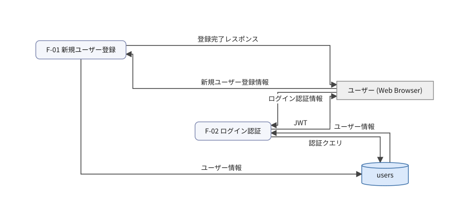

### DFD: projects

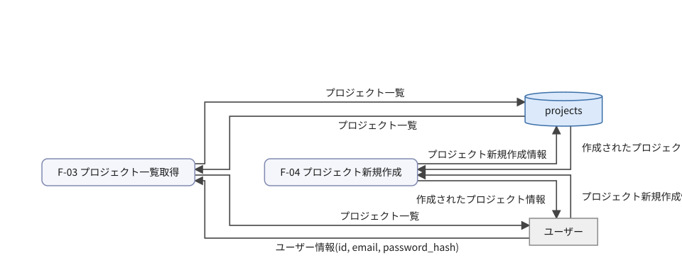

### DFD: documents

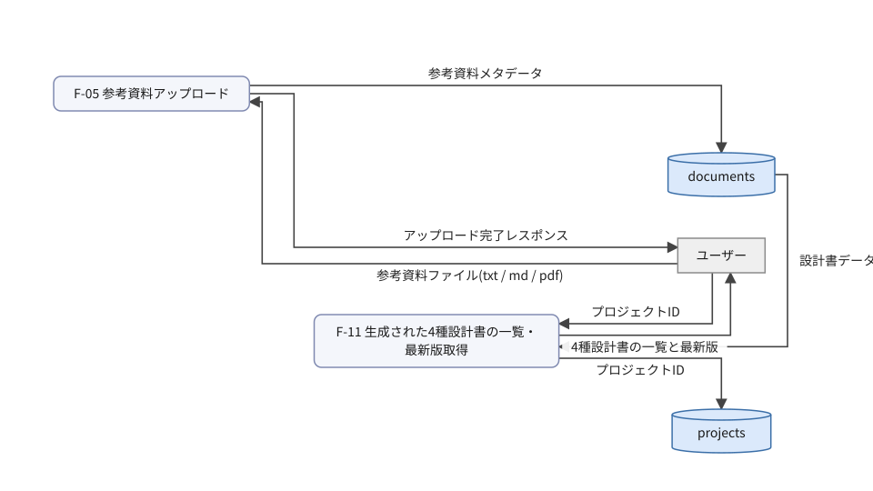

### DFD: chats

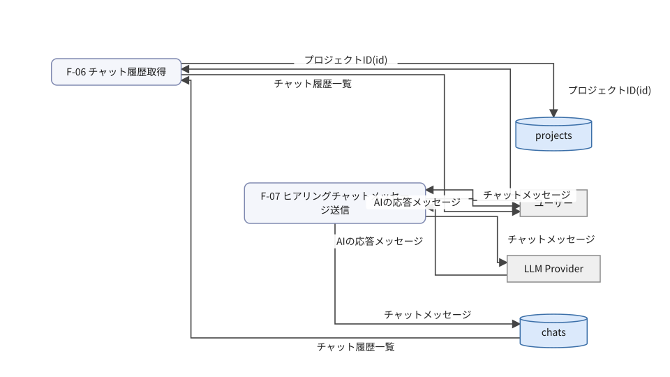

### DFD: summary

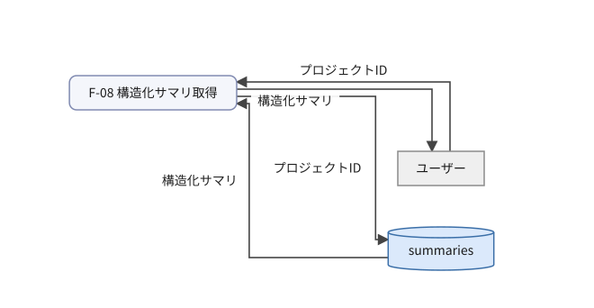

### データ辞書

| データ項目 | フィールド | 使う処理 |
|---|---|---|
| 4種設計書の一覧と最新版 | documents | F-11 |
| AIの応答メッセージ | response | F-07 |
| JWT | token | F-02 |
| JWT(token) | token | — |
| アップロード完了レスポンス | status, message | F-05 |
| チャットメッセージ | message | F-07 |
| チャット履歴一覧 | chats | F-06 |
| プロジェクトID | id | F-11, F-08 |
| プロジェクトID(id) | id | F-06 |
| プロジェクト一覧 | projects | F-03 |
| プロジェクト新規作成情報 | name, description | F-04 |
| ユーザー情報 | id, email, password_hash | F-01, F-02 |
| ユーザー情報(id, email, password_hash) | id, email, password_hash | F-03 |
| ログイン認証情報 | email, password | F-02 |
| 作成されたプロジェクト情報 | id, name, description | F-04 |
| 参考資料ファイル(txt / md / pdf) | file | F-05 |
| 参考資料メタデータ | file_name, file_path | F-05 |
| 新規ユーザー登録情報 | email, password | F-01 |
| 構造化サマリ | summary | F-08 |
| 登録完了レスポンス | status, message | F-01 |
| 設計書データ | document_id, content | F-11 |
| 認証クエリ | email | F-02 |

### 処理概要表(入力 / 処理 / 出力)

| 処理ID | 名称 | 入力 | 処理内容 | 出力 |
|---|---|---|---|---|
| F-01 | 新規ユーザー登録 | 新規ユーザー登録情報 | 入力されたユーザー情報を検証し、重複がないことを判定して、PostgreSQLにユーザー情報を保存する。 | 登録完了レスポンス |
| F-02 | ログイン認証 | ログイン認証情報 | 入力された認証情報を検証し、有効なユーザーであるかを判定して、JWTを発行する。 | JWT |
| F-03 | プロジェクト一覧取得 | ユーザー情報 | リクエスト元のユーザー権限を検証し、PostgreSQLから作成済みプロジェクトの一覧を取得する。 | プロジェクト一覧 |
| F-04 | プロジェクト新規作成 | プロジェクト新規作成情報 | 入力内容を検証し、プロジェクトデータをPostgreSQLに保存する。 | 作成されたプロジェクト情報 |
| F-05 | 参考資料アップロード | 参考資料ファイル(txt / md / pdf) | ファイルの形式と最大3件までの制限を検証し、ストレージにファイルを保存してPostgreSQLにメタデータを記録する。 | アップロード完了レスポンス |
| F-06 | チャット履歴取得 | プロジェクトID | 対象プロジェクトの存在とアクセス権を検証し、PostgreSQLからチャット履歴を取得する。 | チャット履歴一覧 |
| F-07 | ヒアリングチャットメッセージ送信 | チャットメッセージ | 入力内容を検証し、LLM Providerへメッセージを送信してAIの応答を取得し、チャット履歴としてPostgreSQLに保存する。 | AIの応答メッセージ |
| F-08 | 構造化サマリ取得 | プロジェクトID | ヒアリング状況を検証し、AIが生成した構造化サマリをPostgreSQLから取得する。 | 構造化サマリ |
| F-09 | 構造化サマリ承認・設計書非同期生成トリガー | 承認済みの構造化サマリ | サマリの内容を検証し、バックグラウンドの非同期処理キューイング機構に4種設計書の一括生成ジョブを登録する。 | 非同期生成ジョブID |
| F-10 | 非同期生成ジョブの進捗ステータス確認 | ジョブID | ジョブの実行状態を判定し、非同期生成ジョブの進捗ステータスを習得する。 | 進捗ステータス |
| F-11 | 生成された4種設計書の一覧・最新版取得 | プロジェクトID | プロジェクトの存在とアクセス権を検証し、PostgreSQLから生成された4種設計書の一覧と最新版を取得する。 | 4種設計書の一覧と最新版 |
| F-12 | 指定文書の版一覧取得 | 文書ID | 指定された文書の存在を検証し、PostgreSQLから直近3件の版の一覧を取得する。 | 版の一覧(直近3件) |
| F-13 | 追加修正指示による文書再生成 | 追加修正指示 | 追加修正指示を検証し、LLM Providerを呼び出して文書を再生成し、新しい版としてPostgreSQLに保存する(直近3件保持)。 | 再生成された文書の新版 |
| F-14 | AIによる自己診断結果取得 | 文書ID | 対象文書の存在を検証し、LLM Providerを呼び出して不足点を3段階(最重要 / 中程度 / 軽微)で診断した結果を取得する。 | AIによる自己診断結果 |

## 03 データモデル

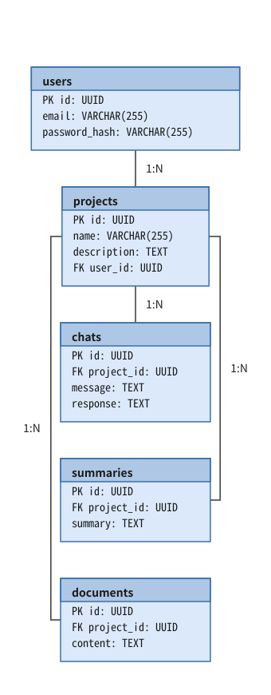

### テーブル定義

#### users

ユーザー情報テーブル

| 列 | 型 | キー | NULL | 制約 | 説明 |
|---|---|---|---|---|---|
| id | UUID | PK | 不可 | — | ユーザーID |
| email | VARCHAR(255) | — | 不可 | UNIQUE | メールアドレス |
| password_hash | VARCHAR(255) | — | 不可 | — | パスワードハッシュ |

#### projects

プロジェクト情報テーブル

| 列 | 型 | キー | NULL | 制約 | 説明 |
|---|---|---|---|---|---|
| id | UUID | PK | 不可 | — | プロジェクトID |
| name | VARCHAR(255) | — | 不可 | — | プロジェクト名 |
| description | TEXT | — | 可 | — | プロジェクト説明 |
| user_id | UUID | FK | 不可 | FK: users(id) ON DELETE CASCADE | 所有者ユーザーID |

#### chats

チャット履歴テーブル

| 列 | 型 | キー | NULL | 制約 | 説明 |
|---|---|---|---|---|---|
| id | UUID | PK | 不可 | — | チャットID |
| project_id | UUID | FK | 不可 | FK: projects(id) ON DELETE CASCADE | プロジェクトID |
| message | TEXT | — | 不可 | — | チャットメッセージ内容 |
| response | TEXT | — | 可 | — | AIの応答メッセージ |

#### summaries

構造化サマリテーブル

| 列 | 型 | キー | NULL | 制約 | 説明 |
|---|---|---|---|---|---|
| id | UUID | PK | 不可 | — | サマリID |
| project_id | UUID | FK | 不可 | FK: projects(id) ON DELETE CASCADE | プロジェクトID |
| summary | TEXT | — | 不可 | — | 構造化サマリ内容 |

#### documents

設計書データテーブル

| 列 | 型 | キー | NULL | 制約 | 説明 |
|---|---|---|---|---|---|
| id | UUID | PK | 不可 | — | 文書ID |
| project_id | UUID | FK | 不可 | FK: projects(id) ON DELETE CASCADE | プロジェクトID |
| content | TEXT | — | 不可 | — | 設計書コンテンツ |

### CRUD 図(処理 × テーブル)

| 処理ID | 名称 | users | projects | chats | summaries | documents |
|---|---|---|---|---|---|---|
| F-01 | 新規ユーザー登録 | C+ | — | — | — | — |
| F-02 | ログイン認証 | RU+ | — | — | — | — |
| F-03 | プロジェクト一覧取得 | — | RU+ | — | — | — |
| F-04 | プロジェクト新規作成 | — | C+R | — | — | — |
| F-05 | 参考資料アップロード | — | — | — | — | C+ |
| F-06 | チャット履歴取得 | — | U+ | R | — | — |
| F-07 | ヒアリングチャットメッセージ送信 | — | — | C+ | — | — |
| F-08 | 構造化サマリ取得 | — | — | — | RU+ | — |
| F-09 | 構造化サマリ承認・設計書非同期生成トリガー | — | — | — | U* | — |
| F-11 | 生成された4種設計書の一覧・最新版取得 | — | U+ | — | — | R |
| F-12 | 指定文書の版一覧取得 | — | — | — | — | R* |
| F-13 | 追加修正指示による文書再生成 | — | — | — | — | C*U* |
| F-14 | AIによる自己診断結果取得 | — | — | — | — | R* |

記号: 印なし = DFD の線から決まる R / `+` = 書き込みは DFD の線から決まり、C/U/D の区別は人が確定 / `*` = DFD に描いていない分で、人が確定

## 04 ソフトウェア構造

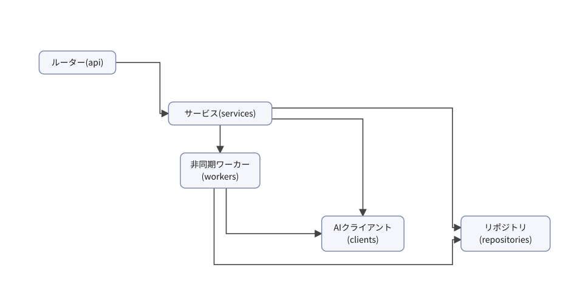

### モジュール一覧

| パス | 層 | 責務 | 主な依存先 | 関わる処理 |
|---|---|---|---|---|
| app/main.py | 入口 | アプリケーションの組み立てを行う | app/api/routers.py, FastAPI | 全処理 |
| app/api/auth.py | 入口 | 認証に関するAPIエンドポイントの受け皿とリクエスト検証を行う | app/services/auth.py | F-01, F-02 |
| app/api/projects.py | 入口 | プロジェクト・参考資料・チャットに関するAPIエンドポイントの受け皿とリクエスト検証を行う | app/services/project.py, app/services/chat.py, app/services/document.py | F-03, F-04, F-05, F-06, F-07 |
| app/api/documents.py | 入口 | サマリ・設計書・ジョブ・版管理に関するAPIエンドポイントの受け皿とリクエスト検証を行う | app/services/summary.py, app/services/document.py, app/services/job.py | F-08, F-09, F-10, F-11, F-12, F-13, F-14 |
| app/services/auth.py | ユースケース | ユーザー登録およびログイン認証のビジネスロジックを制御する | app/repositories/user.py | F-01, F-02 |
| app/services/project.py | ユースケース | プロジェクトの取得および新規作成のビジネスロジックを制御する | app/repositories/project.py | F-03, F-04 |
| app/services/chat.py | ユースケース | チャット履歴の取得およびヒアリングチャットメッセージ送信のビジネスロジックを制御する | app/repositories/chat.py, app/clients/ai.py | F-06, F-07 |
| app/services/summary.py | ユースケース | 構造化サマリの取得に関するビジネスロジックを制御する | app/repositories/summary.py | F-08 |
| app/services/job.py | ユースケース | 構造化サマリ承認・設計書非同期生成トリガーおよび非同期生成ジョブの進捗ステータス確認を制御する | app/repositories/summary.py, app/workers/generator.py | F-09, F-10 |
| app/services/document.py | ユースケース | 参考資料アップロード、設計書取得、版一覧取得、文書再生成、自己診断結果取得のビジネスロジックを制御する | app/repositories/document.py, app/clients/ai.py | F-05, F-11, F-12, F-13, F-14 |
| app/workers/generator.py | ユースケース | バックグラウンドで4種設計書の順次生成や再生成の非同期ジョブを処理する | app/repositories/document.py, app/clients/ai.py, Celery | F-09, F-13 |
| app/clients/ai.py | 外部連携 | LLM Providerとの通信やプロンプト管理を行いAIモデルの差異を抽象化する | OpenAI | F-07, F-13, F-14 |
| app/repositories/user.py | 永続化 | usersテーブルに対するPostgreSQLのCRUD操作を行う | PostgreSQL | F-01, F-02 |
| app/repositories/project.py | 永続化 | projectsテーブルに対するPostgreSQLのCRUD操作を行う | PostgreSQL | F-03, F-04, F-06, F-11 |
| app/repositories/chat.py | 永続化 | chatsテーブルに対するPostgreSQLのCRUD操作を行う | PostgreSQL | F-06, F-07 |
| app/repositories/summary.py | 永続化 | summariesテーブルに対するPostgreSQLのCRUD操作を行う | PostgreSQL | F-08, F-09 |
| app/repositories/document.py | 永続化 | documentsテーブルに対するPostgreSQLのCRUD操作を行う | PostgreSQL | F-05, F-11, F-12, F-13, F-14 |

## 05 主要処理の手順

### 5.0 索引

| 処理ID | 名称 | トリガー | 選定理由 | 手順数 | 詳細(06) |
|---|---|---|---|---|---|
| F-01 | 新規ユーザー登録 | POST /api/v1/auth/register | 新規ユーザー登録において、入力値の検証、重複確認、およびユーザー情報の安全な保存をトランザクション内で確実に実行するため。 | 6 | L-01 |
| F-02 | ログイン認証 | POST /api/v1/auth/login | ユーザー認証情報の一致確認とログイン成功時のJWT発行、およびログイン日時の更新を行う。 | 6 | L-02, L-03 |
| F-03 | プロジェクト一覧取得 | GET /api/v1/projects | ユーザーの権限検証を行った上で、projectsテーブルから効率よくプロジェクトの一覧を取得するため。 | 5 | L-04 |
| F-04 | プロジェクト新規作成 | POST /api/v1/projects | プロジェクト新規作成におけるバリデーションとPostgreSQLへの保存手順を明確にするため | 5 | L-05 |
| F-05 | 参考資料アップロード | POST /api/v1/projects/{id}/documents | 参考資料のファイル形式と件数制限を検証し、ストレージ保存とDBへのメタデータ記録を確実に行うため | 6 | — |
| F-06 | チャット履歴取得 | GET /api/v1/projects/{id}/chats | プロジェクトの存在とアクセス権を検証した上で、チャット履歴を安全に取得するため。 | 5 | — |
| F-07 | ヒアリングチャットメッセージ送信 | POST /api/v1/projects/{id}/chats | ヒアリングチャットのメッセージを受け取り、AIからの応答を取得してチャット履歴として保存する一連の処理の流れを正確に記述するため。 | 6 | — |
| F-08 | 構造化サマリ取得 | GET /api/v1/projects/{id}/summary | プロジェクトIDをもとに構造化サマリを安全に取得するため、リクエスト検証、サービス層での取得処理、およびリポジトリ層でのDBアクセスを順に実行する。 | 5 | — |
| F-09 | 構造化サマリ承認・設計書非同期生成トリガー | POST /api/v1/projects/{id}/generate | 構造化サマリの承認状態を更新し、バックグラウンドワーカーで非同期に設計書生成ジョブをキューイングするため、正確な手順とトランザクション管理が必要。 | 6 | — |
| F-10 | 非同期生成ジョブの進捗ステータス確認 | GET /api/v1/projects/{id}/jobs/{jobId} | 非同期生成ジョブの進捗ステータスを正しく取得して返却する重要かつシンプルな処理である。 | 5 | — |
| F-11 | 生成された4種設計書の一覧・最新版取得 | GET /api/v1/projects/{id}/documents | プロジェクトの存在検証とドキュメント取得を安全に行うため、適切なサービスとリポジトリを経由して最新版の4種設計書一覧を取得する処理手順である。 | 6 | — |
| F-12 | 指定文書の版一覧取得 | GET /api/v1/documents/{id}/versions | 指定された文書の存在確認を行い、PostgreSQLから直近3件の版の一覧を効率的に取得するため | 5 | — |
| F-13 | 追加修正指示による文書再生成 | POST /api/v1/documents/{id}/regenerate | 追加修正指示に基づきLLMプロバイダで文書を再生成し新しい版を保存する処理の流れを記述するため | 6 | — |
| F-14 | AIによる自己診断結果取得 | GET /api/v1/documents/{id}/diagnostics | 文書の存在確認を行った上でAIクライアントを呼び出し、3段階の自己診断結果を取得する一連の流れを正確に表現するため | 6 | — |

### 5.0.1 処理 × モジュール(セルは手順番号)

| 処理ID | app/api/auth.py | app/api/projects.py | app/api/documents.py | app/services/auth.py | app/services/project.py | app/services/chat.py | app/services/summary.py | app/services/job.py | app/services/document.py | app/workers/generator.py | app/clients/ai.py | app/repositories/user.py | app/repositories/project.py | app/repositories/chat.py | app/repositories/summary.py | app/repositories/document.py |
|---|---|---|---|---|---|---|---|---|---|---|---|---|---|---|---|---|
| F-01 | 1 | — | — | 2 | — | — | — | — | — | — | — | 3, 4 | — | — | — | — |
| F-02 | 1 | — | — | 2, 5 | — | — | — | — | — | — | — | 3, 4 | — | — | — | — |
| F-03 | — | 1 | — | — | 2 | — | — | — | — | — | — | — | 3 | — | — | — |
| F-04 | — | 1 | — | — | 2 | — | — | — | — | — | — | — | 3 | — | — | — |
| F-05 | — | 1 | — | — | — | — | — | — | 2 | — | — | — | — | — | — | 3, 4 |
| F-06 | — | 1 | — | — | — | 2 | — | — | — | — | — | — | — | 3 | — | — |
| F-07 | — | 1 | — | — | — | 2 | — | — | — | — | 3 | — | — | 4 | — | — |
| F-08 | — | — | 1 | — | — | — | 2 | — | — | — | — | — | — | — | 3 | — |
| F-09 | — | — | 1 | — | — | — | — | 2 | — | 4 | — | — | — | — | 3 | — |
| F-10 | — | — | 1 | — | — | — | — | 2 | — | — | — | — | — | — | 3 | — |
| F-11 | — | — | 1 | — | — | — | — | — | 2 | — | — | — | 3 | — | — | 4 |
| F-12 | — | — | 1 | — | — | — | — | — | 2 | — | — | — | — | — | — | 3 |
| F-13 | — | — | 1 | — | — | — | — | — | 2 | — | 3 | — | — | — | — | 4 |
| F-14 | — | — | 1 | — | — | — | — | — | 2 | — | 4 | — | — | — | — | 3 |

### 5.1 F-01 新規ユーザー登録

トリガー: POST /api/v1/auth/register

選定理由: 新規ユーザー登録において、入力値の検証、重複確認、およびユーザー情報の安全な保存をトランザクション内で確実に実行するため。

| No | 呼び出し元 → 呼び出し先 | 種別 | 関数 | 渡すデータ | 処理内容 | 結果 | DB 操作 | 分岐・例外 |
|---|---|---|---|---|---|---|---|---|
| 1 | 利用者 → app/api/auth.py | 同期 | register | 新規ユーザー登録情報 | APIリクエストを受け取り、リクエストデータのバリデーションを行う | 検証済みユーザー登録情報 | — | 2a へ |
| 1a | — | — | — | バリデーションエラー | リクエストデータが不正な場合 | 400 Bad Request | — | 不正 |
| 2 | app/api/auth.py → app/services/auth.py | 同期 | register → 詳細: L-01 | 検証済みユーザー登録情報 | ユーザー登録のビジネスロジックを実行する | ユーザー登録結果 | — | 4a へ |
| 3 | app/services/auth.py → app/repositories/user.py | 同期 | find_by_email | メールアドレス | 既存ユーザーの重複チェックを行うためメールアドレスで検索する | 検索結果 | users R | — |
| 3a | — | — | — | 既存ユーザー情報 | すでに同名のメールアドレスが存在する場合 | 409 Conflict | — | 重複あり |
| 4 | app/services/auth.py → app/repositories/user.py | 同期 | create | ユーザー登録情報 | usersテーブルに新規ユーザー情報を保存する | 保存完了 | users C | — |
| 5 | app/services/auth.py → app/api/auth.py | 戻り | — | 登録完了データ | 登録結果を返す | 登録完了レスポンス | — | — |
| 6 | app/api/auth.py → 利用者 | 戻り | — | 登録完了レスポンス | クライアントへレスポンスを返す | 201 Created | — | — |

注記: 手順 3〜5 が1つのトランザクション

シーケンス図(手順の表から導いた図。直すのは表):

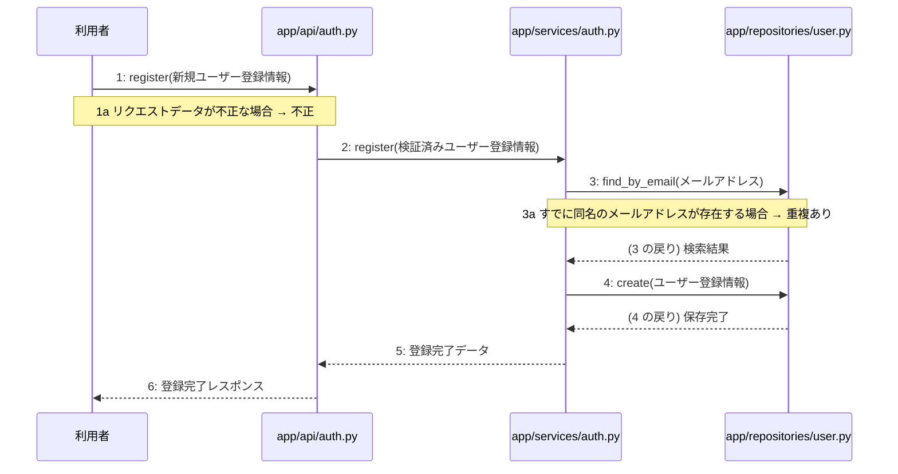

### 5.2 F-02 ログイン認証

トリガー: POST /api/v1/auth/login

選定理由: ユーザー認証情報の一致確認とログイン成功時のJWT発行、およびログイン日時の更新を行う。

| No | 呼び出し元 → 呼び出し先 | 種別 | 関数 | 渡すデータ | 処理内容 | 結果 | DB 操作 | 分岐・例外 |
|---|---|---|---|---|---|---|---|---|
| 1 | 利用者 → app/api/auth.py | 同期 | login | ログイン認証情報 | ログインAPIのエンドポイントでリクエストを受け取る | バリデーション結果 | — | F-02a へ |
| 1a | — | — | — | ログイン認証情報 | リクエストのバリデーションエラー | 400 Bad Request | — | ValidationError → 400 |
| 2 | app/api/auth.py → app/services/auth.py | 同期 | authenticate_user → 詳細: L-02 | ログイン認証情報 | 認証ビジネスロジックを呼び出す | 認証結果 | — | F-02b へ |
| 3 | app/services/auth.py → app/repositories/user.py | 同期 | find_by_email | メールアドレス | ユーザー情報を取得する | ユーザー情報 | users R | F-02c へ |
| 3a | — | — | — | メールアドレス | 該当するユーザーが存在しない場合 | 認証エラー | — | NotFoundError → 401 |
| 3b | — | — | — | パスワード | パスワードが一致しない場合 | 認証エラー | — | AuthenticationError → 401 |
| 4 | app/services/auth.py → app/repositories/user.py | 同期 | update_last_login | ユーザーID | 最終ログイン日時を更新する | 更新成功 | users U | — |
| 5 | app/services/auth.py → app/services/auth.py | 同期 | create_access_token → 詳細: L-03 | ユーザー情報 | JWTを発行する | JWT | — | — |
| 6 | app/api/auth.py → 利用者 | 戻り | — | JWT | JWTを返却する | 200 OK | — | — |

注記: 手順 3〜5 が1つのトランザクション

シーケンス図(手順の表から導いた図。直すのは表):

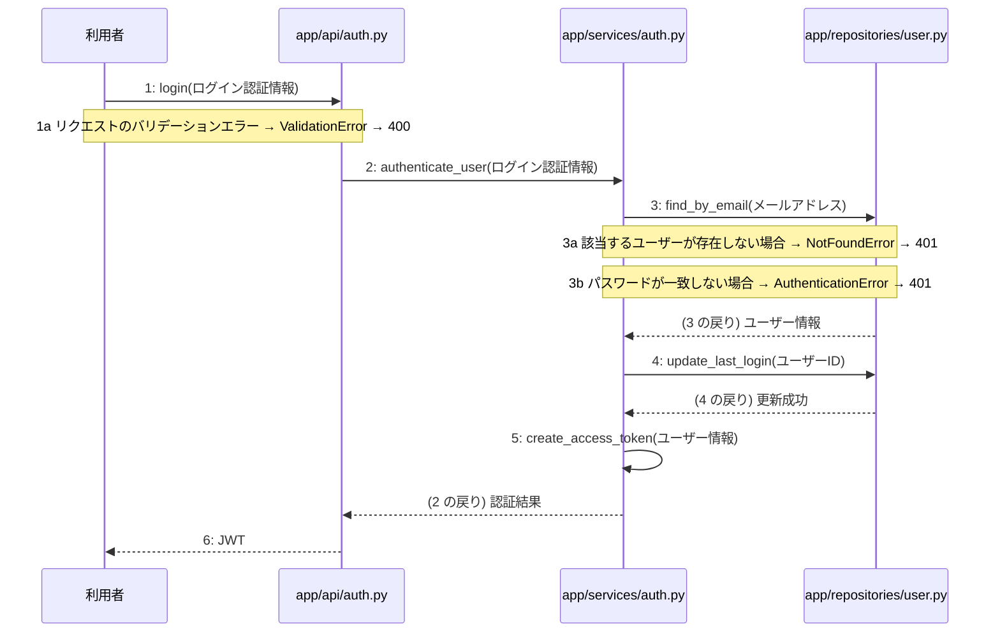

### 5.3 F-03 プロジェクト一覧取得

トリガー: GET /api/v1/projects

選定理由: ユーザーの権限検証を行った上で、projectsテーブルから効率よくプロジェクトの一覧を取得するため。

| No | 呼び出し元 → 呼び出し先 | 種別 | 関数 | 渡すデータ | 処理内容 | 結果 | DB 操作 | 分岐・例外 |
|---|---|---|---|---|---|---|---|---|
| 1 | 利用者 → app/api/projects.py | 同期 | get_projects | ユーザー情報 | プロジェクト一覧取得APIへのリクエストを受け取る | リクエスト | — | 3a へ |
| 1a | — | — | — | — | リクエスト元のユーザー権限が無効である場合 | UnauthorizedError | — | 401 Unauthorized |
| 2 | app/api/projects.py → app/services/project.py | 同期 | get_projects → 詳細: L-04 | ユーザー情報 | プロジェクト一覧取得のビジネスロジックを実行する | プロジェクト一覧 | — | — |
| 3 | app/services/project.py → app/repositories/project.py | 同期 | find_all | ユーザー情報 | projectsテーブルから作成済みプロジェクトの一覧を検索する | プロジェクト一覧レコード | projects R | — |
| 4 | app/services/project.py → app/api/projects.py | 戻り | — | プロジェクト一覧 | プロジェクト一覧を返す | プロジェクト一覧 | — | — |
| 5 | app/api/projects.py → 利用者 | 戻り | — | プロジェクト一覧 | プロジェクト一覧をレスポンスとして返す | プロジェクト一覧 | — | — |

シーケンス図(手順の表から導いた図。直すのは表):

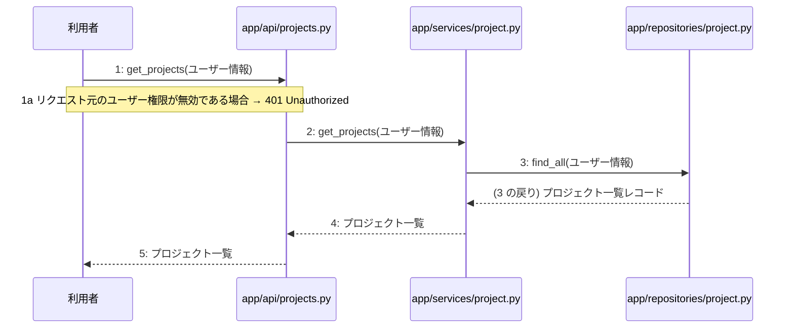

### 5.4 F-04 プロジェクト新規作成

トリガー: POST /api/v1/projects

選定理由: プロジェクト新規作成におけるバリデーションとPostgreSQLへの保存手順を明確にするため

| No | 呼び出し元 → 呼び出し先 | 種別 | 関数 | 渡すデータ | 処理内容 | 結果 | DB 操作 | 分岐・例外 |
|---|---|---|---|---|---|---|---|---|
| 1 | 利用者 → app/api/projects.py | 同期 | create_project | プロジェクト新規作成情報 | プロジェクト新規作成APIのリクエストを受け取り、リクエスト内容を検証する | 検証済みプロジェクト新規作成情報 | — | 4a へ |
| 1a | — | — | — | 検証エラー | リクエスト内容が不正である場合 | ValidationError → 422 | — | — |
| 2 | app/api/projects.py → app/services/project.py | 同期 | ProjectService.create_project → 詳細: L-05 | 検証済みプロジェクト新規作成情報 | プロジェクト新規作成のビジネスロジックを実行する | 作成されたプロジェクトデータ | — | — |
| 3 | app/services/project.py → app/repositories/project.py | 同期 | ProjectRepository.create | プロジェクトデータ | projectsテーブルに新しいプロジェクトを登録する | 登録されたプロジェクトレコード | projects C | — |
| 4 | app/services/project.py → app/api/projects.py | 戻り | — | 作成されたプロジェクトデータ | ビジネスロジックの結果をAPI層へ返す | 作成されたプロジェクトデータ | — | — |
| 5 | app/api/projects.py → 利用者 | 戻り | — | 作成されたプロジェクト情報 | 作成されたプロジェクト情報をレスポンスとして返す | 作成されたプロジェクト情報 (201 Created) | — | — |

注記: 手順 2〜4 が1つのトランザクション

シーケンス図(手順の表から導いた図。直すのは表):

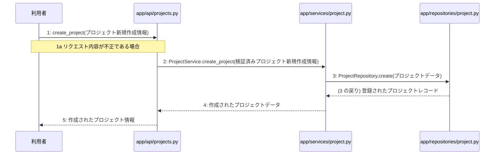

### 5.5 F-05 参考資料アップロード

トリガー: POST /api/v1/projects/{id}/documents

選定理由: 参考資料のファイル形式と件数制限を検証し、ストレージ保存とDBへのメタデータ記録を確実に行うため

| No | 呼び出し元 → 呼び出し先 | 種別 | 関数 | 渡すデータ | 処理内容 | 結果 | DB 操作 | 分岐・例外 |
|---|---|---|---|---|---|---|---|---|
| 1 | 利用者 → app/api/projects.py | 同期 | upload_document | 参考資料ファイル(txt / md / pdf), プロジェクトID | 参考資料アップロードリクエストを受信する | アップロード受付 | — | F-05a へ |
| 1a | — | — | — | 参考資料ファイル | ファイル形式(txt / md / pdf)が不正、または登録数が3件を超えている場合 | バリデーションエラー | — | 不正な場合は 400 Bad Request を返す |
| 2 | app/api/projects.py → app/services/document.py | 同期 | DocumentService.upload | 参考資料ファイル, プロジェクトID | 参考資料アップロードのビジネスロジックを実行する | アップロード結果 | — | — |
| 3 | app/services/document.py → app/repositories/document.py | 同期 | DocumentRepository.count_by_project_id | プロジェクトID | 登録済み参考資料の件数を確認する | 件数 | documents R | F-05b へ |
| 3a | — | — | — | 件数 | 登録件数が既に3件以上である場合 | 制限超過エラー | — | 3件を超える場合は例外を送出する |
| 4 | app/services/document.py → app/repositories/document.py | 同期 | DocumentRepository.create | 参考資料メタデータ, プロジェクトID | documentsテーブルにメタデータを保存する | 保存完了 | documents C | — |
| 5 | app/services/document.py → app/api/projects.py | 戻り | — | アップロード完了レスポンスデータ | 処理結果をAPI層に返す | アップロード完了レスポンスデータ | — | — |
| 6 | app/api/projects.py → 利用者 | 戻り | — | アップロード完了レスポンス | 利用者にアップロード完了レスポンスを返却する | HTTP 200 OK | — | — |

注記: 手順 4〜6 が1つのトランザクション

シーケンス図(手順の表から導いた図。直すのは表):

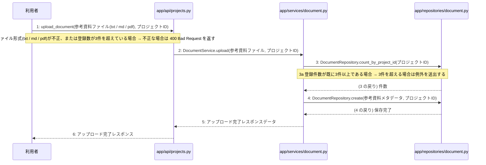

### 5.6 F-06 チャット履歴取得

トリガー: GET /api/v1/projects/{id}/chats

選定理由: プロジェクトの存在とアクセス権を検証した上で、チャット履歴を安全に取得するため。

| No | 呼び出し元 → 呼び出し先 | 種別 | 関数 | 渡すデータ | 処理内容 | 結果 | DB 操作 | 分岐・例外 |
|---|---|---|---|---|---|---|---|---|
| 1 | 利用者 → app/api/projects.py | 同期 | get_chats | プロジェクトID | チャット履歴取得APIリクエストを受け取る | バリデーション済みのプロジェクトID | — | — |
| 2 | app/api/projects.py → app/services/chat.py | 同期 | get_chats | プロジェクトID | チャット履歴取得処理を呼び出す | チャット履歴一覧 | — | 3a へ |
| 2a | — | — | — | プロジェクトID | プロジェクトの存在とアクセス権を確認する | 検証結果 | projects U | プロジェクトが存在しない、または権限がない場合は403/404エラー |
| 3 | app/services/chat.py → app/repositories/chat.py | 同期 | find_by_project_id | プロジェクトID | chatsテーブルからチャット履歴を検索する | チャット履歴一覧 | chats R | — |
| 4 | app/services/chat.py → app/api/projects.py | 戻り | — | チャット履歴一覧 | チャット履歴一覧を返す | チャット履歴一覧 | — | — |
| 5 | app/api/projects.py → 利用者 | 戻り | — | チャット履歴一覧 | チャット履歴一覧をレスポンスとして返す | HTTP 200 OK | — | — |

注記: 手順 2〜4 が1つのトランザクション

シーケンス図(手順の表から導いた図。直すのは表):

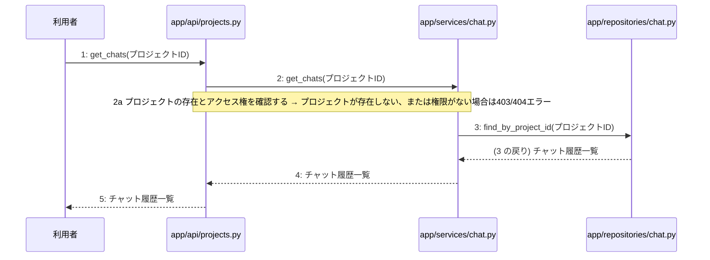

### 5.7 F-07 ヒアリングチャットメッセージ送信

トリガー: POST /api/v1/projects/{id}/chats

選定理由: ヒアリングチャットのメッセージを受け取り、AIからの応答を取得してチャット履歴として保存する一連の処理の流れを正確に記述するため。

| No | 呼び出し元 → 呼び出し先 | 種別 | 関数 | 渡すデータ | 処理内容 | 結果 | DB 操作 | 分岐・例外 |
|---|---|---|---|---|---|---|---|---|
| 1 | 利用者 → app/api/projects.py | 同期 | post_chat | プロジェクトID、チャットメッセージ | チャットメッセージ送信のリクエストを受け付ける | バリデーション結果 | — | 3a へ |
| 1a | — | — | — | リクエストパラメータ | 入力値の検証を行う | 検証エラー | — | ValidationError → 400 |
| 2 | app/api/projects.py → app/services/chat.py | 同期 | ChatService.send_message | プロジェクトID、チャットメッセージ | メッセージ送信とAI応答取得のビジネスロジックを実行する | AI応答メッセージ | — | — |
| 3 | app/services/chat.py → app/clients/ai.py | 同期 | AIClient.generate_chat_response | チャットメッセージ | LLM Providerへメッセージを送信してAIの応答を取得する | AI応答メッセージ | — | — |
| 4 | app/services/chat.py → app/repositories/chat.py | 同期 | ChatRepository.create | プロジェクトID、チャットメッセージ、AI応答メッセージ | ユーザーのメッセージとAIの応答をチャット履歴として保存する | 保存完了 | chats C | — |
| 5 | app/services/chat.py → app/api/projects.py | 戻り | — | AI応答メッセージ | ビジネスロジックの結果を返す | AI応答メッセージ | — | — |
| 6 | app/api/projects.py → 利用者 | 戻り | — | AI応答メッセージ | AIの応答メッセージをクライアントへ返却する | HTTP 200 OK | — | — |

注記: 手順 3〜5 が1つのトランザクション

シーケンス図(手順の表から導いた図。直すのは表):

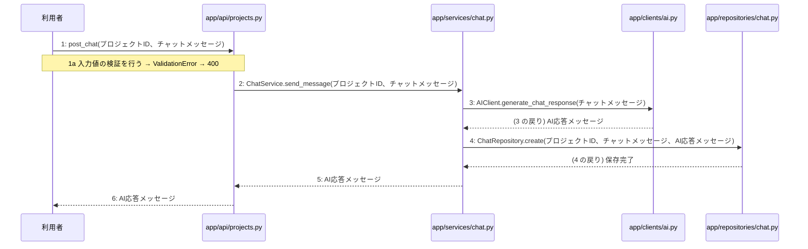

### 5.8 F-08 構造化サマリ取得

トリガー: GET /api/v1/projects/{id}/summary

選定理由: プロジェクトIDをもとに構造化サマリを安全に取得するため、リクエスト検証、サービス層での取得処理、およびリポジトリ層でのDBアクセスを順に実行する。

| No | 呼び出し元 → 呼び出し先 | 種別 | 関数 | 渡すデータ | 処理内容 | 結果 | DB 操作 | 分岐・例外 |
|---|---|---|---|---|---|---|---|---|
| 1 | 利用者 → app/api/documents.py | 同期 | — | プロジェクトID | GET /api/v1/projects/{id}/summary リクエストを受信する | 構造化サマリ取得のトリガー | — | F-08 a へ |
| 1a | — | — | — | プロジェクトID | リクエストのパスパラメータの検証を行う | 検証結果 | — | 不正な形式の場合 400 Bad Request を返却 |
| 2 | app/api/documents.py → app/services/summary.py | 同期 | SummaryService.get_summary | プロジェクトID | 構造化サマリ取得処理を呼び出す | 構造化サマリデータ | — | F-08 b へ |
| 2a | — | — | — | プロジェクトID | 該当するプロジェクトの構造化サマリの存在を確認する | サマリデータの有無 | summaries R | 存在しない場合 NotFoundError |
| 3 | app/services/summary.py → app/repositories/summary.py | 同期 | SummaryRepository.find_by_project_id | プロジェクトID | summariesテーブルから構造化サマリを取得する | 構造化サマリレコード | summaries R | — |
| 4 | app/services/summary.py → app/api/documents.py | 戻り | — | 構造化サマリデータ | 構造化サマリを返す | 構造化サマリデータ | — | — |
| 5 | app/api/documents.py → 利用者 | 戻り | — | 構造化サマリ | レスポンスとして構造化サマリを返却する | 200 OK と 構造化サマリ | — | — |

シーケンス図(手順の表から導いた図。直すのは表):

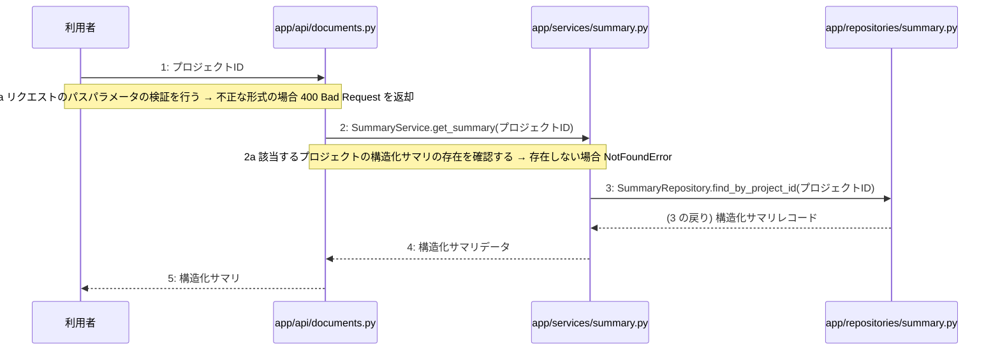

### 5.9 F-09 構造化サマリ承認・設計書非同期生成トリガー

トリガー: POST /api/v1/projects/{id}/generate

選定理由: 構造化サマリの承認状態を更新し、バックグラウンドワーカーで非同期に設計書生成ジョブをキューイングするため、正確な手順とトランザクション管理が必要。

| No | 呼び出し元 → 呼び出し先 | 種別 | 関数 | 渡すデータ | 処理内容 | 結果 | DB 操作 | 分岐・例外 |
|---|---|---|---|---|---|---|---|---|
| 1 | 利用者 → app/api/documents.py | 同期 | generate_documents | project_id | 構造化サマリ承認・設計書非同期生成トリガーのエンドポイントにリクエストを送信する | 非同期生成ジョブID | — | 1a へ |
| 1a | — | — | — | リクエストデータ | バリデーションエラーまたはプロジェクト・サマリが存在しない場合 | 400 Bad Request または 404 Not Found | — | 例外送出 |
| 2 | app/api/documents.py → app/services/job.py | 同期 | trigger_generation | project_id | ジョブサービスのサマリ承認と非同期生成トリガー処理を呼び出す | 非同期生成ジョブID | — | — |
| 3 | app/services/job.py → app/repositories/summary.py | 同期 | update_summary_status | project_id, 承認済みステータス | summariesテーブルのサマリを承認済みに更新する | 更新成功 | summaries U | — |
| 4 | app/services/job.py → app/workers/generator.py | 非同期 | enqueue_generation_job | project_id | 4種設計書の一括生成ジョブをCelery非同期キューに登録する | 非同期生成ジョブID | — | — |
| 5 | app/services/job.py → app/api/documents.py | 戻り | — | 非同期生成ジョブID | 非同期生成ジョブIDを返す | 非同期生成ジョブID | — | — |
| 6 | app/api/documents.py → 利用者 | 戻り | — | 非同期生成ジョブID | レスポンスとして非同期生成ジョブIDを返す | 非同期生成ジョブID | — | — |

注記: 手順 3〜4 が1つのトランザクション

シーケンス図(手順の表から導いた図。直すのは表):

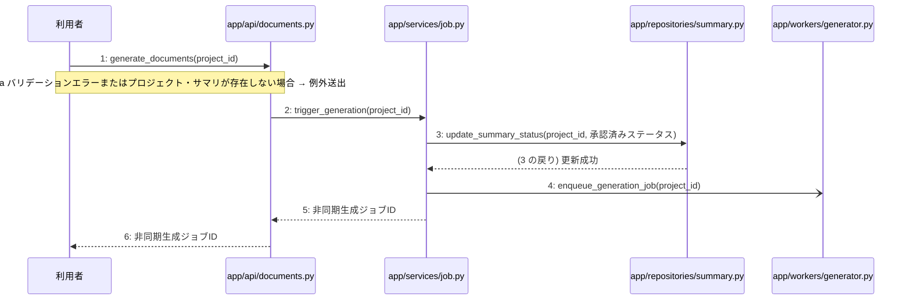

### 5.10 F-10 非同期生成ジョブの進捗ステータス確認

トリガー: GET /api/v1/projects/{id}/jobs/{jobId}

選定理由: 非同期生成ジョブの進捗ステータスを正しく取得して返却する重要かつシンプルな処理である。

| No | 呼び出し元 → 呼び出し先 | 種別 | 関数 | 渡すデータ | 処理内容 | 結果 | DB 操作 | 分岐・例外 |
|---|---|---|---|---|---|---|---|---|
| 1 | 利用者 → app/api/documents.py | 同期 | — | プロジェクトID, ジョブID | 非同期生成ジョブの進捗ステータス確認APIを呼び出す | HTTPレスポンス | — | F-10 a へ |
| 1a | — | — | — | リクエストパラメータ | リクエストの検証に失敗した場合 | 400 Bad Request | — | ValidationError → 400 |
| 2 | app/api/documents.py → app/services/job.py | 同期 | JobService.get_job_status | プロジェクトID, ジョブID | ジョブの進捗ステータス取得を依頼する | 進捗ステータス | — | F-10 b へ |
| 2a | — | — | — | ジョブID | 対象のジョブが存在しない場合 | 404 Not Found | — | NotFoundError → 404 |
| 3 | app/services/job.py → app/repositories/summary.py | 同期 | SummaryRepository.find_by_job_id | ジョブID | ジョブに対応するサマリまたはジョブの状態を取得する | ジョブ情報 | summaries R | — |
| 4 | app/services/job.py → app/api/documents.py | 戻り | — | 進捗ステータス | 進捗ステータスを返却する | 進捗ステータス | — | — |
| 5 | app/api/documents.py → 利用者 | 戻り | — | 進捗ステータス | ジョブの進捗ステータスをレスポンスとして返す | 200 OK | — | — |

シーケンス図(手順の表から導いた図。直すのは表):

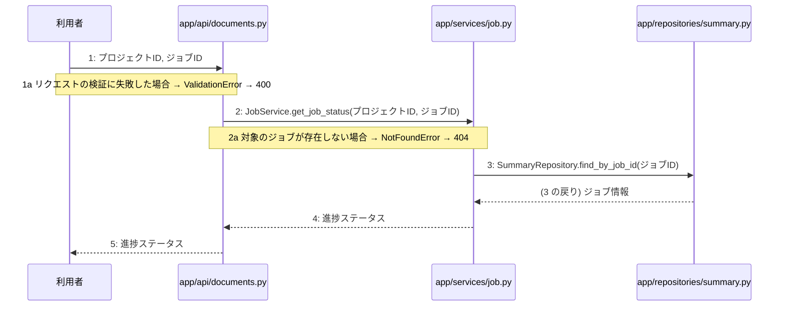

### 5.11 F-11 生成された4種設計書の一覧・最新版取得

トリガー: GET /api/v1/projects/{id}/documents

選定理由: プロジェクトの存在検証とドキュメント取得を安全に行うため、適切なサービスとリポジトリを経由して最新版の4種設計書一覧を取得する処理手順である。

| No | 呼び出し元 → 呼び出し先 | 種別 | 関数 | 渡すデータ | 処理内容 | 結果 | DB 操作 | 分岐・例外 |
|---|---|---|---|---|---|---|---|---|
| 1 | 利用者 → app/api/documents.py | 同期 | get_documents | プロジェクトID | 4種設計書の一覧・最新版取得APIのリクエストを受信する | バリデーション済みのプロジェクトID | — | — |
| 2 | app/api/documents.py → app/services/document.py | 同期 | DocumentService.get_documents | プロジェクトID | 設計書一覧および最新版の取得ビジネスロジックを呼び出す | 4種設計書の一覧・最新版 | — | 1a へ |
| 2a | — | — | — | プロジェクトID | 指定されたプロジェクトが存在しない場合 | NotFoundError | — | 404 Not Found を返却 |
| 3 | app/services/document.py → app/repositories/project.py | 同期 | ProjectRepository.get_project | プロジェクトID | プロジェクトの存在確認を行う | プロジェクト情報 | projects R | — |
| 4 | app/services/document.py → app/repositories/document.py | 同期 | DocumentRepository.get_latest_documents_by_project | プロジェクトID | 生成された4種設計書の最新版一覧を取得する | 4種設計書のリスト | documents R | — |
| 5 | app/services/document.py → app/api/documents.py | 戻り | — | 4種設計書の一覧・最新版 | 取得した設計書一覧をAPI層へ返す | 4種設計書の一覧・最新版 | — | — |
| 6 | app/api/documents.py → 利用者 | 戻り | — | 4種設計書の一覧・最新版 | APIレスポンスとして結果を返却する | HTTP 200 OK と4種設計書の一覧・最新版 | — | — |

注記: トランザクションは使用せず、参照系クエリを順次実行する

シーケンス図(手順の表から導いた図。直すのは表):

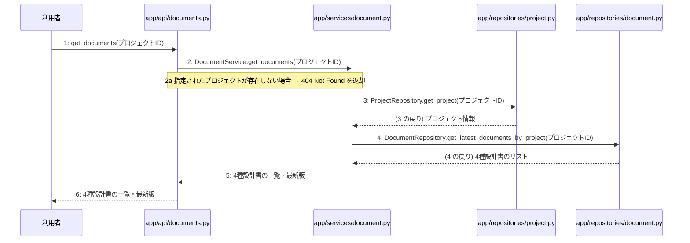

### 5.12 F-12 指定文書の版一覧取得

トリガー: GET /api/v1/documents/{id}/versions

選定理由: 指定された文書の存在確認を行い、PostgreSQLから直近3件の版の一覧を効率的に取得するため

| No | 呼び出し元 → 呼び出し先 | 種別 | 関数 | 渡すデータ | 処理内容 | 結果 | DB 操作 | 分岐・例外 |
|---|---|---|---|---|---|---|---|---|
| 1 | 利用者 → app/api/documents.py | 同期 | get_document_versions | 文書ID | 文書の版一覧取得リクエストを受信する | 版の一覧 | — | 1a へ |
| 1a | — | — | — | 文書ID | リクエストされた文書IDの形式や妥当性を検証する | 検証結果 | — | 不正な場合 400 Bad Request |
| 2 | app/api/documents.py → app/services/document.py | 同期 | get_versions | 文書ID | 文書の版一覧取得ビジネスロジックを呼び出す | 版の一覧 | — | 2a へ |
| 2a | — | — | — | 文書ID | 指定された文書が存在するか検証する | 存在確認結果 | documents R | 存在しない場合 NotFoundError → 404 |
| 3 | app/services/document.py → app/repositories/document.py | 同期 | find_versions_by_document_id | 文書ID | PostgreSQLから直近3件の版の一覧を取得するリポジトリを呼び出す | 版の一覧データ | documents R | — |
| 4 | app/services/document.py → app/api/documents.py | 戻り | — | 版の一覧データ | 取得した版の一覧を呼び出し元へ返す | 版の一覧 | — | — |
| 5 | app/api/documents.py → 利用者 | 戻り | — | 版の一覧 | 版の一覧をレスポンスとして返す | HTTP 200 OK と版の一覧 | — | — |

シーケンス図(手順の表から導いた図。直すのは表):

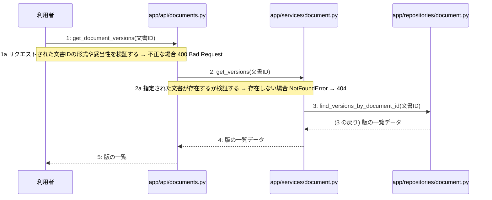

### 5.13 F-13 追加修正指示による文書再生成

トリガー: POST /api/v1/documents/{id}/regenerate

選定理由: 追加修正指示に基づきLLMプロバイダで文書を再生成し新しい版を保存する処理の流れを記述するため

| No | 呼び出し元 → 呼び出し先 | 種別 | 関数 | 渡すデータ | 処理内容 | 結果 | DB 操作 | 分岐・例外 |
|---|---|---|---|---|---|---|---|---|
| 1 | 利用者 → app/api/documents.py | 同期 | regenerate_document | 文書ID, 追加修正指示 | 文書の再生成リクエストを受信する | バリデーション結果 | — | 1a へ |
| 1a | — | — | — | バリデーションエラー | 入力値が不正である場合 | 400 Bad Request | — | バリデーションエラー |
| 2 | app/api/documents.py → app/services/document.py | 同期 | DocumentService.regenerate | 文書ID, 追加修正指示 | 文書再生成のビジネスロジックを実行する | 再生成された文書 | — | 3a へ |
| 2a | — | — | — | 文書ID | 指定された文書が存在しない場合 | NotFoundError | documents R | NotFoundError → 404 |
| 3 | app/services/document.py → app/clients/ai.py | 同期 | AIClient.regenerate_document | 既存文書, 追加修正指示 | LLM Providerを呼び出して文書を再生成する | 再生成された文書テキスト | — | — |
| 4 | app/services/document.py → app/repositories/document.py | 同期 | DocumentRepository.create | 再生成された文書データ | 新しい版として文書をデータベースに保存し直近3件を保持する | 保存された文書データ | documents CU | — |
| 5 | app/services/document.py → app/api/documents.py | 戻り | — | 再生成された文書の新版 | 処理結果を返す | 再生成された文書の新版 | — | — |
| 6 | app/api/documents.py → 利用者 | 戻り | — | 再生成された文書の新版 | レスポンスを返却する | 200 OK | — | — |

注記: 手順 3〜6 が1つのトランザクション

シーケンス図(手順の表から導いた図。直すのは表):

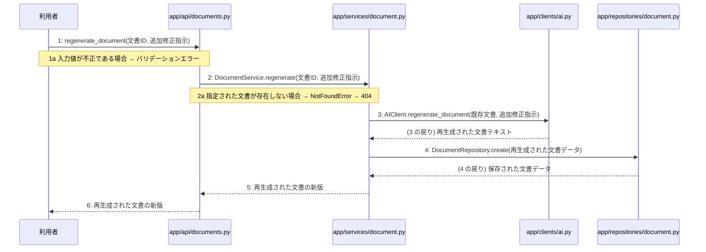

### 5.14 F-14 AIによる自己診断結果取得

トリガー: GET /api/v1/documents/{id}/diagnostics

選定理由: 文書の存在確認を行った上でAIクライアントを呼び出し、3段階の自己診断結果を取得する一連の流れを正確に表現するため

| No | 呼び出し元 → 呼び出し先 | 種別 | 関数 | 渡すデータ | 処理内容 | 結果 | DB 操作 | 分岐・例外 |
|---|---|---|---|---|---|---|---|---|
| 1 | 利用者 → app/api/documents.py | 同期 | get_document_diagnostics | 文書ID(id) | 自己診断結果取得APIのリクエストを受け付ける | リクエストパラメータ | — | F-14a へ |
| 1a | — | — | — | 文書ID(id) | リクエストされた文書IDが空または不正である場合 | バリデーションエラー | — | 400 Bad Request |
| 2 | app/api/documents.py → app/services/document.py | 同期 | get_diagnostics | 文書ID(id) | 自己診断結果取得ビジネスロジックを呼び出す | AI診断結果データ | — | F-14b へ |
| 2a | — | — | — | 文書ID(id) | documentsテーブルを検索し該当文書が存在しない場合 | NotFoundError | documents R | 404 Not Found |
| 3 | app/services/document.py → app/repositories/document.py | 同期 | find_by_id | 文書ID(id) | 対象文書の存在を検証するためにデータを取得する | 文書データ | documents R | — |
| 4 | app/services/document.py → app/clients/ai.py | 同期 | generate_diagnostics | 文書データ | LLM Providerを呼び出して不足点を3段階で診断する | AIによる自己診断結果 | — | — |
| 5 | app/services/document.py → app/api/documents.py | 戻り | — | AIによる自己診断結果 | 自己診断結果をAPI層へ返す | AIによる自己診断結果 | — | — |
| 6 | app/api/documents.py → 利用者 | 戻り | — | AIによる自己診断結果 | 自己診断結果を返却する | AIによる自己診断結果(200 OK) | — | — |

シーケンス図(手順の表から導いた図。直すのは表):

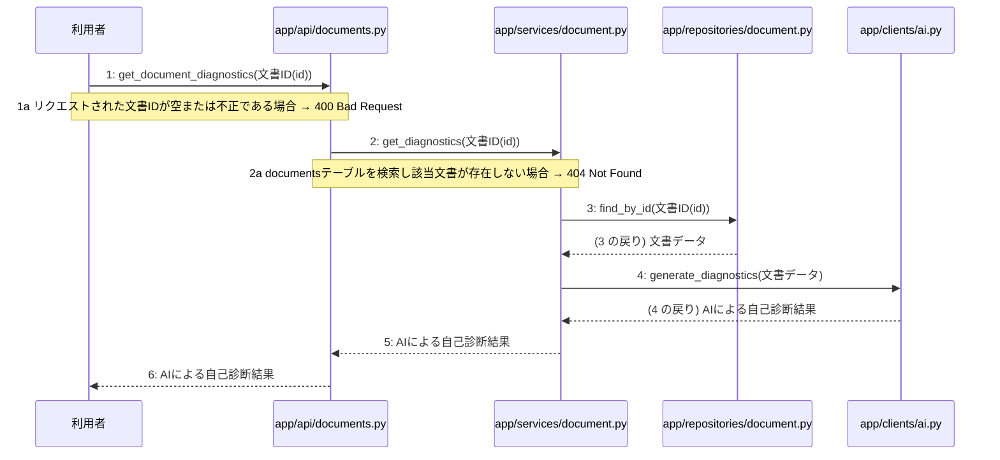

## 06 処理ロジックの詳細

### 6.0 逆引き(関数 × 手順)

| L-ID | 関数 | モジュール | 呼ばれる手順 |
|---|---|---|---|
| L-01 | register | app/services/auth.py | F-01#2 |
| L-02 | authenticate_user | app/services/auth.py | F-02#2 |
| L-03 | create_access_token | app/services/auth.py | F-02#5 |
| L-04 | get_projects | app/services/project.py | F-03#2 |
| L-05 | ProjectService.create_project | app/services/project.py | F-04#2 |

### 6.1 L-01 register

呼ばれる手順: F-01#2

モジュール: app/services/auth.py

| 項目 | 内容 |
|---|---|
| シグネチャ | def register(user_data: UserCreate) -> UserResponse: |
| 引数 | user_data: 検証済みユーザー登録情報 |
| 戻り値 | ユーザー登録結果 |
| 例外 | なし |
| 事前条件 | app/repositories/user.py が利用可能であること |
| 事後条件 | ユーザーが登録され、ユーザー登録結果が返されること |

擬似フロー:

1. ユーザー登録情報を取得する
    - 渡された検証済みユーザー登録情報を変数に格納する
2. アプリのリポジトリ層を呼び出してユーザーを登録する
    - app/repositories/user.py の処理を実行する
    - users テーブルへの登録データを構築する
3. ユーザー登録結果を返却する
    - リポジトリ層からの戻り値を整形して呼び出し元へ返す

### 6.2 L-02 authenticate_user

呼ばれる手順: F-02#2

モジュール: app/services/auth.py

| 項目 | 内容 |
|---|---|
| シグネチャ | def authenticate_user(credentials: LoginCredentials) -> AuthResult: |
| 引数 | credentials: ログイン認証情報 |
| 戻り値 | 認証結果 |
| 例外 | AuthenticationError: 認証に失敗した場合、HTTP 401を返す |
| 事前条件 | 有効なログイン認証情報が入力されていること |
| 事後条件 | 入力された認証情報に基づきユーザーの検証を行い、結果を返すこと |

擬似フロー:

1. ユーザーリポジトリを使用して入力された認証情報のユーザーを検索する
    - app/repositories/user.py の関数を呼び出す
    - 該当するユーザーが存在しない場合は認証エラーとする
2. パスワードの検証を行う
    - 入力されたパスワードと保存されているハッシュ化パスワードを比較する
    - 一致しない場合は認証エラーとする
3. 認証成功時の結果を生成して返却する
    - 認証結果のデータを組み立てる
    - 呼び出し元へ返却する

### 6.3 L-03 create_access_token

呼ばれる手順: F-02#5

モジュール: app/services/auth.py

| 項目 | 内容 |
|---|---|
| シグネチャ | def create_access_token(user: dict) -> str: |
| 引数 | user: ユーザー情報を格納した辞書 |
| 戻り値 | 生成されたJWT文字列 |
| 例外 | なし |
| 事前条件 | 渡されたユーザー情報が有効であること |
| 事後条件 | 有効なJWT文字列が返却されること |

擬似フロー:

1. アクセストークンのペイロードを作成する
    - ユーザーの識別子を含める
    - 有効期限を設定する
2. 秘密鍵とアルゴリズムを用いてJWTを署名・生成する
    - 設定された秘密鍵を取得する
    - JWTエンコード処理を実行する
3. 生成されたJWT文字列を返却する

### 6.4 L-04 get_projects

呼ばれる手順: F-03#2

モジュール: app/services/project.py

| 項目 | 内容 |
|---|---|
| シグネチャ | def get_projects(user_info: dict) -> list[dict]: |
| 引数 | user_info: ユーザー情報 |
| 戻り値 | プロジェクト一覧 |
| 例外 | なし |
| 事前条件 | ユーザーが認証されており有効なユーザー情報が渡されていること |
| 事後条件 | 指定されたユーザーに関連するプロジェクト一覧が返却されること |

擬似フロー:

1. プロジェクトリポジトリを呼び出し、プロジェクト一覧を取得する
    - app/repositories/project.pyの関数を実行する
    - ユーザー情報をもとにデータベースからプロジェクト情報を抽出する
2. 取得したプロジェクト一覧のデータを整理する
    - 必要な属性値が揃っているか確認する
    - 戻り値の形式にデータを整形する
3. 整形したプロジェクト一覧を呼び出し元へ返却する
    - 正常に処理を終了する

### 6.5 L-05 ProjectService.create_project

呼ばれる手順: F-04#2

モジュール: app/services/project.py

| 項目 | 内容 |
|---|---|
| シグネチャ | def create_project(project_in: ProjectCreate) -> Project: |
| 引数 | project_in: 検証済みプロジェクト新規作成情報 |
| 戻り値 | 作成されたプロジェクトデータ |
| 例外 | なし |
| 事前条件 | 呼び出し元で検証済みプロジェクト新規作成情報が用意されていること |
| 事後条件 | projects テーブルに新しいプロジェクトが登録され、作成されたプロジェクトデータが返されること |

擬似フロー:

1. プロジェクト新規作成情報を受け取る
    - 引数の project_in を取得する
2. app/repositories/project.py のリポジトリを呼び出してプロジェクトを永続化する
    - プロジェクト作成のデータベース操作を実行する
3. 作成されたプロジェクトデータを返却する
    - 永続化されたプロジェクトのデータを戻り値として返す

## 07 横断事項

| 項目 | 方針 | 関わるファイル(例) |
|---|---|---|
| 例外と HTTP | システム内で発生した例外は、APIエンドポイント層において共通の例外ハンドラーで捕捉する。バリデーションエラーは 400 Bad Request、認証エラーは 401 Unauthorized、リソースが存在しない場合は 404 Not Found、予期せぬサーバーエラーは 500 Internal Server Error を返却する。 | app/main.py, app/api/auth.py, app/api/projects.py, app/api/documents.py |
| 認証 | クライアントのリクエスト認証には JWT を使用し、有効期限は『(要決定)』とする。認証が必要なすべてのエンドポイントにおいて、リクエストヘッダーに含まれる Bearer トークンの検証を必須とする。 | app/api/auth.py, app/services/auth.py, app/repositories/user.py |
| トランザクション | 複数のリポジトリ操作やデータベースの書き込みを伴う一連のビジネスロジックは、ユースケース層において単一のトランザクションとして実行する。トランザクション内でエラーが発生した場合は自動的にロールバックを行う。 | app/services/auth.py, app/services/project.py, app/services/chat.py, app/services/summary.py, app/services/job.py, app/services/document.py |
| ログ | すべてのAPIリクエストおよびレスポンス、エラー発生時には構造化ログを出力する。ログにはタイムスタンプ、ユーザーID、処理ID、リクエストパス、ステータスコード、エラーメッセージを含め、個人情報やパスワードハッシュは出力しない。 | app/main.py, app/api/auth.py, app/api/projects.py, app/api/documents.py |
| 非同期処理 | 構造化サマリ承認後の4種設計書の順次生成や文書の再生成は、Celeryを用いたバックグラウンドの非同期ジョブとして実行する。ジョブの実行状態や進捗ステータスは適宜データベースに記録し、API経由で確認できるようにする。 | app/services/job.py, app/workers/generator.py |
| 外部サービスの呼び出し | LLM Providerなどの外部サービスとの通信はすべて外部連携層にカプセル化する。外部API呼び出し時のタイムアウトやレート制限によるエラーを想定し、適切な例外処理と必要に応じたリトライを実装する。 | app/clients/ai.py, app/services/chat.py, app/services/document.py, app/workers/generator.py |
