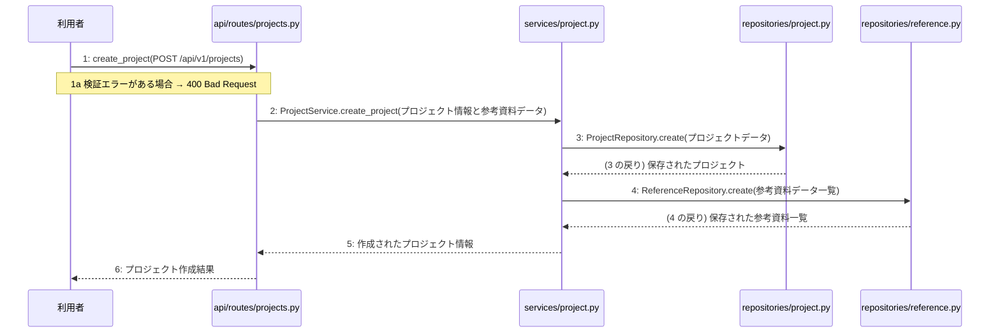

# M-01-T02 プロジェクト作成と参考資料の初期登録機能の実装

> 種別: 機能 / マイルストーン: M-01 M-01: 環境構築とベース・プロジェクト作成機能の実装 / 要件: FR-005 / 依存: M-01-T01

## 目的

利用者からのプロジェクト作成と参考資料の初期登録のAPIリクエストを受け付け、ビジネスロジックを制御してデータベースに永続化する。

## 対象の処理・参照する設計

- 段階5 F-01 プロジェクト作成と参考資料の初期登録
- 段階6 create_project(`api/routes/projects.py`)(設計に無い ── 未定義を参照)
- 段階6 L-01 ProjectService.create_project(`services/project.py`)
- 段階6 ProjectRepository.create(`repositories/project.py`)(設計に無い ── 未定義を参照)
- 段階6 ReferenceRepository.create(`repositories/reference.py`)(設計に無い ── 未定義を参照)
- 段階4 `api/routes/projects.py`
- 段階4 `services/project.py`
- 段階4 `repositories/project.py`
- 段階4 `repositories/reference.py`

### シーケンス図(段階5 F-01 プロジェクト作成と参考資料の初期登録 の手順から導出)

## 作成・変更するファイル(依存順)

| ファイル | 種類 | 責務 | 根拠 |
|---|---|---|---|
| `repositories/project.py` | モジュール | PostgreSQLデータベースのprojectsテーブルに対するCRUD操作を行う | 段階4 |
| `repositories/reference.py` | モジュール | PostgreSQLデータベースのreferencesテーブルに対するCRUD操作を行う | 段階4 |
| `services/project.py` | モジュール | プロジェクト作成と参考資料登録のビジネスロジックを制御する | 段階4 |
| `api/routes/projects.py` | モジュール | プロジェクト作成と参考資料の初期登録のAPIリクエストを受け取り検証する | 段階4 |
| `tests/test_projects.py` | テスト | プロジェクト作成と参考資料初期登録のAPIおよびサービスのテストを行う | 段階7 開発環境 |

## 実装の要点(設計に書いていないことだけ)

- データベースの書き込みを伴う複数の操作のため、サービス層で一つのトランザクションとして管理する
- 依存される順序として、リポジトリ層を作成した後にサービス層、APIルーター層の順に実装する

## テスト観点

| # | 観点 | SUT | ドライバ | スタブ |
|---|---|---|---|---|
| TC-01 | 有効なプロジェクトデータと参考資料データが渡された場合に、正常にレコードが作成され201が返る | api/routes/projects.py | 結合テスト (TestClient) | スタブ不要 ── 実データベースまたはテスト用セッションを使用 |
| TC-02 | リクエストに検証エラーがある場合に400 Bad Requestが返る | api/routes/projects.py | 結合テスト (TestClient) | スタブ不要 ── 実際のバリデーション機構を使用 |

- Given: 有効なプロジェクト情報と参考資料データがある / When: POST /api/v1/projects にリクエストを送信する / Then: データベースに保存され 201 Created が返る
- Given: 不正なプロジェクト情報がある / When: POST /api/v1/projects にリクエストを送信する / Then: 400 Bad Request が返る

## 確認方法

- pytest を実行してテストがすべて成功することを確認する
- POST /api/v1/projects エンドポイントに対してリクエストを送り、201 Created と期待されるレスポンスが返ることを確認する

## 未定義・要決定

| 重要度 | 出どころ | 対象 | 内容 | 直す段階 |
|---|---|---|---|---|
| 中程度 | AI | services/project.py | 段階6において create_project の詳細な処理ロジックや具体的な例外処理の詳細が設計に記載されていないため、実装時にエラーハンドリングの詳細仕様の確認が必要となる。 | 段階6 |
