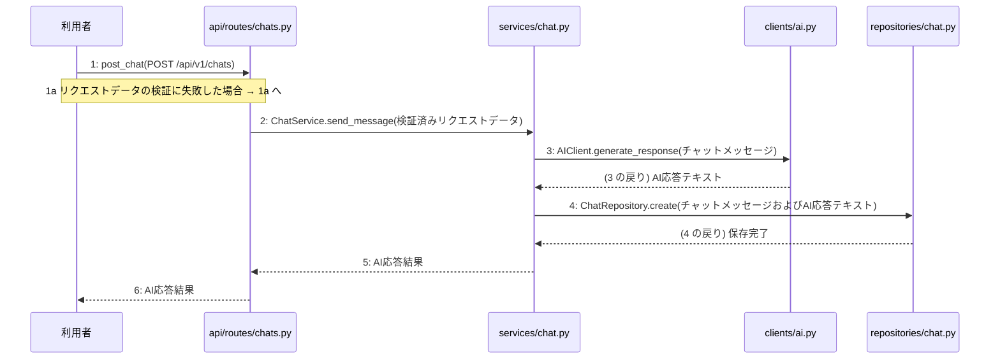

# M-02-T01 チャットメッセージの送信とAI応答の取得機能の実装

> 種別: 機能 / マイルストーン: M-02 M-02: チャット機能の実装 / 要件: FR-001, FR-011, NFR-003 / 依存: M-01-T02

## 目的

利用者がチャットメッセージを送信し、外部AIサービスからの応答を取得して履歴をデータベースに保存できるようにする。

## 対象の処理・参照する設計

- 段階5 F-02 チャットメッセージの送信とAI応答の取得
- 段階6 post_chat(`api/routes/chats.py`)(設計に無い ── 未定義を参照)
- 段階6 L-02 ChatService.send_message(`services/chat.py`)
- 段階6 AIClient.generate_response(`clients/ai.py`)(設計に無い ── 未定義を参照)
- 段階6 ChatRepository.create(`repositories/chat.py`)(設計に無い ── 未定義を参照)
- 段階4 `api/routes/chats.py`
- 段階4 `services/chat.py`
- 段階4 `clients/ai.py`
- 段階4 `repositories/chat.py`

### シーケンス図(段階5 F-02 チャットメッセージの送信とAI応答の取得 の手順から導出)

## 作成・変更するファイル(依存順)

| ファイル | 種類 | 責務 | 根拠 |
|---|---|---|---|
| `repositories/chat.py` | モジュール | PostgreSQLデータベースのchatsテーブルに対するCRUD操作を行う | 段階4 |
| `clients/ai.py` | モジュール | 外部のAIサービスを呼び出して対話応答や設計書生成を行う | 段階4 |
| `services/chat.py` | モジュール | チャットメッセージの送信とAI応答取得のビジネスロジックを制御する | 段階4 |
| `api/routes/chats.py` | モジュール | チャットメッセージ送信のAPIリクエストを受け取り検証する | 段階4 |
| `tests/test_chat.py` | テスト | チャットメッセージの送信とAI応答取得機能のテストを行う | 段階7 開発環境 |

## 実装の要点(設計に書いていないことだけ)

- 依存される順序に従って repositories/chat.py、clients/ai.py、services/chat.py、api/routes/chats.py の順に作成する。
- サービス層でのトランザクション管理を適用し、手順 3〜5 を一つのトランザクションとして扱う。

## テスト観点

| # | 観点 | SUT | ドライバ | スタブ |
|---|---|---|---|---|
| TC-01 | 正常系: チャットメッセージ送信とAI応答の取得が成功し保存されること | api/routes/chats.py | 結合テスト (pytest) | AIClient.generate_responseをモック化して固定のAI応答テキストを返す |
| TC-02 | 異常系: リクエストデータの検証に失敗した場合に400エラーとなること | api/routes/chats.py | 結合テスト (pytest) | スタブ不要 ── バリデーションエラーの検証 |

- Given: 有効なチャットメッセージのリクエストデータがある When: POST /api/v1/chats を呼び出す Then: AI応答結果が返却されデータベースに保存される
- Given: 不正なチャットメッセージのリクエストデータがある When: POST /api/v1/chats を呼び出す Then: 400 Bad Requestが返却される

## 確認方法

- pytestを実行し、チャット関連のテストがすべて成功することを確認する。

## 未定義・要決定

| 重要度 | 出どころ | 対象 | 内容 | 直す段階 |
|---|---|---|---|---|
| 最重要 | AI | 段階6 post_chat(api/routes/chats.py) | 段階6の post_chat の詳細な処理手順とリクエスト・レスポンスのPydanticモデルの定義が設計にありません。 | 段階6 |
| 最重要 | AI | 段階6 AIClient.generate_response(clients/ai.py) | 段階6の AIClient.generate_response の外部AIサービス呼び出しの詳細な仕様や利用するAPIのエンドポイント・パラメータが設計にありません。 | 段階6 |
| 最重要 | AI | 段階6 ChatRepository.create(repositories/chat.py) | 段階6の ChatRepository.create の詳細なデータベース操作手順やchatsテーブルのカセット仕様が設計にありません。 | 段階6 |
