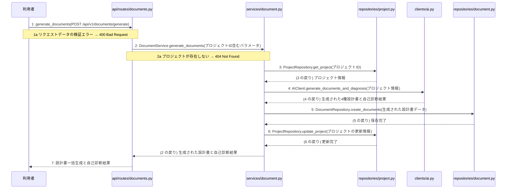

# M-03-T01 4種設計書の一括生成と自己診断の実行機能の実装

> 種別: 機能 / マイルストーン: M-03 M-03: 設計書生成・取得機能の実装 / 要件: FR-002, FR-003, FR-012, NFR-004 / 依存: M-02-T01

## 目的

利用者がPOST /api/v1/documents/generateを通じて4種設計書を一括生成し、自己診断を実行してデータベースに保存できるようになる。

## 対象の処理・参照する設計

- 段階5 F-03 4種設計書の一括生成と自己診断の実行
- 段階6 generate_documents(`api/routes/documents.py`)(設計に無い ── 未定義を参照)
- 段階6 L-03 DocumentService.generate_documents(`services/document.py`)
- 段階6 ProjectRepository.get_project(`repositories/project.py`)(設計に無い ── 未定義を参照)
- 段階6 AIClient.generate_documents_and_diagnosis(`clients/ai.py`)(設計に無い ── 未定義を参照)
- 段階6 DocumentRepository.create_documents(`repositories/document.py`)(設計に無い ── 未定義を参照)
- 段階6 ProjectRepository.update_project(`repositories/project.py`)(設計に無い ── 未定義を参照)
- 段階4 `api/routes/documents.py`
- 段階4 `services/document.py`
- 段階4 `clients/ai.py`
- 段階4 `repositories/project.py`
- 段階4 `repositories/document.py`

### シーケンス図(段階5 F-03 4種設計書の一括生成と自己診断の実行 の手順から導出)

## 作成・変更するファイル(依存順)

| ファイル | 種類 | 責務 | 根拠 |
|---|---|---|---|
| `repositories/project.py` | モジュール | プロジェクト情報の取得および更新を行う | 段階4 |
| `repositories/document.py` | モジュール | 生成された設計書データをデータベースに保存する | 段階4 |
| `clients/ai.py` | モジュール | 外部AIサービスを呼び出して4種のMarkdown設計書を一括生成し自己診断を実行する | 段階4 |
| `services/document.py` | モジュール | 4種設計書の一括生成と自己診断のビジネスロジックを制御しトランザクションを管理する | 段階4 |
| `api/routes/documents.py` | モジュール | 設計書一括生成と自己診断のAPIリクエストを受け取り検証する | 段階4 |

## 実装の要点(設計に書いていないことだけ)

- データベースの書き込みを伴う複数の操作はサービス層で1つのトランザクションとして管理する
- 依存される順序に従い、リポジトリ層、外部クライアント層、サービス層、APIルーター層の順に実装する

## テスト観点

| # | 観点 | SUT | ドライバ | スタブ |
|---|---|---|---|---|
| TC-01 | 正常系: 有効なプロジェクトIDでリクエストされた場合に設計書が一括生成され自己診断結果が返却されること | generate_documents | 結合テスト (pytest) | AIClient (外部AIサービスの呼び出しをモック化) |
| TC-02 | 異常系: 存在しないプロジェクトIDでリクエストされた場合に404 Not Foundが返却されること | generate_documents | 結合テスト (pytest) | スタブ不要 ── データベースの存在確認を利用 |

- Given 存在するプロジェクトIDとリクエストデータがある When POST /api/v1/documents/generate を呼び出す Then 4種設計書が生成され200 OKが返却される

## 確認方法

- pytestを実行し、設計書一括生成と自己診断のテストケースがすべて成功することを確認する

## 未定義・要決定

なし
