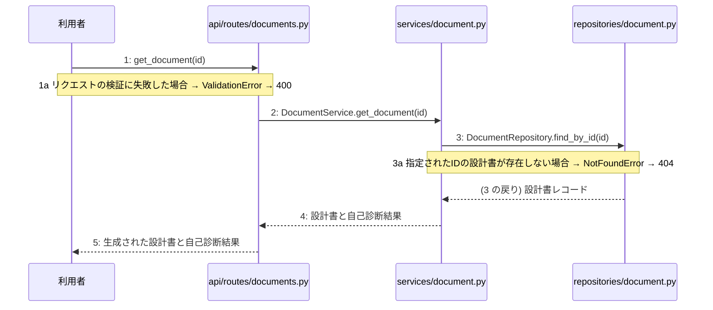

# M-03-T02 生成された設計書と自己診断結果の取得機能の実装

> 種別: 機能 / マイルストーン: M-03 M-03: 設計書生成・取得機能の実装 / 要件: FR-002, FR-003, FR-004 / 依存: M-03-T01

## 目的

生成された設計書と自己診断結果をデータベースから取得し、APIを通じてクライアントに返却できるようになる。

## 対象の処理・参照する設計

- 段階5 F-04 生成された設計書と自己診断結果の取得
- 段階6 get_document(`api/routes/documents.py`)(設計に無い ── 未定義を参照)
- 段階6 L-04 DocumentService.get_document(`services/document.py`)
- 段階6 DocumentRepository.find_by_id(`repositories/document.py`)(設計に無い ── 未定義を参照)
- 段階4 `api/routes/documents.py`
- 段階4 `services/document.py`
- 段階4 `repositories/document.py`

### シーケンス図(段階5 F-04 生成された設計書と自己診断結果の取得 の手順から導出)

## 作成・変更するファイル(依存順)

| ファイル | 種類 | 責務 | 根拠 |
|---|---|---|---|
| `repositories/document.py` | モジュール | データベースから指定されたIDの設計書レコードを検索する | 段階4 |
| `services/document.py` | モジュール | 設計書と自己診断結果の取得ロジックと例外制御を制御する | 段階4 |
| `api/routes/documents.py` | モジュール | 設計書取得APIのリクエストを受け取り検証した上でサービス層へ処理を委譲する | 段階4 |

## 実装の要点(設計に書いていないことだけ)

- 依存関係の順序に従い、リポジトリ層、サービス層、APIルーター層の順に実装する。

## テスト観点

| # | 観点 | SUT | ドライバ | スタブ |
|---|---|---|---|---|
| TC-01 | 指定したIDの設計書と自己診断結果が正しく取得できること | DocumentService.get_document | pytestによる単体テスト | DocumentRepositoryはテストダブルに差し替えて設計書データを返すようにする |
| TC-02 | 指定したIDの設計書が存在しない場合にNotFoundErrorが送出されること | DocumentService.get_document | pytestによる単体テスト | DocumentRepositoryはテストダブルに差し替えてNoneを返すようにする |

- Given データベースに対象の設計書が存在する When get_documentを呼び出す Then 設計書データと自己診断結果が返却される

## 確認方法

- pytestを実行し、設計書取得に関するテストがすべて成功することを確認する。

## 未定義・要決定

| 重要度 | 出どころ | 対象 | 内容 | 直す段階 |
|---|---|---|---|---|
| 最重要 | AI | 段階6 get_document(api/routes/documents.py) | 設計にありません | 段階6 |
| 最重要 | AI | 段階6 DocumentRepository.find_by_id(repositories/document.py) | 設計にありません | 段階6 |
