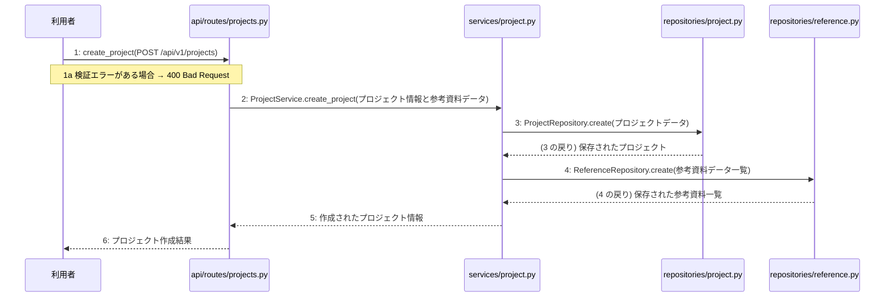

> ⚠ この単位には「未定義・要決定」が 1 件残っています(最重要 0 件)。決めてから渡すことを勧めます。

あなたは実装担当者です。以下の設計情報に従って実装してください。

## プロジェクト概要

Devex: 段階7のマイルストーン M-01〜M-03 を実装する。今回はそのうち、M-01(M-01: 環境構築とベース・プロジェクト作成機能の実装)の単位 M-01-T02 だけを扱う。

## 実装ルール

- モジュールは、段階4のモジュール一覧の依存先にだけ依存する(層を飛び越さない)。

### 07章 横断事項

| 項目 | 方針 | 関わるファイル(例) |
|---|---|---|
| 例外 | 発生した例外は app.py の例外変換機構で捕捉し、共通の JSON 形式のエラーレスポンスに変換する。検証エラーは 400 Bad Request、存在しないリソースへのアクセスは 404 Not Found、予期せぬシステムエラーは 500 Internal Server Error に対応させる。 | app.py, api/routes/projects.py, api/routes/chats.py, api/routes/documents.py |
| HTTP | API のルーティングとリクエスト・レスポンスはすべて FastAPI を用いて実装する。データ構造のバリデーションには Pydantic モデルを使用し、成功時のステータスコードは新規作成が 201 Created、取得・成功が 200 OK とする。 | app.py, api/routes/projects.py, api/routes/chats.py, api/routes/documents.py |
| 認証 | 本人以外が他人のプロジェクトを見られないようアクセス権限を管理する。認証に関する具体的な実装およびトークンの有効期限については (要決定) とする。 | app.py |
| トランザクション | データベースの書き込みを伴う複数の操作(プロジェクト作成や文書生成など)は、サービス層で一つのトランザクションとして管理する。処理が成功した場合はコミットし、例外が発生した場合はロールバックする。 | services/project.py, services/chat.py, services/document.py, repositories/project.py, repositories/reference.py, repositories/chat.py, repositories/document.py |
| ログ | 開発者自身がエラーログや死活監視ツールの通知メールで異常に気づけるよう、エラー発生時にはタイムスタンプ、処理ID、エラー内容、トレースバックをログに出力する。また、外部サービスの呼び出しエラーやシステム異常を適切に記録する。 | app.py, clients/ai.py |

### 段階7 開発環境

DockerおよびDocker Composeを用いたローカル開発環境を構築する。PythonおよびFastAPIを採用し、データベースにはPostgreSQLを使用する。自動テストはpytestを用いた単体テストおよび結合テストを実施する方針とする。

## 今回の実装単位

M-01-T02 プロジェクト作成と参考資料の初期登録機能の実装(種別: 機能 / 処理: F-01)

実現する要件:

- FR-005: txt、md、pdf形式の参考資料を最大3件まで初期入力で読み込める。

目的: 利用者からのプロジェクト作成と参考資料の初期登録のAPIリクエストを受け付け、ビジネスロジックを制御してデータベースに永続化する。

前提: M-01-T01 まで実装済み

## 作成・変更するファイル(依存順)

| ファイル | 種類 | 責務 |
|---|---|---|
| `repositories/project.py` | モジュール | PostgreSQLデータベースのprojectsテーブルに対するCRUD操作を行う |
| `repositories/reference.py` | モジュール | PostgreSQLデータベースのreferencesテーブルに対するCRUD操作を行う |
| `services/project.py` | モジュール | プロジェクト作成と参考資料登録のビジネスロジックを制御する |
| `api/routes/projects.py` | モジュール | プロジェクト作成と参考資料の初期登録のAPIリクエストを受け取り検証する |
| `tests/test_projects.py` | テスト | プロジェクト作成と参考資料初期登録のAPIおよびサービスのテストを行う |

実装の要点:

- データベースの書き込みを伴う複数の操作のため、サービス層で一つのトランザクションとして管理する
- 依存される順序として、リポジトリ層を作成した後にサービス層、APIルーター層の順に実装する

## 参照する設計

### 段階5 F-01 プロジェクト作成と参考資料の初期登録

トリガー: POST /api/v1/projects

| No | 呼び出し元 → 呼び出し先 | 種別 | 関数 | 渡すデータ | 処理内容 | 結果 | DB 操作 | 分岐・例外 |
|---|---|---|---|---|---|---|---|---|
| 1 | 利用者 → api/routes/projects.py | 同期 | create_project | POST /api/v1/projects | プロジェクト作成と参考資料の初期登録のAPIリクエストを受け取り検証する | プロジェクト作成結果 | — | 2a へ |
| 1a | — | — | — | リクエストデータ | 検証エラーがある場合 | ValidationError → 400 | — | 400 Bad Request |
| 2 | api/routes/projects.py → services/project.py | 同期 | ProjectService.create_project → 詳細: L-01 | プロジェクト情報と参考資料データ | プロジェクト作成と参考資料登録のビジネスロジックを制御する | 作成されたプロジェクト情報 | — | — |
| 3 | services/project.py → repositories/project.py | 同期 | ProjectRepository.create | プロジェクトデータ | プロジェクト情報をデータベースに保存する | 保存されたプロジェクト | projects C | — |
| 4 | services/project.py → repositories/reference.py | 同期 | ReferenceRepository.create | 参考資料データ一覧 | 参考資料情報をデータベースに保存する | 保存された参考資料一覧 | references C | — |
| 5 | services/project.py → api/routes/projects.py | 戻り | — | 作成されたプロジェクト情報 | 処理結果を返す | プロジェクト作成結果 | — | — |
| 6 | api/routes/projects.py → 利用者 | 戻り | — | プロジェクト作成結果 | プロジェクト作成結果を応答する | 201 Created | — | — |

注記: 手順 2〜7 が1つのトランザクション

シーケンス図(手順の表から導いた図。直すのは表):

- 段階6 create_project(`api/routes/projects.py`): 設計にありません

### 段階6 L-01 ProjectService.create_project(`services/project.py`)

呼ばれる手順: F-01#2

| 項目 | 内容 |
|---|---|
| シグネチャ | def create_project(project_data: dict, reference_data: list) -> dict |
| 引数 | project_data: プロジェクト情報 / reference_data: 参考資料データ |
| 戻り値 | 作成されたプロジェクト情報 |
| 例外 | なし |
| 事前条件 | 有効な認証済みユーザーからのリクエストであること |
| 事後条件 | プロジェクトおよび参考資料がデータベースに永続化され、作成されたプロジェクト情報が返されること |

擬似フロー:

1. プロジェクト情報を取得し、projectsテーブルに新規プロジェクトを作成する
    - リクエストからプロジェクト名や関連情報を抽出する
    - repositories/project.pyを呼び出してレコードを挿入する
2. 参考資料データを検証し、存在する場合はreferencesテーブルに登録する
    - 参考資料データのリストを走査する
    - repositories/reference.pyを呼び出して各参考資料を保存する
3. 作成されたプロジェクト情報と参考資料情報を統合して構築する
    - 永続化されたプロジェクトのIDを取得する
    - 関連付けられた参考資料の情報を結果オブジェクトに格納する
4. 作成されたプロジェクト情報を呼び出し元に返却する
    - 構築したプロジェクト情報を返す

- 段階6 ProjectRepository.create(`repositories/project.py`): 設計にありません

- 段階6 ReferenceRepository.create(`repositories/reference.py`): 設計にありません

- 段階4 `api/routes/projects.py`(入口): プロジェクト作成と参考資料の初期登録のAPIリクエストを受け取り検証する / 依存先: services/project.py

- 段階4 `services/project.py`(ユースケース): プロジェクト作成と参考資料登録のビジネスロジックを制御する / 依存先: repositories/project.py, repositories/reference.py

- 段階4 `repositories/project.py`(永続化): PostgreSQLデータベースのprojectsテーブルに対するCRUD操作を行う / 依存先: sqlalchemy

- 段階4 `repositories/reference.py`(永続化): PostgreSQLデータベースのreferencesテーブルに対するCRUD操作を行う / 依存先: sqlalchemy

## テスト観点

| # | 観点 | SUT | ドライバ | スタブ |
|---|---|---|---|---|
| TC-01 | 有効なプロジェクトデータと参考資料データが渡された場合に、正常にレコードが作成され201が返る | api/routes/projects.py | 結合テスト (TestClient) | スタブ不要 ── 実データベースまたはテスト用セッションを使用 |
| TC-02 | リクエストに検証エラーがある場合に400 Bad Requestが返る | api/routes/projects.py | 結合テスト (TestClient) | スタブ不要 ── 実際のバリデーション機構を使用 |

- Given: 有効なプロジェクト情報と参考資料データがある / When: POST /api/v1/projects にリクエストを送信する / Then: データベースに保存され 201 Created が返る
- Given: 不正なプロジェクト情報がある / When: POST /api/v1/projects にリクエストを送信する / Then: 400 Bad Request が返る

## 完了条件

- この単位のテストが全件成功する
- 既存のテストが壊れていない
- lint・型チェックが成功する
- (テーブルを変える単位)マイグレーションの適用が成功する
- 開発環境で起動し、確認方法の操作ができる
- 確認方法: pytest を実行してテストがすべて成功することを確認する
- 確認方法: POST /api/v1/projects エンドポイントに対してリクエストを送り、201 Created と期待されるレスポンスが返ることを確認する

## 未定義・要決定(決まるまで、推測で実装しないこと)

- [中程度] services/project.py: 段階6において create_project の詳細な処理ロジックや具体的な例外処理の詳細が設計に記載されていないため、実装時にエラーハンドリングの詳細仕様の確認が必要となる。

## 制約

- 既存の API を変更しない。
- 設計に無いことを推測で決めない。

まず現在のリポジトリを調査し、既存実装との整合性を確認してください。不整合がある場合は実装せず、問題点を報告してください。
