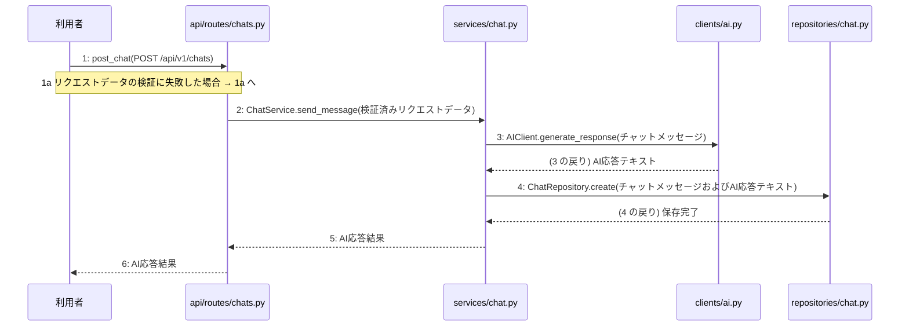

> ⚠ この単位には「未定義・要決定」が 3 件残っています(最重要 3 件)。決めてから渡すことを勧めます。

あなたは実装担当者です。以下の設計情報に従って実装してください。

## プロジェクト概要

Devex: 段階7のマイルストーン M-01〜M-03 を実装する。今回はそのうち、M-02(M-02: チャット機能の実装)の単位 M-02-T01 だけを扱う。

## 実装ルール

- モジュールは、段階4のモジュール一覧の依存先にだけ依存する(層を飛び越さない)。

### 07章 横断事項

| 項目 | 方針 | 関わるファイル(例) |
|---|---|---|
| 例外 | 発生した例外は app.py の例外変換機構で捕捉し、共通の JSON 形式のエラーレスポンスに変換する。検証エラーは 400 Bad Request、存在しないリソースへのアクセスは 404 Not Found、予期せぬシステムエラーは 500 Internal Server Error に対応させる。 | app.py, api/routes/projects.py, api/routes/chats.py, api/routes/documents.py |
| HTTP | API のルーティングとリクエスト・レスポンスはすべて FastAPI を用いて実装する。データ構造のバリデーションには Pydantic モデルを使用し、成功時のステータスコードは新規作成が 201 Created、取得・成功が 200 OK とする。 | app.py, api/routes/projects.py, api/routes/chats.py, api/routes/documents.py |
| 認証 | 本人以外が他人のプロジェクトを見られないようアクセス権限を管理する。認証に関する具体的な実装およびトークンの有効期限については (要決定) とする。 | app.py |
| トランザクション | データベースの書き込みを伴う複数の操作(プロジェクト作成や文書生成など)は、サービス層で一つのトランザクションとして管理する。処理が成功した場合はコミットし、例外が発生した場合はロールバックする。 | services/project.py, services/chat.py, services/document.py, repositories/project.py, repositories/reference.py, repositories/chat.py, repositories/document.py |
| ログ | 開発者自身がエラーログや死活監視ツールの通知メールで異常に気づけるよう、エラー発生時にはタイムスタンプ、処理ID、エラー内容、トレースバックをログに出力する。また、外部サービスの呼び出しエラーやシステム異常を適切に記録する。 | app.py, clients/ai.py |

### 段階7 開発環境

DockerおよびDocker Composeを用いたローカル開発環境を構築する。PythonおよびFastAPIを採用し、データベースにはPostgreSQLを使用する。自動テストはpytestを用いた単体テストおよび結合テストを実施する方針とする。

## 今回の実装単位

M-02-T01 チャットメッセージの送信とAI応答の取得機能の実装(種別: 機能 / 処理: F-02)

実現する要件:

- FR-001: 対話型チャットによるヒアリング機能を提供する。
- FR-011: AI応答失敗時は理由を表示してメッセージを保存せずに再送を促す。
- NFR-003: チャットの最初の文字が数秒で出力されること。

目的: 利用者がチャットメッセージを送信し、外部AIサービスからの応答を取得して履歴をデータベースに保存できるようにする。

前提: M-01-T02 まで実装済み

## 作成・変更するファイル(依存順)

| ファイル | 種類 | 責務 |
|---|---|---|
| `repositories/chat.py` | モジュール | PostgreSQLデータベースのchatsテーブルに対するCRUD操作を行う |
| `clients/ai.py` | モジュール | 外部のAIサービスを呼び出して対話応答や設計書生成を行う |
| `services/chat.py` | モジュール | チャットメッセージの送信とAI応答取得のビジネスロジックを制御する |
| `api/routes/chats.py` | モジュール | チャットメッセージ送信のAPIリクエストを受け取り検証する |
| `tests/test_chat.py` | テスト | チャットメッセージの送信とAI応答取得機能のテストを行う |

実装の要点:

- 依存される順序に従って repositories/chat.py、clients/ai.py、services/chat.py、api/routes/chats.py の順に作成する。
- サービス層でのトランザクション管理を適用し、手順 3〜5 を一つのトランザクションとして扱う。

## 参照する設計

### 段階5 F-02 チャットメッセージの送信とAI応答の取得

トリガー: POST /api/v1/chats

| No | 呼び出し元 → 呼び出し先 | 種別 | 関数 | 渡すデータ | 処理内容 | 結果 | DB 操作 | 分岐・例外 |
|---|---|---|---|---|---|---|---|---|
| 1 | 利用者 → api/routes/chats.py | 同期 | post_chat | POST /api/v1/chats | チャットメッセージ送信のリクエストを受け取り検証する | 検証済みリクエストデータ | — | 400 Bad Request |
| 1a | — | — | — | — | リクエストデータの検証に失敗した場合 | — | — | 1a へ |
| 2 | api/routes/chats.py → services/chat.py | 同期 | ChatService.send_message → 詳細: L-02 | 検証済みリクエストデータ | チャットメッセージの送信とAI応答取得のビジネスロジックを制御する | AI応答結果 | — | — |
| 3 | services/chat.py → clients/ai.py | 同期 | AIClient.generate_response | チャットメッセージ | 外部のAIサービスを呼び出して対話応答を取得する | AI応答テキスト | — | — |
| 4 | services/chat.py → repositories/chat.py | 同期 | ChatRepository.create | チャットメッセージおよびAI応答テキスト | チャット履歴をデータベースに保存する | 保存完了 | chats C | — |
| 5 | services/chat.py → api/routes/chats.py | 戻り | — | AI応答結果 | AI応答結果を返す | AI応答結果 | — | — |
| 6 | api/routes/chats.py → 利用者 | 戻り | — | AI応答結果 | レスポンスを返す | AI応答結果 | — | — |

注記: 手順 3〜5 が1つのトランザクション

シーケンス図(手順の表から導いた図。直すのは表):

- 段階6 post_chat(`api/routes/chats.py`): 設計にありません

### 段階6 L-02 ChatService.send_message(`services/chat.py`)

呼ばれる手順: F-02#2

| 項目 | 内容 |
|---|---|
| シグネチャ | def send_message(self, request_data: dict) -> dict: |
| 引数 | request_data: 検証済みリクエストデータ |
| 戻り値 | AI応答結果 |
| 例外 | なし |
| 事前条件 | 検証済みリクエストデータが提供されていること |
| 事後条件 | チャットメッセージが保存され、AI応答結果が返却されること |

擬似フロー:

1. リクエストデータから必要なパラメータを取得する
    - プロジェクト情報やメッセージ内容を抽出する
2. repositories/chat.pyを使用してチャットメッセージをchatsテーブルに保存する
    - 送信されたメッセージをデータベースに永続化する
3. clients/ai.pyを使用してAIサービスにメッセージを送信し、AI応答を取得する
    - プロジェクトのコンテキストや関連するreferences、documentsを参照に含める
4. AI応答結果を整形して戻り値として構築する
    - 取得したAIの返答データを整理する

- 段階6 AIClient.generate_response(`clients/ai.py`): 設計にありません

- 段階6 ChatRepository.create(`repositories/chat.py`): 設計にありません

- 段階4 `api/routes/chats.py`(入口): チャットメッセージ送信のAPIリクエストを受け取り検証する / 依存先: services/chat.py

- 段階4 `services/chat.py`(ユースケース): チャットメッセージの送信とAI応答取得のビジネスロジックを制御する / 依存先: clients/ai.py, repositories/chat.py

- 段階4 `clients/ai.py`(外部連携): 外部のAIサービスを呼び出して対話応答や設計書生成を行う / 依存先: httpx

- 段階4 `repositories/chat.py`(永続化): PostgreSQLデータベースのchatsテーブルに対するCRUD操作を行う / 依存先: sqlalchemy

## テスト観点

| # | 観点 | SUT | ドライバ | スタブ |
|---|---|---|---|---|
| TC-01 | 正常系: チャットメッセージ送信とAI応答の取得が成功し保存されること | api/routes/chats.py | 結合テスト (pytest) | AIClient.generate_responseをモック化して固定のAI応答テキストを返す |
| TC-02 | 異常系: リクエストデータの検証に失敗した場合に400エラーとなること | api/routes/chats.py | 結合テスト (pytest) | スタブ不要 ── バリデーションエラーの検証 |

- Given: 有効なチャットメッセージのリクエストデータがある When: POST /api/v1/chats を呼び出す Then: AI応答結果が返却されデータベースに保存される
- Given: 不正なチャットメッセージのリクエストデータがある When: POST /api/v1/chats を呼び出す Then: 400 Bad Requestが返却される

## 完了条件

- この単位のテストが全件成功する
- 既存のテストが壊れていない
- lint・型チェックが成功する
- (テーブルを変える単位)マイグレーションの適用が成功する
- 開発環境で起動し、確認方法の操作ができる
- 確認方法: pytestを実行し、チャット関連のテストがすべて成功することを確認する。

## 未定義・要決定(決まるまで、推測で実装しないこと)

- [最重要] 段階6 post_chat(api/routes/chats.py): 段階6の post_chat の詳細な処理手順とリクエスト・レスポンスのPydanticモデルの定義が設計にありません。
- [最重要] 段階6 AIClient.generate_response(clients/ai.py): 段階6の AIClient.generate_response の外部AIサービス呼び出しの詳細な仕様や利用するAPIのエンドポイント・パラメータが設計にありません。
- [最重要] 段階6 ChatRepository.create(repositories/chat.py): 段階6の ChatRepository.create の詳細なデータベース操作手順やchatsテーブルのカセット仕様が設計にありません。

## 制約

- 既存の API を変更しない。
- 設計に無いことを推測で決めない。

まず現在のリポジトリを調査し、既存実装との整合性を確認してください。不整合がある場合は実装せず、問題点を報告してください。
