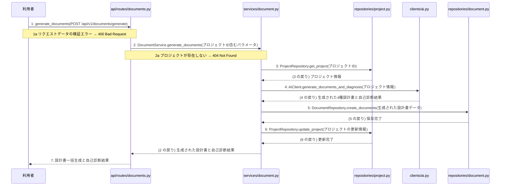

あなたは実装担当者です。以下の設計情報に従って実装してください。

## プロジェクト概要

Devex: 段階7のマイルストーン M-01〜M-03 を実装する。今回はそのうち、M-03(M-03: 設計書生成・取得機能の実装)の単位 M-03-T01 だけを扱う。

## 実装ルール

- モジュールは、段階4のモジュール一覧の依存先にだけ依存する(層を飛び越さない)。

### 07章 横断事項

| 項目 | 方針 | 関わるファイル(例) |
|---|---|---|
| 例外 | 発生した例外は app.py の例外変換機構で捕捉し、共通の JSON 形式のエラーレスポンスに変換する。検証エラーは 400 Bad Request、存在しないリソースへのアクセスは 404 Not Found、予期せぬシステムエラーは 500 Internal Server Error に対応させる。 | app.py, api/routes/projects.py, api/routes/chats.py, api/routes/documents.py |
| HTTP | API のルーティングとリクエスト・レスポンスはすべて FastAPI を用いて実装する。データ構造のバリデーションには Pydantic モデルを使用し、成功時のステータスコードは新規作成が 201 Created、取得・成功が 200 OK とする。 | app.py, api/routes/projects.py, api/routes/chats.py, api/routes/documents.py |
| 認証 | 本人以外が他人のプロジェクトを見られないようアクセス権限を管理する。認証に関する具体的な実装およびトークンの有効期限については (要決定) とする。 | app.py |
| トランザクション | データベースの書き込みを伴う複数の操作(プロジェクト作成や文書生成など)は、サービス層で一つのトランザクションとして管理する。処理が成功した場合はコミットし、例外が発生した場合はロールバックする。 | services/project.py, services/chat.py, services/document.py, repositories/project.py, repositories/reference.py, repositories/chat.py, repositories/document.py |
| ログ | 開発者自身がエラーログや死活監視ツールの通知メールで異常に気づけるよう、エラー発生時にはタイムスタンプ、処理ID、エラー内容、トレースバックをログに出力する。また、外部サービスの呼び出しエラーやシステム異常を適切に記録する。 | app.py, clients/ai.py |

### 段階7 開発環境

DockerおよびDocker Composeを用いたローカル開発環境を構築する。PythonおよびFastAPIを採用し、データベースにはPostgreSQLを使用する。自動テストはpytestを用いた単体テストおよび結合テストを実施する方針とする。

## 今回の実装単位

M-03-T01 4種設計書の一括生成と自己診断の実行機能の実装(種別: 機能 / 処理: F-03)

実現する要件:

- FR-002: 要件定義、外部設計、内部設計、実装計画の4種のMarkdown設計書を一括生成する。
- FR-003: 生成後にAIが各文書の不足点を3段階で自己診断して提示する。
- FR-012: 文書生成失敗時は再試行できるようにする。
- NFR-004: 4文書の生成は数分以内の応答を許容する。

目的: 利用者がPOST /api/v1/documents/generateを通じて4種設計書を一括生成し、自己診断を実行してデータベースに保存できるようになる。

前提: M-02-T01 まで実装済み

## 作成・変更するファイル(依存順)

| ファイル | 種類 | 責務 |
|---|---|---|
| `repositories/project.py` | モジュール | プロジェクト情報の取得および更新を行う |
| `repositories/document.py` | モジュール | 生成された設計書データをデータベースに保存する |
| `clients/ai.py` | モジュール | 外部AIサービスを呼び出して4種のMarkdown設計書を一括生成し自己診断を実行する |
| `services/document.py` | モジュール | 4種設計書の一括生成と自己診断のビジネスロジックを制御しトランザクションを管理する |
| `api/routes/documents.py` | モジュール | 設計書一括生成と自己診断のAPIリクエストを受け取り検証する |

実装の要点:

- データベースの書き込みを伴う複数の操作はサービス層で1つのトランザクションとして管理する
- 依存される順序に従い、リポジトリ層、外部クライアント層、サービス層、APIルーター層の順に実装する

## 参照する設計

### 段階5 F-03 4種設計書の一括生成と自己診断の実行

トリガー: POST /api/v1/documents/generate

| No | 呼び出し元 → 呼び出し先 | 種別 | 関数 | 渡すデータ | 処理内容 | 結果 | DB 操作 | 分岐・例外 |
|---|---|---|---|---|---|---|---|---|
| 1 | 利用者 → api/routes/documents.py | 同期 | generate_documents | POST /api/v1/documents/generate | 設計書一括生成と自己診断のAPIリクエストを受け取る | 設計書一括生成と自己診断結果 | — | 2a へ |
| 1a | — | — | — | リクエストデータ | リクエストデータの検証エラー | ValidationError | — | 400 Bad Request |
| 2 | api/routes/documents.py → services/document.py | 同期 | DocumentService.generate_documents → 詳細: L-03 | プロジェクトID含むパラメータ | 4種設計書の一括生成と自己診断のビジネスロジックを実行する | 生成された設計書と自己診断結果 | — | 3a へ |
| 2a | — | — | — | プロジェクトID | プロジェクトが存在しない | NotFoundError | — | 404 Not Found |
| 3 | services/document.py → repositories/project.py | 同期 | ProjectRepository.get_project | プロジェクトID | プロジェクトの情報を取得する | プロジェクト情報 | projects R | — |
| 4 | services/document.py → clients/ai.py | 同期 | AIClient.generate_documents_and_diagnosis | プロジェクト情報 | 外部AIサービスを呼び出して4種のMarkdown設計書を一括生成し自己診断を実行する | 生成された4種設計書と自己診断結果 | — | — |
| 5 | services/document.py → repositories/document.py | 同期 | DocumentRepository.create_documents | 生成された設計書データ | 生成結果をデータベースに保存する | 保存完了 | documents C | — |
| 6 | services/document.py → repositories/project.py | 同期 | ProjectRepository.update_project | プロジェクトの更新情報 | プロジェクトの情報を更新する | 更新完了 | projects U | — |
| 7 | api/routes/documents.py → 利用者 | 戻り | — | 設計書一括生成と自己診断結果 | 処理結果を返却する | HTTP 200 OK とレスポンスデータ | — | — |

注記: 手順 2〜8 が1つのトランザクション

シーケンス図(手順の表から導いた図。直すのは表):

- 段階6 generate_documents(`api/routes/documents.py`): 設計にありません

### 段階6 L-03 DocumentService.generate_documents(`services/document.py`)

呼ばれる手順: F-03#2

| 項目 | 内容 |
|---|---|
| シグネチャ | async def generate_documents(self, projectId: int) -> dict |
| 引数 | projectId: プロジェクトID |
| 戻り値 | 生成された設計書と自己診断結果を含む辞書データ |
| 例外 | NotFoundError: プロジェクトが存在しない場合 (404 Not Found) |
| 事前条件 | プロジェクトが存在していること |
| 事後条件 | 4種設計書が一括生成および自己診断され、その結果が返却されること |

擬似フロー:

1. プロジェクトの存在確認を行う
    - repositories/project.pyの関数を使用してprojectsテーブルから対象のプロジェクトを取得する
    - プロジェクトが存在しない場合はNotFoundErrorを送出する
2. 設計書生成に必要な関連データを収集する
    - references, chats, documentsの各テーブルから必要な情報を取得する
3. AIクライアントを呼び出して4種設計書の一括生成と自己診断を実行する
    - clients/ai.pyの関数に収集したデータを渡して処理を依頼する
4. 生成された設計書と自己診断結果を保存および返却する
    - repositories/document.pyを使用して生成結果をデータベースに保存する
    - 生成された設計書と自己診断結果を呼び出し元に返却する

- 段階6 ProjectRepository.get_project(`repositories/project.py`): 設計にありません

- 段階6 AIClient.generate_documents_and_diagnosis(`clients/ai.py`): 設計にありません

- 段階6 DocumentRepository.create_documents(`repositories/document.py`): 設計にありません

- 段階6 ProjectRepository.update_project(`repositories/project.py`): 設計にありません

- 段階4 `api/routes/documents.py`(入口): 設計書の一括生成や取得のAPIリクエストを受け取り検証する / 依存先: services/document.py

- 段階4 `services/document.py`(ユースケース): 4種設計書の一括生成と自己診断および取得のビジネスロジックを制御する / 依存先: clients/ai.py, repositories/project.py, repositories/document.py

- 段階4 `clients/ai.py`(外部連携): 外部のAIサービスを呼び出して対話応答や設計書生成を行う / 依存先: httpx

- 段階4 `repositories/project.py`(永続化): PostgreSQLデータベースのprojectsテーブルに対するCRUD操作を行う / 依存先: sqlalchemy

- 段階4 `repositories/document.py`(永続化): PostgreSQLデータベースのdocumentsテーブルに対するCRUD操作を行う / 依存先: sqlalchemy

## テスト観点

| # | 観点 | SUT | ドライバ | スタブ |
|---|---|---|---|---|
| TC-01 | 正常系: 有効なプロジェクトIDでリクエストされた場合に設計書が一括生成され自己診断結果が返却されること | generate_documents | 結合テスト (pytest) | AIClient (外部AIサービスの呼び出しをモック化) |
| TC-02 | 異常系: 存在しないプロジェクトIDでリクエストされた場合に404 Not Foundが返却されること | generate_documents | 結合テスト (pytest) | スタブ不要 ── データベースの存在確認を利用 |

- Given 存在するプロジェクトIDとリクエストデータがある When POST /api/v1/documents/generate を呼び出す Then 4種設計書が生成され200 OKが返却される

## 完了条件

- この単位のテストが全件成功する
- 既存のテストが壊れていない
- lint・型チェックが成功する
- (テーブルを変える単位)マイグレーションの適用が成功する
- 開発環境で起動し、確認方法の操作ができる
- 確認方法: pytestを実行し、設計書一括生成と自己診断のテストケースがすべて成功することを確認する

## 未定義・要決定(決まるまで、推測で実装しないこと)

なし

## 制約

- 既存の API を変更しない。
- 設計に無いことを推測で決めない。

まず現在のリポジトリを調査し、既存実装との整合性を確認してください。不整合がある場合は実装せず、問題点を報告してください。
