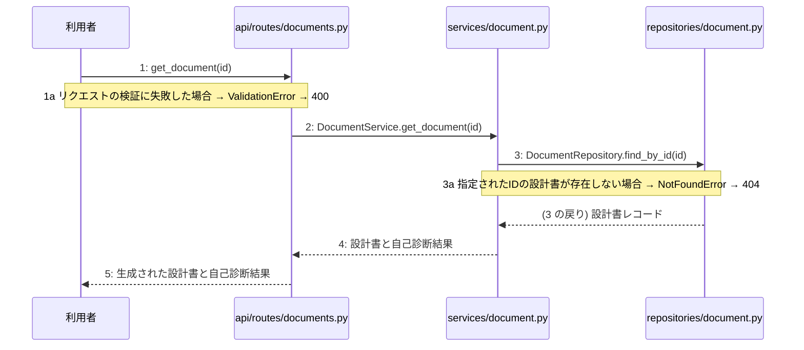

> ⚠ この単位には「未定義・要決定」が 2 件残っています(最重要 2 件)。決めてから渡すことを勧めます。

あなたは実装担当者です。以下の設計情報に従って実装してください。

## プロジェクト概要

Devex: 段階7のマイルストーン M-01〜M-03 を実装する。今回はそのうち、M-03(M-03: 設計書生成・取得機能の実装)の単位 M-03-T02 だけを扱う。

## 実装ルール

- モジュールは、段階4のモジュール一覧の依存先にだけ依存する(層を飛び越さない)。

### 07章 横断事項

| 項目 | 方針 | 関わるファイル(例) |
|---|---|---|
| 例外 | 発生した例外は app.py の例外変換機構で捕捉し、共通の JSON 形式のエラーレスポンスに変換する。検証エラーは 400 Bad Request、存在しないリソースへのアクセスは 404 Not Found、予期せぬシステムエラーは 500 Internal Server Error に対応させる。 | app.py, api/routes/projects.py, api/routes/chats.py, api/routes/documents.py |
| HTTP | API のルーティングとリクエスト・レスポンスはすべて FastAPI を用いて実装する。データ構造のバリデーションには Pydantic モデルを使用し、成功時のステータスコードは新規作成が 201 Created、取得・成功が 200 OK とする。 | app.py, api/routes/projects.py, api/routes/chats.py, api/routes/documents.py |
| 認証 | 本人以外が他人のプロジェクトを見られないようアクセス権限を管理する。認証に関する具体的な実装およびトークンの有効期限については (要決定) とする。 | app.py |
| トランザクション | データベースの書き込みを伴う複数の操作(プロジェクト作成や文書生成など)は、サービス層で一つのトランザクションとして管理する。処理が成功した場合はコミットし、例外が発生した場合はロールバックする。 | services/project.py, services/chat.py, services/document.py, repositories/project.py, repositories/reference.py, repositories/chat.py, repositories/document.py |
| ログ | 開発者自身がエラーログや死活監視ツールの通知メールで異常に気づけるよう、エラー発生時にはタイムスタンプ、処理ID、エラー内容、トレースバックをログに出力する。また、外部サービスの呼び出しエラーやシステム異常を適切に記録する。 | app.py, clients/ai.py |

### 段階7 開発環境

DockerおよびDocker Composeを用いたローカル開発環境を構築する。PythonおよびFastAPIを採用し、データベースにはPostgreSQLを使用する。自動テストはpytestを用いた単体テストおよび結合テストを実施する方針とする。

## 今回の実装単位

M-03-T02 生成された設計書と自己診断結果の取得機能の実装(種別: 機能 / 処理: F-04)

実現する要件:

- FR-002: 要件定義、外部設計、内部設計、実装計画の4種のMarkdown設計書を一括生成する。
- FR-003: 生成後にAIが各文書の不足点を3段階で自己診断して提示する。
- FR-004: 生成したMarkdownをプレビュー・コピー・ダウンロードできる。

目的: 生成された設計書と自己診断結果をデータベースから取得し、APIを通じてクライアントに返却できるようになる。

前提: M-03-T01 まで実装済み

## 作成・変更するファイル(依存順)

| ファイル | 種類 | 責務 |
|---|---|---|
| `repositories/document.py` | モジュール | データベースから指定されたIDの設計書レコードを検索する |
| `services/document.py` | モジュール | 設計書と自己診断結果の取得ロジックと例外制御を制御する |
| `api/routes/documents.py` | モジュール | 設計書取得APIのリクエストを受け取り検証した上でサービス層へ処理を委譲する |

実装の要点:

- 依存関係の順序に従い、リポジトリ層、サービス層、APIルーター層の順に実装する。

## 参照する設計

### 段階5 F-04 生成された設計書と自己診断結果の取得

トリガー: GET /api/v1/documents/{id}

| No | 呼び出し元 → 呼び出し先 | 種別 | 関数 | 渡すデータ | 処理内容 | 結果 | DB 操作 | 分岐・例外 |
|---|---|---|---|---|---|---|---|---|
| 1 | 利用者 → api/routes/documents.py | 同期 | get_document | id | 設計書取得APIのリクエストを受け取り検証する | 検証済みID | — | 3a へ |
| 1a | — | — | — | 検証エラー | リクエストの検証に失敗した場合 | 400 Bad Request | — | ValidationError → 400 |
| 2 | api/routes/documents.py → services/document.py | 同期 | DocumentService.get_document → 詳細: L-04 | id | 設計書と自己診断結果の取得処理を呼び出す | 設計書データ | — | 4a へ |
| 3 | services/document.py → repositories/document.py | 同期 | DocumentRepository.find_by_id | id | データベースから設計書と自己診断結果を取得する | 設計書レコード | documents R | 4a へ |
| 3a | — | — | — | 対象レコード無し | 指定されたIDの設計書が存在しない場合 | 404 Not Found | documents R | NotFoundError → 404 |
| 4 | services/document.py → api/routes/documents.py | 戻り | — | 設計書と自己診断結果 | 取得した設計書と自己診断結果を返す | 設計書と自己診断結果 | — | — |
| 5 | api/routes/documents.py → 利用者 | 戻り | — | 生成された設計書と自己診断結果 | APIレスポンスとして設計書と自己診断結果を返却する | 200 OK | — | — |

注記: 手順 3〜4 が1つのトランザクション

シーケンス図(手順の表から導いた図。直すのは表):

- 段階6 get_document(`api/routes/documents.py`): 設計にありません

### 段階6 L-04 DocumentService.get_document(`services/document.py`)

呼ばれる手順: F-04#2

| 項目 | 内容 |
|---|---|
| シグネチャ | def get_document(self, id: str) -> dict: |
| 引数 | id: 対象の設計書を一意に特定する識別子 |
| 戻り値 | 取得した設計書データと自己診断結果を含む辞書 |
| 例外 | ValueError: 指定された識別子の設計書が存在しない場合 (HTTP 404) |
| 事前条件 | データベースへの接続が確立されており、対象の識別子が有効であること |
| 事後条件 | 指定された設計書データが取得され、戻り値として返却されること |

擬似フロー:

1. 設計書リポジトリから指定された識別子の設計書データを取得する
    - リポジトリ関数を呼び出して documents テーブルからデータを検索する
2. 取得結果が存在するかどうかを検証する
    - データが存在しない場合は ValueError を送出する
3. 取得した設計書データを整形して返却する
    - 設計書データと自己診断結果を結合して構築する

- 段階6 DocumentRepository.find_by_id(`repositories/document.py`): 設計にありません

- 段階4 `api/routes/documents.py`(入口): 設計書の一括生成や取得のAPIリクエストを受け取り検証する / 依存先: services/document.py

- 段階4 `services/document.py`(ユースケース): 4種設計書の一括生成と自己診断および取得のビジネスロジックを制御する / 依存先: clients/ai.py, repositories/project.py, repositories/document.py

- 段階4 `repositories/document.py`(永続化): PostgreSQLデータベースのdocumentsテーブルに対するCRUD操作を行う / 依存先: sqlalchemy

## テスト観点

| # | 観点 | SUT | ドライバ | スタブ |
|---|---|---|---|---|
| TC-01 | 指定したIDの設計書と自己診断結果が正しく取得できること | DocumentService.get_document | pytestによる単体テスト | DocumentRepositoryはテストダブルに差し替えて設計書データを返すようにする |
| TC-02 | 指定したIDの設計書が存在しない場合にNotFoundErrorが送出されること | DocumentService.get_document | pytestによる単体テスト | DocumentRepositoryはテストダブルに差し替えてNoneを返すようにする |

- Given データベースに対象の設計書が存在する When get_documentを呼び出す Then 設計書データと自己診断結果が返却される

## 完了条件

- この単位のテストが全件成功する
- 既存のテストが壊れていない
- lint・型チェックが成功する
- (テーブルを変える単位)マイグレーションの適用が成功する
- 開発環境で起動し、確認方法の操作ができる
- 確認方法: pytestを実行し、設計書取得に関するテストがすべて成功することを確認する。

## 未定義・要決定(決まるまで、推測で実装しないこと)

- [最重要] 段階6 get_document(api/routes/documents.py): 設計にありません
- [最重要] 段階6 DocumentRepository.find_by_id(repositories/document.py): 設計にありません

## 制約

- 既存の API を変更しない。
- 設計に無いことを推測で決めない。

まず現在のリポジトリを調査し、既存実装との整合性を確認してください。不整合がある場合は実装せず、問題点を報告してください。
