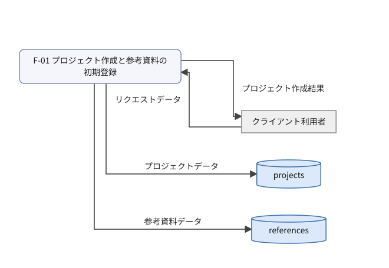
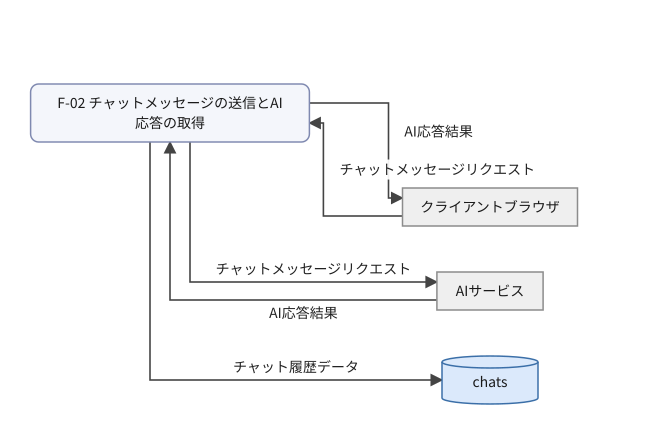
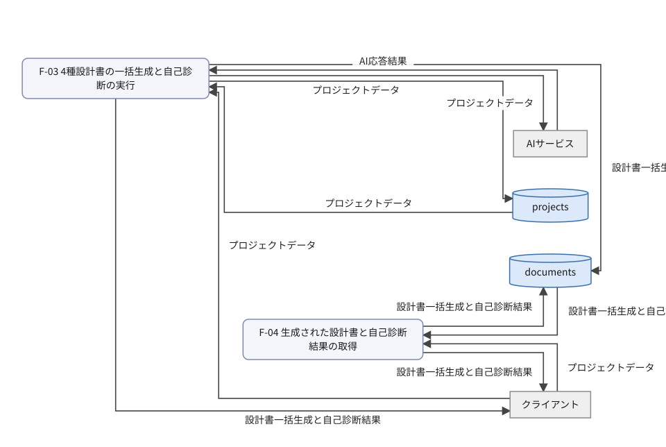
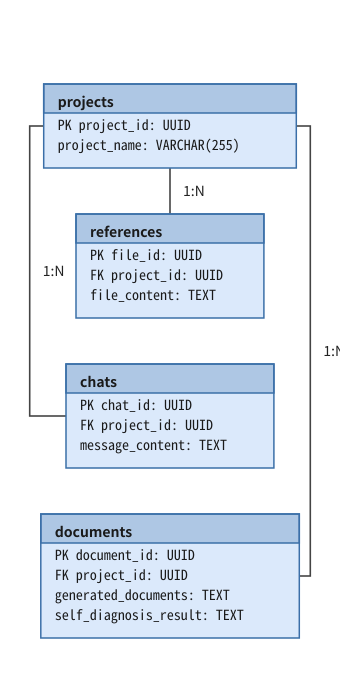
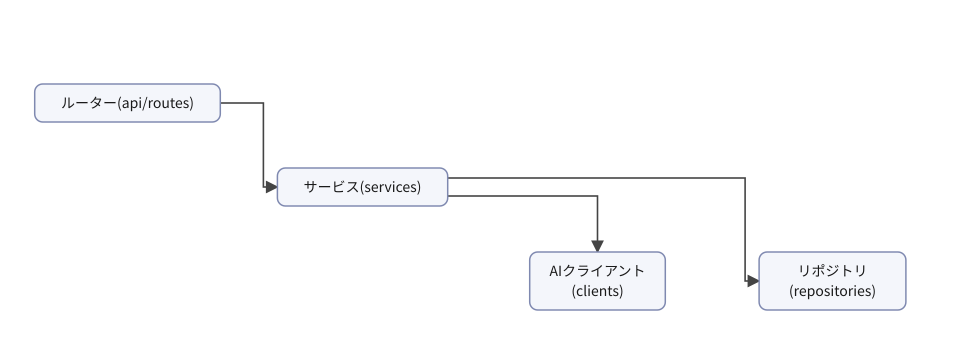
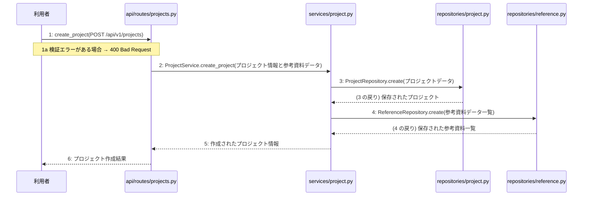
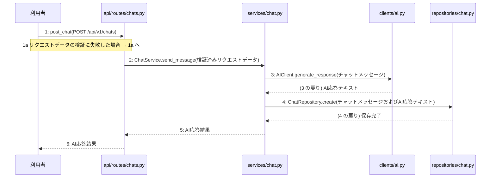
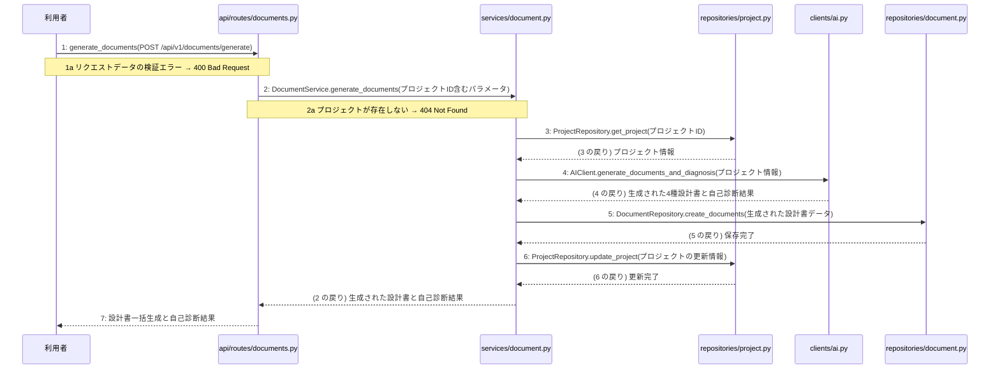
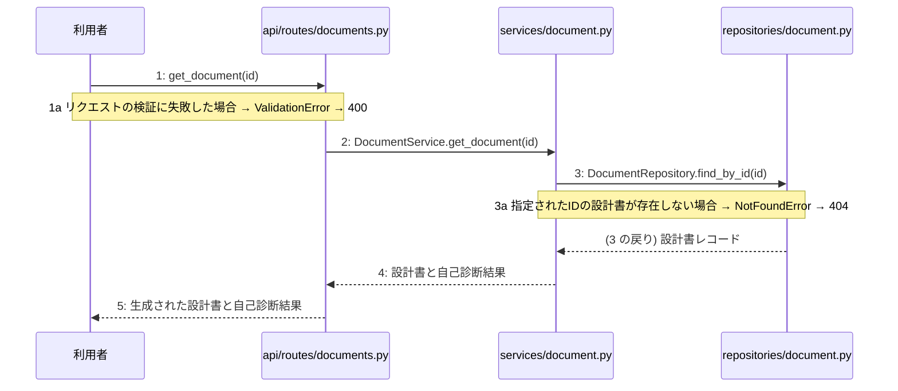

# 詳細設計書: Devex

## 01 機能(処理)一覧

| 処理ID | 名称 | 種別 | トリガー | 関連画面 | 要件 | 機能グループ | 概要 |
|---|---|---|---|---|---|---|---|
| F-01 | プロジェクト作成と参考資料の初期登録 | API | POST /api/v1/projects | SCR-001 | FR-005 | projects | プロジェクトの初期作成とアップロードされた参考資料を登録する。 |
| F-02 | チャットメッセージの送信とAI応答の取得 | API | POST /api/v1/chats | SCR-002 | FR-001, FR-011, NFR-003 | chats | チャットのメッセージを送信し、AIからの応答を取得する。 |
| F-03 | 4種設計書の一括生成と自己診断の実行 | API | POST /api/v1/documents/generate | SCR-003 | FR-002, FR-003, FR-012, NFR-004 | documents | 4種類のMarkdown設計書を一括生成し、自己診断を実行する。 |
| F-04 | 生成された設計書と自己診断結果の取得 | API | GET /api/v1/documents/{id} | SCR-003 | FR-002, FR-003, FR-004 | documents | 生成された設計書と自己診断結果を取得する。 |

## 02 データフロー

### DFD: projects

### DFD: chats

### DFD: documents

### データ辞書

| データ項目 | フィールド | 使う処理 |
|---|---|---|
| AI応答結果 | response, status | F-02, F-03 |
| チャットメッセージリクエスト | projectId, message | F-02 |
| チャット履歴データ | chatId, projectId, messageContent | F-02 |
| プロジェクトデータ | projectId, projectName | F-01, F-03, F-04 |
| プロジェクト作成結果 | status, projectId | F-01 |
| リクエストデータ | projectName, referenceFiles | F-01 |
| 参考資料データ | fileId, projectId, fileContent | F-01 |
| 設計書一括生成と自己診断結果 | documentId, generatedDocuments, selfDiagnosisResult | F-03, F-04 |

### 処理概要表(入力 / 処理 / 出力)

| 処理ID | 名称 | 入力 | 処理内容 | 出力 |
|---|---|---|---|---|
| F-01 | プロジェクト作成と参考資料の初期登録 | POST /api/v1/projects | アップロードされた参考資料を検証し、プロジェクトを作成して参考資料をデータベースに保存する。 | プロジェクト作成結果 |
| F-02 | チャットメッセージの送信とAI応答の取得 | POST /api/v1/chats | チャットメッセージの入力を検証し、AIサービスを呼び出して応答を取得し、チャット履歴を保存する。 | AI応答結果 |
| F-03 | 4種設計書の一括生成と自己診断の実行 | POST /api/v1/documents/generate | プロジェクトの情報を取得し、AIサービスを呼び出して4種のMarkdown設計書を一括生成して自己診断を実行し、生成結果を保存する。 | 設計書一括生成と自己診断結果 |
| F-04 | 生成された設計書と自己診断結果の取得 | GET /api/v1/documents/{id} | リクエストされた識別子に基づいて生成された設計書と自己診断結果をデータベースから取得する。 | 生成された設計書と自己診断結果 |

## 03 データモデル

### テーブル定義

#### projects

プロジェクトデータを管理するテーブル

| 列 | 型 | キー | NULL | 制約 | 説明 |
|---|---|---|---|---|---|
| project_id | UUID | PK | 不可 | PRIMARY KEY | プロジェクトを一意に識別する識別子(projectId) |
| project_name | VARCHAR(255) | — | 不可 | — | プロジェクト名(projectName) |

#### references

参考資料データを管理するテーブル

| 列 | 型 | キー | NULL | 制約 | 説明 |
|---|---|---|---|---|---|
| file_id | UUID | PK | 不可 | PRIMARY KEY | ファイルを一意に識別する識別子(fileId) |
| project_id | UUID | FK | 不可 | FK references projects(project_id) ON DELETE CASCADE | プロジェクト識別子(projectId) |
| file_content | TEXT | — | 不可 | — | 参考資料の内容(fileContent) |

#### chats

チャット履歴データを管理するテーブル

| 列 | 型 | キー | NULL | 制約 | 説明 |
|---|---|---|---|---|---|
| chat_id | UUID | PK | 不可 | PRIMARY KEY | チャットを一意に識別する識別子(chatId) |
| project_id | UUID | FK | 不可 | FK references projects(project_id) ON DELETE CASCADE | プロジェクト識別子(projectId) |
| message_content | TEXT | — | 不可 | — | チャットメッセージの内容(messageContent) |

#### documents

設計書一括生成と自己診断結果を管理するテーブル

| 列 | 型 | キー | NULL | 制約 | 説明 |
|---|---|---|---|---|---|
| document_id | UUID | PK | 不可 | PRIMARY KEY | ドキュメントを一意に識別する識別子(documentId) |
| project_id | UUID | FK | 不可 | FK references projects(project_id) ON DELETE CASCADE | プロジェクト識別子(projectId) |
| generated_documents | TEXT | — | 不可 | — | 生成された設計書データ(generatedDocuments) |
| self_diagnosis_result | TEXT | — | 不可 | — | 自己診断の結果(selfDiagnosisResult) |

### CRUD 図(処理 × テーブル)

| 処理ID | 名称 | projects | references | chats | documents |
|---|---|---|---|---|---|
| F-01 | プロジェクト作成と参考資料の初期登録 | C+ | C+ | — | — |
| F-02 | チャットメッセージの送信とAI応答の取得 | — | — | C+ | — |
| F-03 | 4種設計書の一括生成と自己診断の実行 | RU+ | — | — | C+ |
| F-04 | 生成された設計書と自己診断結果の取得 | — | — | — | RU+ |

記号: 印なし = DFD の線から決まる R / `+` = 書き込みは DFD の線から決まり、C/U/D の区別は人が確定 / `*` = DFD に描いていない分で、人が確定

## 04 ソフトウェア構造

### モジュール一覧

| パス | 層 | 責務 | 主な依存先 | 関わる処理 |
|---|---|---|---|---|
| api/routes/projects.py | 入口 | プロジェクト作成と参考資料の初期登録のAPIリクエストを受け取り検証する | services/project.py | F-01 |
| api/routes/chats.py | 入口 | チャットメッセージ送信のAPIリクエストを受け取り検証する | services/chat.py | F-02 |
| api/routes/documents.py | 入口 | 設計書の一括生成や取得のAPIリクエストを受け取り検証する | services/document.py | F-03, F-04 |
| services/project.py | ユースケース | プロジェクト作成と参考資料登録のビジネスロジックを制御する | repositories/project.py, repositories/reference.py | F-01 |
| services/chat.py | ユースケース | チャットメッセージの送信とAI応答取得のビジネスロジックを制御する | clients/ai.py, repositories/chat.py | F-02 |
| services/document.py | ユースケース | 4種設計書の一括生成と自己診断および取得のビジネスロジックを制御する | clients/ai.py, repositories/project.py, repositories/document.py | F-03, F-04 |
| clients/ai.py | 外部連携 | 外部のAIサービスを呼び出して対話応答や設計書生成を行う | httpx | F-02, F-03 |
| repositories/project.py | 永続化 | PostgreSQLデータベースのprojectsテーブルに対するCRUD操作を行う | sqlalchemy | F-01, F-03 |
| repositories/reference.py | 永続化 | PostgreSQLデータベースのreferencesテーブルに対するCRUD操作を行う | sqlalchemy | F-01 |
| repositories/chat.py | 永続化 | PostgreSQLデータベースのchatsテーブルに対するCRUD操作を行う | sqlalchemy | F-02 |
| repositories/document.py | 永続化 | PostgreSQLデータベースのdocumentsテーブルに対するCRUD操作を行う | sqlalchemy | F-03, F-04 |
| app.py | 入口 | アプリケーションの組み立て、認証のDI、および例外の変換を行う | fastapi | 全処理 |

## 05 主要処理の手順

### 5.0 索引

| 処理ID | 名称 | トリガー | 選定理由 | 手順数 | 詳細(06) |
|---|---|---|---|---|---|
| F-01 | プロジェクト作成と参考資料の初期登録 | POST /api/v1/projects | プロジェクト作成と複数の参考資料をトランザクション内で安全に登録するため、API層から順に呼び出してデータベースを更新する手順が重要である。 | 6 | L-01 |
| F-02 | チャットメッセージの送信とAI応答の取得 | POST /api/v1/chats | チャットメッセージの検証、AIサービスからの応答取得、およびチャット履歴の永続化を正しく順序立てて行うことが重要であるため。 | 6 | L-02 |
| F-03 | 4種設計書の一括生成と自己診断の実行 | POST /api/v1/documents/generate | 4種類の設計書を一括生成して自己診断を実行するため、複数モジュールとAI連携、DB操作のトランザクション制御が重要となるため。 | 7 | L-03 |
| F-04 | 生成された設計書と自己診断結果の取得 | GET /api/v1/documents/{id} | 指定された識別子に基づく設計書と自己診断結果を安全に取得するために、リクエスト検証からリポジトリ経由のデータ取得までを順次実行する。 | 5 | L-04 |

### 5.0.1 処理 × モジュール(セルは手順番号)

| 処理ID | api/routes/projects.py | api/routes/chats.py | api/routes/documents.py | services/project.py | services/chat.py | services/document.py | clients/ai.py | repositories/project.py | repositories/reference.py | repositories/chat.py | repositories/document.py |
|---|---|---|---|---|---|---|---|---|---|---|---|
| F-01 | 1 | — | — | 2 | — | — | — | 3 | 4 | — | — |
| F-02 | — | 1 | — | — | 2 | — | 3 | — | — | 4 | — |
| F-03 | — | — | 1 | — | — | 2 | 4 | 3, 6 | — | — | 5 |
| F-04 | — | — | 1 | — | — | 2 | — | — | — | — | 3 |

### 5.1 F-01 プロジェクト作成と参考資料の初期登録

トリガー: POST /api/v1/projects

選定理由: プロジェクト作成と複数の参考資料をトランザクション内で安全に登録するため、API層から順に呼び出してデータベースを更新する手順が重要である。

| No | 呼び出し元 → 呼び出し先 | 種別 | 関数 | 渡すデータ | 処理内容 | 結果 | DB 操作 | 分岐・例外 |
|---|---|---|---|---|---|---|---|---|
| 1 | 利用者 → api/routes/projects.py | 同期 | create_project | POST /api/v1/projects | プロジェクト作成と参考資料の初期登録のAPIリクエストを受け取り検証する | プロジェクト作成結果 | — | 2a へ |
| 1a | — | — | — | リクエストデータ | 検証エラーがある場合 | ValidationError → 400 | — | 400 Bad Request |
| 2 | api/routes/projects.py → services/project.py | 同期 | ProjectService.create_project → 詳細: L-01 | プロジェクト情報と参考資料データ | プロジェクト作成と参考資料登録のビジネスロジックを制御する | 作成されたプロジェクト情報 | — | — |
| 3 | services/project.py → repositories/project.py | 同期 | ProjectRepository.create | プロジェクトデータ | プロジェクト情報をデータベースに保存する | 保存されたプロジェクト | projects C | — |
| 4 | services/project.py → repositories/reference.py | 同期 | ReferenceRepository.create | 参考資料データ一覧 | 参考資料情報をデータベースに保存する | 保存された参考資料一覧 | references C | — |
| 5 | services/project.py → api/routes/projects.py | 戻り | — | 作成されたプロジェクト情報 | 処理結果を返す | プロジェクト作成結果 | — | — |
| 6 | api/routes/projects.py → 利用者 | 戻り | — | プロジェクト作成結果 | プロジェクト作成結果を応答する | 201 Created | — | — |

注記: 手順 2〜7 が1つのトランザクション

シーケンス図(手順の表から導いた図。直すのは表):

### 5.2 F-02 チャットメッセージの送信とAI応答の取得

トリガー: POST /api/v1/chats

選定理由: チャットメッセージの検証、AIサービスからの応答取得、およびチャット履歴の永続化を正しく順序立てて行うことが重要であるため。

| No | 呼び出し元 → 呼び出し先 | 種別 | 関数 | 渡すデータ | 処理内容 | 結果 | DB 操作 | 分岐・例外 |
|---|---|---|---|---|---|---|---|---|
| 1 | 利用者 → api/routes/chats.py | 同期 | post_chat | POST /api/v1/chats | チャットメッセージ送信のリクエストを受け取り検証する | 検証済みリクエストデータ | — | 400 Bad Request |
| 1a | — | — | — | — | リクエストデータの検証に失敗した場合 | — | — | 1a へ |
| 2 | api/routes/chats.py → services/chat.py | 同期 | ChatService.send_message → 詳細: L-02 | 検証済みリクエストデータ | チャットメッセージの送信とAI応答取得のビジネスロジックを制御する | AI応答結果 | — | — |
| 3 | services/chat.py → clients/ai.py | 同期 | AIClient.generate_response | チャットメッセージ | 外部のAIサービスを呼び出して対話応答を取得する | AI応答テキスト | — | — |
| 4 | services/chat.py → repositories/chat.py | 同期 | ChatRepository.create | チャットメッセージおよびAI応答テキスト | チャット履歴をデータベースに保存する | 保存完了 | chats C | — |
| 5 | services/chat.py → api/routes/chats.py | 戻り | — | AI応答結果 | AI応答結果を返す | AI応答結果 | — | — |
| 6 | api/routes/chats.py → 利用者 | 戻り | — | AI応答結果 | レスポンスを返す | AI応答結果 | — | — |

注記: 手順 3〜5 が1つのトランザクション

シーケンス図(手順の表から導いた図。直すのは表):

### 5.3 F-03 4種設計書の一括生成と自己診断の実行

トリガー: POST /api/v1/documents/generate

選定理由: 4種類の設計書を一括生成して自己診断を実行するため、複数モジュールとAI連携、DB操作のトランザクション制御が重要となるため。

| No | 呼び出し元 → 呼び出し先 | 種別 | 関数 | 渡すデータ | 処理内容 | 結果 | DB 操作 | 分岐・例外 |
|---|---|---|---|---|---|---|---|---|
| 1 | 利用者 → api/routes/documents.py | 同期 | generate_documents | POST /api/v1/documents/generate | 設計書一括生成と自己診断のAPIリクエストを受け取る | 設計書一括生成と自己診断結果 | — | 2a へ |
| 1a | — | — | — | リクエストデータ | リクエストデータの検証エラー | ValidationError | — | 400 Bad Request |
| 2 | api/routes/documents.py → services/document.py | 同期 | DocumentService.generate_documents → 詳細: L-03 | プロジェクトID含むパラメータ | 4種設計書の一括生成と自己診断のビジネスロジックを実行する | 生成された設計書と自己診断結果 | — | 3a へ |
| 2a | — | — | — | プロジェクトID | プロジェクトが存在しない | NotFoundError | — | 404 Not Found |
| 3 | services/document.py → repositories/project.py | 同期 | ProjectRepository.get_project | プロジェクトID | プロジェクトの情報を取得する | プロジェクト情報 | projects R | — |
| 4 | services/document.py → clients/ai.py | 同期 | AIClient.generate_documents_and_diagnosis | プロジェクト情報 | 外部AIサービスを呼び出して4種のMarkdown設計書を一括生成し自己診断を実行する | 生成された4種設計書と自己診断結果 | — | — |
| 5 | services/document.py → repositories/document.py | 同期 | DocumentRepository.create_documents | 生成された設計書データ | 生成結果をデータベースに保存する | 保存完了 | documents C | — |
| 6 | services/document.py → repositories/project.py | 同期 | ProjectRepository.update_project | プロジェクトの更新情報 | プロジェクトの情報を更新する | 更新完了 | projects U | — |
| 7 | api/routes/documents.py → 利用者 | 戻り | — | 設計書一括生成と自己診断結果 | 処理結果を返却する | HTTP 200 OK とレスポンスデータ | — | — |

注記: 手順 2〜8 が1つのトランザクション

シーケンス図(手順の表から導いた図。直すのは表):

### 5.4 F-04 生成された設計書と自己診断結果の取得

トリガー: GET /api/v1/documents/{id}

選定理由: 指定された識別子に基づく設計書と自己診断結果を安全に取得するために、リクエスト検証からリポジトリ経由のデータ取得までを順次実行する。

| No | 呼び出し元 → 呼び出し先 | 種別 | 関数 | 渡すデータ | 処理内容 | 結果 | DB 操作 | 分岐・例外 |
|---|---|---|---|---|---|---|---|---|
| 1 | 利用者 → api/routes/documents.py | 同期 | get_document | id | 設計書取得APIのリクエストを受け取り検証する | 検証済みID | — | 3a へ |
| 1a | — | — | — | 検証エラー | リクエストの検証に失敗した場合 | 400 Bad Request | — | ValidationError → 400 |
| 2 | api/routes/documents.py → services/document.py | 同期 | DocumentService.get_document → 詳細: L-04 | id | 設計書と自己診断結果の取得処理を呼び出す | 設計書データ | — | 4a へ |
| 3 | services/document.py → repositories/document.py | 同期 | DocumentRepository.find_by_id | id | データベースから設計書と自己診断結果を取得する | 設計書レコード | documents R | 4a へ |
| 3a | — | — | — | 対象レコード無し | 指定されたIDの設計書が存在しない場合 | 404 Not Found | documents R | NotFoundError → 404 |
| 4 | services/document.py → api/routes/documents.py | 戻り | — | 設計書と自己診断結果 | 取得した設計書と自己診断結果を返す | 設計書と自己診断結果 | — | — |
| 5 | api/routes/documents.py → 利用者 | 戻り | — | 生成された設計書と自己診断結果 | APIレスポンスとして設計書と自己診断結果を返却する | 200 OK | — | — |

注記: 手順 3〜4 が1つのトランザクション

シーケンス図(手順の表から導いた図。直すのは表):

## 06 処理ロジックの詳細

### 6.0 逆引き(関数 × 手順)

| L-ID | 関数 | モジュール | 呼ばれる手順 |
|---|---|---|---|
| L-01 | ProjectService.create_project | services/project.py | F-01#2 |
| L-02 | ChatService.send_message | services/chat.py | F-02#2 |
| L-03 | DocumentService.generate_documents | services/document.py | F-03#2 |
| L-04 | DocumentService.get_document | services/document.py | F-04#2 |

### 6.1 L-01 ProjectService.create_project

呼ばれる手順: F-01#2

モジュール: services/project.py

| 項目 | 内容 |
|---|---|
| シグネチャ | def create_project(project_data: dict, reference_data: list) -> dict |
| 引数 | project_data: プロジェクト情報 / reference_data: 参考資料データ |
| 戻り値 | 作成されたプロジェクト情報 |
| 例外 | なし |
| 事前条件 | 有効な認証済みユーザーからのリクエストであること |
| 事後条件 | プロジェクトおよび参考資料がデータベースに永続化され、作成されたプロジェクト情報が返されること |

擬似フロー:

1. プロジェクト情報を取得し、projectsテーブルに新規プロジェクトを作成する
    - リクエストからプロジェクト名や関連情報を抽出する
    - repositories/project.pyを呼び出してレコードを挿入する
2. 参考資料データを検証し、存在する場合はreferencesテーブルに登録する
    - 参考資料データのリストを走査する
    - repositories/reference.pyを呼び出して各参考資料を保存する
3. 作成されたプロジェクト情報と参考資料情報を統合して構築する
    - 永続化されたプロジェクトのIDを取得する
    - 関連付けられた参考資料の情報を結果オブジェクトに格納する
4. 作成されたプロジェクト情報を呼び出し元に返却する
    - 構築したプロジェクト情報を返す

### 6.2 L-02 ChatService.send_message

呼ばれる手順: F-02#2

モジュール: services/chat.py

| 項目 | 内容 |
|---|---|
| シグネチャ | def send_message(self, request_data: dict) -> dict: |
| 引数 | request_data: 検証済みリクエストデータ |
| 戻り値 | AI応答結果 |
| 例外 | なし |
| 事前条件 | 検証済みリクエストデータが提供されていること |
| 事後条件 | チャットメッセージが保存され、AI応答結果が返却されること |

擬似フロー:

1. リクエストデータから必要なパラメータを取得する
    - プロジェクト情報やメッセージ内容を抽出する
2. repositories/chat.pyを使用してチャットメッセージをchatsテーブルに保存する
    - 送信されたメッセージをデータベースに永続化する
3. clients/ai.pyを使用してAIサービスにメッセージを送信し、AI応答を取得する
    - プロジェクトのコンテキストや関連するreferences、documentsを参照に含める
4. AI応答結果を整形して戻り値として構築する
    - 取得したAIの返答データを整理する

### 6.3 L-03 DocumentService.generate_documents

呼ばれる手順: F-03#2

モジュール: services/document.py

| 項目 | 内容 |
|---|---|
| シグネチャ | async def generate_documents(self, projectId: int) -> dict |
| 引数 | projectId: プロジェクトID |
| 戻り値 | 生成された設計書と自己診断結果を含む辞書データ |
| 例外 | NotFoundError: プロジェクトが存在しない場合 (404 Not Found) |
| 事前条件 | プロジェクトが存在していること |
| 事後条件 | 4種設計書が一括生成および自己診断され、その結果が返却されること |

擬似フロー:

1. プロジェクトの存在確認を行う
    - repositories/project.pyの関数を使用してprojectsテーブルから対象のプロジェクトを取得する
    - プロジェクトが存在しない場合はNotFoundErrorを送出する
2. 設計書生成に必要な関連データを収集する
    - references, chats, documentsの各テーブルから必要な情報を取得する
3. AIクライアントを呼び出して4種設計書の一括生成と自己診断を実行する
    - clients/ai.pyの関数に収集したデータを渡して処理を依頼する
4. 生成された設計書と自己診断結果を保存および返却する
    - repositories/document.pyを使用して生成結果をデータベースに保存する
    - 生成された設計書と自己診断結果を呼び出し元に返却する

### 6.4 L-04 DocumentService.get_document

呼ばれる手順: F-04#2

モジュール: services/document.py

| 項目 | 内容 |
|---|---|
| シグネチャ | def get_document(self, id: str) -> dict: |
| 引数 | id: 対象の設計書を一意に特定する識別子 |
| 戻り値 | 取得した設計書データと自己診断結果を含む辞書 |
| 例外 | ValueError: 指定された識別子の設計書が存在しない場合 (HTTP 404) |
| 事前条件 | データベースへの接続が確立されており、対象の識別子が有効であること |
| 事後条件 | 指定された設計書データが取得され、戻り値として返却されること |

擬似フロー:

1. 設計書リポジトリから指定された識別子の設計書データを取得する
    - リポジトリ関数を呼び出して documents テーブルからデータを検索する
2. 取得結果が存在するかどうかを検証する
    - データが存在しない場合は ValueError を送出する
3. 取得した設計書データを整形して返却する
    - 設計書データと自己診断結果を結合して構築する

## 07 横断事項

| 項目 | 方針 | 関わるファイル(例) |
|---|---|---|
| 例外 | 発生した例外は app.py の例外変換機構で捕捉し、共通の JSON 形式のエラーレスポンスに変換する。検証エラーは 400 Bad Request、存在しないリソースへのアクセスは 404 Not Found、予期せぬシステムエラーは 500 Internal Server Error に対応させる。 | app.py, api/routes/projects.py, api/routes/chats.py, api/routes/documents.py |
| HTTP | API のルーティングとリクエスト・レスポンスはすべて FastAPI を用いて実装する。データ構造のバリデーションには Pydantic モデルを使用し、成功時のステータスコードは新規作成が 201 Created、取得・成功が 200 OK とする。 | app.py, api/routes/projects.py, api/routes/chats.py, api/routes/documents.py |
| 認証 | 本人以外が他人のプロジェクトを見られないようアクセス権限を管理する。認証に関する具体的な実装およびトークンの有効期限については (要決定) とする。 | app.py |
| トランザクション | データベースの書き込みを伴う複数の操作(プロジェクト作成や文書生成など)は、サービス層で一つのトランザクションとして管理する。処理が成功した場合はコミットし、例外が発生した場合はロールバックする。 | services/project.py, services/chat.py, services/document.py, repositories/project.py, repositories/reference.py, repositories/chat.py, repositories/document.py |
| ログ | 開発者自身がエラーログや死活監視ツールの通知メールで異常に気づけるよう、エラー発生時にはタイムスタンプ、処理ID、エラー内容、トレースバックをログに出力する。また、外部サービスの呼び出しエラーやシステム異常を適切に記録する。 | app.py, clients/ai.py |
