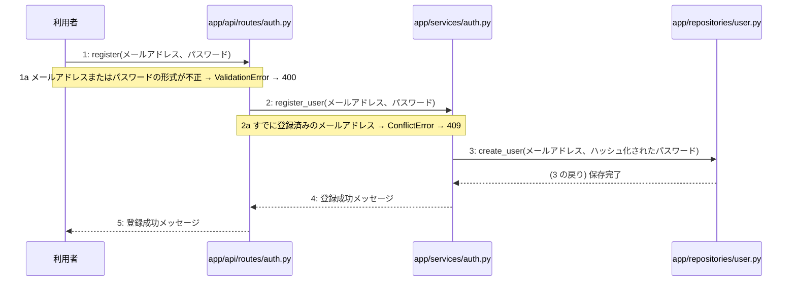
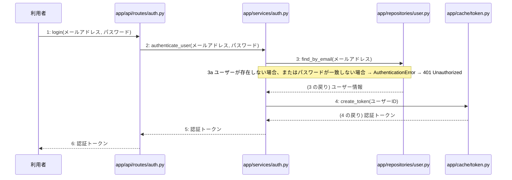
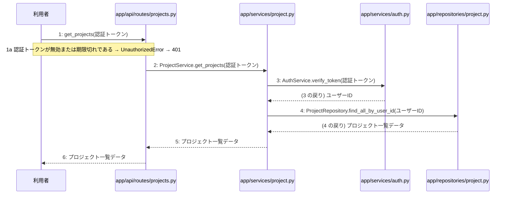
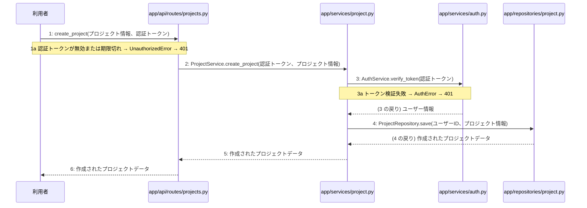
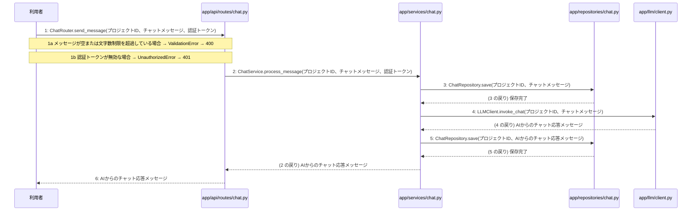
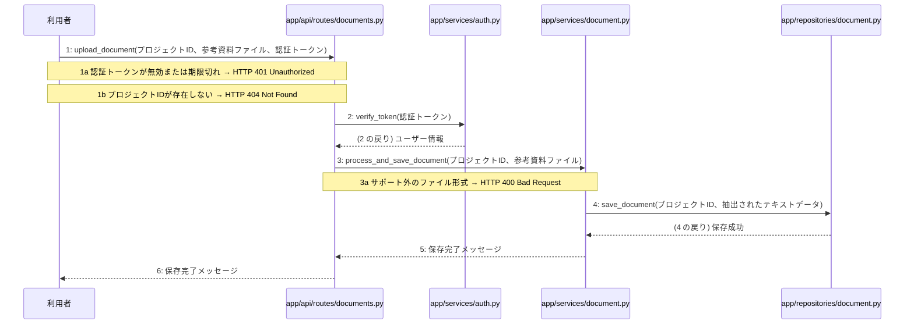
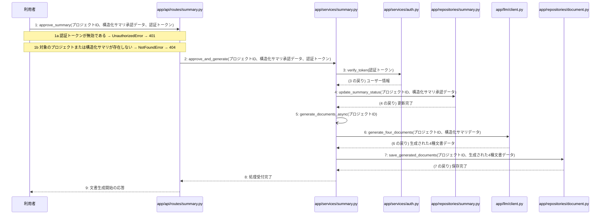
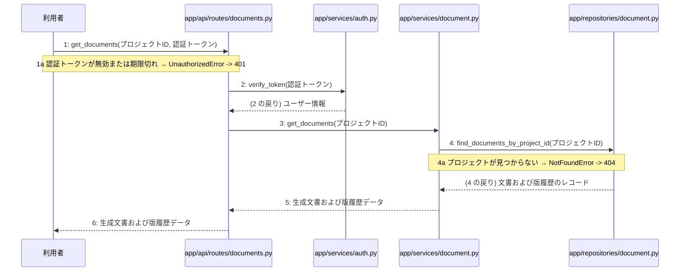

# 詳細設計書: Devex

## 01 機能(処理)一覧

| 処理ID | 名称 | 種別 | トリガー | 関連画面 | 要件 | 機能グループ | 概要 |
|---|---|---|---|---|---|---|---|
| F-01 | ユーザー登録する | API | POST /api/v1/auth/register | SCR-001 | FR-001 | auth | メールアドレスとパスワードを受け取り新規ユーザー登録を行う |
| F-02 | ログインする | API | POST /api/v1/auth/login | SCR-001 | FR-001 | auth | メールアドレスとパスワードで認証を行いトークンを返却する |
| F-03 | プロジェクト一覧を取得する | API | GET /api/v1/projects | SCR-002 | FR-002 | projects | 既存のプロジェクト一覧を取得する |
| F-04 | プロジェクトを作成する | API | POST /api/v1/projects | SCR-002 | FR-002 | projects | 新規プロジェクトを作成する |
| F-05 | チャットメッセージを送信する | API | POST /api/v1/projects/{id}/chat | SCR-003 | FR-002, FR-009, FR-010 | chat | チャットメッセージを送信しAIからの応答を取得する |
| F-06 | 参考資料をアップロードする | API | POST /api/v1/projects/{id}/documents/upload | SCR-003 | FR-003 | documents | 参考資料ファイルをアップロードして保存する |
| F-07 | 構造化サマリを承認して文書生成を開始する | API+バッチ | POST /api/v1/projects/{id}/summary/approve | SCR-004, SCR-005 | FR-004, FR-005, FR-006 | summary | 構造化サマリを承認し、裏で4種文書の順次生成および自己診断を開始する |
| F-08 | 生成文書および版一覧を取得する | API | GET /api/v1/projects/{id}/documents | SCR-005 | FR-007, FR-008 | documents | 生成された4種文書と版の履歴を取得する |

## 02 データフロー

### DFD: auth

### DFD: projects

### DFD: chat

### DFD: documents

### DFD: summary

### データ辞書

| データ項目 | フィールド | 使う処理 |
|---|---|---|
| AIからのチャット応答メッセージ | response | F-05 |
| chats | project_id, message, response | F-05 |
| セッション情報 | token, email | F-02 |
| チャットメッセージ | message | F-05 |
| パスワード | password | F-01, F-02 |
| プロジェクトID | id | F-05 |
| プロジェクトID(id) | id | F-06, F-08, F-07 |
| プロジェクト一覧データ | projects | F-03 |
| プロジェクト情報 | name | F-04 |
| メールアドレス | email | F-01, F-02 |
| ユーザー情報 | email, password_hash | F-01, F-02 |
| 作成されたプロジェクトデータ | project_id, name | F-04 |
| 保存完了メッセージ | message | F-06 |
| 参考資料テキストデータ | content | F-06 |
| 参考資料ファイル(txt, md, PDF) | file | F-06 |
| 文書生成開始の応答 | message | F-07 |
| 構造化サマリ承認データ | approved | F-07 |
| 生成文書および版履歴データ | documents, history | F-08, F-07 |
| 登録成功メッセージ | message | F-01 |
| 認証トークン | token | F-02, F-03, F-04, F-05 |
| 認証トークン(token) | token | F-06, F-08, F-07 |

### 処理概要表(入力 / 処理 / 出力)

| 処理ID | 名称 | 入力 | 処理内容 | 出力 |
|---|---|---|---|---|
| F-01 | ユーザー登録する | メールアドレス、パスワード | メールアドレスとパスワードの形式を検証し、パスワードをハッシュ化してPostgreSQLにユーザー情報を保存する。 | 登録成功メッセージ |
| F-02 | ログインする | メールアドレス、パスワード | メールアドレスとパスワードをもとにPostgreSQLで認証を行い、認証成功時にRedisを用いてトークンを発行する。 | 認証トークン |
| F-03 | プロジェクト一覧を取得する | 認証トークン | 認証トークンを検証し、PostgreSQLから既存のプロジェクト一覧を取得する。 | プロジェクト一覧データ |
| F-04 | プロジェクトを作成する | プロジェクト情報、認証トークン | 認証トークンを検証し、入力されたプロジェクト情報をPostgreSQLに新規保存する。 | 作成されたプロジェクトデータ |
| F-05 | チャットメッセージを送信する | プロジェクトID、チャットメッセージ、認証トークン | 認証トークンを検証し、メッセージ内容の文字数や空送信でないことを確認した上で、LangChain・LangGraphとGemini Flash-Liteを呼び出して応答を取得する。 | AIからのチャット応答メッセージ |
| F-06 | 参考資料をアップロードする | プロジェクトID、参考資料ファイル(txt, md, PDF)、認証トークン | 認証トークンを検証し、アップロードされたファイルを読み込んでテキスト化し、PostgreSQLに保存する。 | 保存完了メッセージ |
| F-07 | 構造化サマリを承認して文書生成を開始する | プロジェクトID、構造化サマリ承認データ、認証トークン | 認証トークンを検証し、構造化サマリを承認状態に更新したのち、バックグラウンド処理としてGemini Flash-Liteを用いた4種文書の順次生成および自己診断を開始する。 | 文書生成開始の応答 |
| F-08 | 生成文書および版一覧を取得する | プロジェクトID、認証トークン | 認証トークンを検証し、PostgreSQLから生成された4種文書と直近3件までの版の履歴を取得する。 | 生成文書および版履歴データ |

## 03 データモデル

### テーブル定義

#### users

ユーザー情報テーブル

| 列 | 型 | キー | NULL | 制約 | 説明 |
|---|---|---|---|---|---|
| id | UUID | PK | 不可 | — | ユーザーID |
| email | VARCHAR(255) | — | 不可 | UNIQUE | メールアドレス |
| password_hash | VARCHAR(255) | — | 不可 | — | パスワードハッシュ |

#### tokens

セッション情報・認証トークンテーブル

| 列 | 型 | キー | NULL | 制約 | 説明 |
|---|---|---|---|---|---|
| id | UUID | PK | 不可 | — | トークンID |
| token | VARCHAR(255) | — | 不可 | UNIQUE | 認証トークン |
| email | VARCHAR(255) | — | 不可 | — | メールアドレス |

#### projects

プロジェクト情報テーブル

| 列 | 型 | キー | NULL | 制約 | 説明 |
|---|---|---|---|---|---|
| id | UUID | PK | 不可 | — | プロジェクトID |
| name | VARCHAR(255) | — | 不可 | — | プロジェクト情報 |

#### chats

チャットメッセージテーブル

| 列 | 型 | キー | NULL | 制約 | 説明 |
|---|---|---|---|---|---|
| id | UUID | PK | 不可 | — | チャットID |
| project_id | UUID | FK | 不可 | FK projects(id) ON DELETE CASCADE | プロジェクトID |
| message | TEXT | — | 不可 | — | チャットメッセージ |
| response | TEXT | — | 不可 | — | AIからのチャット応答メッセージ |

#### documents

参考資料テキストデータ・ファイルテーブル

| 列 | 型 | キー | NULL | 制約 | 説明 |
|---|---|---|---|---|---|
| id | UUID | PK | 不可 | — | 文書ID |
| project_id | UUID | FK | 不可 | FK projects(id) ON DELETE CASCADE | プロジェクトID |
| content | TEXT | — | 不可 | — | 参考資料テキストデータ |

#### summaries

構造化サマリ承認データ・生成文書および版履歴データテーブル

| 列 | 型 | キー | NULL | 制約 | 説明 |
|---|---|---|---|---|---|
| id | UUID | PK | 不可 | — | サマリID |
| project_id | UUID | FK | 不可 | FK projects(id) ON DELETE CASCADE | プロジェクトID |
| approved | BOOLEAN | — | 不可 | DEFAULT false | 構造化サマリ承認データ |

### CRUD 図(処理 × テーブル)

| 処理ID | 名称 | users | tokens | projects | chats | documents | summaries |
|---|---|---|---|---|---|---|---|
| F-01 | ユーザー登録する | C+ | — | — | — | — | — |
| F-02 | ログインする | R | C+ | — | — | — | — |
| F-03 | プロジェクト一覧を取得する | — | — | R | — | — | — |
| F-04 | プロジェクトを作成する | — | — | C+ | — | — | — |
| F-05 | チャットメッセージを送信する | — | — | — | C+ | — | — |
| F-06 | 参考資料をアップロードする | — | — | — | — | C+ | — |
| F-07 | 構造化サマリを承認して文書生成を開始する | — | — | — | — | C+ | U+ |
| F-08 | 生成文書および版一覧を取得する | — | — | — | — | R | — |

記号: 印なし = DFD の線から決まる R / `+` = 書き込みは DFD の線から決まり、C/U/D の区別は人が確定 / `*` = DFD に描いていない分で、人が確定

## 04 ソフトウェア構造

### モジュール一覧

| パス | 層 | 責務 | 主な依存先 | 関わる処理 |
|---|---|---|---|---|
| app/api/routes/auth.py | ルーター(api/routes) | ユーザー登録およびログインのAPIエンドポイントを提供する。 | app/services/auth.py | F-01, F-02 |
| app/api/routes/projects.py | ルーター(api/routes) | プロジェクト一覧取得および新規作成のAPIエンドポイントを提供する。 | app/services/project.py | F-03, F-04 |
| app/api/routes/chat.py | ルーター(api/routes) | チャットメッセージ送信のAPIエンドポイントを提供する。 | app/services/chat.py | F-05 |
| app/api/routes/documents.py | ルーター(api/routes) | 参考資料アップロードおよび生成文書・版一覧取得のAPIエンドポイントを提供する。 | app/services/document.py | F-06, F-08 |
| app/api/routes/summary.py | ルーター(api/routes) | 構造化サマリ承認と文書生成開始のAPIエンドポイントを提供する。 | app/services/summary.py | F-07 |
| app/services/auth.py | サービス(services) | 認証に関するビジネスロジックを制御する。 | app/repositories/user.py, app/cache/token.py | F-01, F-02, F-03, F-04, F-05, F-06, F-07, F-08 |
| app/services/project.py | サービス(services) | プロジェクトに関するビジネスロジックを制御する。 | app/repositories/project.py, app/services/auth.py | F-03, F-04 |
| app/services/chat.py | サービス(services) | チャットヒアリングのビジネスロジックとLLM連携を制御する。 | app/repositories/chat.py, app/llm/client.py, app/services/auth.py | F-05 |
| app/services/document.py | サービス(services) | 参考資料のテキスト化と生成文書の版管理のビジネスロジックを制御する。 | app/repositories/document.py, app/services/auth.py | F-06, F-08 |
| app/services/summary.py | サービス(services) | 構造化サマリの承認と4種文書の順次生成および自己診断を制御する。 | app/repositories/summary.py, app/repositories/document.py, app/llm/client.py, app/services/auth.py | F-07 |
| app/llm/client.py | LLM連携(llm) | LangChain・LangGraphとGemini Flash-Liteの呼び出しを制御する。 | langchain, langgraph | F-05, F-07 |
| app/repositories/user.py | リポジトリ(repositories) | PostgreSQLへのユーザー情報の永続化と取得処理を行う。 | psycopg2 | F-01, F-02 |
| app/repositories/project.py | リポジトリ(repositories) | PostgreSQLへのプロジェクト情報の永続化と取得処理を行う。 | psycopg2 | F-03, F-04 |
| app/repositories/chat.py | リポジトリ(repositories) | PostgreSQLへのチャットメッセージの永続化を行う。 | psycopg2 | F-05 |
| app/repositories/document.py | リポジトリ(repositories) | PostgreSQLへの参考資料および生成文書・版履歴の永続化と取得処理を行う。 | psycopg2 | F-06, F-07, F-08 |
| app/repositories/summary.py | リポジトリ(repositories) | PostgreSQLの構造化サマリ情報の更新処理を行う。 | psycopg2 | F-07 |
| app/cache/token.py | キャッシュ・トークン管理(cache) | Redisを用いたトークン管理とレート制限処理を行う。 | redis | F-02 |
| app/main.py | ルーター(api/routes) | アプリケーションの組み立て、認証のDI、例外の変換を一括して行う。 | app/api/routes/auth.py, app/api/routes/projects.py, app/api/routes/chat.py, app/api/routes/documents.py, app/api/routes/summary.py, fastapi | 全処理 |

## 05 主要処理の手順

### 5.0 索引

| 処理ID | 名称 | トリガー | 選定理由 | 手順数 | 詳細(06) |
|---|---|---|---|---|---|
| F-01 | ユーザー登録する | POST /api/v1/auth/register | メールアドレスとパスワードの検証、パスワードのハッシュ化、データベースへの保存を安全に行うため | 5 | L-01 |
| F-02 | ログインする | POST /api/v1/auth/login | メールアドレスとパスワードによる認証を行い、DBからのユーザー検証とRedisへのトークン発行を安全に連携させるため | 6 | L-02 |
| F-03 | プロジェクト一覧を取得する | GET /api/v1/projects | 認証トークンを検証して既存のプロジェクト一覧を取得する一連の流れを正確に記述する | 6 | L-03, L-04 |
| F-04 | プロジェクトを作成する | POST /api/v1/projects | プロジェクト作成APIにおける認証確認からデータベースへの新規保存までの処理手順を明確にするため。 | 6 | L-05, L-04 |
| F-05 | チャットメッセージを送信する | POST /api/v1/projects/{id}/chat | チャットメッセージのバリデーション、永続化、およびLangChain・LangGraphとGemini Flash-Liteを通じたLLM応答の取得を確実に行うため | 6 | — |
| F-06 | 参考資料をアップロードする | POST /api/v1/projects/{id}/documents/upload | アップロードされた参考資料ファイルを読み込んでテキスト化し、PostgreSQLへ安全に永続化するため。 | 6 | — |
| F-07 | 構造化サマリを承認して文書生成を開始する | POST /api/v1/projects/{id}/summary/approve | 構造化サマリの承認後、非同期でLLMを利用した4種文書の順次生成および自己診断を開始するため、同期処理と非同期バッチ処理の連携が重要である。 | 9 | — |
| F-08 | 生成文書および版一覧を取得する | GET /api/v1/projects/{id}/documents | プロジェクトIDに紐づく4種文書と直近3件までの版履歴を効率的に取得するため、認証チェック後にリポジトリ経由でデータを取得する。 | 6 | — |

### 5.0.1 処理 × モジュール(セルは手順番号)

| 処理ID | app/api/routes/auth.py | app/api/routes/projects.py | app/api/routes/chat.py | app/api/routes/documents.py | app/api/routes/summary.py | app/services/auth.py | app/services/project.py | app/services/chat.py | app/services/document.py | app/services/summary.py | app/llm/client.py | app/repositories/user.py | app/repositories/project.py | app/repositories/chat.py | app/repositories/document.py | app/repositories/summary.py | app/cache/token.py |
|---|---|---|---|---|---|---|---|---|---|---|---|---|---|---|---|---|---|
| F-01 | 1 | — | — | — | — | 2 | — | — | — | — | — | 3 | — | — | — | — | — |
| F-02 | 1 | — | — | — | — | 2 | — | — | — | — | — | 3 | — | — | — | — | 4 |
| F-03 | — | 1 | — | — | — | 3 | 2 | — | — | — | — | — | 4 | — | — | — | — |
| F-04 | — | 1 | — | — | — | 3 | 2 | — | — | — | — | — | 4 | — | — | — | — |
| F-05 | — | — | 1 | — | — | — | — | 2 | — | — | 4 | — | — | 3, 5 | — | — | — |
| F-06 | — | — | — | 1 | — | 2 | — | — | 3 | — | — | — | — | — | 4 | — | — |
| F-07 | — | — | — | — | 1 | 3 | — | — | — | 2, 5 | 6 | — | — | — | 7 | 4 | — |
| F-08 | — | — | — | 1 | — | 2 | — | — | 3 | — | — | — | — | — | 4 | — | — |

### 5.1 F-01 ユーザー登録する

トリガー: POST /api/v1/auth/register

選定理由: メールアドレスとパスワードの検証、パスワードのハッシュ化、データベースへの保存を安全に行うため

| No | 呼び出し元 → 呼び出し先 | 種別 | 関数 | 渡すデータ | 処理内容 | 結果 | DB 操作 | 分岐・例外 |
|---|---|---|---|---|---|---|---|---|
| 1 | 利用者 → app/api/routes/auth.py | 同期 | register | メールアドレス、パスワード | ユーザー登録リクエストを受信する | 登録処理の実行 | — | 1a へ |
| 1a | — | — | — | — | メールアドレスまたはパスワードの形式が不正 | — | — | ValidationError → 400 |
| 2 | app/api/routes/auth.py → app/services/auth.py | 同期 | register_user → 詳細: L-01 | メールアドレス、パスワード | ビジネスロジックを実行しパスワードをハッシュ化する | ハッシュ化されたユーザー情報 | — | 2a へ |
| 2a | — | — | — | — | すでに登録済みのメールアドレス | — | — | ConflictError → 409 |
| 3 | app/services/auth.py → app/repositories/user.py | 同期 | create_user | メールアドレス、ハッシュ化されたパスワード | PostgreSQLへユーザー情報を保存する | 保存完了 | users C | — |
| 4 | app/services/auth.py → app/api/routes/auth.py | 戻り | — | 登録成功メッセージ | 登録成功の結果をルーターへ返す | 登録成功メッセージ | — | — |
| 5 | app/api/routes/auth.py → 利用者 | 戻り | — | 登録成功メッセージ | 登録成功メッセージを利用者へ返す | 201 Created | — | — |

注記: 手順3から4が1つのトランザクション

シーケンス図(手順の表から導いた図。直すのは表):

### 5.2 F-02 ログインする

トリガー: POST /api/v1/auth/login

選定理由: メールアドレスとパスワードによる認証を行い、DBからのユーザー検証とRedisへのトークン発行を安全に連携させるため

| No | 呼び出し元 → 呼び出し先 | 種別 | 関数 | 渡すデータ | 処理内容 | 結果 | DB 操作 | 分岐・例外 |
|---|---|---|---|---|---|---|---|---|
| 1 | 利用者 → app/api/routes/auth.py | 同期 | login | メールアドレス, パスワード | ログインAPIリクエストを受け取る | 認証トークン | — | — |
| 2 | app/api/routes/auth.py → app/services/auth.py | 同期 | authenticate_user → 詳細: L-02 | メールアドレス, パスワード | 認証ビジネスロジックを実行する | ユーザー情報 | — | — |
| 3 | app/services/auth.py → app/repositories/user.py | 同期 | find_by_email | メールアドレス | メールアドレスをもとにユーザーを検索する | ユーザー情報 | users R | 3a へ |
| 3a | — | — | — | — | ユーザーが存在しない場合、またはパスワードが一致しない場合 | — | — | AuthenticationError → 401 Unauthorized |
| 4 | app/services/auth.py → app/cache/token.py | 同期 | create_token | ユーザーID | Redisを使用して認証トークンを発行・保存する | 認証トークン | tokens C | — |
| 5 | app/services/auth.py → app/api/routes/auth.py | 戻り | — | 認証トークン | 認証トークンをルーターへ返却する | 認証トークン | — | — |
| 6 | app/api/routes/auth.py → 利用者 | 戻り | — | 認証トークン | ログイン成功レスポンスを返却する | 認証トークン | — | — |

注記: 手順2〜4が1つのトランザクション

シーケンス図(手順の表から導いた図。直すのは表):

### 5.3 F-03 プロジェクト一覧を取得する

トリガー: GET /api/v1/projects

選定理由: 認証トークンを検証して既存のプロジェクト一覧を取得する一連の流れを正確に記述する

| No | 呼び出し元 → 呼び出し先 | 種別 | 関数 | 渡すデータ | 処理内容 | 結果 | DB 操作 | 分岐・例外 |
|---|---|---|---|---|---|---|---|---|
| 1 | 利用者 → app/api/routes/projects.py | 同期 | get_projects | 認証トークン | プロジェクト一覧取得APIへのリクエストを送信する | プロジェクト一覧データ | — | 1a へ |
| 1a | — | — | — | — | 認証トークンが無効または期限切れである | — | — | UnauthorizedError → 401 |
| 2 | app/api/routes/projects.py → app/services/project.py | 同期 | ProjectService.get_projects → 詳細: L-03 | 認証トークン | プロジェクト一覧の取得をサービス層に依頼する | プロジェクト一覧データ | — | — |
| 3 | app/services/project.py → app/services/auth.py | 同期 | AuthService.verify_token → 詳細: L-04 | 認証トークン | 認証トークンの検証を依頼する | ユーザーID | — | — |
| 4 | app/services/project.py → app/repositories/project.py | 同期 | ProjectRepository.find_all_by_user_id | ユーザーID | ユーザーIDに紐づくプロジェクト一覧の取得をリポジトリ層に依頼する | プロジェクト一覧データ | projects R | — |
| 5 | app/services/project.py → app/api/routes/projects.py | 戻り | — | プロジェクト一覧データ | 取得したプロジェクト一覧データをルーター層へ返す | プロジェクト一覧データ | — | — |
| 6 | app/api/routes/projects.py → 利用者 | 戻り | — | プロジェクト一覧データ | プロジェクト一覧データをレスポンスとして返却する | プロジェクト一覧データ | — | — |

シーケンス図(手順の表から導いた図。直すのは表):

### 5.4 F-04 プロジェクトを作成する

トリガー: POST /api/v1/projects

選定理由: プロジェクト作成APIにおける認証確認からデータベースへの新規保存までの処理手順を明確にするため。

| No | 呼び出し元 → 呼び出し先 | 種別 | 関数 | 渡すデータ | 処理内容 | 結果 | DB 操作 | 分岐・例外 |
|---|---|---|---|---|---|---|---|---|
| 1 | 利用者 → app/api/routes/projects.py | 同期 | create_project | プロジェクト情報、認証トークン | プロジェクト作成リクエストを受信する | プロジェクト作成処理の起動 | — | 1a へ |
| 1a | — | — | — | — | 認証トークンが無効または期限切れ | — | — | UnauthorizedError → 401 |
| 2 | app/api/routes/projects.py → app/services/project.py | 同期 | ProjectService.create_project → 詳細: L-05 | 認証トークン、プロジェクト情報 | プロジェクト作成ビジネスロジックを呼び出す | プロジェクト作成処理の実行 | — | — |
| 3 | app/services/project.py → app/services/auth.py | 同期 | AuthService.verify_token → 詳細: L-04 | 認証トークン | 認証トークンを検証しユーザーを特定する | ユーザー情報 | tokens R | 3a へ |
| 3a | — | — | — | — | トークン検証失敗 | — | — | AuthError → 401 |
| 4 | app/services/project.py → app/repositories/project.py | 同期 | ProjectRepository.save | ユーザーID、プロジェクト情報 | プロジェクト情報をPostgreSQLに新規保存する | 作成されたプロジェクトデータ | projects C | — |
| 5 | app/services/project.py → app/api/routes/projects.py | 戻り | — | 作成されたプロジェクトデータ | 作成されたプロジェクトデータを返す | プロジェクトデータ | — | — |
| 6 | app/api/routes/projects.py → 利用者 | 戻り | — | 作成されたプロジェクトデータ | プロジェクト作成完了レスポンスを返す | 201 Created | — | — |

注記: 手順 2〜5 が1つのトランザクション

シーケンス図(手順の表から導いた図。直すのは表):

### 5.5 F-05 チャットメッセージを送信する

トリガー: POST /api/v1/projects/{id}/chat

選定理由: チャットメッセージのバリデーション、永続化、およびLangChain・LangGraphとGemini Flash-Liteを通じたLLM応答の取得を確実に行うため

| No | 呼び出し元 → 呼び出し先 | 種別 | 関数 | 渡すデータ | 処理内容 | 結果 | DB 操作 | 分岐・例外 |
|---|---|---|---|---|---|---|---|---|
| 1 | 利用者 → app/api/routes/chat.py | 同期 | ChatRouter.send_message | プロジェクトID、チャットメッセージ、認証トークン | チャットメッセージ送信リクエストを受け付ける | チャット応答メッセージ | — | 1a へ、1b へ |
| 1a | — | — | — | — | メッセージが空または文字数制限を超過している場合 | — | — | ValidationError → 400 |
| 1b | — | — | — | — | 認証トークンが無効な場合 | — | — | UnauthorizedError → 401 |
| 2 | app/api/routes/chat.py → app/services/chat.py | 同期 | ChatService.process_message | プロジェクトID、チャットメッセージ、認証トークン | 認証トークンを検証し、チャットメッセージのビジネスロジックを実行する | AIからのチャット応答メッセージ | — | — |
| 3 | app/services/chat.py → app/repositories/chat.py | 同期 | ChatRepository.save | プロジェクトID、チャットメッセージ | 送信されたチャットメッセージをデータベースに保存する | 保存完了 | chats C | — |
| 4 | app/services/chat.py → app/llm/client.py | 同期 | LLMClient.invoke_chat | プロジェクトID、チャットメッセージ | LangChain・LangGraphとGemini Flash-Liteを呼び出して応答を取得する | AIからのチャット応答メッセージ | — | — |
| 5 | app/services/chat.py → app/repositories/chat.py | 同期 | ChatRepository.save | プロジェクトID、AIからのチャット応答メッセージ | AIからのチャット応答メッセージをデータベースに保存する | 保存完了 | chats C | — |
| 6 | app/api/routes/chat.py → 利用者 | 戻り | — | AIからのチャット応答メッセージ | AIからのチャット応答メッセージを返却する | HTTP 200 OK | — | — |

注記: 手順3から手順5が1つのトランザクション

シーケンス図(手順の表から導いた図。直すのは表):

### 5.6 F-06 参考資料をアップロードする

トリガー: POST /api/v1/projects/{id}/documents/upload

選定理由: アップロードされた参考資料ファイルを読み込んでテキスト化し、PostgreSQLへ安全に永続化するため。

| No | 呼び出し元 → 呼び出し先 | 種別 | 関数 | 渡すデータ | 処理内容 | 結果 | DB 操作 | 分岐・例外 |
|---|---|---|---|---|---|---|---|---|
| 1 | 利用者 → app/api/routes/documents.py | 同期 | upload_document | プロジェクトID、参考資料ファイル、認証トークン | 参考資料アップロードリクエストを受け付ける | HTTPレスポンス | — | 1a へ、1b へ |
| 1a | — | — | — | — | 認証トークンが無効または期限切れ | — | — | HTTP 401 Unauthorized |
| 1b | — | — | — | — | プロジェクトIDが存在しない | — | — | HTTP 404 Not Found |
| 2 | app/api/routes/documents.py → app/services/auth.py | 同期 | verify_token | 認証トークン | 認証トークンを検証してユーザー情報を取得する | ユーザー情報 | tokens R | — |
| 3 | app/api/routes/documents.py → app/services/document.py | 同期 | process_and_save_document | プロジェクトID、参考資料ファイル | ファイルを読み込んでテキスト化し、DBに保存する | 保存完了メッセージ | documents C | 3a へ |
| 3a | — | — | — | — | サポート外のファイル形式 | — | — | HTTP 400 Bad Request |
| 4 | app/services/document.py → app/repositories/document.py | 同期 | save_document | プロジェクトID、抽出されたテキストデータ | 参考資料のテキストデータをPostgreSQLに保存する | 保存成功 | documents C | — |
| 5 | app/services/document.py → app/api/routes/documents.py | 戻り | — | 保存完了メッセージ | サービス層から結果を返す | 保存完了メッセージ | — | — |
| 6 | app/api/routes/documents.py → 利用者 | 戻り | — | 保存完了メッセージ | 保存完了メッセージを返却する | HTTP 200 OK | — | — |

注記: 手順3〜4が1つのトランザクション

シーケンス図(手順の表から導いた図。直すのは表):

### 5.7 F-07 構造化サマリを承認して文書生成を開始する

トリガー: POST /api/v1/projects/{id}/summary/approve

選定理由: 構造化サマリの承認後、非同期でLLMを利用した4種文書の順次生成および自己診断を開始するため、同期処理と非同期バッチ処理の連携が重要である。

| No | 呼び出し元 → 呼び出し先 | 種別 | 関数 | 渡すデータ | 処理内容 | 結果 | DB 操作 | 分岐・例外 |
|---|---|---|---|---|---|---|---|---|
| 1 | 利用者 → app/api/routes/summary.py | 同期 | approve_summary | プロジェクトID、構造化サマリ承認データ、認証トークン | 構造化サマリ承認と文書生成開始のAPIリクエストを受け取る | 文書生成開始の応答 | — | 1a へ、1b へ |
| 1a | — | — | — | — | 認証トークンが無効である | — | — | UnauthorizedError → 401 |
| 1b | — | — | — | — | 対象のプロジェクトまたは構造化サマリが存在しない | — | — | NotFoundError → 404 |
| 2 | app/api/routes/summary.py → app/services/summary.py | 同期 | approve_and_generate | プロジェクトID、構造化サマリ承認データ、認証トークン | 構造化サマリの承認と文書生成開始のビジネスロジックを呼び出す | 処理開始確認 | — | — |
| 3 | app/services/summary.py → app/services/auth.py | 同期 | verify_token | 認証トークン | 認証トークンを検証する | ユーザー情報 | — | — |
| 4 | app/services/summary.py → app/repositories/summary.py | 同期 | update_summary_status | プロジェクトID、構造化サマリ承認データ | 構造化サマリを承認状態に更新する | 更新完了 | summaries U | — |
| 5 | app/services/summary.py → app/services/summary.py | 非同期 | generate_documents_async | プロジェクトID | Gemini Flash-Liteを用いた4種文書の順次生成および自己診断をバックグラウンドで開始する | バックグラウンド処理起動 | — | — |
| 6 | app/services/summary.py → app/llm/client.py | 同期 | generate_four_documents | プロジェクトID、構造化サマリデータ | Gemini Flash-Liteを使用して4種文書の順次生成と自己診断を実行する | 生成された4種文書データ | — | — |
| 7 | app/services/summary.py → app/repositories/document.py | 同期 | save_generated_documents | プロジェクトID、生成された4種文書データ | 生成された4種文書をデータベースに保存する | 保存完了 | documents C | — |
| 8 | app/services/summary.py → app/api/routes/summary.py | 戻り | — | 処理受付完了 | サービス層の処理結果を返す | 処理受付完了 | — | — |
| 9 | app/api/routes/summary.py → 利用者 | 戻り | — | 文書生成開始の応答 | APIレスポンスを返す | 文書生成開始の応答 | — | — |

注記: 手順 3〜4 が1つのトランザクション

シーケンス図(手順の表から導いた図。直すのは表):

### 5.8 F-08 生成文書および版一覧を取得する

トリガー: GET /api/v1/projects/{id}/documents

選定理由: プロジェクトIDに紐づく4種文書と直近3件までの版履歴を効率的に取得するため、認証チェック後にリポジトリ経由でデータを取得する。

| No | 呼び出し元 → 呼び出し先 | 種別 | 関数 | 渡すデータ | 処理内容 | 結果 | DB 操作 | 分岐・例外 |
|---|---|---|---|---|---|---|---|---|
| 1 | 利用者 → app/api/routes/documents.py | 同期 | get_documents | プロジェクトID, 認証トークン | 生成文書および版一覧取得のリクエストを受け取る | 文書および版一覧データ | — | 1a へ |
| 1a | — | — | — | — | 認証トークンが無効または期限切れ | — | — | UnauthorizedError -> 401 |
| 2 | app/api/routes/documents.py → app/services/auth.py | 同期 | verify_token | 認証トークン | 認証トークンを検証し、ユーザーを特定する | ユーザー情報 | — | — |
| 3 | app/api/routes/documents.py → app/services/document.py | 同期 | get_documents | プロジェクトID | 生成文書と版の履歴の取得をサービスに指示する | 生成文書および版履歴データ | — | — |
| 4 | app/services/document.py → app/repositories/document.py | 同期 | find_documents_by_project_id | プロジェクトID | PostgreSQLからプロジェクトに紐づく4種文書と直近3件の版履歴を取得する | 文書および版履歴のレコード | documents R | 4a へ |
| 4a | — | — | — | — | プロジェクトが見つからない | — | — | NotFoundError -> 404 |
| 5 | app/services/document.py → app/api/routes/documents.py | 戻り | — | 生成文書および版履歴データ | 取得した文書および版履歴データをルーターへ返す | 生成文書および版履歴データ | — | — |
| 6 | app/api/routes/documents.py → 利用者 | 戻り | — | 生成文書および版履歴データ | 生成文書および版一覧のレスポンスを返す | 200 OK, 生成文書および版履歴データ | — | — |

シーケンス図(手順の表から導いた図。直すのは表):

## 06 処理ロジックの詳細

### 6.0 逆引き(関数 × 手順)

| L-ID | 関数 | モジュール | 呼ばれる手順 |
|---|---|---|---|
| L-01 | register_user | app/services/auth.py | F-01#2 |
| L-02 | authenticate_user | app/services/auth.py | F-02#2 |
| L-03 | ProjectService.get_projects | app/services/project.py | F-03#2 |
| L-04 | AuthService.verify_token | app/services/auth.py | F-03#3, F-04#3 |
| L-05 | ProjectService.create_project | app/services/project.py | F-04#2 |

### 6.1 L-01 register_user

呼ばれる手順: F-01#2

モジュール: app/services/auth.py

| 項目 | 内容 |
|---|---|
| シグネチャ | def register_user(email: str, password: str) -> dict |
| 引数 | email: メールアドレス / password: パスワード |
| 戻り値 | ハッシュ化されたユーザー情報 |
| 例外 | ConflictError: すでに登録済みのメールアドレスの場合(HTTP 409) |
| 事前条件 | 有効なメールアドレスとパスワードが入力されていること |
| 事後条件 | ユーザーが新規登録され、ハッシュ化されたユーザー情報が返却されること |

擬似フロー:

1. 入力されたメールアドレスが users テーブルにすでに存在するか確認する
    - app/repositories/user.py を使用して検索を行う
    - すでに存在する場合は ConflictError を送出する
2. パスワードを安全な方式でハッシュ化する
    - 平文のパスワードを暗号学的なハッシュ関数で変換する
3. ハッシュ化された情報を含むユーザーデータを構築する
    - メールアドレスとハッシュ化済みパスワードをユーザー情報としてまとめる
4. 構築したユーザー情報を保存し、結果を返却する
    - app/repositories/user.py を使用して users テーブルに登録する
    - 登録されたユーザー情報を戻り値として返す

### 6.2 L-02 authenticate_user

呼ばれる手順: F-02#2

モジュール: app/services/auth.py

| 項目 | 内容 |
|---|---|
| シグネチャ | def authenticate_user(email: str, password: str) -> dict: |
| 引数 | email: メールアドレス / password: パスワード |
| 戻り値 | 認証されたユーザー情報 |
| 例外 | なし |
| 事前条件 | 有効なメールアドレスとパスワードが入力されていること |
| 事後条件 | ユーザーが認証され情報が返却されること |

擬似フロー:

1. メールアドレスをもとにリポジトリからユーザー情報を取得する
    - app/repositories/user.py を呼び出す
2. 取得したユーザー情報のパスワードを検証する
    - 入力されたパスワードとハッシュ値を比較する
3. 検証結果に応じてユーザー情報を返却する
    - 認証成功時はユーザー情報を返却する

### 6.3 L-03 ProjectService.get_projects

呼ばれる手順: F-03#2

モジュール: app/services/project.py

| 項目 | 内容 |
|---|---|
| シグネチャ | def get_projects(token: str) -> list[dict]: |
| 引数 | token: 認証トークン |
| 戻り値 | プロジェクト一覧データ |
| 例外 | 認証エラーなどの例外が発生した場合は適切なHTTPステータスコードと共に送出する |
| 事前条件 | 有効な認証トークンが渡されていること |
| 事後条件 | 指定されたユーザーのプロジェクト一覧データが正常に取得されること |

擬似フロー:

1. 認証トークンを使用してユーザーを検証する
    - 認証サービス(app/services/auth.py)を呼び出す
    - トークンが無効な場合は例外を送出する
2. プロジェクト一覧の取得をリポジトリ層に依頼する
    - プロジェクトリポジトリ(app/repositories/project.py)の関数を呼び出す
    - projectsテーブルからデータを取得する
3. 取得したプロジェクト一覧データを整形して返却する
    - 結果をリスト形式に変換する

### 6.4 L-04 AuthService.verify_token

呼ばれる手順: F-03#3, F-04#3

モジュール: app/services/auth.py

| 項目 | 内容 |
|---|---|
| シグネチャ | def verify_token(self, token: str) -> dict: |
| 引数 | token: 認証トークン |
| 戻り値 | ユーザー情報 |
| 例外 | AuthError: トークンが無効または期限切れの場合、401を返す |
| 事前条件 | 有効な認証トークン文字列が渡されること |
| 事後条件 | トークンが検証され、紐づくユーザー情報が返されること |

擬似フロー:

1. 認証トークンの形式を検証する
    - トークンが空または不正な形式の場合はAuthErrorを送出する
2. キャッシュまたはtokensテーブルを参照してトークンを検索する
    - tokensテーブルから該当するトークン情報を取得する(tokens R)
3. トークンの有効期限と存在を判定する
    - トークンが存在しないまたは期限切れの場合はAuthErrorを送出する
4. 紐づくユーザー情報を取得して返却する
    - usersテーブルからユーザー情報を取得する
    - ユーザー情報を戻り値として返す

### 6.5 L-05 ProjectService.create_project

呼ばれる手順: F-04#2

モジュール: app/services/project.py

| 項目 | 内容 |
|---|---|
| シグネチャ | def create_project(token: str, project_data: dict) -> dict |
| 引数 | token: 認証トークン / project_data: プロジェクト情報 |
| 戻り値 | 作成されたプロジェクト情報 |
| 例外 | ValueError: トークンが無効または期限切れの場合(HTTP 401) |
| 事前条件 | 有効な認証トークンが提供されていること |
| 事後条件 | projects テーブルに新しいプロジェクトが作成されること |

擬似フロー:

1. 認証トークンの検証を行う
    - app/services/auth.py を利用して token の有効性を確認する
    - 無効な場合は ValueError を送出する
2. プロジェクト作成データを準備する
    - project_data から必要な値を取り出す
3. プロジェクトを永続化する
    - app/repositories/project.py を呼び出して projects テーブルにレコードを追加する
4. 作成されたプロジェクト情報を返却する
    - データベースから返されたプロジェクト情報を呼び出し元に返す

## 07 横断事項

| 項目 | 方針 | 関わるファイル(例) |
|---|---|---|
| 例外と HTTP | 発生した例外は app/main.py の共通例外ハンドラーで捕捉し、ValidationError は HTTP 400、AuthenticationError や UnauthorizedError は HTTP 401、ConflictError は HTTP 409、NotFoundError は HTTP 404、その他の予期せぬエラーは HTTP 500 としてクライアントへ返却する。AIの応答失敗時および文書生成失敗時には適切なエラーメッセージを含めたレスポンスを返す。 | app/main.py, app/api/routes/auth.py, app/api/routes/projects.py, app/api/routes/chat.py, app/api/routes/documents.py, app/api/routes/summary.py |
| 認証 | ユーザー登録およびログインにより発行された認証トークンは Redis および tokens テーブルで管理する。各APIリクエストのヘッダーに含まれるトークンは app/services/auth.py の verify_token により検証し、有効期限(要決定)が切れている場合は 401 Unauthorized エラーとする。 | app/api/routes/auth.py, app/services/auth.py, app/cache/token.py, app/repositories/user.py |
| トランザクション | データベースへの書き込み伴う処理(ユーザー登録、ログインでのトークン発行、プロジェクト作成、チャットの保存、参考資料の保存、構造化サマリの承認と文書保存など)は、各リポジトリ層およびサービス層でトランザクション境界を厳守し、失敗時はロールバックしてデータの整合性を保つ。 | app/repositories/user.py, app/repositories/project.py, app/repositories/chat.py, app/repositories/document.py, app/repositories/summary.py |
| ログ | セキュリティ要件に基づき、チャットの入力内容はログに残さず、ユーザーの操作記録やシステムの稼働状況などの監査ログのみを保存する。エラー発生時はトレースバックを含む詳細情報をログに出力し、死活監視や追跡に活用する。 | app/main.py, app/services/chat.py |
| レート制限 | ログインの総当たり、登録の大量作成、チャットや生成の回数上限を設けて不正利用を防ぐため、Redisを利用してIPアドレスまたはユーザー単位のリクエスト頻度を制限する。上限を超過した場合は HTTP 429 Too Many Requests を返却する。 | app/cache/token.py, app/main.py |
| 外部サービスの呼び出し | Gemini Flash-Liteの呼び出しは app/llm/client.py にカプセル化し、APIキーを用いた認証を行う。上限超過やタイムアウトなどのエラーが発生した場合は、理由をメッセージに含めて例外として送出し、安全に再送や再生成を促せるようにする。 | app/llm/client.py, app/services/chat.py, app/services/summary.py |
