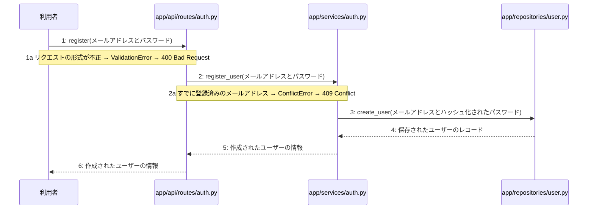

# M-01-T02 ユーザー登録機能の実装

> 種別: 機能 / マイルストーン: M-01 M-01: 環境構築と認証機能 / 要件: FR-001, FR-011, FR-012 / 依存: M-01-T01

## 目的

利用者からのユーザー登録リクエストを受け付け、パスワードを安全にハッシュ化した上でデータベースに新規ユーザー情報を保存し、作成されたユーザー情報を返却する。

## 対象の処理・参照する設計

- 段階5 F-01 ユーザー登録する
- 段階6 register(`app/api/routes/auth.py`)(設計に無い ── 未定義を参照)
- 段階6 L-01 register_user(`app/services/auth.py`)
- 段階6 create_user(`app/repositories/user.py`)(設計に無い ── 未定義を参照)
- 段階4 `app/api/routes/auth.py`
- 段階4 `app/services/auth.py`
- 段階4 `app/repositories/user.py`

### シーケンス図(段階5 F-01 ユーザー登録する の手順から導出)

## 作成・変更するファイル(依存順)

| ファイル | 種類 | 責務 | 根拠 |
|---|---|---|---|
| `app/repositories/user.py` | モジュール | usersテーブルに対するデータ入出力およびクエリの実行を行う | 段階4 |
| `app/services/auth.py` | モジュール | ユーザー登録に関するビジネスロジックの実行と制御を行う | 段階4 |
| `app/api/routes/auth.py` | モジュール | ユーザー登録APIエンドポイントの定義とリクエストの受け付けを行う | 段階4 |
| `tests/api/test_auth.py` | テスト | ユーザー登録機能の結合テストおよびエンドポイントの検証を行う | 段階7 開発環境 |

## 実装の要点(設計に書いていないことだけ)

- リポジトリ層 app/repositories/user.py を先に実装し、それを呼び出すサービス層 app/services/auth.py、最後にAPIルーター層 app/api/routes/auth.py の順に実装する。
- トランザクション管理およびパスワードのハッシュ化処理を適用する。

## テスト観点

| # | 観点 | SUT | ドライバ | スタブ |
|---|---|---|---|---|
| TC-01 | 正常なメールアドレスとパスワードでユーザー登録が成功し、201 Createdが返ること | POST /api/v1/auth/register | 結合テスト(FastAPI TestClient) | スタブ不要 ── 実データベースまたはテスト用インメモリDBを使用 |
| TC-02 | すでに登録済みのメールアドレスの場合にConflictErrorが発生し、409 Conflictが返ること | POST /api/v1/auth/register | 結合テスト(FastAPI TestClient) | スタブ不要 ── 事前に同一メールアドレスのレコードを登録しておく |

- Given: 有効な未登録のメールアドレスとパスワードがある / When: ユーザー登録APIにリクエストを送信する / Then: 201 Createdと作成されたユーザー情報が返される
- Given: すでに登録済みのメールアドレスがある / When: 同じメールアドレスでユーザー登録APIにリクエストを送信する / Then: 409 Conflictが返される

## 確認方法

- pytestを実行し、ユーザー登録の正常系および重複メールアドレス時の異常系テストがすべてパスすることを確認する。

## 未定義・要決定

なし
