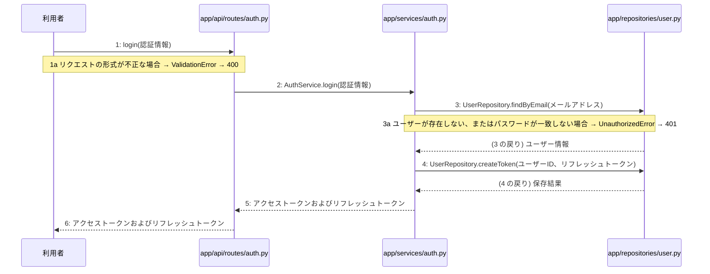

# M-01-T03 ログイン機能の実装

> 種別: 機能 / マイルストーン: M-01 M-01: 環境構築と認証機能 / 要件: FR-001, FR-002, FR-011 / 依存: M-01-T02

## 目的

利用者からのログインリクエストを受け付け、認証情報の検証後にアクセストークンおよびリフレッシュトークンを発行して返却できるようにする。

## 対象の処理・参照する設計

- 段階5 F-02 ログインする
- 段階6 login(`app/api/routes/auth.py`)(設計に無い ── 未定義を参照)
- 段階6 L-02 AuthService.login(`app/services/auth.py`)
- 段階6 UserRepository.findByEmail(`app/repositories/user.py`)(設計に無い ── 未定義を参照)
- 段階6 UserRepository.createToken(`app/repositories/user.py`)(設計に無い ── 未定義を参照)
- 段階4 `app/api/routes/auth.py`
- 段階4 `app/services/auth.py`
- 段階4 `app/repositories/user.py`

### シーケンス図(段階5 F-02 ログインする の手順から導出)

## 作成・変更するファイル(依存順)

| ファイル | 種類 | 責務 | 根拠 |
|---|---|---|---|
| `app/repositories/user.py` | モジュール | usersおよびtokensテーブルに対するPostgreSQLとのデータ入出力およびクエリの実行を行う | 段階4 |
| `app/services/auth.py` | モジュール | ユーザー登録やログイン・ログアウト等の認証ビジネスロジックの実行と制御を行う | 段階4 |
| `app/api/routes/auth.py` | モジュール | 認証に関するAPIエンドポイントの定義とリクエストの受け付けを行う | 段階4 |

## 実装の要点(設計に書いていないことだけ)

- 依存される順序に従い、リポジトリ層(app/repositories/user.py)、サービス層(app/services/auth.py)、APIルーター層(app/api/routes/auth.py)の順に実装する。

## テスト観点

| # | 観点 | SUT | ドライバ | スタブ |
|---|---|---|---|---|
| TC-01 | 正しい認証情報が渡された場合にトークンが発行されHttpOnly Cookieに設定されること | POST /api/v1/auth/login | 結合テスト(TestClient) | スタブ不要 ── 実際のデータベースおよびリポジトリ層を使用する |

- Given: 有効なユーザーのメールアドレスとパスワードが登録されている
- When: 正しい認証情報でログインAPIにリクエストを送信する
- Then: ステータスコード200が返却され、HttpOnly Cookieにアクセストークンとリフレッシュトークンが設定される

## 確認方法

- pytestを用いたテストを実行し、ログイン機能に関するテストが全て成功することを確認する。

## 未定義・要決定

| 重要度 | 出どころ | 対象 | 内容 | 直す段階 |
|---|---|---|---|---|
| 軽微 | 検証 | M-01-T03 | M-01-T03 はテスト観点がありますが、作成・変更するファイルにテストのファイルがありません(手順書を作り直すか、テストのファイルを足します)。 | — |
