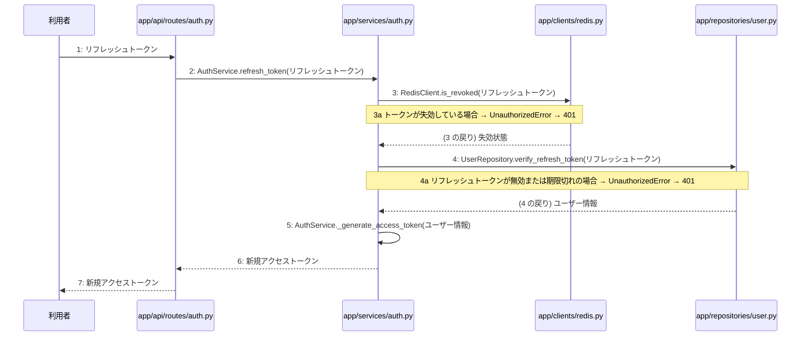

# M-01-T04 トークンリフレッシュ機能の実装

> 種別: 機能 / マイルストーン: M-01 M-01: 環境構築と認証機能 / 要件: FR-002 / 依存: M-01-T03

## 目的

リフレッシュトークンを利用して新規アクセストークンを再発給できるようになる。

## 対象の処理・参照する設計

- 段階5 F-03 トークンをリフレッシュする
- 段階6 L-03 AuthService.refresh_token(`app/services/auth.py`)
- 段階6 RedisClient.is_revoked(`app/clients/redis.py`)(設計に無い ── 未定義を参照)
- 段階6 UserRepository.verify_refresh_token(`app/repositories/user.py`)(設計に無い ── 未定義を参照)
- 段階6 L-04 AuthService._generate_access_token(`app/services/auth.py`)
- 段階4 `app/api/routes/auth.py`
- 段階4 `app/services/auth.py`
- 段階4 `app/repositories/user.py`
- 段階4 `app/clients/redis.py`

### シーケンス図(段階5 F-03 トークンをリフレッシュする の手順から導出)

## 作成・変更するファイル(依存順)

| ファイル | 種類 | 責務 | 根拠 |
|---|---|---|---|
| `app/clients/redis.py` | モジュール | Redisとの通信を行いトークン失効管理等を行う | 段階4 |
| `app/repositories/user.py` | モジュール | usersおよびtokensテーブルに対するPostgreSQLとのデータ入出力およびクエリの実行を行う | 段階4 |
| `app/services/auth.py` | モジュール | ユーザー登録やログイン・ログアウト等の認証ビジネスロジックの実行と制御を行う | 段階4 |
| `app/api/routes/auth.py` | モジュール | 認証に関するAPIエンドポイントの定義とリクエストの受け付けを行う | 段階4 |
| `tests/api/test_auth.py` | テスト | トークンリフレッシュ機能のAPIおよびサービステストを行う | 段階7 開発環境 |

## 実装の要点(設計に書いていないことだけ)

- 既存の認証関連モジュールを再利用してトークンリフレッシュ処理を追加する
- 依存される順にRedisクライアント、リポジトリ層、サービス層、ルーター層の順で実装・修正を行う

## テスト観点

| # | 観点 | SUT | ドライバ | スタブ |
|---|---|---|---|---|
| TC-01 | 有効なリフレッシュトークンで新規アクセストークンが取得できること | AuthService.refresh_token | 結合テスト(APIテスト) | スタブ不要 ── 実際のRedisおよびデータベースを使用する |
| TC-02 | 失効したトークンまたは無効なトークンの場合に401エラーになること | AuthService.refresh_token | 結合テスト(APIテスト) | スタブ不要 ── 実際のRedisおよびデータベースを使用する |

- Given: 有効なリフレッシュトークンが存在する
- When: POST /api/v1/auth/refresh にリフレッシュトークンを送信する
- Then: 新規アクセストークンが返却される

## 確認方法

- pytest tests/api/test_auth.py を実行してすべてのテストが成功することを確認する

## 未定義・要決定

なし
