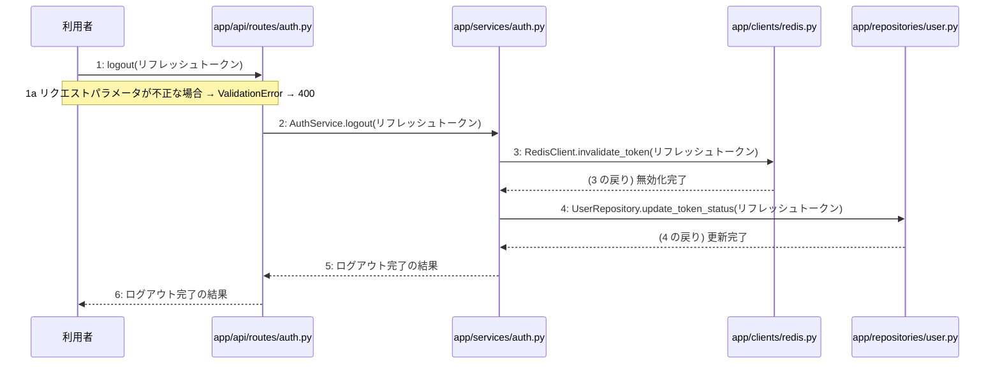

# M-01-T05 ログアウト機能の実装

> 種別: 機能 / マイルストーン: M-01 M-01: 環境構築と認証機能 / 要件: FR-002, FR-012 / 依存: M-01-T04

## 目的

利用者がPOST /api/v1/auth/logoutを通じてログアウトを行い、リフレッシュトークンを無効化できるようにする。

## 対象の処理・参照する設計

- 段階5 F-04 ログアウトする
- 段階6 logout(`app/api/routes/auth.py`)(設計に無い ── 未定義を参照)
- 段階6 L-05 AuthService.logout(`app/services/auth.py`)
- 段階6 RedisClient.invalidate_token(`app/clients/redis.py`)(設計に無い ── 未定義を参照)
- 段階6 UserRepository.update_token_status(`app/repositories/user.py`)(設計に無い ── 未定義を参照)
- 段階4 `app/api/routes/auth.py`
- 段階4 `app/services/auth.py`
- 段階4 `app/repositories/user.py`
- 段階4 `app/clients/redis.py`

### シーケンス図(段階5 F-04 ログアウトする の手順から導出)

## 作成・変更するファイル(依存順)

| ファイル | 種類 | 責務 | 根拠 |
|---|---|---|---|
| `app/clients/redis.py` | モジュール | Redisを用いてリフレッシュトークンの無効化を行う | 段階4 |
| `app/repositories/user.py` | モジュール | tokensテーブルのトークン状態を更新する | 段階4 |
| `app/services/auth.py` | モジュール | ログアウトビジネスロジックを実行する | 段階4 |
| `app/api/routes/auth.py` | モジュール | ログアウトAPIリクエストを受け付ける | 段階4 |
| `tests/api/test_auth.py` | テスト | ログアウト機能の結合テストおよび単体テストを行う | 段階7 開発環境 |

## 実装の要点(設計に書いていないことだけ)

- 手順2から手順4までは1つのトランザクションとして処理をまとめる。
- 依存される順序に従い、Redisクライアント、リポジトリ層、サービス層、APIルーターの順に実装を進める。

## テスト観点

| # | 観点 | SUT | ドライバ | スタブ |
|---|---|---|---|---|
| TC-01 | 正常なリフレッシュトークンでログアウトが成功しHTTP 200が返る | app/api/routes/auth.py logout | 結合テスト(TestClient) | スタブ不要 ── 実際のRedisおよびテスト用DBを使用 |
| TC-02 | 不正なリフレッシュトークンまたはパラメータでValidationErrorとなりHTTP 400が返る | app/api/routes/auth.py logout | 結合テスト(TestClient) | スタブ不要 ── 実際のRedisおよびテスト用DBを使用 |

- Given 有効なリフレッシュトークンが存在する時 When ログアウトAPIにリクエストを送信すると Then トークンが無効化されHTTP 200が返る
- Given 不正なリフレッシュトークンである時 When ログアウトAPIにリクエストを送信すると Then バリデーションエラーによりHTTP 400が返る

## 確認方法

- pytest tests/api/test_auth.pyを実行し、ログアウトに関するテストがすべて成功することを確認する。

## 未定義・要決定

| 重要度 | 出どころ | 対象 | 内容 | 直す段階 |
|---|---|---|---|---|
| 最重要 | AI | 段階6 L-05 AuthService.logout | RedisClient.invalidate_tokenおよびUserRepository.update_token_statusの詳細なメソッドシグネチャと引数が段階6に記載されていない。 | 段階6 |
| 中程度 | AI | 段階6 RedisClient.invalidate_token | RedisClientのinvalidate_tokenメソッドの引数および戻り値の仕様が定義されていない。 | 段階6 |
