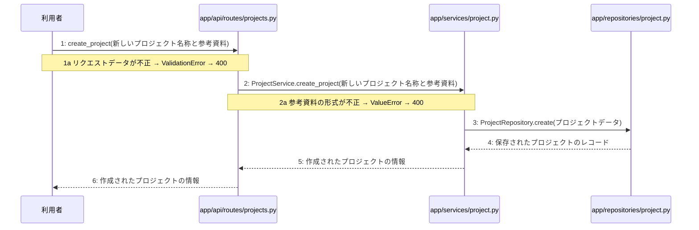

# M-02-T01 プロジェクト作成機能の実装

> 種別: 機能 / マイルストーン: M-02 M-02: プロジェクト管理とチャット対話機能 / 要件: FR-003, FR-009 / 依存: M-01-T05

## 目的

利用者からのプロジェクト作成リクエストを受け付け、参考資料の検証とデータベースへの保存を行って作成されたプロジェクト情報を返す。

## 対象の処理・参照する設計

- 段階5 F-06 プロジェクトを作成する
- 段階6 create_project(`app/api/routes/projects.py`)(設計に無い ── 未定義を参照)
- 段階6 ProjectService.create_project(`app/services/project.py`)(設計に無い ── 未定義を参照)
- 段階6 ProjectRepository.create(`app/repositories/project.py`)(設計に無い ── 未定義を参照)
- 段階4 `app/api/routes/projects.py`
- 段階4 `app/services/project.py`
- 段階4 `app/repositories/project.py`

### シーケンス図(段階5 F-06 プロジェクトを作成する の手順から導出)

## 作成・変更するファイル(依存順)

| ファイル | 種類 | 責務 | 根拠 |
|---|---|---|---|
| `app/repositories/project.py` | モジュール | projectsテーブルに対するPostgreSQLとのデータ入出力およびクエリの実行を行う | 段階4 |
| `app/services/project.py` | モジュール | プロジェクト作成のビジネスロジックの実行と制御を行う | 段階4 |
| `app/api/routes/projects.py` | モジュール | プロジェクト作成APIエンドポイントの定義とリクエストの受け付けを行う | 段階4 |
| `tests/api/test_projects.py` | テスト | プロジェクト作成機能のAPIおよび各層の結合テストを行う | 段階7 開発環境 |

## 実装の要点(設計に書いていないことだけ)

- リポジトリ層、サービス層、APIルーター層の順に依存関係に沿って実装する。
- データベースへの書き込みを伴うためトランザクション制御とエラー時のロールバックを実装に含める。

## テスト観点

| # | 観点 | SUT | ドライバ | スタブ |
|---|---|---|---|---|
| TC-01 | 正常なプロジェクト名称と参考資料が渡された場合にプロジェクトが作成され201が返る | app/api/routes/projects.py | 結合テスト(FastAPI TestClient) | スタブ不要 ── 実データベースまたはテスト用DBを使用 |
| TC-02 | リクエストデータが不正な場合に400 Bad Requestが返る | app/api/routes/projects.py | 結合テスト(FastAPI TestClient) | スタブ不要 ── バリデーションによる検証 |
| TC-03 | 参考資料の形式が不正な場合に400 Bad Requestが返る | app/services/project.py | 単体テスト | スタブ不要 ── サービスクラスの直接呼び出し |

- Given: 有効なプロジェクト名称と参考資料がある, When: POST /api/v1/projects にリクエストを送信する, Then: HTTP 201 Created と作成されたプロジェクト情報が返る
- Given: 不正なリクエストデータがある, When: POST /api/v1/projects にリクエストを送信する, Then: ValidationError により 400 Bad Request が返る
- Given: 不正な形式の参考資料がある, When: ProjectService.create_project を呼び出す, Then: ValueError により 400 Bad Request が返る

## 確認方法

- 作成したテストを実行しすべてのテストが成功することを確認する
- FastClient等を用いてPOST /api/v1/projectsエンドポイントにリクエストを送り意図したレスポンスが返ることを確認する

## 未定義・要決定

| 重要度 | 出どころ | 対象 | 内容 | 直す段階 |
|---|---|---|---|---|
| 中程度 | AI | 段階6 create_project | 段階6の詳細処理ロジックが記載されていないため、具体的なリクエストスキーマやバリデーション仕様を定義する必要がある。 | 段階6 |
| 中程度 | AI | 段階6 ProjectService.create_project | 段階6の詳細処理ロジックが記載されていないため、参考資料の形式の検証ルールや保持するプロジェクトデータの構造を定義する必要がある。 | 段階6 |
| 中程度 | AI | 段階6 ProjectRepository.create | 段階6の詳細処理ロジックが記載されていないため、PostgreSQLへ保存する際のテーブル定義やクエリの詳細を定義する必要がある。 | 段階6 |
