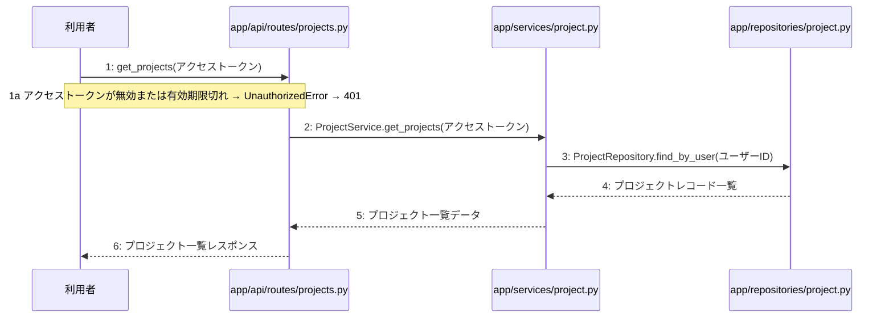

# M-02-T02 プロジェクト一覧取得機能の実装

> 種別: 機能 / マイルストーン: M-02 M-02: プロジェクト管理とチャット対話機能 / 要件: FR-003, FR-009 / 依存: M-02-T01

## 目的

ユーザーがアクセス可能なプロジェクトの一覧を取得できるようになること。

## 対象の処理・参照する設計

- 段階5 F-05 プロジェクト一覧を取得する
- 段階6 get_projects(`app/api/routes/projects.py`)(設計に無い ── 未定義を参照)
- 段階6 ProjectService.get_projects(`app/services/project.py`)(設計に無い ── 未定義を参照)
- 段階6 ProjectRepository.find_by_user(`app/repositories/project.py`)(設計に無い ── 未定義を参照)
- 段階4 `app/api/routes/projects.py`
- 段階4 `app/services/project.py`
- 段階4 `app/repositories/project.py`

### シーケンス図(段階5 F-05 プロジェクト一覧を取得する の手順から導出)

## 作成・変更するファイル(依存順)

| ファイル | 種類 | 責務 | 根拠 |
|---|---|---|---|
| `app/repositories/project.py` | モジュール | projectsテーブルに対するPostgreSQLとのデータ入出力およびクエリの実行を行う | 段階4 |
| `app/services/project.py` | モジュール | プロジェクト管理やチャット応答・設計書生成のビジネスロジックの実行と制御を行う | 段階4 |
| `app/api/routes/projects.py` | モジュール | プロジェクトおよびチャット・設計書に関するAPIエンドポイントの定義とリクエストの受け付けを行う | 段階4 |
| `tests/api/test_projects.py` | テスト | プロジェクト一覧取得機能のAPI結合テストを実施する | 段階7 開発環境 |

## 実装の要点(設計に書いていないことだけ)

- 依存される順序に従い、リポジトリ層、サービス層、API層の順に実装する。

## テスト観点

| # | 観点 | SUT | ドライバ | スタブ |
|---|---|---|---|---|
| TC-01 | 有効なアクセストークンを渡した場合にプロジェクト一覧が返ること | GET /api/v1/projects | 結合テスト(FastAPI TestClient) | スタブ不要 ── 実際のデータベースおよび認証モジュールを使用する |
| TC-02 | 無効なアクセストークンの場合に401エラーが返ること | GET /api/v1/projects | 結合テスト(FastAPI TestClient) | 認証モジュールを不正なトークンを検知するように利用 |

- Given ユーザーが認証済みである when プロジェクト一覧取得APIを呼び出す then プロジェクト一覧が返される

## 確認方法

- pytest tests/api/test_projects.py を実行し、すべてのテストがパスすることを確認する

## 未定義・要決定

| 重要度 | 出どころ | 対象 | 内容 | 直す段階 |
|---|---|---|---|---|
| 最重要 | AI | 段階6 get_projects | 段階6のロジック詳細が設計に記載されていないため、具体的なクエリ条件やレスポンスのデータ構造の詳細を定義する必要がある。 | 段階6 |
| 最重要 | AI | 段階6 ProjectService.get_projects | 段階6のロジック詳細が設計に記載されていないため、ユーザーIDの抽出方法やリポジトリ層との連携手順を定義する必要がある。 | 段階6 |
| 最重要 | AI | 段階6 ProjectRepository.find_by_user | 段階6のロジック詳細が設計に記載されていないため、projectsテーブルに対する検索クエリの詳細を定義する必要がある。 | 段階6 |
