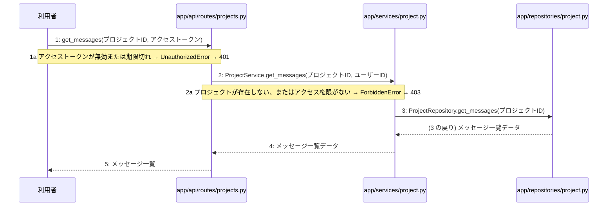

# M-02-T03 チャット履歴取得機能の実装

> 種別: 機能 / マイルストーン: M-02 M-02: プロジェクト管理とチャット対話機能 / 要件: FR-003, FR-004, FR-009 / 依存: M-02-T02

## 目的

チャット履歴取得のエンドポイント、サービス、リポジトリ層を実装し、指定プロジェクトのメッセージ一覧を取得できるようにする。

## 対象の処理・参照する設計

- 段階5 F-07 チャット履歴を取得する
- 段階6 get_messages(`app/api/routes/projects.py`)(設計に無い ── 未定義を参照)
- 段階6 ProjectService.get_messages(`app/services/project.py`)(設計に無い ── 未定義を参照)
- 段階6 ProjectRepository.get_messages(`app/repositories/project.py`)(設計に無い ── 未定義を参照)
- 段階4 `app/api/routes/projects.py`
- 段階4 `app/services/project.py`
- 段階4 `app/repositories/project.py`

### シーケンス図(段階5 F-07 チャット履歴を取得する の手順から導出)

## 作成・変更するファイル(依存順)

| ファイル | 種類 | 責務 | 根拠 |
|---|---|---|---|
| `app/repositories/project.py` | モジュール | PostgreSQLから指定プロジェクトのメッセージ一覧を取得するクエリを実行する | 段階4 |
| `app/services/project.py` | モジュール | プロジェクトへのアクセス権限を検証し、リポジトリ層へチャット履歴の取得を指示する | 段階4 |
| `app/api/routes/projects.py` | モジュール | チャット履歴取得のリクエストを受け付け、サービス層を呼び出してレスポンスを返す | 段階4 |

## 実装の要点(設計に書いていないことだけ)

- 依存される順序に従い、リポジトリ層、サービス層、API層の順に実装する。
- 読み取り専用の処理であるため明示的なトランザクションブロックは設定しない。

## テスト観点

| # | 観点 | SUT | ドライバ | スタブ |
|---|---|---|---|---|
| TC-01 | 正常系: 指定プロジェクトのチャット履歴が正しく取得できること | GET /api/v1/projects/{id}/messages | 結合テスト (TestClient) | スタブ不要 ── 実際のデータベースまたはテスト用セッションを使用 |
| TC-02 | 異常系: 無効なアクセストークンの場合に401が返ること | GET /api/v1/projects/{id}/messages | 結合テスト (TestClient) | 認証モジュールを無効なトークンを返すようにモック化 |
| TC-03 | 異常系: 存在しないプロジェクトまたは権限がない場合に403が返ること | GET /api/v1/projects/{id}/messages | 結合テスト (TestClient) | サービス層の権限チェックをモック化または該当データが存在しない状態を作成 |

- Given ログイン済みのユーザーと対象プロジェクトが存在する When チャット履歴取得APIを呼び出す Then メッセージ一覧が返される
- Given 無効なアクセストークンがある When チャット履歴取得APIを呼び出す Then 401 Unauthorizedが返される
- Given ユーザーがアクセス権を持たないプロジェクトIDがある When チャット履歴取得APIを呼び出す Then 403 Forbiddenが返される

## 確認方法

- 自動テストを実行し、すべてのテストケースが成功することを確認する。
- APIクライアントを用いてエンドポイントにリクエストを送り、期待されるステータスコードとレスポンスが得られることを確認する。

## 未定義・要決定

| 重要度 | 出どころ | 対象 | 内容 | 直す段階 |
|---|---|---|---|---|
| 最重要 | AI | 段階6 get_messages | 段階6の設計（ルーティング、サービス、リポジトリの詳細な入出力やクエリ内容）が記載されていないため、具体的な実装ロジックを確定できない。 | 段階6 |
| 最重要 | AI | 段階6 ProjectService.get_messages | 権限検証の詳細なルールやデータ構造が段階6に記載されていない。 | 段階6 |
| 最重要 | AI | 段階6 ProjectRepository.get_messages | messagesテーブルから取得する際のカラムやソート順等の詳細が段階6に記載されていない。 | 段階6 |
| 軽微 | 検証 | M-02-T03 | M-02-T03 はテスト観点がありますが、作成・変更するファイルにテストのファイルがありません(手順書を作り直すか、テストのファイルを足します)。 | — |
