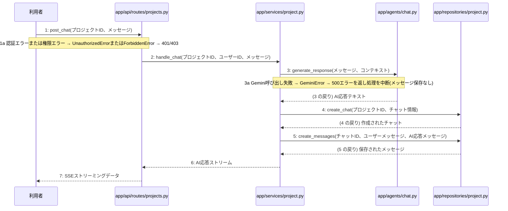

# M-02-T04 チャットメッセージ送信およびAI応答機能の実装

> 種別: 機能 / マイルストーン: M-02 M-02: プロジェクト管理とチャット対話機能 / 要件: FR-003, FR-004, FR-010, FR-011 / 依存: M-02-T03

## 目的

プロジェクトのチャットメッセージ送信とGeminiを用いたAI応答の生成および保存、SSEストリーミングによる返却機能を実現する。

## 対象の処理・参照する設計

- 段階5 F-08 チャットメッセージを送信する
- 段階6 post_chat(`app/api/routes/projects.py`)(設計に無い ── 未定義を参照)
- 段階6 handle_chat(`app/services/project.py`)(設計に無い ── 未定義を参照)
- 段階6 generate_response(`app/agents/chat.py`)(設計に無い ── 未定義を参照)
- 段階6 create_chat(`app/repositories/project.py`)(設計に無い ── 未定義を参照)
- 段階6 create_messages(`app/repositories/project.py`)(設計に無い ── 未定義を参照)
- 段階4 `app/api/routes/projects.py`
- 段階4 `app/services/project.py`
- 段階4 `app/repositories/project.py`
- 段階4 `app/agents/chat.py`
- 段階4 `app/clients/gemini.py`

### シーケンス図(段階5 F-08 チャットメッセージを送信する の手順から導出)

## 作成・変更するファイル(依存順)

| ファイル | 種類 | 責務 | 根拠 |
|---|---|---|---|
| `app/clients/gemini.py` | モジュール | Gemini Flash-Lite等の外部AIモデルとの通信を行う | 段階4 |
| `app/agents/chat.py` | モジュール | LangChainとLangGraphを用いたチャット応答生成を行う | 段階4 |
| `app/repositories/project.py` | モジュール | projects、chats、messages、generation_jobsテーブルに対するPostgreSQLとのデータ入出力およびクエリの実行を行う | 段階4 |
| `app/services/project.py` | モジュール | プロジェクト管理やチャット応答・設計書生成のビジネスロジックの実行と制御を行う | 段階4 |
| `app/api/routes/projects.py` | モジュール | プロジェクトおよびチャット・設計書に関するAPIエンドポイントの定義とリクエストの受け付けを行う | 段階4 |

## 実装の要点(設計に書いていないことだけ)

- 依存される順序に従い、外部クライアント、エージェント層、リポジトリ層、サービス層、APIルーター層の順に実装する。

## テスト観点

| # | 観点 | SUT | ドライバ | スタブ |
|---|---|---|---|---|
| TC-01 | チャットメッセージ送信とAI応答のSSEストリーミング返却が正常に行われること | post_chat | 結合テスト (FastAPI TestClient) | app/clients/gemini.pyの外部API呼び出しをスタブ化し、固定のAI応答を返す |

- Given プロジェクトへのアクセス権限を持つユーザーが認証されており、チャットメッセージを入力している
- When POST /api/v1/projects/{id}/chat エンドポイントにメッセージを送信する
- Then 正常にAIの対話応答がSSEストリーミングで返却され、チャットとメッセージがデータベースに保存される

## 確認方法

- pytest を実行し、チャット送信APIの結合テストが成功することを確認する。

## 未定義・要決定

| 重要度 | 出どころ | 対象 | 内容 | 直す段階 |
|---|---|---|---|---|
| 軽微 | 検証 | F-08 | M-02-T04 のテスト観点1のスタブ(app/clients/gemini.py)は、F-08 の手順で SUT(app/api/routes/projects.py)から呼ばれていません(手順に無い依存です。手順に足すか、観点のスタブを直します)。 | 段階5 |
| 軽微 | 検証 | M-02-T04 | M-02-T04 はテスト観点がありますが、作成・変更するファイルにテストのファイルがありません(手順書を作り直すか、テストのファイルを足します)。 | — |
