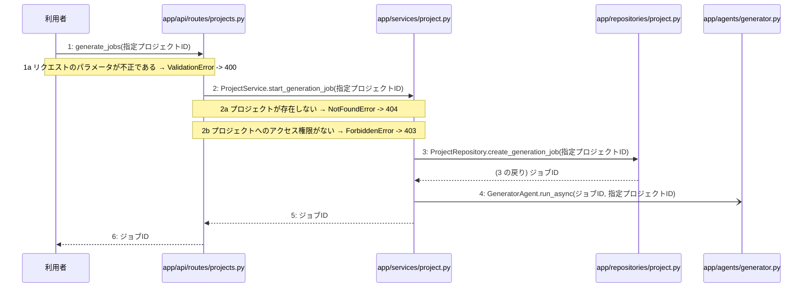

# M-03-T01 設計書一括生成およびAI自己診断の非同期ジョブ開始機能の実装

> 種別: 機能 / マイルストーン: M-03 M-03: 設計書一括生成と自己診断機能 / 要件: FR-003, FR-005, FR-006, FR-010, FR-011 / 依存: M-02-T04

## 目的

指定されたプロジェクトに対する設計書一括生成およびAI自己診断の非同期ジョブ開始機能を実装し、ジョブIDを発行して非同期にタスクを起動できるようにする。

## 対象の処理・参照する設計

- 段階5 F-09 設計書一括生成およびAI自己診断の非同期ジョブを開始する
- 段階6 generate_jobs(`app/api/routes/projects.py`)(設計に無い ── 未定義を参照)
- 段階6 ProjectService.start_generation_job(`app/services/project.py`)(設計に無い ── 未定義を参照)
- 段階6 ProjectRepository.create_generation_job(`app/repositories/project.py`)(設計に無い ── 未定義を参照)
- 段階6 GeneratorAgent.run_async(`app/agents/generator.py`)(設計に無い ── 未定義を参照)
- 段階4 `app/api/routes/projects.py`
- 段階4 `app/services/project.py`
- 段階4 `app/repositories/project.py`
- 段階4 `app/agents/generator.py`

### シーケンス図(段階5 F-09 設計書一括生成およびAI自己診断の非同期ジョブを開始する の手順から導出)

## 作成・変更するファイル(依存順)

| ファイル | 種類 | 責務 | 根拠 |
|---|---|---|---|
| `app/repositories/project.py` | モジュール | generation_jobsテーブルに新規ジョブレコードを作成する | 段階4 |
| `app/agents/generator.py` | モジュール | 4種の設計書一括生成と自己診断の非同期ジョブを起動する | 段階4 |
| `app/services/project.py` | モジュール | プロジェクトへのアクセス権限を検証し非同期ジョブの開始を制御する | 段階4 |
| `app/api/routes/projects.py` | モジュール | 設計書一括生成およびAI自己診断の非同期ジョブ開始リクエストを受け付けジョブIDを返す | 段階4 |
| `tests/api/test_projects.py` | テスト | 非同期ジョブ開始APIの正常系および異常系のテストを行う | 段階7 開発環境 |

## 実装の要点(設計に書いていないことだけ)

- 依存関係の順序に従い、リポジトリ層、エージェント層、サービス層、APIルーター層の順に実装する。
- 手順 2 から 4 までを1つのトランザクションとして扱う。

## テスト観点

| # | 観点 | SUT | ドライバ | スタブ |
|---|---|---|---|---|
| TC-01 | 正常系: 指定プロジェクトの非同期ジョブが正常に開始されジョブIDが返却されること | generate_jobs | 結合テスト(FastAPI TestClient) | スタブ不要 ── 実際のデータベースおよびエージェント層を利用する |
| TC-02 | 異常系: 存在しないプロジェクトIDを指定した場合に404エラーが返却されること | generate_jobs | 結合テスト(FastAPI TestClient) | スタブ不要 |
| TC-03 | 異常系: アクセス権限のないプロジェクトIDを指定した場合に403エラーが返却されること | generate_jobs | 結合テスト(FastAPI TestClient) | スタブ不要 |

- Given 認証済みユーザーがアクセス可能なプロジェクトが存在する
- When POST /api/v1/projects/{id}/generateを呼び出す
- Then 202 AcceptedとともにジョブIDが返却される

## 確認方法

- pytestを実行し、非同期ジョブ開始に関するテストがすべて成功することを確認する。

## 未定義・要決定

| 重要度 | 出どころ | 対象 | 内容 | 直す段階 |
|---|---|---|---|---|
| 最重要 | AI | 段階6 generate_jobs(app/api/routes/projects.py) | 段階6のロジック詳細が設計に記載されていないため、具体的なパラメータのバリデーション仕様やレスポンスのスキーマ定義を決定する必要がある。 | 段階6 |
| 最重要 | AI | 段階6 ProjectService.start_generation_job(app/services/project.py) | 段階6のロジック詳細が設計に記載されていないため、アクセス権限の検証ロジックやトランザクションの境界処理の詳細を決定する必要がある。 | 段階6 |
| 最重要 | AI | 段階6 ProjectRepository.create_generation_job(app/repositories/project.py) | 段階6のロジック詳細が設計に記載されていないため、generation_jobsテーブルへのINSERT文や発行されるジョブIDの形式・採番方法を決定する必要がある。 | 段階6 |
| 最重要 | AI | 段階6 GeneratorAgent.run_async(app/agents/generator.py) | 段階6のロジック詳細が設計に記載されていないため、非同期バックグラウンドタスクの起動方法(FastAPI BackgroundTasksやCeleryなど)を決定する必要がある。 | 段階6 |
