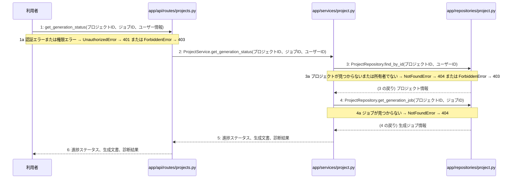

# M-03-T02 設計書生成ジョブの進捗確認機能の実装

> 種別: 機能 / マイルストーン: M-03 M-03: 設計書一括生成と自己診断機能 / 要件: FR-003, FR-005, FR-006 / 依存: M-03-T01

## 目的

設計書生成ジョブの進捗状態をAPI経由で取得できるようにする。

## 対象の処理・参照する設計

- 段階5 F-10 設計書生成ジョブの進捗を確認する
- 段階6 get_generation_status(`app/api/routes/projects.py`)(設計に無い ── 未定義を参照)
- 段階6 ProjectService.get_generation_status(`app/services/project.py`)(設計に無い ── 未定義を参照)
- 段階6 ProjectRepository.find_by_id(`app/repositories/project.py`)(設計に無い ── 未定義を参照)
- 段階6 ProjectRepository.get_generation_job(`app/repositories/project.py`)(設計に無い ── 未定義を参照)
- 段階4 `app/api/routes/projects.py`
- 段階4 `app/services/project.py`
- 段階4 `app/repositories/project.py`

### シーケンス図(段階5 F-10 設計書生成ジョブの進捗を確認する の手順から導出)

## 作成・変更するファイル(依存順)

| ファイル | 種類 | 責務 | 根拠 |
|---|---|---|---|
| `app/repositories/project.py` | モジュール | projectsテーブルおよびgeneration_jobsテーブルからのデータ取得を行う | 段階4 |
| `app/services/project.py` | モジュール | プロジェクトの所有権検証と生成ジョブの進捗状態取得のビジネスロジックを実行する | 段階4 |
| `app/api/routes/projects.py` | モジュール | 設計書生成ジョブ進捗確認APIのエンドポイントとしてリクエストを受け付ける | 段階4 |

## 実装の要点(設計に書いていないことだけ)

- リポジトリ層でデータベースからプロジェクト情報および生成ジョブ情報を取得する処理を実装したのちに、サービス層で所有権の検証と進捗状態の取得を統御し、最後にAPIルーター層でエンドポイントを追加する順序で実装する。
- 読み取り専用の処理であるため明示的なトランザクションブロックは設定しない。

## テスト観点

| # | 観点 | SUT | ドライバ | スタブ |
|---|---|---|---|---|
| TC-01 | 正常系: 指定したプロジェクトの有効なジョブIDで進捗状態が正常に取得できること | get_generation_status | API結合テスト | スタブ不要 ── 実際のデータベースおよびサービス層を使用する |
| TC-02 | 異常系: 存在しないプロジェクトIDまたは所有者でない場合に404または403が返却されること | get_generation_status | API結合テスト | スタブ不要 ── 実際のデータベースおよびサービス層を使用する |
| TC-03 | 異常系: 存在しないジョブIDを指定した場合に404が返却されること | get_generation_status | API結合テスト | スタブ不要 ── 実際のデータベースおよびサービス層を使用する |

- Given 認証済みユーザーが所有するプロジェクトと生成ジョブが存在する時, When GET /api/v1/projects/{id}/generate/status を呼び出すと, Then 進捗ステータス、生成文書、診断結果が返却される

## 確認方法

- pytest を実行し、設計書生成ジョブの進捗確認に関するテストがすべて成功することを確認する。

## 未定義・要決定

| 重要度 | 出どころ | 対象 | 内容 | 直す段階 |
|---|---|---|---|---|
| 軽微 | 検証 | M-03-T02 | M-03-T02 はテスト観点がありますが、作成・変更するファイルにテストのファイルがありません(手順書を作り直すか、テストのファイルを足します)。 | — |
