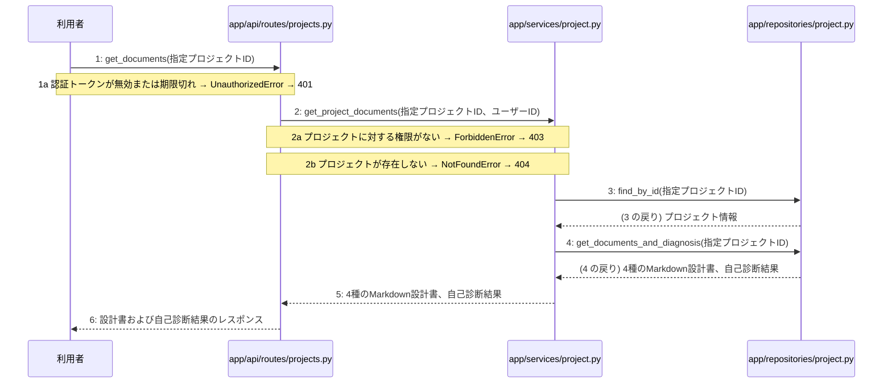

# M-03-T03 生成文書および自己診断結果の取得機能の実装

> 種別: 機能 / マイルストーン: M-03 M-03: 設計書一括生成と自己診断機能 / 要件: FR-003, FR-005, FR-006, FR-009 / 依存: M-03-T02

## 目的

指定されたプロジェクトに紐づく確定した4種のMarkdown設計書および自己診断結果を取得するAPI機能を実装する。

## 対象の処理・参照する設計

- 段階5 F-11 生成文書および自己診断結果を取得する
- 段階6 get_documents(`app/api/routes/projects.py`)(設計に無い ── 未定義を参照)
- 段階6 get_project_documents(`app/services/project.py`)(設計に無い ── 未定義を参照)
- 段階6 find_by_id(`app/repositories/project.py`)(設計に無い ── 未定義を参照)
- 段階6 get_documents_and_diagnosis(`app/repositories/project.py`)(設計に無い ── 未定義を参照)
- 段階4 `app/api/routes/projects.py`
- 段階4 `app/services/project.py`
- 段階4 `app/repositories/project.py`

### シーケンス図(段階5 F-11 生成文書および自己診断結果を取得する の手順から導出)

## 作成・変更するファイル(依存順)

| ファイル | 種類 | 責務 | 根拠 |
|---|---|---|---|
| `app/repositories/project.py` | モジュール | プロジェクト情報の取得および確定した4種のMarkdown設計書と自己診断結果をデータベースから取得する | 段階4 |
| `app/services/project.py` | モジュール | プロジェクトへのアクセス権限検証と文書および自己診断結果取得のビジネスロジックを実行する | 段階4 |
| `app/api/routes/projects.py` | モジュール | 生成文書および自己診断結果の取得リクエストを受け付け、サービス層へ処理を委譲してレスポンスを返す | 段階4 |
| `tests/api/test_projects.py` | テスト | 生成文書および自己診断結果の取得機能の正常系および異常系を検証する | 手順書で決める |

## 実装の要点(設計に書いていないことだけ)

- 依存される順序に従い、リポジトリ層、サービス層、APIルーター層、テストの順に実装する。
- 読み取り専用の処理のため明示的なトランザクションブロックは設定しない。

## テスト観点

| # | 観点 | SUT | ドライバ | スタブ |
|---|---|---|---|---|
| TC-01 | 正常系：指定プロジェクトの4種のMarkdown設計書と自己診断結果が取得できること | get_documents | 結合テスト (TestClient) | スタブ不要 ── 実際のデータベースおよび認証モジュールを使用する |
| TC-02 | 異常系：プロジェクトが存在しない場合に404が返ること | get_documents | 結合テスト (TestClient) | スタブ不要 ── 実際のデータベースおよび認証モジュールを使用する |

- Given 認証済みユーザーが所有するプロジェクトが存在する時, When GET /api/v1/projects/{id}/documents を呼び出すと, Then 4種のMarkdown設計書と自己診断結果が返されること

## 確認方法

- pytest tests/api/test_projects.py を実行し、生成文書および自己診断結果の取得に関するテストがすべて成功することを確認する。

## 未定義・要決定

なし
