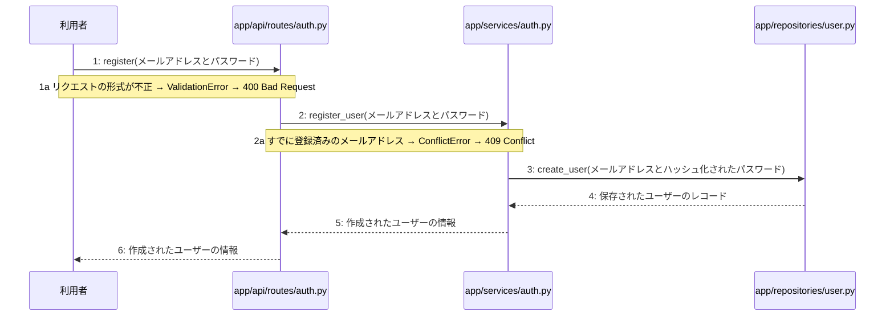

あなたは実装担当者です。以下の設計情報に従って実装してください。

## プロジェクト概要

Devex(ステージ8効果測定 詳細): 段階7のマイルストーン M-01〜M-03 を実装する。今回はそのうち、M-01(M-01: 環境構築と認証機能)の単位 M-01-T02 だけを扱う。

## 実装ルール

- モジュールは、段階4のモジュール一覧の依存先にだけ依存する(層を飛び越さない)。

### 07章 横断事項

| 項目 | 方針 | 関わるファイル(例) |
|---|---|---|
| 例外と HTTP | APIの処理で例外が発生した場合は、対応するHTTPステータスコードに変換して返却する。入力値の検証エラーは400 Bad Request、認証失敗やトークン無効は401 Unauthorized、アクセス権限がない場合は403 Forbidden、対象が存在しない場合は404 NotFound、一意制約違反などは409 Conflict、AI応答失敗等のサーバー内部エラーは500 Internal Server Errorを返却する。 | app/api/routes/auth.py, app/api/routes/projects.py |
| 認証 | JWTを用いた認証を実装し、アクセストークンの有効期限は30分、リフレッシュトークンは14日間としHttpOnly Cookieに設定する。ログアウト時やトークン失効時にはRedisを用いてリフレッシュトークンを無効化し、不正利用や総当たり攻撃を防ぐ。 | app/services/auth.py, app/clients/redis.py, app/repositories/user.py |
| トランザクション | データベースへの書き込みを伴う処理（ユーザー登録、ログインでのトークン保存、プロジェクト作成、チャットメッセージ保存、非同期ジョブ開始など）は、リポジトリ層との連携において1つのトランザクションとして扱い、エラー時はロールバックを行う。読み取り専用の処理では明示的なトランザクションブロックを設定しない。 | app/services/auth.py, app/services/project.py, app/repositories/user.py, app/repositories/project.py |
| ログ | セキュリティおよびプライバシーの観点から、ユーザーから入力された内容や機密情報はログに残さず、処理のエラーの有無や発生時刻、ステータスのみをログとして記録する。 | app/core/config.py, app/services/auth.py, app/services/project.py |

### 段階7 開発環境

開発環境はPython 3.13、FastAPI、Next.js(App Router)およびTamaguiを使用する。データベースにはPostgreSQL、トークン失効管理にRedisを用いる。インフラはVPS上にDocker Composeとnginxで構築し、GitHub Actionsを用いたmainブランチへのpushによる自動デプロイを行う。自動テストは単体テスト・結合テストを順次導入する方針とする。

## 今回の実装単位

M-01-T02 ユーザー登録機能の実装(種別: 機能 / 処理: F-01)

実現する要件:

- FR-001: メールアドレスとパスワードによるユーザー登録およびログイン機能を提供する。
- FR-011: ログインの総当たり攻撃、登録の大量作成を防ぐ仕組みを導入し、チャットと生成にも推奨されるおすすめの回数制限を設定する。
- FR-012: パスワードは標準的な条件を満たすものとし、パスワード再設定機能やメール確認、トークンローテーション、CSRF対策については推奨される標準仕様を適用する。

目的: 利用者からのユーザー登録リクエストを受け付け、パスワードを安全にハッシュ化した上でデータベースに新規ユーザー情報を保存し、作成されたユーザー情報を返却する。

前提: M-01-T01 まで実装済み

## 作成・変更するファイル(依存順)

| ファイル | 種類 | 責務 |
|---|---|---|
| `app/repositories/user.py` | モジュール | usersテーブルに対するデータ入出力およびクエリの実行を行う |
| `app/services/auth.py` | モジュール | ユーザー登録に関するビジネスロジックの実行と制御を行う |
| `app/api/routes/auth.py` | モジュール | ユーザー登録APIエンドポイントの定義とリクエストの受け付けを行う |
| `tests/api/test_auth.py` | テスト | ユーザー登録機能の結合テストおよびエンドポイントの検証を行う |

実装の要点:

- リポジトリ層 app/repositories/user.py を先に実装し、それを呼び出すサービス層 app/services/auth.py、最後にAPIルーター層 app/api/routes/auth.py の順に実装する。
- トランザクション管理およびパスワードのハッシュ化処理を適用する。

## 参照する設計

### 段階5 F-01 ユーザー登録する

トリガー: POST /api/v1/auth/register

| No | 呼び出し元 → 呼び出し先 | 種別 | 関数 | 渡すデータ | 処理内容 | 結果 | DB 操作 | 分岐・例外 |
|---|---|---|---|---|---|---|---|---|
| 1 | 利用者 → app/api/routes/auth.py | 同期 | register | メールアドレスとパスワード | 新規ユーザー登録リクエストを受け付ける | リクエストデータ | — | 1a へ |
| 1a | — | — | — | — | リクエストの形式が不正 | — | — | ValidationError → 400 Bad Request |
| 2 | app/api/routes/auth.py → app/services/auth.py | 同期 | register_user → 詳細: L-01 | メールアドレスとパスワード | ユーザー登録のビジネスロジックを実行する | 作成されたユーザーの情報 | — | 2a へ |
| 2a | — | — | — | — | すでに登録済みのメールアドレス | — | — | ConflictError → 409 Conflict |
| 3 | app/services/auth.py → app/repositories/user.py | 同期 | create_user | メールアドレスとハッシュ化されたパスワード | usersテーブルに新規ユーザー情報を保存する | 保存されたユーザーのレコード | users C | — |
| 4 | app/repositories/user.py → app/services/auth.py | 戻り | — | 保存されたユーザーのレコード | 作成されたユーザー情報を返却する | 作成されたユーザーの情報 | — | — |
| 5 | app/services/auth.py → app/api/routes/auth.py | 戻り | — | 作成されたユーザーの情報 | ユーザー登録結果を返却する | 作成されたユーザーの情報 | — | — |
| 6 | app/api/routes/auth.py → 利用者 | 戻り | — | 作成されたユーザーの情報 | レスポンスを返す | 201 Created とユーザー情報 | — | — |

注記: 手順 2〜4 が1つのトランザクション

シーケンス図(手順の表から導いた図。直すのは表):

- 段階6 register(`app/api/routes/auth.py`): 設計にありません

### 段階6 L-01 register_user(`app/services/auth.py`)

呼ばれる手順: F-01#2

| 項目 | 内容 |
|---|---|
| シグネチャ | def register_user(email: str, password: str) -> dict |
| 引数 | email: 登録するユーザーのメールアドレス / password: 登録するユーザーのパスワード |
| 戻り値 | 作成されたユーザーの情報 |
| 例外 | ConflictError: すでに登録済みのメールアドレスの場合、409 Conflict を返す |
| 事前条件 | メールアドレスとパスワードが有効な形式であること |
| 事後条件 | ユーザーが正常に登録され、ユーザー情報が返されること |

擬似フロー:

1. リクエストされたメールアドレスがすでに users テーブルに存在するか確認する
    - app/repositories/user.py を使用してメールアドレスを検索する
2. メールアドレスの重複チェックの結果を評価する
    - すでに登録済みの場合は ConflictError を送出する
3. パスワードのハッシュ化など、ユーザー登録に必要なデータを準備する
    - 平文のパスワードを安全な形式に変換する
4. users テーブルに新しいユーザー情報を保存する
    - app/repositories/user.py を使用して新規レコードを作成する
5. 作成されたユーザーの情報を戻り値として構築し、呼び出し元に返す
    - 機密情報を除外したユーザーデータを返却形式に整える

- 段階6 create_user(`app/repositories/user.py`): 設計にありません

- 段階4 `app/api/routes/auth.py`(入口): 認証に関するAPIエンドポイントの定義とリクエストの受け付けを行う / 依存先: app/services/auth.py

- 段階4 `app/services/auth.py`(ユースケース): ユーザー登録やログイン・ログアウト等の認証ビジネスロジックの実行と制御を行う / 依存先: app/repositories/user.py, app/clients/redis.py

- 段階4 `app/repositories/user.py`(永続化): usersおよびtokensテーブルに対するPostgreSQLとのデータ入出力およびクエリの実行を行う / 依存先: PostgreSQL

## テスト観点

| # | 観点 | SUT | ドライバ | スタブ |
|---|---|---|---|---|
| TC-01 | 正常なメールアドレスとパスワードでユーザー登録が成功し、201 Createdが返ること | POST /api/v1/auth/register | 結合テスト(FastAPI TestClient) | スタブ不要 ── 実データベースまたはテスト用インメモリDBを使用 |
| TC-02 | すでに登録済みのメールアドレスの場合にConflictErrorが発生し、409 Conflictが返ること | POST /api/v1/auth/register | 結合テスト(FastAPI TestClient) | スタブ不要 ── 事前に同一メールアドレスのレコードを登録しておく |

- Given: 有効な未登録のメールアドレスとパスワードがある / When: ユーザー登録APIにリクエストを送信する / Then: 201 Createdと作成されたユーザー情報が返される
- Given: すでに登録済みのメールアドレスがある / When: 同じメールアドレスでユーザー登録APIにリクエストを送信する / Then: 409 Conflictが返される

## 完了条件

- この単位のテストが全件成功する
- 既存のテストが壊れていない
- lint・型チェックが成功する
- (テーブルを変える単位)マイグレーションの適用が成功する
- 開発環境で起動し、確認方法の操作ができる
- 確認方法: pytestを実行し、ユーザー登録の正常系および重複メールアドレス時の異常系テストがすべてパスすることを確認する。

## 未定義・要決定(決まるまで、推測で実装しないこと)

なし

## 制約

- 既存の API を変更しない。
- 設計に無いことを推測で決めない。

まず現在のリポジトリを調査し、既存実装との整合性を確認してください。不整合がある場合は実装せず、問題点を報告してください。
