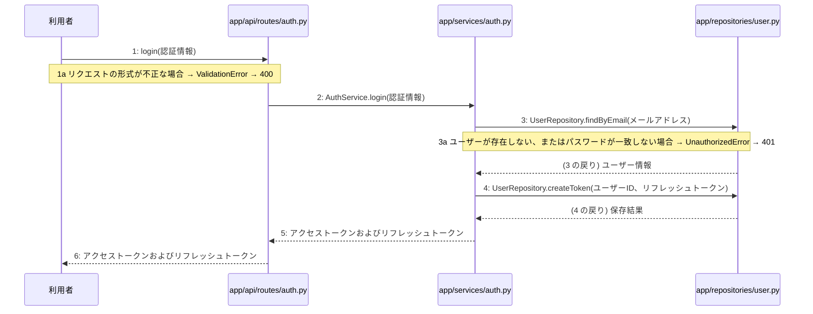

> ⚠ この単位には「未定義・要決定」が 1 件残っています(最重要 0 件)。決めてから渡すことを勧めます。

あなたは実装担当者です。以下の設計情報に従って実装してください。

## プロジェクト概要

Devex(ステージ8効果測定 詳細): 段階7のマイルストーン M-01〜M-03 を実装する。今回はそのうち、M-01(M-01: 環境構築と認証機能)の単位 M-01-T03 だけを扱う。

## 実装ルール

- モジュールは、段階4のモジュール一覧の依存先にだけ依存する(層を飛び越さない)。

### 07章 横断事項

| 項目 | 方針 | 関わるファイル(例) |
|---|---|---|
| 例外と HTTP | APIの処理で例外が発生した場合は、対応するHTTPステータスコードに変換して返却する。入力値の検証エラーは400 Bad Request、認証失敗やトークン無効は401 Unauthorized、アクセス権限がない場合は403 Forbidden、対象が存在しない場合は404 NotFound、一意制約違反などは409 Conflict、AI応答失敗等のサーバー内部エラーは500 Internal Server Errorを返却する。 | app/api/routes/auth.py, app/api/routes/projects.py |
| 認証 | JWTを用いた認証を実装し、アクセストークンの有効期限は30分、リフレッシュトークンは14日間としHttpOnly Cookieに設定する。ログアウト時やトークン失効時にはRedisを用いてリフレッシュトークンを無効化し、不正利用や総当たり攻撃を防ぐ。 | app/services/auth.py, app/clients/redis.py, app/repositories/user.py |
| トランザクション | データベースへの書き込みを伴う処理（ユーザー登録、ログインでのトークン保存、プロジェクト作成、チャットメッセージ保存、非同期ジョブ開始など）は、リポジトリ層との連携において1つのトランザクションとして扱い、エラー時はロールバックを行う。読み取り専用の処理では明示的なトランザクションブロックを設定しない。 | app/services/auth.py, app/services/project.py, app/repositories/user.py, app/repositories/project.py |
| ログ | セキュリティおよびプライバシーの観点から、ユーザーから入力された内容や機密情報はログに残さず、処理のエラーの有無や発生時刻、ステータスのみをログとして記録する。 | app/core/config.py, app/services/auth.py, app/services/project.py |

### 段階7 開発環境

開発環境はPython 3.13、FastAPI、Next.js(App Router)およびTamaguiを使用する。データベースにはPostgreSQL、トークン失効管理にRedisを用いる。インフラはVPS上にDocker Composeとnginxで構築し、GitHub Actionsを用いたmainブランチへのpushによる自動デプロイを行う。自動テストは単体テスト・結合テストを順次導入する方針とする。

## 今回の実装単位

M-01-T03 ログイン機能の実装(種別: 機能 / 処理: F-02)

実現する要件:

- FR-001: メールアドレスとパスワードによるユーザー登録およびログイン機能を提供する。
- FR-002: JWTを用いた認証を実装し、アクセストークンの有効期限を30分、リフレッシュトークンの有効期限を14日（HttpOnly Cookie）とする。
- FR-011: ログインの総当たり攻撃、登録の大量作成を防ぐ仕組みを導入し、チャットと生成にも推奨されるおすすめの回数制限を設定する。

目的: 利用者からのログインリクエストを受け付け、認証情報の検証後にアクセストークンおよびリフレッシュトークンを発行して返却できるようにする。

前提: M-01-T02 まで実装済み

## 作成・変更するファイル(依存順)

| ファイル | 種類 | 責務 |
|---|---|---|
| `app/repositories/user.py` | モジュール | usersおよびtokensテーブルに対するPostgreSQLとのデータ入出力およびクエリの実行を行う |
| `app/services/auth.py` | モジュール | ユーザー登録やログイン・ログアウト等の認証ビジネスロジックの実行と制御を行う |
| `app/api/routes/auth.py` | モジュール | 認証に関するAPIエンドポイントの定義とリクエストの受け付けを行う |

実装の要点:

- 依存される順序に従い、リポジトリ層(app/repositories/user.py)、サービス層(app/services/auth.py)、APIルーター層(app/api/routes/auth.py)の順に実装する。

## 参照する設計

### 段階5 F-02 ログインする

トリガー: POST /api/v1/auth/login

| No | 呼び出し元 → 呼び出し先 | 種別 | 関数 | 渡すデータ | 処理内容 | 結果 | DB 操作 | 分岐・例外 |
|---|---|---|---|---|---|---|---|---|
| 1 | 利用者 → app/api/routes/auth.py | 同期 | login | 認証情報 | ログインリクエストを受け付ける | ログインレスポンス | — | 1a へ |
| 1a | — | — | — | — | リクエストの形式が不正な場合 | — | — | ValidationError → 400 |
| 2 | app/api/routes/auth.py → app/services/auth.py | 同期 | AuthService.login → 詳細: L-02 | 認証情報 | ログインビジネスロジックを実行する | アクセストークンおよびリフレッシュトークン | — | — |
| 3 | app/services/auth.py → app/repositories/user.py | 同期 | UserRepository.findByEmail | メールアドレス | ユーザー情報を取得する | ユーザー情報 | users R | 3a へ |
| 3a | — | — | — | — | ユーザーが存在しない、またはパスワードが一致しない場合 | — | — | UnauthorizedError → 401 |
| 4 | app/services/auth.py → app/repositories/user.py | 同期 | UserRepository.createToken | ユーザーID、リフレッシュトークン | リフレッシュトークンを保存する | 保存結果 | tokens C | — |
| 5 | app/services/auth.py → app/api/routes/auth.py | 戻り | — | アクセストークンおよびリフレッシュトークン | トークンを返す | アクセストークンおよびリフレッシュトークン | — | — |
| 6 | app/api/routes/auth.py → 利用者 | 戻り | — | アクセストークンおよびリフレッシュトークン | HttpOnly Cookieにトークンを設定してレスポンスを返す | ログイン成功レスポンス | — | — |

注記: 手順 3〜5 が1つのトランザクション

シーケンス図(手順の表から導いた図。直すのは表):

- 段階6 login(`app/api/routes/auth.py`): 設計にありません

### 段階6 L-02 AuthService.login(`app/services/auth.py`)

呼ばれる手順: F-02#2

| 項目 | 内容 |
|---|---|
| シグネチャ | def login(credentials: AuthCredentials) -> TokenPair |
| 引数 | credentials: 認証情報 |
| 戻り値 | アクセストークンおよびリフレッシュトークン |
| 例外 | ValueError: 認証失敗時は401エラー相当の例外を送出する |
| 事前条件 | 認証情報の形式が正しく、users テーブルにアクセス可能なこと |
| 事後条件 | 有効なアクセストークンとリフレッシュトークンが発行されること |

擬似フロー:

1. 受け取った認証情報をもとに app/repositories/user.py を介してユーザー情報を取得する
    - ユーザーが存在しない場合は例外を送出する
2. 取得したユーザー情報のパスワードハッシュと入力されたパスワードを検証する
    - パスワードが一致しない場合は例外を送出する
3. アクセストークンおよびリフレッシュトークンを生成する
    - 有効期限を設定してトークンを発行する
4. 必要に応じて app/clients/redis.py を介してリフレッシュトークンをキャッシュまたは保存する
    - 保存に失敗した場合は例外を送出する
5. 生成したアクセストークンとリフレッシュトークンを返す

- 段階6 UserRepository.findByEmail(`app/repositories/user.py`): 設計にありません

- 段階6 UserRepository.createToken(`app/repositories/user.py`): 設計にありません

- 段階4 `app/api/routes/auth.py`(入口): 認証に関するAPIエンドポイントの定義とリクエストの受け付けを行う / 依存先: app/services/auth.py

- 段階4 `app/services/auth.py`(ユースケース): ユーザー登録やログイン・ログアウト等の認証ビジネスロジックの実行と制御を行う / 依存先: app/repositories/user.py, app/clients/redis.py

- 段階4 `app/repositories/user.py`(永続化): usersおよびtokensテーブルに対するPostgreSQLとのデータ入出力およびクエリの実行を行う / 依存先: PostgreSQL

## テスト観点

| # | 観点 | SUT | ドライバ | スタブ |
|---|---|---|---|---|
| TC-01 | 正しい認証情報が渡された場合にトークンが発行されHttpOnly Cookieに設定されること | POST /api/v1/auth/login | 結合テスト(TestClient) | スタブ不要 ── 実際のデータベースおよびリポジトリ層を使用する |

- Given: 有効なユーザーのメールアドレスとパスワードが登録されている
- When: 正しい認証情報でログインAPIにリクエストを送信する
- Then: ステータスコード200が返却され、HttpOnly Cookieにアクセストークンとリフレッシュトークンが設定される

## 完了条件

- この単位のテストが全件成功する
- 既存のテストが壊れていない
- lint・型チェックが成功する
- (テーブルを変える単位)マイグレーションの適用が成功する
- 開発環境で起動し、確認方法の操作ができる
- 確認方法: pytestを用いたテストを実行し、ログイン機能に関するテストが全て成功することを確認する。

## 未定義・要決定(決まるまで、推測で実装しないこと)

- [軽微] M-01-T03: M-01-T03 はテスト観点がありますが、作成・変更するファイルにテストのファイルがありません(手順書を作り直すか、テストのファイルを足します)。

## 制約

- 既存の API を変更しない。
- 設計に無いことを推測で決めない。

まず現在のリポジトリを調査し、既存実装との整合性を確認してください。不整合がある場合は実装せず、問題点を報告してください。
