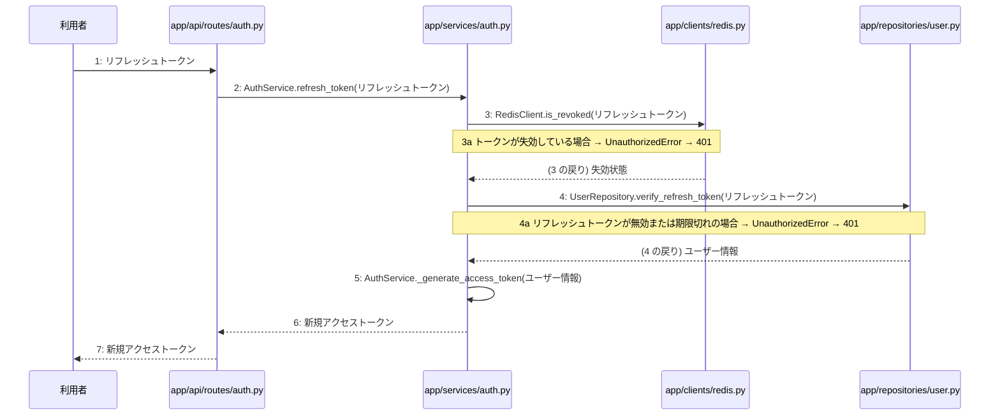

あなたは実装担当者です。以下の設計情報に従って実装してください。

## プロジェクト概要

Devex(ステージ8効果測定 詳細): 段階7のマイルストーン M-01〜M-03 を実装する。今回はそのうち、M-01(M-01: 環境構築と認証機能)の単位 M-01-T04 だけを扱う。

## 実装ルール

- モジュールは、段階4のモジュール一覧の依存先にだけ依存する(層を飛び越さない)。

### 07章 横断事項

| 項目 | 方針 | 関わるファイル(例) |
|---|---|---|
| 例外と HTTP | APIの処理で例外が発生した場合は、対応するHTTPステータスコードに変換して返却する。入力値の検証エラーは400 Bad Request、認証失敗やトークン無効は401 Unauthorized、アクセス権限がない場合は403 Forbidden、対象が存在しない場合は404 NotFound、一意制約違反などは409 Conflict、AI応答失敗等のサーバー内部エラーは500 Internal Server Errorを返却する。 | app/api/routes/auth.py, app/api/routes/projects.py |
| 認証 | JWTを用いた認証を実装し、アクセストークンの有効期限は30分、リフレッシュトークンは14日間としHttpOnly Cookieに設定する。ログアウト時やトークン失効時にはRedisを用いてリフレッシュトークンを無効化し、不正利用や総当たり攻撃を防ぐ。 | app/services/auth.py, app/clients/redis.py, app/repositories/user.py |
| トランザクション | データベースへの書き込みを伴う処理（ユーザー登録、ログインでのトークン保存、プロジェクト作成、チャットメッセージ保存、非同期ジョブ開始など）は、リポジトリ層との連携において1つのトランザクションとして扱い、エラー時はロールバックを行う。読み取り専用の処理では明示的なトランザクションブロックを設定しない。 | app/services/auth.py, app/services/project.py, app/repositories/user.py, app/repositories/project.py |
| ログ | セキュリティおよびプライバシーの観点から、ユーザーから入力された内容や機密情報はログに残さず、処理のエラーの有無や発生時刻、ステータスのみをログとして記録する。 | app/core/config.py, app/services/auth.py, app/services/project.py |

### 段階7 開発環境

開発環境はPython 3.13、FastAPI、Next.js(App Router)およびTamaguiを使用する。データベースにはPostgreSQL、トークン失効管理にRedisを用いる。インフラはVPS上にDocker Composeとnginxで構築し、GitHub Actionsを用いたmainブランチへのpushによる自動デプロイを行う。自動テストは単体テスト・結合テストを順次導入する方針とする。

## 今回の実装単位

M-01-T04 トークンリフレッシュ機能の実装(種別: 機能 / 処理: F-03)

実現する要件:

- FR-002: JWTを用いた認証を実装し、アクセストークンの有効期限を30分、リフレッシュトークンの有効期限を14日（HttpOnly Cookie）とする。

目的: リフレッシュトークンを利用して新規アクセストークンを再発給できるようになる。

前提: M-01-T03 まで実装済み

## 作成・変更するファイル(依存順)

| ファイル | 種類 | 責務 |
|---|---|---|
| `app/clients/redis.py` | モジュール | Redisとの通信を行いトークン失効管理等を行う |
| `app/repositories/user.py` | モジュール | usersおよびtokensテーブルに対するPostgreSQLとのデータ入出力およびクエリの実行を行う |
| `app/services/auth.py` | モジュール | ユーザー登録やログイン・ログアウト等の認証ビジネスロジックの実行と制御を行う |
| `app/api/routes/auth.py` | モジュール | 認証に関するAPIエンドポイントの定義とリクエストの受け付けを行う |
| `tests/api/test_auth.py` | テスト | トークンリフレッシュ機能のAPIおよびサービステストを行う |

実装の要点:

- 既存の認証関連モジュールを再利用してトークンリフレッシュ処理を追加する
- 依存される順にRedisクライアント、リポジトリ層、サービス層、ルーター層の順で実装・修正を行う

## 参照する設計

### 段階5 F-03 トークンをリフレッシュする

トリガー: POST /api/v1/auth/refresh

| No | 呼び出し元 → 呼び出し先 | 種別 | 関数 | 渡すデータ | 処理内容 | 結果 | DB 操作 | 分岐・例外 |
|---|---|---|---|---|---|---|---|---|
| 1 | 利用者 → app/api/routes/auth.py | 同期 | — | リフレッシュトークン | POST /api/v1/auth/refresh を受け付ける | リクエストデータ | — | — |
| 2 | app/api/routes/auth.py → app/services/auth.py | 同期 | AuthService.refresh_token → 詳細: L-03 | リフレッシュトークン | トークンのリフレッシュ処理を呼び出す | 新規アクセストークン | — | — |
| 3 | app/services/auth.py → app/clients/redis.py | 同期 | RedisClient.is_revoked | リフレッシュトークン | トークンがRedis上で失効していないか検証する | 失効状態 | tokens R | 3a へ |
| 3a | — | — | — | — | トークンが失効している場合 | — | — | UnauthorizedError → 401 |
| 4 | app/services/auth.py → app/repositories/user.py | 同期 | UserRepository.verify_refresh_token | リフレッシュトークン | tokensテーブルを参照してリフレッシュトークンの有効性を検証する | ユーザー情報 | tokens R | 4a へ |
| 4a | — | — | — | — | リフレッシュトークンが無効または期限切れの場合 | — | — | UnauthorizedError → 401 |
| 5 | app/services/auth.py → app/services/auth.py | 同期 | AuthService._generate_access_token → 詳細: L-04 | ユーザー情報 | 新規アクセストークンを再発給する | 新規アクセストークン | — | — |
| 6 | app/services/auth.py → app/api/routes/auth.py | 戻り | — | 新規アクセストークン | 新規アクセストークンを返す | 新規アクセストークン | — | — |
| 7 | app/api/routes/auth.py → 利用者 | 戻り | — | 新規アクセストークン | レスポンスとして新規アクセストークンを返す | HTTP 200 OK | — | — |

注記: 手順 2〜4 が1つのトランザクション

シーケンス図(手順の表から導いた図。直すのは表):

### 段階6 L-03 AuthService.refresh_token(`app/services/auth.py`)

呼ばれる手順: F-03#2

| 項目 | 内容 |
|---|---|
| シグネチャ | def refresh_token(self, refresh_token: str) -> dict |
| 引数 | refresh_token: リフレッシュトークン |
| 戻り値 | 新規アクセストークン |
| 例外 | ValueError: リフレッシュトークンが無効または期限切れの場合 |
| 事前条件 | 有効なリフレッシュトークンが提供されていること |
| 事後条件 | 新規アクセストークンが発行されること |

擬似フロー:

1. リフレッシュトークンの検証を行う
    - リフレッシュトークンが有効か確認する
    - 無効な場合はValueErrorを送出する
2. ユーザー情報の特定を行う
    - リフレッシュトークンからユーザー情報を取得する
3. 新規アクセストークンを生成する
    - 新しいアクセストークンを発行して戻り値として準備する

- 段階6 RedisClient.is_revoked(`app/clients/redis.py`): 設計にありません

- 段階6 UserRepository.verify_refresh_token(`app/repositories/user.py`): 設計にありません

### 段階6 L-04 AuthService._generate_access_token(`app/services/auth.py`)

呼ばれる手順: F-03#5

| 項目 | 内容 |
|---|---|
| シグネチャ | def _generate_access_token(self, user_info: dict) -> str: |
| 引数 | user_info: 新規アクセストークンを再発給する対象のユーザー情報 |
| 戻り値 | 再発給された新規アクセストークン |
| 例外 | なし |
| 事前条件 | 呼び出し元で対象のユーザー情報が正しく取得されていること |
| 事後条件 | 新規アクセストークンが生成されて返却されること |

擬似フロー:

1. アクセストークン生成のための設定情報を読み込む
    - 秘密鍵や有効期限の環境変数を取得する
2. ユーザー情報からペイロードを作成する
    - ユーザーIDや関連する識別子を含める
    - トークンの有効期限を設定する
3. アクセストークンを暗号化および署名して生成する
    - 設定されたアルゴリズムで署名を作成する

- 段階4 `app/api/routes/auth.py`(入口): 認証に関するAPIエンドポイントの定義とリクエストの受け付けを行う / 依存先: app/services/auth.py

- 段階4 `app/services/auth.py`(ユースケース): ユーザー登録やログイン・ログアウト等の認証ビジネスロジックの実行と制御を行う / 依存先: app/repositories/user.py, app/clients/redis.py

- 段階4 `app/repositories/user.py`(永続化): usersおよびtokensテーブルに対するPostgreSQLとのデータ入出力およびクエリの実行を行う / 依存先: PostgreSQL

- 段階4 `app/clients/redis.py`(外部連携): Redisとの通信を行いトークン失効管理等を行う / 依存先: Redis

## テスト観点

| # | 観点 | SUT | ドライバ | スタブ |
|---|---|---|---|---|
| TC-01 | 有効なリフレッシュトークンで新規アクセストークンが取得できること | AuthService.refresh_token | 結合テスト(APIテスト) | スタブ不要 ── 実際のRedisおよびデータベースを使用する |
| TC-02 | 失効したトークンまたは無効なトークンの場合に401エラーになること | AuthService.refresh_token | 結合テスト(APIテスト) | スタブ不要 ── 実際のRedisおよびデータベースを使用する |

- Given: 有効なリフレッシュトークンが存在する
- When: POST /api/v1/auth/refresh にリフレッシュトークンを送信する
- Then: 新規アクセストークンが返却される

## 完了条件

- この単位のテストが全件成功する
- 既存のテストが壊れていない
- lint・型チェックが成功する
- (テーブルを変える単位)マイグレーションの適用が成功する
- 開発環境で起動し、確認方法の操作ができる
- 確認方法: pytest tests/api/test_auth.py を実行してすべてのテストが成功することを確認する

## 未定義・要決定(決まるまで、推測で実装しないこと)

なし

## 制約

- 既存の API を変更しない。
- 設計に無いことを推測で決めない。

まず現在のリポジトリを調査し、既存実装との整合性を確認してください。不整合がある場合は実装せず、問題点を報告してください。
