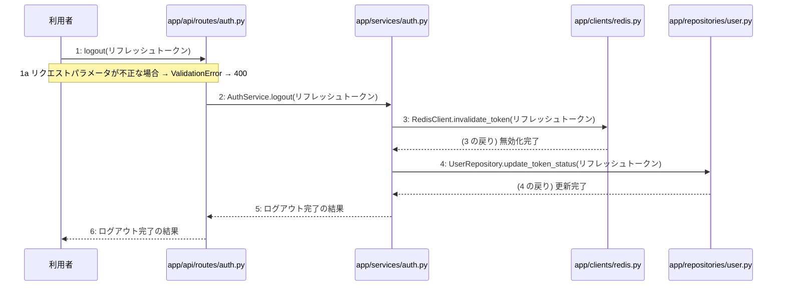

> ⚠ この単位には「未定義・要決定」が 2 件残っています(最重要 1 件)。決めてから渡すことを勧めます。

あなたは実装担当者です。以下の設計情報に従って実装してください。

## プロジェクト概要

Devex(ステージ8効果測定 詳細): 段階7のマイルストーン M-01〜M-03 を実装する。今回はそのうち、M-01(M-01: 環境構築と認証機能)の単位 M-01-T05 だけを扱う。

## 実装ルール

- モジュールは、段階4のモジュール一覧の依存先にだけ依存する(層を飛び越さない)。

### 07章 横断事項

| 項目 | 方針 | 関わるファイル(例) |
|---|---|---|
| 例外と HTTP | APIの処理で例外が発生した場合は、対応するHTTPステータスコードに変換して返却する。入力値の検証エラーは400 Bad Request、認証失敗やトークン無効は401 Unauthorized、アクセス権限がない場合は403 Forbidden、対象が存在しない場合は404 NotFound、一意制約違反などは409 Conflict、AI応答失敗等のサーバー内部エラーは500 Internal Server Errorを返却する。 | app/api/routes/auth.py, app/api/routes/projects.py |
| 認証 | JWTを用いた認証を実装し、アクセストークンの有効期限は30分、リフレッシュトークンは14日間としHttpOnly Cookieに設定する。ログアウト時やトークン失効時にはRedisを用いてリフレッシュトークンを無効化し、不正利用や総当たり攻撃を防ぐ。 | app/services/auth.py, app/clients/redis.py, app/repositories/user.py |
| トランザクション | データベースへの書き込みを伴う処理（ユーザー登録、ログインでのトークン保存、プロジェクト作成、チャットメッセージ保存、非同期ジョブ開始など）は、リポジトリ層との連携において1つのトランザクションとして扱い、エラー時はロールバックを行う。読み取り専用の処理では明示的なトランザクションブロックを設定しない。 | app/services/auth.py, app/services/project.py, app/repositories/user.py, app/repositories/project.py |
| ログ | セキュリティおよびプライバシーの観点から、ユーザーから入力された内容や機密情報はログに残さず、処理のエラーの有無や発生時刻、ステータスのみをログとして記録する。 | app/core/config.py, app/services/auth.py, app/services/project.py |

### 段階7 開発環境

開発環境はPython 3.13、FastAPI、Next.js(App Router)およびTamaguiを使用する。データベースにはPostgreSQL、トークン失効管理にRedisを用いる。インフラはVPS上にDocker Composeとnginxで構築し、GitHub Actionsを用いたmainブランチへのpushによる自動デプロイを行う。自動テストは単体テスト・結合テストを順次導入する方針とする。

## 今回の実装単位

M-01-T05 ログアウト機能の実装(種別: 機能 / 処理: F-04)

実現する要件:

- FR-002: JWTを用いた認証を実装し、アクセストークンの有効期限を30分、リフレッシュトークンの有効期限を14日（HttpOnly Cookie）とする。
- FR-012: パスワードは標準的な条件を満たすものとし、パスワード再設定機能やメール確認、トークンローテーション、CSRF対策については推奨される標準仕様を適用する。

目的: 利用者がPOST /api/v1/auth/logoutを通じてログアウトを行い、リフレッシュトークンを無効化できるようにする。

前提: M-01-T04 まで実装済み

## 作成・変更するファイル(依存順)

| ファイル | 種類 | 責務 |
|---|---|---|
| `app/clients/redis.py` | モジュール | Redisを用いてリフレッシュトークンの無効化を行う |
| `app/repositories/user.py` | モジュール | tokensテーブルのトークン状態を更新する |
| `app/services/auth.py` | モジュール | ログアウトビジネスロジックを実行する |
| `app/api/routes/auth.py` | モジュール | ログアウトAPIリクエストを受け付ける |
| `tests/api/test_auth.py` | テスト | ログアウト機能の結合テストおよび単体テストを行う |

実装の要点:

- 手順2から手順4までは1つのトランザクションとして処理をまとめる。
- 依存される順序に従い、Redisクライアント、リポジトリ層、サービス層、APIルーターの順に実装を進める。

## 参照する設計

### 段階5 F-04 ログアウトする

トリガー: POST /api/v1/auth/logout

| No | 呼び出し元 → 呼び出し先 | 種別 | 関数 | 渡すデータ | 処理内容 | 結果 | DB 操作 | 分岐・例外 |
|---|---|---|---|---|---|---|---|---|
| 1 | 利用者 → app/api/routes/auth.py | 同期 | logout | リフレッシュトークン | ログアウトAPIリクエストを受け付ける | 処理の実行 | — | 1a へ |
| 1a | — | — | — | — | リクエストパラメータが不正な場合 | — | — | ValidationError → 400 |
| 2 | app/api/routes/auth.py → app/services/auth.py | 同期 | AuthService.logout → 詳細: L-05 | リフレッシュトークン | ログアウトビジネスロジックを実行する | ログアウト完了の結果 | — | — |
| 3 | app/services/auth.py → app/clients/redis.py | 同期 | RedisClient.invalidate_token | リフレッシュトークン | Redisを用いてリフレッシュトークンを無効化する | 無効化完了 | — | — |
| 4 | app/services/auth.py → app/repositories/user.py | 同期 | UserRepository.update_token_status | リフレッシュトークン | tokensテーブルのトークン状態を更新する | 更新完了 | tokens U | — |
| 5 | app/services/auth.py → app/api/routes/auth.py | 戻り | — | ログアウト完了の結果 | 結果を返す | ログアウト完了 | — | — |
| 6 | app/api/routes/auth.py → 利用者 | 戻り | — | ログアウト完了の結果 | レスポンスを返す | HTTP 200 OK | — | — |

注記: 手順2〜4が1つのトランザクション

シーケンス図(手順の表から導いた図。直すのは表):

- 段階6 logout(`app/api/routes/auth.py`): 設計にありません

### 段階6 L-05 AuthService.logout(`app/services/auth.py`)

呼ばれる手順: F-04#2

| 項目 | 内容 |
|---|---|
| シグネチャ | def logout(self, refreshToken: str) -> None |
| 引数 | refreshToken: ログアウト対象のリフレッシュトークン |
| 戻り値 | なし |
| 例外 | リフレッシュトークンが無効または期限切れの場合にエラーを送出する |
| 事前条件 | 有効な認証コンテキストが存在すること |
| 事後条件 | 指定されたリフレッシュトークンが無効化されていること |

擬似フロー:

1. 受け取ったリフレッシュトークンの検証を行う
    - リフレッシュトークンの形式や署名を検証する
2. リフレッシュトークンの有効性を確認する
    - データベースまたは Redis から該当するトークン情報を取得する
    - トークンが存在しない、または期限切れの場合は例外を送出する
3. リフレッシュトークンを無効化する
    - 該当するトークンを破棄またはブラックリストに追加する

- 段階6 RedisClient.invalidate_token(`app/clients/redis.py`): 設計にありません

- 段階6 UserRepository.update_token_status(`app/repositories/user.py`): 設計にありません

- 段階4 `app/api/routes/auth.py`(入口): 認証に関するAPIエンドポイントの定義とリクエストの受け付けを行う / 依存先: app/services/auth.py

- 段階4 `app/services/auth.py`(ユースケース): ユーザー登録やログイン・ログアウト等の認証ビジネスロジックの実行と制御を行う / 依存先: app/repositories/user.py, app/clients/redis.py

- 段階4 `app/repositories/user.py`(永続化): usersおよびtokensテーブルに対するPostgreSQLとのデータ入出力およびクエリの実行を行う / 依存先: PostgreSQL

- 段階4 `app/clients/redis.py`(外部連携): Redisとの通信を行いトークン失効管理等を行う / 依存先: Redis

## テスト観点

| # | 観点 | SUT | ドライバ | スタブ |
|---|---|---|---|---|
| TC-01 | 正常なリフレッシュトークンでログアウトが成功しHTTP 200が返る | app/api/routes/auth.py logout | 結合テスト(TestClient) | スタブ不要 ── 実際のRedisおよびテスト用DBを使用 |
| TC-02 | 不正なリフレッシュトークンまたはパラメータでValidationErrorとなりHTTP 400が返る | app/api/routes/auth.py logout | 結合テスト(TestClient) | スタブ不要 ── 実際のRedisおよびテスト用DBを使用 |

- Given 有効なリフレッシュトークンが存在する時 When ログアウトAPIにリクエストを送信すると Then トークンが無効化されHTTP 200が返る
- Given 不正なリフレッシュトークンである時 When ログアウトAPIにリクエストを送信すると Then バリデーションエラーによりHTTP 400が返る

## 完了条件

- この単位のテストが全件成功する
- 既存のテストが壊れていない
- lint・型チェックが成功する
- (テーブルを変える単位)マイグレーションの適用が成功する
- 開発環境で起動し、確認方法の操作ができる
- 確認方法: pytest tests/api/test_auth.pyを実行し、ログアウトに関するテストがすべて成功することを確認する。

## 未定義・要決定(決まるまで、推測で実装しないこと)

- [最重要] 段階6 L-05 AuthService.logout: RedisClient.invalidate_tokenおよびUserRepository.update_token_statusの詳細なメソッドシグネチャと引数が段階6に記載されていない。
- [中程度] 段階6 RedisClient.invalidate_token: RedisClientのinvalidate_tokenメソッドの引数および戻り値の仕様が定義されていない。

## 制約

- 既存の API を変更しない。
- 設計に無いことを推測で決めない。

まず現在のリポジトリを調査し、既存実装との整合性を確認してください。不整合がある場合は実装せず、問題点を報告してください。
